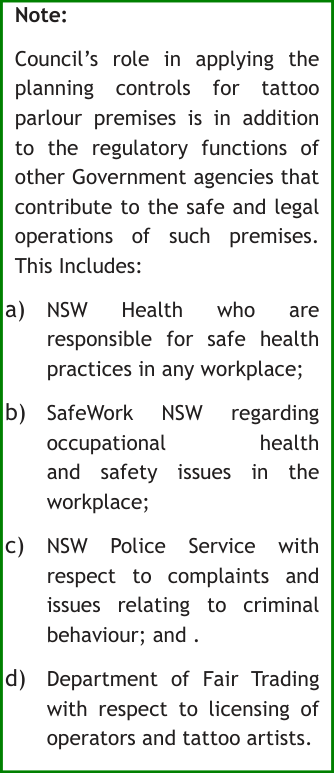

### 18.2 18.2 General Requirements for Tattoo Parlour Premises

#### General

#### Requirements

Objectives:

#### forTattoo

■ Ensure tattoo parlour premises are appropriately located so as to minimise any potential adverse social or economic impacts upon surrounding locality.

#### Parlour

#### Premises

■ Identify relevant public health and safety standards that are required for all

> [Picture on page 3: a picture, saved as a picture (images/vol-1-part-18-tattoo-parlour-premises-page-3-11.gif, 150 dpi).]
> Words printed on the picture (title and legend, copied from the PDF):
> a)
> a)	 NSW Health who are
> b)
> b)	 SafeWork NSW regarding
> c)
> c)	 NSW Police Service with
> d)
> d)	 Department of Fair Trading

tattoo parlour premises.

#### Note:

#### 18.2.1 Requirements for a

#### 18.2.1 Requirements for a development application

development application

a)	 All tattoo parlour premises within Campbelltown Local Government Area require development consent issued under the Environmental Planning and Assessment Act 1979 (The Act) to legally operate.

Council’s role in applying the planning controls for tattoo parlour premises is in addition to the regulatory functions of other Government agencies that contribute to the safe and legal operations of such premises. This Includes:

b)	 Campbelltown City Council is the

NSW Health who are responsible for safe health

responsible for safe health practices in any workplace;

practices in any workplace;

consent authority for the assessment and determination of development applications for skin penetration/ tattoo parlour premises.

#### 18.2.2 Location requirements

#### 18.2.2 Location requirements

SafeWork NSW regarding occupational health

occupational health and safety issues in the

and safety issues in the workplace;

workplace;

a)

a)	 The

The tattoo parlour premises shall not

parlour premises shall not

adjoin areas that are zoned residential.

adjoin areas that are zoned residential.

#### 18.2.3 Tattoo Parlour Registration and

#### 18.2.3 Tattoo Parlour Registration and General Requirements

#### General Requirements

NSW Police Service with respect to complaints and

respect to complaints and issues relating to criminal

issues relating to criminal behaviour; and .

behaviour; and . Department of Fair Trading with respect to licensing of

with respect to licensing of operators and tattoo artists.

operators and tattoo artists.

a)

a)	 All tattoo parlour premises are required

All tattoo parlour premises are required to be registered with Council under the

to be registered with Council under the provisions of the Public Health Act and

provisions of the Public Health Act and the Local Government ant Act 1993

the Local Government ant Act 1993 for on going health surveillance and

for on going health surveillance and regulatory purposes.

regulatory purposes. b)

b)	 All tattoo parlours shall comply with

All tattoo parlours shall comply with the Tattoo Parlours Act 2012 and the

the Tattoo Parlours Act 2012 and the Tattoo Parlours Regulation 2013. This

Tattoo Parlours Regulation 2013. This Act and Regulation is governed by the

Act and Regulation is governed by the Police and Department of Fair Trading

Police and Department of Fair Trading and requires all tattoo parlours and

and requires all tattoo parlours and tattoo artists to be licensed. For

tattoo artists to be licensed. For

#### General

#### Requirements

#### for Tattoo

further information please visit the

further information please visit the following website: http://www.

following website: http://www. fairtrading.nsw.gov.au/Businesses/

fairtrading.nsw.gov.au/Businesses/ Specific_industries_and_businesses/

Specific_industries_and_businesses/ Tattoo_parlours.html

Tattoo_parlours.html

#### Parlour

#### Premises

c)

c)	 A condition of any development

A condition of any development consent issued for

consent issued for tattoo parlour premises shall require:

shall require:

i)

i)	 written notification to Council

written notification to Council of the person responsible for

of the person responsible for operating the premises (proprietor/

operating the premises (proprietor/ licensee); and

licensee); and ii)

ii)	 environmental health inspection by

environmental health inspection by Council to ensure compliance with

Council to ensure compliance with construction/hygiene standards

construction/hygiene standards prior to commencement of the use

prior to commencement of the use of the premises.

of the premises.

#### 18.2.4 Construction requirements

#### 18.2.4 Construction requirements

a)	 The internal walls of the premises shall be constructed to provide a smooth, even, and impervious surface that is capable of being easily cleaned.

b)	 The floor construction shall be finished in a smooth, non-slip, impervious material that is capable of being easily cleaned.

c)	 The ceiling of a tattoo treatment room/bay shall be constructed with rigid, non-absorbent, smooth faced material free from open joints, cracks and crevices and be painted with a light coloured washable paint.

d)	 The intersection of the walls and ceiling must be tight-jointed, sealed and dust proofed. Drop in panels are not permitted.

e)	 All gaps, open joints, cracks and crevices within the walls and floors which may allow dust, hair, lint and other residue to collect shall be sealed in all walls and floors to enable easy cleaning.

f) All service pipes and electrical

| 18.2 |  | conduit shall be contained in the floor, walls or ceiling. |
|---|---|---|
| General Requirements for Tattoo Parlour Premises | g) h) i) 18.2.5 18.2.5 Sanitary Sanitary Facilities Facilities a) a) b) b) c) c) d) d) e) e) f) f) g) g) h) h) | The internal and external surfaces of storage cabinets, cupboards, preparation benches and the like shall be finished in a smooth impervious material that is capable of being easily cleaned. All surfaces of chairs and treatment beds must be finished in a smooth impervious material that is capable of being easily cleaned. Provide appropriate ventilation to eliminate odours and fumes. A A hand hand washbasin washbasin shall shall be be installed installed in in all all treatment treatment rooms/bays. rooms/bays. The The hand hand washbasin washbasin shall shall be be serviced serviced with with a a continuous continuous supply supply of of potable potable hot hot and and cold cold water water through through a a single single outlet outlet and and fitted fitted with with a a hands-off hands-off type type tap tap set set (portable (portable handwash handwash basins basins are are not not permitted). permitted). The The hand hand washbasins washbasins shall shall be be provided provided with with an an adequate adequate supply supply of of soap soap and and disposable disposable handtowels handtowels from from a a dispenser dispenser at at all all times. times. A A toilet toilet shall shall be be provided provided for for the the client client and and all all employees employees . . All All toilets toilets and and wastewater wastewater collection collection facilities facilities shall shall be be connected connected to to the the sewer sewer in in accordance accordance with with the the local local authorities’ authorities’ requirements. requirements. The The toilet toilet shall shall be be provided provided with with a a hand hand washbasin washbasin serviced serviced with with hot hot and and cold cold water water through through a a single single outlet outlet and and fitted fitted with with a a hands- hands- off off type type tap tap set set (portable (portable handwash handwash basins basins are are not not permitted) permitted). Provide Provide an an equipment equipment wash wash sink sink of of adequate adequate size size to to clean clean and and rinse rinse all all equipment equipment and and implements. implements. The The equipment equipment wash wash sink sink shall shall be be provided provided with with a a continuous continuous supply supply of of hot hot and and cold cold water water through through a a single single outlet. outlet. If If reusable reusable skin skin penetration penetration implements implements are are used, used, a a designated designated cleaning cleaning and and sterilisation sterilisation work work area area shall shall be be provided provided within within the the premises premises and and designed designed in in accordance accordance with with |

#### General

#### Requirements

#### for Tattoo

AS4815:2006 Office based health care facilities

AS4815:2006 Office based health care facilities

– Reprocessing of reusable medical and surgical

– Reprocessing of reusable medical and surgical instruments and equipment and maintenance

instruments and equipment and maintenance of the associated environment.  This work area

of the associated environment.  This work area shall be separate from a treatment room/

shall be separate from a treatment room/ lunch room and constructed so as to prevent

lunch room and constructed so as to prevent the possibilities of contamination.

the possibilities of contamination.

#### Parlour

#### Premises

i)

i) The cleaning and sterilisation area shall be

The cleaning and sterilisation area shall be provided with the following:

provided with the following: i)

i)	 A hand washbasin in an accessible and

A hand washbasin in an accessible and convenient location within the area.  The

convenient location within the area.  The basin shall be freestanding, serviced with

basin shall be freestanding, serviced with hot and cold water through a single outlet,

hot and cold water through a single outlet, able to be mixed at a temperature of at

able to be mixed at a temperature of at least 40°C and fitted with a hands-off type

least 40°C and fitted with a hands-off type tap set

tap set. ii)

ii)	 A double bowl wash sink of adequate

A double bowl wash sink of adequate capacity to clean and rinse all equipment

capacity to clean and rinse all equipment and implements.  The sinks shall be

and implements.  The sinks shall be serviced with hot and cold water through a

serviced with hot and cold water through a single outlet in addition to the hand basin;

single outlet in addition to the hand basin; iii)

iii)	All walls, floor, cabinets, cupboards,

All walls, floor, cabinets, cupboards, benches and the ceiling shall be provided

benches and the ceiling shall be provided with smooth and impervious surfaces that

with smooth and impervious surfaces that are free from gaps, cracks and crevices

are free from gaps, cracks and crevices to enable easy cleaning. A drop in panel

to enable easy cleaning. A drop in panel ceiling shall not be permitted

ceiling shall not be permitted iv)

iv)	An approved autoclave operated in

An approved autoclave operated in accordance with Australian Standard

accordance with Australian Standard (AS) 4815:2006 Office-based health care

(AS) 4815:2006 Office-based health care facilities – cleaning, disinfection and

facilities – cleaning, disinfection and sterilisation of re-usable medical and

sterilisation of re-usable medical and surgical instruments and equipment

surgical instruments and equipment and maintenance of the associated

and maintenance of the associated environment. The autoclave shall be

environment. The autoclave shall be tested, serviced regularly and calibrated

tested, serviced regularly and calibrated at least once a year by a qualified service

at least once a year by a qualified service technician.  Details and documents of the

technician.  Details and documents of the services shall be provided and available at

services shall be provided and available at all times at the premises;

all times at the premises; v)

v)	 An ultrasonic cleaner to clean all

An ultrasonic cleaner to clean all implements and equipment. An ultrasonic

implements and equipment. An ultrasonic cleaner shall not be used as a method of

cleaner shall not be used as a method of sterilisation.

sterilisation. vi)

vi)	Sterilisation procedures must comply with

Sterilisation procedures must comply with

#### General

#### Requirements

AS4815:2006 Office based health care

AS4815:2006 Office based health care facilities – Reprocessing of reusable medical

facilities – Reprocessing of reusable medical and surgical instruments and equipment

and surgical instruments and equipment and maintenance of the associated

and maintenance of the associated environment.

environment.

#### for Tattoo

#### Parlour

#### Premises

j)

j) A cleaner’s sink shall be installed within the

A cleaner’s sink shall be installed within the tattoo parlour premises and must be serviced

tattoo parlour premises and must be serviced with hot and cold water through taps fitted

with hot and cold water through taps fitted with hose connectors to adequately clean the

with hose connectors to adequately clean the premises and to dispose of all waste water.

premises and to dispose of all waste water.

#### 18.2.6 Waste

#### 18.2.6 Waste

a)	 General waste should be placed in plastic lined receptacles at the site of generation. Waste bags and containers must be tied and sealed and left in a secure waste bin to be collected by an approved waste transporter. (Protection of the Environment Operations (Waste) Regulation -1996)

b)	 Sharps and clinical waste must be placed into a sharps container immediately after

use. The yellow sharps container must be approved by Australian Standards and comply with AS4261:1994 or AS 4031:1992. The sharps container must be collected and disposed of appropriately by an approved waste transporter to a treatment facility licensed by the EPA (Protection of the Environment Operations (Waste) Regulation 1996). c)

c)	 A Commercial Contractor Agreement for the

A Commercial Contractor Agreement for the disposal of all the generated waste from

disposal of all the generated waste from the premises shall be provided with the

the premises shall be provided with the development application.

development application.

### This page is intentionally left

### blank.
