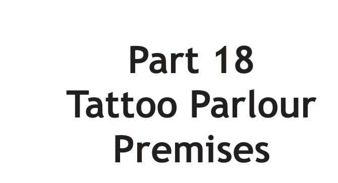

# Campbelltown Sustainable City Development Control Plan 2015 - Part 18 Tattoo Parlour Premises

> This chapter is split into 2 section file(s), one per numbered heading, in the order they appear in the PDF.

Source PDF: [part-18-tattoo-parlour-premises-amendment-21-sept2024.pdf](https://planfortomorrow.sharepoint.com/sites/Planfortomorrow/Shared%20Documents/00%20NSW-Planning-Resources/dcp/campbelltown-sustainable-city-development-control-plan-2015/vol-1-part-18-tattoo-parlour-premises/part-18-tattoo-parlour-premises-amendment-21-sept2024.pdf)

> [Picture on page 1: a picture, saved as a picture (images/vol-1-part-18-tattoo-parlour-premises-page-1-1.gif, 150 dpi).]

<!-- sections -->
## Sections

1. [18.1 Application](01-18-1-application.md)
2. [18.2 18.2 General Requirements for Tattoo Parlour Premises](02-18-2-18-2-general-requirements-for-tattoo.md)
