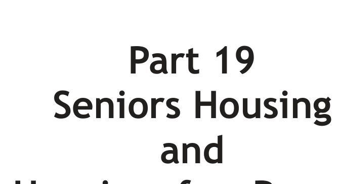

# Campbelltown Sustainable City Development Control Plan 2015 - Part 19 Seniors Living and Housing for People with a Disability

> This chapter is split into 4 section file(s), one per numbered heading, in the order they appear in the PDF.

Source PDF: [part-19-seniors-living-and-people-with-disability-amendment-21-sept2024.pdf](part-19-seniors-living-and-people-with-disability-amendment-21-sept2024.pdf)

> [Picture on page 1: a picture, saved as a picture (images/vol-1-part-19-seniors-living-and-housing-for-people-with-a-d-page-1-1.gif, 150 dpi).]

<!-- sections -->
## Sections

1. [19 Seniors Housing](01-19-seniors-housing.md)
2. [19.1 Application](02-19-1-application.md)
3. [19.3 Additional controls relating to waste management](03-19-3-additional-controls-relating-to-waste.md)
4. [19.4 Additional controls relating to public health](04-19-4-additional-controls-relating-to-public.md)
