## Part 4 Subdivision Standards

| 4.1 | Subdivisions | 39 |
|---|---|---|
| 4.2 4.3 4.4 | 4.1.1 Neighbourhood Subdivision 4.1.2 Allotment Subdivision Streets Access Stormwater | 39 40 41 42 43 |

| Part 5 Public Domain 5.1 Public Open Space 5.2 Community Facility 5.3 Safety and Security | 44 45 46 |
|---|---|
| 5.4 Principles for Adjoining Development 5.4.1 Minto Mall 5.4.2 The Schools 5.4.3 Campbellfield’s Cottage | 47 47 48 49 |

| Appendices A Dwelling Type Locations B Existing Residential Areas C Examples of Suitable Natural Colours D Three Storey Development Sites E Suggested Species Schedule F Front Hedge Species Schedule G Road Heirarchy Plan H Road Hierarchy Schedule I Subdivision Road Network Design | 51 52 53 54 55 58 59 60 |
|---|---|
| Requirements. J Street Planting Strategy K Site Access Plan L Open Space Network | 61 76 80 82 |

#### I

Page II

### contents

#### List of Figures

| Figure 1 | Land to which the DCP Applies |
|---|---|
| Figure 2 | Development Approval Process |
| Figure 3 | The Concept Plan |
| Figure 4 | Development Character Images |
| Figure 5 | Example Site Analysis |
| Figure 6 | Example of a Significant View Corridor to the Site (View from Odessey House) |
| Figure 7 | Examples of Three Storey Elements |
| Figure 8 | General Car Parking Development Criteria |
| Figure 9 | Examples of Appropriate Garage Treatments |
| Figure 10 | Cut and Fill Levels |
| Figure 11 | Flooring Requirements Adjacent to Stormwater Facilities or Overland Flow Paths |
| Figure 12 | Typical Principles for Bushfire Protection Zones |
| Figure 13 | Detached Dwelling Development Criteria |
| Figure 14 | Front Setback for Dwellings (One Adjacent Existing Dwelling) |
| Figure 15 | Front Setback for Dwellings (Two Adjacent Existing Dwellings) |
| Figure 16 | Integrated Housing and Semi Attached Development Criteria |

#### II

Page III

### preliminary  1

### 1.1 The Vision

“To provide a safe, vibrant sense of

### place and community in Minto”

The vision for the DCP is to provide a safe, vibrant sense of place and commu-nity in Minto.

This will to be achieved through :

• changing the mix of residents to a more sustainable public / private mix with bet-ter integration into the surrounding sub-urbs;

• assist in strengthening the sense of place and fostering community identity for Minto’s existing and future residents;

• improving the quality of local infrastruc-ture, public open space areas and local community facilities in a pedestrian friend-ly environments that assist in achieving ESD principles;

• developing a built form which will en-hance the visual environment and create a unique character for the development;

• creating a physical environment which encourages a vibrant local community with a distinctive and memorable neigh-bourhood character;

• enhancing the different characteristics of areas of the site and responds to the natural topography and character; and

The DCP will help to ensure the develop-ment of a variety of built form, from de-tached dwellings on rural residential lots to integrated housing positioned around open space nodal points.  The design will also incorporate a network of linked com-munity open spaces that will accommo-date a variety of open space facilities such as active and passive parks, playgrounds, recreational facilities, a community build-ing and integrated landscaped storm wa-ter treatment areas.

### 1.2 Introduction

#### 1.2.1 Name of the DCP

This Plan is called Minto Renewal Development Control Plan (the DCP).

#### 1.2.2 Purpose of the DCP

The DCP has been prepared in accordance with Section 72 of the Environmental Planning and Assessment Act 1979 (the Act) and Clause Nos 16-24 of the Environmental Planning and Assessment Regulation 2000 (the Regulation). The DCP supplements the existing Campbelltown (Urban Area) Local Environmental Plan 2002 (LEP 2002).

Council (the consent authority) is required under Section 79C of the Act, to take into consideration the relevant provisions of the DCP in determining development applications on land located within the Minto Renewal Area defined in Figure 1.

#### 1.2.3 Land to which the DCP

#### Applies

The DCP applies to all land contained within the Minto Renewal Area as defined in Figure 1.

#### 1.2.4 The Consent Authority

Campbelltown City Council (Council) is the consent authority for local develop-ment within the Minto Renewal Area.

#### 1.2.5 Development Categories

Anticipating the longevity of this Plan, there are 4 categories of development that Council is likely to experience.

#### Exempt Development:

Exempt development is incidental devel-opment that is of minimal environmental impact and may be carried out without the need to obtain development consent from Council. The type of development that is exempt from the need to obtain develop-ment consent is set out in Campbelltown LEP No. 209 Exempt Development.

#### Complying Development :

Complying development is development that meets specific criteria set out in SEPP No. 60 - Exempt and Complying Development.

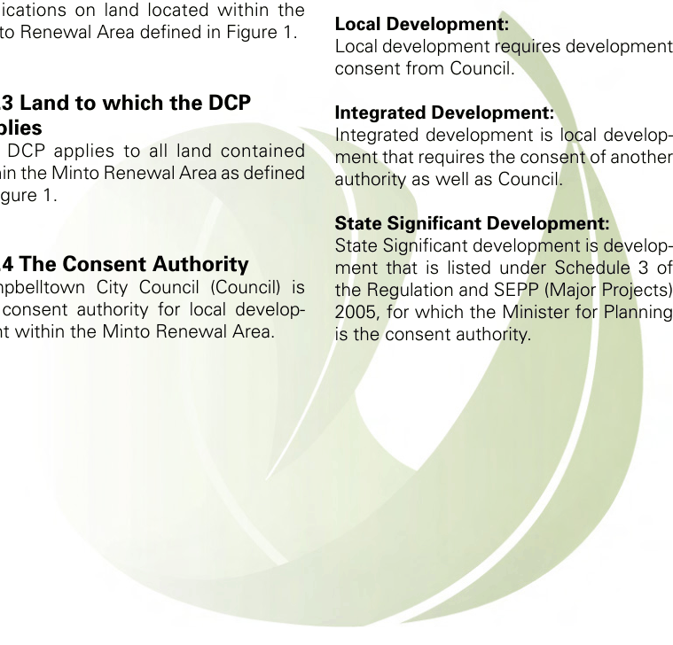

> [Picture on page 7: a picture, saved as a picture (images/vol-2-part-01-minto-renewal-dcp-page-7-48.gif, 150 dpi).]
> Words printed on the picture (title and legend, copied from the PDF):
> Local development requires development
> consent from Council.

#### Local Development:

#### Integrated Development:

Integrated development is local develop-ment that requires the consent of another authority as well as Council.

#### State Significant Development:

State Significant development is develop-ment that is listed under Schedule 3 of the Regulation and SEPP (Major Projects) 2005, for which the Minister for Planning is the consent authority.

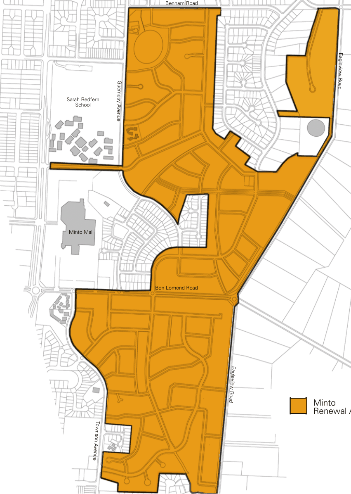

> [Picture on page 8: a picture, saved as a picture (images/vol-2-part-01-minto-renewal-dcp-page-8-1.gif, 150 dpi).]
> Words printed on the picture (title and legend, copied from the PDF):
> Sarah Redfern
> School
> Minto Mall
> Townson Avenue
> Benham Road
> Guernesy Avenue
> Ben Lomond Road
> Eagleview Road
> Eagleview Road
> Minto
> Renewal Area

#### Figure 1:  Land to Which the DCP Applies

#### 1.2.6 Monitoring and Review of

#### the DCP

Council is required to keep its LEP and DCPs under regular and periodic review to ensure that these Plans:

(a) continue to be useful and relevant;

(b) can be judged as to their effectiveness;

(c) reflect an adequate and appropriate capacity for development; and

(d) provide for the appropriate protection of the environment and natural resources.

The DCP shall be reviewed every five (5) years, or earlier, as considered necessary by Council.

#### 1.2.7 Variation to Planning

#### Controls and Standards

#### within the DCP

Council may consider variations to the requirements of the DCP in certain cir-cumstances. Requests for variations are required to be in writing and shall clearly demonstrate the reason(s) why the vari-ation sought would not adversely impact on the environment or local amenity, would not erode the relevant standard and requirement; and that compliance with the objectives and requirements of the DCP are unreasonable or unnecessary in the circumstances of the case. Council gives no assurance that it will permit any variation(s) to the requirements the DCP. Variations will only be considered in ex-ceptional circumstances.

Compliance with any numerical provi-sions of the DCP does not guarantee the granting of development consent. Each application will be considered on its mer-its, having regard to the matters for con-sideration under Section 79C of the Act.

Consistent application of the provisions of the DCP will be given high priority by Council.

#### 1.2.8 Structure of the DCP

The format of the DCP has been set up to identify various objectives and general design requirements for each of the per-missible development typologies. It com-prises the following structure:

Part 1 – Preliminary

Part 2 – All Types of Development Part 3 – Dwelling Development Part 4 – Subdivision Standards Part 5 – Public Domain

#### 1.2.9 Relationship to other Plans

#### and Documents

The provisions of this DCP are site-spe-cific and reflect the planning and design objectives desired by the relevant stake-holder parties.

The provisions contained in the DCP are in addition to the provisions within SEPPs, REPs and the LEP. In the event of

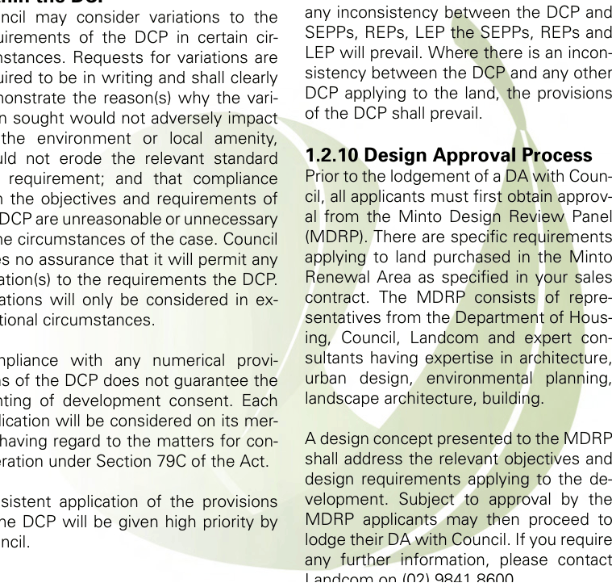

> [Picture on page 9: a picture, saved as a picture (images/vol-2-part-01-minto-renewal-dcp-page-9-65.gif, 150 dpi).]

any inconsistency between the DCP and SEPPs, REPs, LEP the SEPPs, REPs and LEP will prevail. Where there is an incon-sistency between the DCP and any other DCP applying to the land, the provisions of the DCP shall prevail.

#### 1.2.10 Design Approval Process

Prior to the lodgement of a DA with Coun-cil, all applicants must first obtain approv-al from the Minto Design Review Panel (MDRP). There are specific requirements applying to land purchased in the Minto Renewal Area as specified in your sales contract. The MDRP consists of repre-sentatives from the Department of Hous-ing, Council, Landcom and expert con-sultants having expertise in architecture, urban design, environmental planning, landscape architecture, building.

A design concept presented to the MDRP shall address the relevant objectives and design requirements applying to the de-velopment. Subject to approval by the MDRP applicants may then proceed to lodge their DA with Council. If you require any further information, please contact Landcom on (02) 9841 8600.

Check LEP and other relevant state and local planning instruments for detail of controls relating to the locality.

Undertake a site analysis for the site and its locality giving consideration to environmental, physical and regulatory controls. Identify opportunities and

constraints.

Prepare concept drawings for the proposed development demonstrating how the objectives and principles of the DCP have been met.

Submit concept package to the Minto Design Review Panel for review and comment on the proposal.

Gain approval from Minto Design Review Panel

Prepare development approval application including statement of environmental effects.

Check application fee required, complete application form and refer to application checklists for information

required.

Submit plan to Council for consideration for approval

#### Figure 2:  Development Approval Process

#### 1.2.11 How to use the DCP

The following steps provide a general guide to using the DCP. If you require any further information or assistance, please contact Council’s Customer Service Of-ficers on (02) 4645 4608.

#### STEP 1

•  Check the permissibility of the development under the relevant EPI(s).

•  Determine the category of the development by referring to Section 1.2.5.

•  If the development is ‘exempt development’ refer to LEP No. 209

- Exempt Development.

•  If the development is ‘complying development’ refer to SEPP No. 60 - Exempt and Complying Development.

•  If the development is not exempt or complying development, proceed to Step 2.

#### STEP 2

•  Read part 3 (Requirements Applying to All Development) and observe the stated requirements for all development applications.

#### STEP 3

•  Read the relevant part of the DCP that applies to the development;

•  Ensure that the development satisfies the objectives and design requirement of each relevant sections of the DCP.

#### STEP 4

•  Follow the process for seeking development consent from Council, refer Figure 2.

### 1.3 Project Background

This DCP has been developed as part of the Minto Renewal Project.  The project involves the renewal of the public hous-ing estate at Minto and development of surrounding vacant land.  The project is a partnership between, the NSW Depart-ment of Housing and Campbelltown City Council, the two major landowners in the project area.

The project was established in response to the issues encountered in the Minto public housing estate, which was con-structed in the later 1970s/early 1980s based on the Radburn design principles. The Radburn design has proven to be un-suitable for public housing communities because of poor vehicular access, unsafe rear lanes and inadequate surveillance of open spaces.  Also much of the public housing stock was reaching the end of its useful life.

The Minto Renewal Project was an-nounced in 2002.  A Concept Plan has been developed for the project (Refer

ty consultation over a number of years. Under the Concept Plan, poorly perform-ing townhouse areas are proposed to be demolished and redeveloped, whilst the more settled cottage areas will be up-graded and adjoining poorly maintained open space areas are to be developed.  A new street layout and new parks are pro-posed, along with upgrading of the cur-rent infrastructure systems.  The develop-ment will be implemented over a ten-year period.  Upon completion it is anticipated that 30% of the final yield will be retained as public housing.

The Minto Renewal Project has been determined by the Minister for Planning to be a Major Project under SEPP (Major Projects) 2005.  Approval for the Concept Plan has been obtained under Part 3A of the Environmental Planning and Assess-ment Act 1979.

The Concept Plan is generally in accord-ance with the controls and principles set out in this DCP.  This DCP has been pro-duced to ensure that the development principles set out in the Concept Plan are implemented throughout the project area.

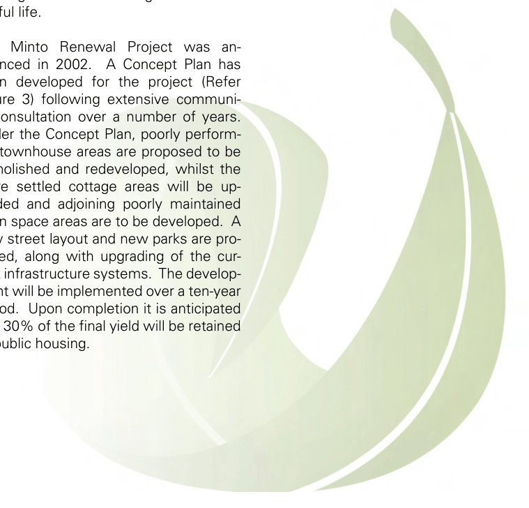

> [Picture on page 11: a picture, saved as a picture (images/vol-2-part-01-minto-renewal-dcp-page-11-54.gif, 150 dpi).]

Figure 3) following extensive communi-

#### Figure 3:  The Concept Plan

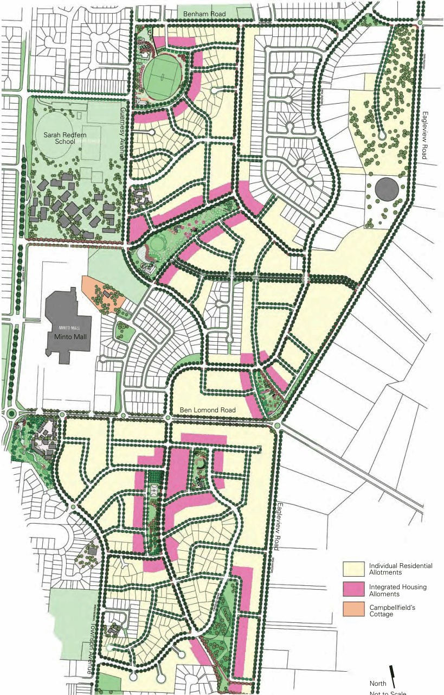

> [Picture on page 12: a map, saved as a picture (images/vol-2-part-01-minto-renewal-dcp-page-12-2.gif, 150 dpi); the street names and other small labels are on the picture.]
> Words printed on the picture (title and legend, copied from the PDF):
> Ben Lomond Road
> Not to Scale

### 1.4 Aims and Objectives

### of the DCP

The aims of this DCP are to:

• Ensure that the aims and objectives of any relevant environmental planning instrument are complemented;

• Ensure that the aims and objectives of the Minto Renewal Project Concept Plan are complemented;

• Ensure that the principles of ecological sustainability are incorporated into the design, construction and ongoing operation of development;

• Facilitate innovative development of high quality design and construction in the Minto Renewal Project area;

• Ensure that new development maintains or enhances the character and quality of the natural and built environment;

• Ensure that new development takes place on land that is capable of supporting development;

• Encourage the creation of safe, secure and liveable environments;

• Ensure that new development minimises the consumption of energy and other finite resources, to conserve environmental assets and to reduce greenhouse gas emissions; and

• Provide for a variety of high quality housing choices within the City of Campbelltown.

Some of the detailed objectives of the DCP are:

#### Social:

1\. To provide for a mixture of housing choice and diversity of tenure including an appropriate quantity of quality public housing;

2\. To foster greater social interactions between residents from various housing styles and tenure;

3\. To create a network of open spaces, focal points and community facilities which provide for the active and passive needs of the community;

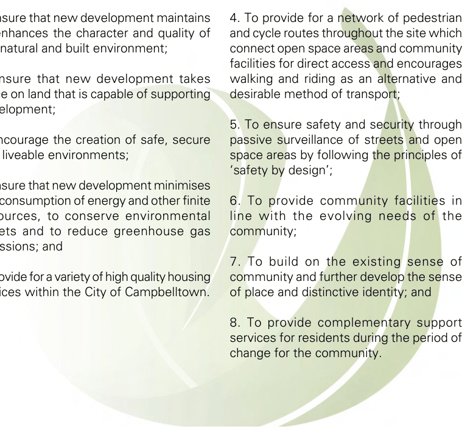

> [Picture on page 13: a picture, saved as a picture (images/vol-2-part-01-minto-renewal-dcp-page-13-46.gif, 150 dpi).]

4\. To provide for a network of pedestrian and cycle routes throughout the site which connect open space areas and community facilities for direct access and encourages walking and riding as an alternative and desirable method of transport;

5\. To ensure safety and security through passive surveillance of streets and open space areas by following the principles of ‘safety by design’;

6\. To provide community facilities in line with the evolving needs of the community;

7\. To build on the existing sense of community and further develop the sense of place and distinctive identity; and

8\. To provide complementary support services for residents during the period of change for the community.

#### Environmental:

1\. To create a legible and functional road network which provides good connections with the surrounding areas and encourages safe and convenient access throughout the site;

2\. To establish quality streetscapes which add to the visual and environmental amenity of the site;

3\. To design an integrated stormwater management system which improves the quality and quantity of the water entering and leaving the site, and which also harnesses the principles of water sensitive urban design;

4\. To improve air quality by encouraging walking, cycling and the use of public transport within the site;

5\. To create linkages between open spaces along the streets inside the site and into the surrounding areas by an extensive street tree planting strategy;

6\. To ensure the visual character of the ‘green’ ridge top is maintained through controls on development within the scenic protection zone and to maximise access to existing views and vistas; and

7\. To encourage environmentally responsible building practices including solar passive design solutions for all housing and community buildings.

8\. To encourage built form which results in the achievement of the Desired Future Character for the site. Refer section 1.5.

#### Economic:

1\. To ensure that social and private housing design be of equal quality, in accordance with the desired character of the area and flexible;

2\. To ensure that the future development enhances the surrounding suburbs and positively impacts upon market values in the area;

3\. To create variety in housing types and tenure mix which is marketable and feasible;

4\. To provide appropriate housing for low

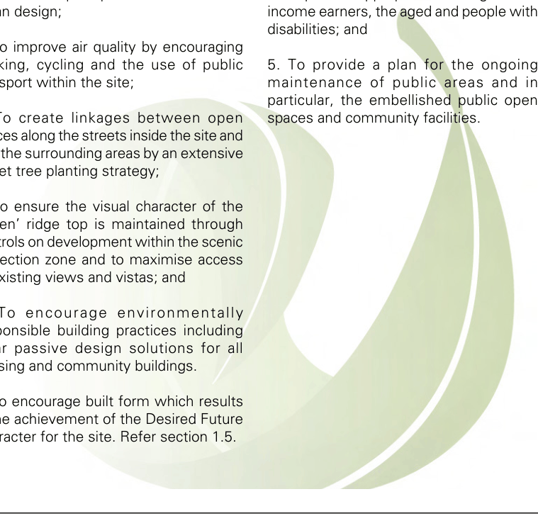

> [Picture on page 14: a picture, saved as a picture (images/vol-2-part-01-minto-renewal-dcp-page-14-48.gif, 150 dpi).]

income earners, the aged and people with disabilities; and

5\. To provide a plan for the ongoing maintenance of public areas and in particular, the embellished public open spaces and community facilities.

#### Integrated Housing

### 1.5 Desired Future

### Character

Three character areas are envisaged and all dwellings will be designed to contribute to the development of these areas as identified in Appendix A.

#### Detached Housing

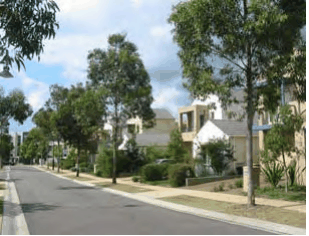

> [Picture on page 15: a picture, saved as a picture (images/vol-2-part-01-minto-renewal-dcp-page-15-9.gif, 150 dpi).]

#### Integrated Housing

The predominant character of the parks will be of a strong built edge. The areas directly adjoining public open space areas and close to major amenities, shall have a strong built form at a higher density to the rest of the site. The predominant character of the parks will be a strong built edge surrounding the open spaces enhancing safety through activity and surveillance.

#### Rural Residential

#### Detached Housing

These areas will be a transition between the dense parks areas surrounding the park to the large ridge top allotments. Allotment sizes should vary based on topography with larger lots located on higher and steeper slopes and smaller lots on the lower gentler slopes. The predominant character of the area shall be of low to mid rise roof form interspersed with vegetation.

#### Rural Residential

This area is zoned 7(d6) Environmental Protection and is most prominent from the suburbs surrounding Minto. This area will maintain its “green” ridge top character. Houses shall be designed to minimise visual impact through their form, materials selection and colours.

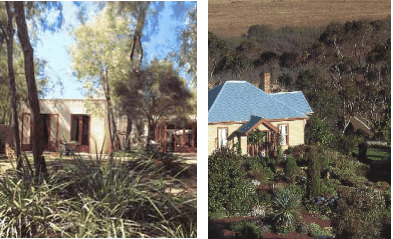

> [Picture on page 15: a picture, saved as a picture (images/vol-2-part-01-minto-renewal-dcp-page-15-39.gif, 150 dpi).]

#### Figure 4:  Development Character Images

Semi attached dwellings and studio apartments occur throughout the site on nominated allotments.

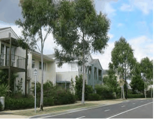

> [Picture on page 15: a picture, saved as a picture (images/vol-2-part-01-minto-renewal-dcp-page-15-44.gif, 150 dpi).]

### 1.6 Definitions

“Amenity” means those qualities and characteristics of a site and its neighbour-ing area that contribute to the comfort and pleasantness of the local environment.

“Asset Protection Zone” means a buff-er between development and hazards. The size and location of an asset protec-tion zone is determined by a number of factors detailed in Planning for Bushfire Protection, 2001.

#### “Average Recurrence Interval” (ARI)

means the average period between the recurrence of a storm event of a given rainfall intensity.

“Battleaxe Allotment” means an allot-ment that does not have primary front-age to a public road and is accessed via a driveway (handle) located between two adjoining allotments.

#### “Building Sustainability Index”

(BASIX) means a web-based planning tool designed to assess the potential per-formance of new development against a range of sustainability indices including landscape, stormwater, water, thermal comfort and energy.

which has been identified as bush fire prone land on the Campbelltown Bush Fire Prone Lands Map as certified by the Commissioner of the NSW Rural Fire Service.

“Car Courts” means a vehicular access-way provided to the rear of a cluster of up to 4 lots. Car courts shall not be dedi-cated to Council and will be managed un-der community title or a reciprocal right of way.

“Character” means the distinctive ele-ments of an area or building.

“DA” means development application.

“Dwelling” means a room or suite of rooms occupied or used or so construct-ed, designed or adapted as to be capable of being occupied or used as a separate domicile.

“Dwelling House” means a building containing one dwelling and may contain a subordinate structure such as a studio apartment or outbuilding.

#### “Ecologically Sustainable Develop-

ment” (ESD) means a development that conserves and enhances the communi-ty’s resources so ecological processes are maintained and the total quality of life, now and in the future, can be increased.

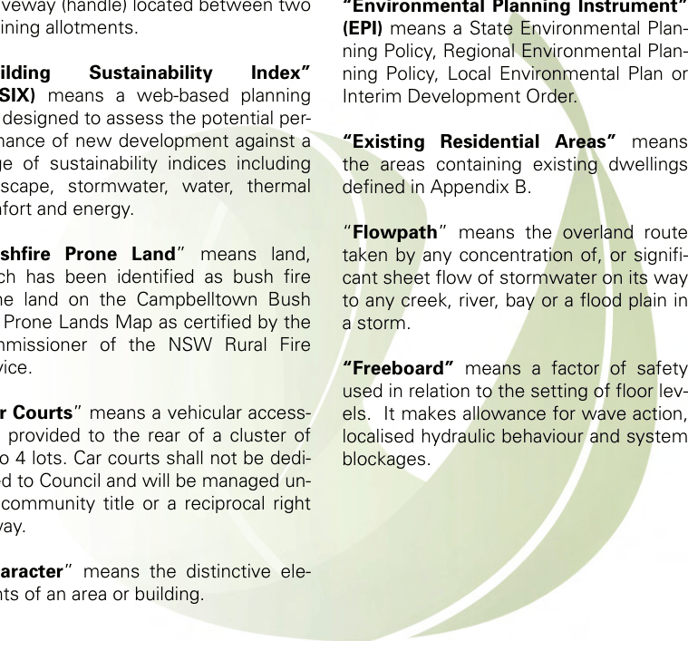

> [Picture on page 16: a picture, saved as a picture (images/vol-2-part-01-minto-renewal-dcp-page-16-57.gif, 150 dpi).]
> Words printed on the picture (title and legend, copied from the PDF):
> “Bushfire Prone Land” means land,
> “Existing Residential Areas” means

#### “Environmental Planning Instrument”

(EPI) means a State Environmental Plan-ning Policy, Regional Environmental Plan-ning Policy, Local Environmental Plan or Interim Development Order.

the areas containing existing dwellings defined in Appendix B.

“Flowpath” means the overland route taken by any concentration of, or signifi-cant sheet flow of stormwater on its way to any creek, river, bay or a flood plain in a storm.

“Freeboard” means a factor of safety used in relation to the setting of floor lev-

els.  It makes allowance for wave action, localised hydraulic behaviour and system blockages.

“Habitable Room” means a room used for normal domestic activities and in-cludes a bedroom, living room, lounge room, music room, television room, rumpus room, sewing room, study, play room, family room, sunroom and the like. It excludes a bathroom, laundry, water closet, pantry, walk in wardrobe, lobby, clothes drying room, and other spaces of a specialised nature that are not occupied frequently or for extended periods.

“Integrated Housing” means the con-struction of dwellings (either attached or detached) and their subsequent subdivi-sion into allotments identified on the map attached as Appendix A to the DCP.

“Natural Ground Level” means the ground level at completion of the subdivi-sion development.

“Noxious Weed” means a weed de-clared by an order under the Noxious Weeds Act 1993.

Note: For the most up to date list refer to www.agric.nsw.gov.au/reader/weeds or contact Council’s Planning and Environ-ment Division on 02 4645 4601.

“Open Space” means areas within a development designed exclusively for ei-ther private or communal use by the oc-cupants of the development.

the building facade facing the primary street frontage.

area between the building/structure and the road to which it is orientated.

setback between the building/ develop-ment and road upon which it faces and or the road from which the allotment is accessed.

“Private Open Space” means open space/landscaped area for the exclusive use of occupants of a dwelling of a mini-mum dimension in any direction of 2 me-tres.

“Principal Private Open Space” means the area of private open space that is di-rectly accessible from the living areas of the dwelling, consisting of an appropri-ately dimensioned square.

“Probable Maximum Flood” (PMF) means the largest flood that could con-ceivably occur at a particular location.

“Public Domain” means an area that is adjacent to the development site, which is under the care, control and/or owner-ship of a public authority.

“Rear loaded” means an allotment where vehicle access is from the rear.

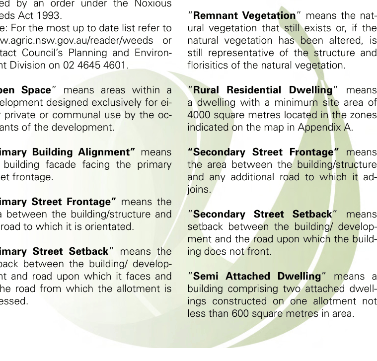

> [Picture on page 17: a picture, saved as a picture (images/vol-2-part-01-minto-renewal-dcp-page-17-58.gif, 150 dpi).]
> Words printed on the picture (title and legend, copied from the PDF):
> “Primary Building Alignment” means
> “Primary Street Frontage” means the
> “Primary Street Setback” means the
> “Remnant Vegetation” means the nat-
> “Rural Residential Dwelling” means
> “Secondary Street Frontage” means
> “Secondary Street Setback” means
> “Semi Attached Dwelling” means a

ural vegetation that still exists or, if the natural vegetation has been altered, is still representative of the structure and florisitics of the natural vegetation.

a dwelling with a minimum site area of 4000 square metres located in the zones indicated on the map in Appendix A.

the area between the building/structure and any additional road to which it ad-joins.

setback between the building/ develop-ment and the road upon which the build-ing does not front.

building comprising two attached dwell-ings constructed on one allotment not less than 600 square metres in area.

“Storey” means that space within a building which is situated between one floor level and the floor level above or if there is no floor above, the ceiling or roof above.

“Studio Apartment” means a self con-tained dwelling constructed above a dou-ble garage fronting a secondary street frontage or car court. These dwellings shall not be subdivided from the main al-lotment into a separate title.

“Suitably Qualified Professional” means a person who through suitable ed-ucation and or experience, accreditation (trade or professional) and knowledge may be reasonably relied upon by Council to provide advice within an area of exper-tise related to the relevant task.

“Tree” means a perennial plant with self supporting stem(s) which:

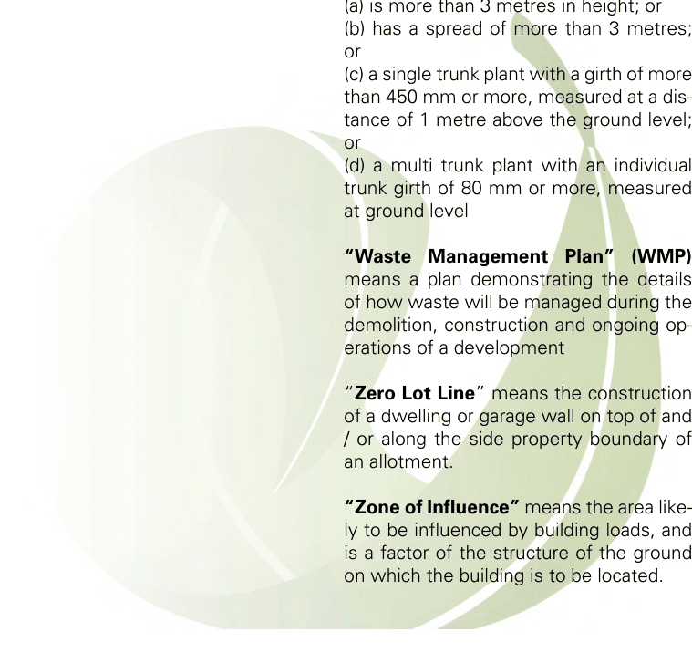

> [Picture on page 18: a picture, saved as a picture (images/vol-2-part-01-minto-renewal-dcp-page-18-21.gif, 150 dpi).]

(a) is more than 3 metres in height; or

(b) has a spread of more than 3 metres; or

(c) a single trunk plant with a girth of more than 450 mm or more, measured at a dis-tance of 1 metre above the ground level; or

(d) a multi trunk plant with an individual trunk girth of 80 mm or more, measured at ground level

#### “Waste Management Plan” (WMP)

means a plan demonstrating the details of how waste will be managed during the demolition, construction and ongoing op-erations of a development

“Zero Lot Line” means the construction of a dwelling or garage wall on top of and / or along the side property boundary of an allotment.

“Zone of Influence” means the area like-ly to be influenced by building loads, and is a factor of the structure of the ground on which the building is to be located.

### all types of development 2

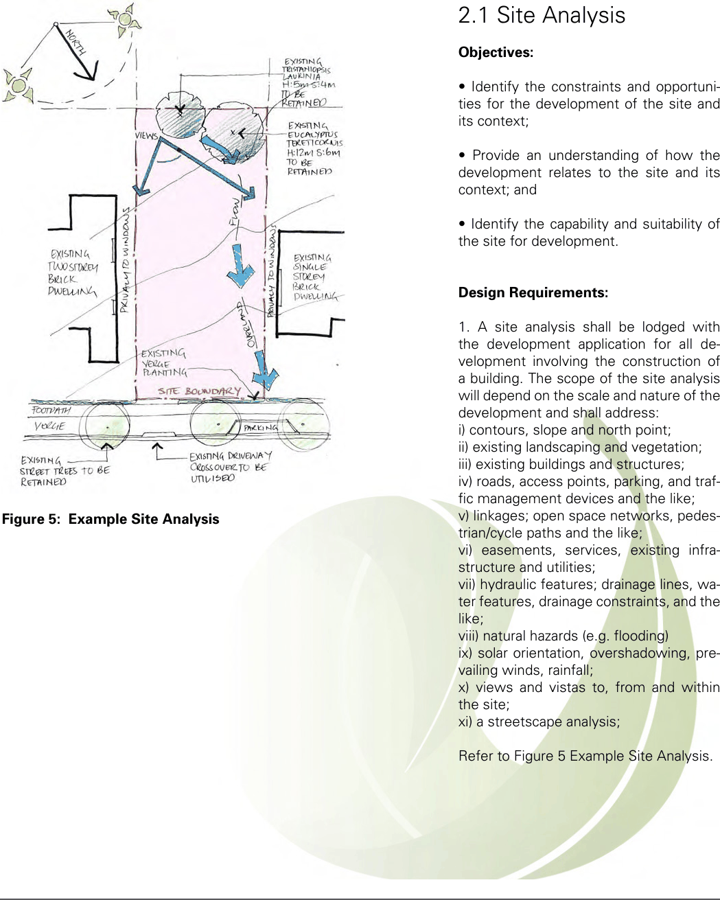

> [Picture on page 19: a picture, saved as a picture (images/vol-2-part-01-minto-renewal-dcp-page-19-2.gif, 150 dpi).]

Figure 5:  Example Site Analysis

### 2.1 Site Analysis

#### Objectives:

• Identify the constraints and opportuni-ties for the development of the site and its context;

• Provide an understanding of how the development relates to the site and its context; and

• Identify the capability and suitability of the site for development.

#### Design Requirements:

1\. A site analysis shall be lodged with the development application for all de-velopment involving the construction of a building. The scope of the site analysis will depend on the scale and nature of the development and shall address:

i) contours, slope and north point;

ii) existing landscaping and vegetation;

iii) existing buildings and structures;

iv) roads, access points, parking, and traf-fic management devices and the like;

v) linkages; open space networks, pedes-trian/cycle paths and the like;

vi) easements, services, existing infra-structure and utilities;

vii) hydraulic features; drainage lines, wa-ter features, drainage constraints, and the like;

viii) natural hazards (e.g. flooding)

ix) solar orientation, overshadowing, pre-vailing winds, rainfall;

x) views and vistas to, from and within the site;

xi) a streetscape analysis;

Refer to Figure 5 Example Site Analysis.

### 2.2 BASIX

The Building Sustainability Index (BASIX) is an interactive, internet-based planning tool designed to assess the potential performance of residential development against a range of sustainability indices. The focus of BASIX is on the key indices of water and energy, and the related in-dices of landscape, stormwater and ther-mal comfort, reflecting the NSW Gov-ernment’s decision to establish water consumption and greenhouse gas emis-sion reduction targets for all new homes built in NSW.

A BASIX certificate shall be submitted with the development application for all residential dwelling development.

Further information is available at www.basix.nsw.gov.au

### 2.3 Solar Access and

### Energy Efficiency

Good design based on efficient use of renewable natural resources can maximise the thermal comfort and energy efficiency of dwellings. This can be achieved by reducing unwanted winds and draughts whilst optimising natural ventilation as well as maximising use of natural light for heating, lighting and clothes drying purposes.

#### Objectives:

• To encourage building design and siting to take advantage of climatic factors and reduce household energy consumption; and

• To encourage features to be incorpo-rated into site and building design to opti-

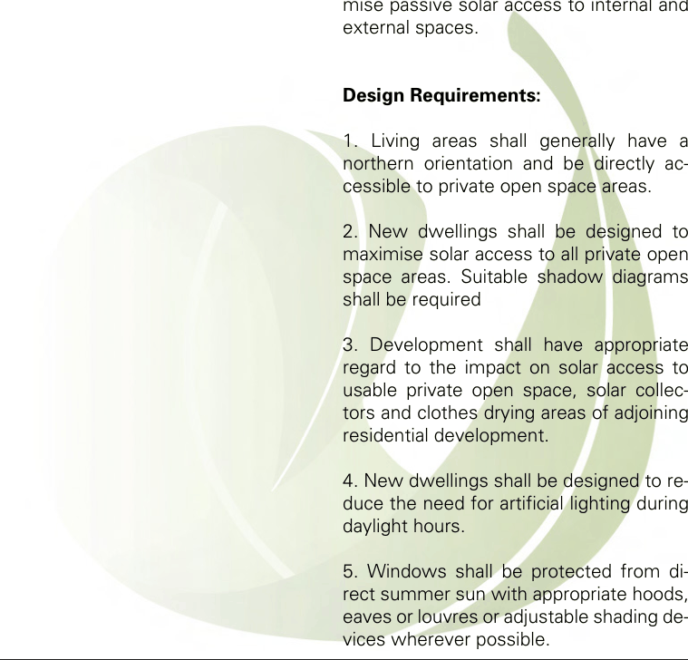

> [Picture on page 20: a picture, saved as a picture (images/vol-2-part-01-minto-renewal-dcp-page-20-38.gif, 150 dpi).]

mise passive solar access to internal and external spaces.

#### Design Requirements:

1\. Living areas shall generally have a northern orientation and be directly ac-cessible to private open space areas.

2\. New dwellings shall be designed to maximise solar access to all private open space areas. Suitable shadow diagrams shall be required

3\. Development shall have appropriate regard to the impact on solar access to usable private open space, solar collec-tors and clothes drying areas of adjoining residential development.

4\. New dwellings shall be designed to re-duce the need for artificial lighting during daylight hours.

5\. Windows shall be protected from di-rect summer sun with appropriate hoods, eaves or louvres or adjustable shading de-vices wherever possible.

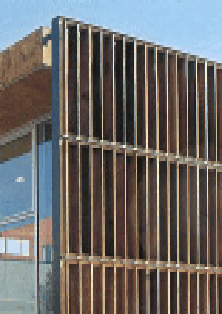

> [Picture on page 20: a picture, saved as a picture (images/vol-2-part-01-minto-renewal-dcp-page-20-61.gif, 150 dpi).]

6\. Materials selection and construction shall respond to orientation and potential for heat retention and protection includ-ing insulation.

7\. An outdoor clothes line with adequate solar access shall be provided for every dwelling.

8\. Windows and doors shall be arranged to encourage cross ventilation.

9\. Council may consider the use of decid-uous trees at the north and west eleva-tions to protect against hot summer tem-perature and to allow for solar penetration in winter, where it may otherwise be inap-propriate to plant native trees.

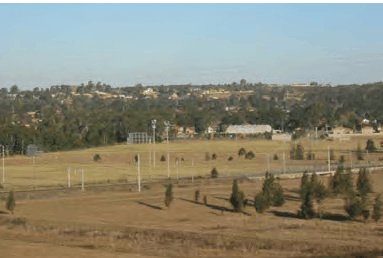

> [Picture on page 21: a picture, saved as a picture (images/vol-2-part-01-minto-renewal-dcp-page-21-16.gif, 150 dpi).]

#### Figure 6:   Example of a Significant

#### View Corridor to the Site (View from

#### Odessey House)

### 2.4 Views and Vistas

#### Objectives:

• To protect scenic value of Campbell-town’s natural and built environment;

• To protect significant views and vistas from and to public places; and

• To maximise access to views and main-tain open vistas to the Central Hills from both the public and private domain.

#### Design Requirements:

1\. Buildings shall be designed to respond to important views and vistas, within and to the site.

2\. Where a building has a potential impact on important views and vistas, appropri-ate consideration is to be given to incor-porating interesting architectural features or reducing the scale of the building.

3\. Buildings shall minimise impact upon the views / vistas of adjoining properties;

4\. Colours, materials and landscape treat-ments shall be selected to reduce the visual impact on views to the site from surrounding areas (Refer Appendix C).

### 2.5  Building form and

### Character

#### Objectives:

• To ensure that buildings are designed to enhance the existing and future desired built form and character of the Minto Re-newal Area by encouraging innovative and quality designs which is distinctive and contemporary and fits harmoniously with their surroundings.

#### Design Requirements:

1\. Building design (including façade treatment, massing, roof design and entrance features), setbacks and landscaping shall complement the scale of development, character and qualities of the adjoining streetscape.

2\. Articulate building frontages facing the street to add visual interest. Use of step-ping, material combinations, verandahs, porches and balconies, canopies and blade walls shall be encouraged.

3\. Development on corner sites shall incorporate facade treatments that address both street frontages and achieve articulation in the building design.

4\. The built form shall relate to the natural landform and setting, particularly when viewed from a public place, building entrance ways and recognised vantage points outside the immediate locality. A sites natural slope should be used to create visual interest and generate innovative housing forms while minimising cut and fill requirements.

5\. All dwellings shall be designed with a contemporary architectural character.

6\. Outbuildings and ancillary structures shall be located to the rear of the site.

7\. The maximum slope of a pitched roof shall be 36 degrees.

8\. Eaves are mandatory and are permit-ted to extend up to 450mm from the side boundary except for zero lot line and para-pet walls.

9\. Parapet, skillion and vaulted roof forms may be incorporated to create variety in architectural style.

10\. No blank walls shall be presented to any street frontage. Any continuous wall

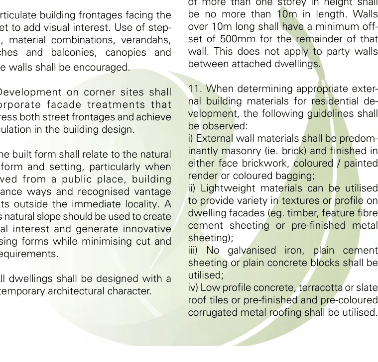

> [Picture on page 22: a picture, saved as a picture (images/vol-2-part-01-minto-renewal-dcp-page-22-51.gif, 150 dpi).]

of more than one storey in height shall be no more than 10m in length. Walls over 10m long shall have a minimum off-set of 500mm for the remainder of that

wall. This does not apply to party walls between attached dwellings.

11\. When determining appropriate exter-nal building materials for residential de-velopment, the following guidelines shall be observed:

i) External wall materials shall be predom-inantly masonry (ie. brick) and finished in either face brickwork, coloured / painted render or coloured bagging;

ii) Lightweight materials can be utilised to provide variety in textures or profile on dwelling facades (eg. timber, feature fibre cement sheeting or pre-finished metal sheeting);

iii) No galvanised iron, plain cement sheeting or plain concrete blocks shall be utilised;

iv) Low profile concrete, terracotta or slate roof tiles or pre-finished and pre-coloured corrugated metal roofing shall be utilised.

12\. The colour palette to be used in all dwellings is to consist largely of neutral, natural tones. Feature colours may be utilised for selected elements to create interest and highlights. The intent of the palette is to create a wholistic aesthetic quality that is harmonious with the bush-land character of the area by utilising col-ours found naturally within it. Refer Ap-pendix C.

13\. A detailed schedule of the proposed external finishes, materials and colours shall be submitted for Council’s approval as part of the development application.

14\. Residential development shall not exceed 2 storeys in height above natural ground level except where a three storey corner element fronting the street is al-lowed (Refer Appendix D). A full third sto-rey shall not be permitted.

15\. The height of development shall not result in any significant loss of amenity (including loss of solar access and visual and acoustic privacy) to adjacent proper-ties and public places.

16\. Council will consider proposals for garages under dwellings on sloping sites if satisfied that the garage would not re-sult in a building that exceeds 2 storeys in height at any point.

16\. All dwellings shall have at least one habitable room at ground level addressing the primary street frontage.

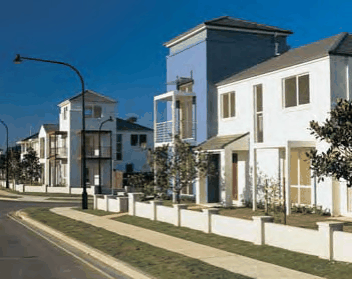

> [Picture on page 23: a picture, saved as a picture (images/vol-2-part-01-minto-renewal-dcp-page-23-34.gif, 150 dpi).]

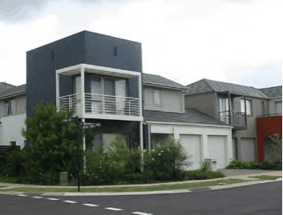

> [Picture on page 23: a picture, saved as a picture (images/vol-2-part-01-minto-renewal-dcp-page-23-35.gif, 150 dpi).]

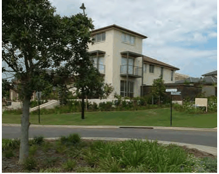

> [Picture on page 23: a picture, saved as a picture (images/vol-2-part-01-minto-renewal-dcp-page-23-36.gif, 150 dpi).]

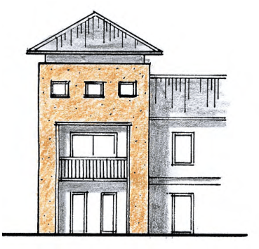

> [Picture on page 23: a picture, saved as a picture (images/vol-2-part-01-minto-renewal-dcp-page-23-37.gif, 150 dpi).]

#### Figure 7:  Examples of Three Storey Elements

### 2.6 Car Parking and

### Access

#### Objectives:

• To minimise visual impact of garages on the streetscape;

• To provide adequate on-site car parking for residents and visitors that is conven-ient, secure and safe;

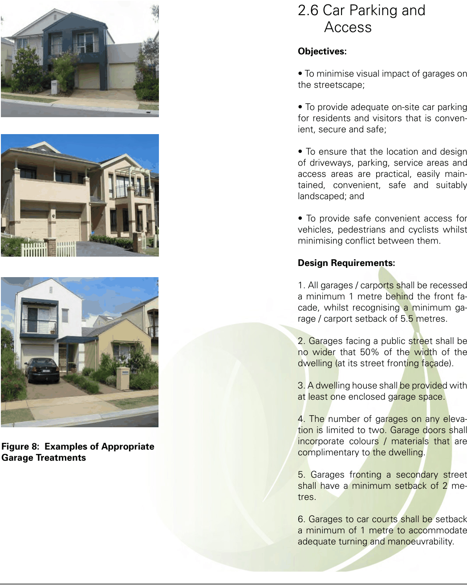

> [Picture on page 24: a picture, saved as a picture (images/vol-2-part-01-minto-renewal-dcp-page-24-9.gif, 150 dpi).]

Figure 8:  Examples of Appropriate

• To ensure that the location and design of driveways, parking, service areas and access areas are practical, easily main-tained, convenient, safe and suitably landscaped; and

• To provide safe convenient access for vehicles, pedestrians and cyclists whilst minimising conflict between them.

#### Design Requirements:

1\. All garages / carports shall be recessed a minimum 1 metre behind the front fa-cade, whilst recognising a minimum ga-rage / carport setback of 5.5 metres.

2\. Garages facing a public street shall be no wider that 50% of the width of the dwelling (at its street fronting façade).

3\. A dwelling house shall be provided with at least one enclosed garage space.

4\. The number of garages on any eleva-tion is limited to two. Garage doors shall incorporate colours / materials that are complimentary to the dwelling.

#### Garage Treatments

5\. Garages fronting a secondary street shall have a minimum setback of 2 me-tres.

6\. Garages to car courts shall be setback a minimum of 1 metre to accommodate adequate turning and manoeuvrability.

10\. Natural concrete finishes on private driveway areas shall not be permitted (i.e. between the front property boundary and the garage).

7\. All driveways shall be located a mini-mum distance of 6 metres from the tan-gent point of the kerb and gutter of an adjacent street corner (regardless of boundary splay).

8\. The geometric design of all driveways is to be in accordance with Australian Standard 2890.1 (as amended), Parking Facilities - Off Street Car Parking.

11\. To reduce the visual impact of ga-rages, built elements such as balconies projecting past the garage frontage shall be encouraged. Refer Figure 8 for exam-ples.

12\. Development shall be in accordance with the general development criteria outlined in Figure 9.

9\. All driveway crossings between the front property boundary and the road kerb shall be finished in natural concrete. Dwellings shall utilise driveway crossover provided.

#### CRITERIA

#### CONTROLS

Garage / Carports Setback to Street Frontage

5.5 metres*

Minimum Dimensions for Enclosed Single Garage

3.0 x 5.5 metres**

Minimum Dimensions for Enclosed Double Garage

5.5 x 5.5 metres**

2.75 x 5.5 metres**

Minimum Dimensions for Hard-stand Car parking Space

\* Garage setback from secondary street frontages can be reduced to 2m and 1m in car courts

\**Where an external space adjoins a building or fence an additional 0.5 metres width is required.

#### Figure 9:  General Car parking Development Criteria

### 2.7 Landscaping

#### Objectives:

• To maintain and rehabilitate the natural environment and assist in the conserva-tion of Campbelltown’s landscape charac-ter;

• To recognise and enhance the sense of place of the Minto Renewal Area;

• To enhance the appearance of the de-velopment within the Minto Renewal Area; and

• To enhance the sustainability of the de-velopment by minimising water usage, contributing to biodiversity and enhancing passive energy systems for dwellings.

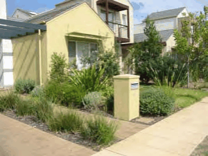

> [Picture on page 26: a picture, saved as a picture (images/vol-2-part-01-minto-renewal-dcp-page-26-16.gif, 150 dpi).]

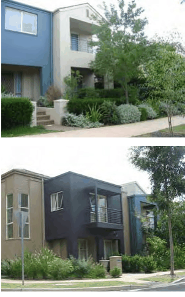

> [Picture on page 26: a picture, saved as a picture (images/vol-2-part-01-minto-renewal-dcp-page-26-17.gif, 150 dpi).]

#### Design Requirements:

1\. A detailed Landscape Plan is required for all developments at DA stage. This plan shall be prepared by a suitably quali-fied professional. This plan shall show the extent and type of materials and finishes, garbage storage area and access, clothes drying area, water storage tank, built el-ements including fencing and retaining walls, existing trees to be retained or re-moved, noxious weeds removed, planting layout, species (botanical and common names), numbers, installation size.

2\. Landscaping shall incorporate the use of locally indigenous and other native plants, which shall form a minimum of 50% of the total plant numbers and spe-cies proposed. The plant species selected should be in accordance with the Species List attached in Appendix E.

3\. Existing vegetation shall be retained where possible however all noxious weeds shall be removed. A report shall be provided with the DA detailing tree protection during construction prepared by a suitably qualified professional.

4\. Maximise use of permeable materials. A minimum of 50% of the landscaped area shall be permeable.

5\. Screen planting shall be used to en-hance privacy between dwellings.

6\. Landscape designs shall have regard for direct and easy access to, and appropriate screening of, bin storage areas, rainwater tanks, hot water units and air conditioning units associated with the dwelling.

7\. A variety of landscape treatments shall be incorporated in the front setbacks of dwellings such as lawns, paved areas, mass planting beds and shade trees.

### 2.8 Erosion and Sediment

### Control

#### Objectives:

• Ensure that any potential loss of soil from a site and/or into the stormwater system is prevented by means of;

- appropriate planning prior to the start of construction works; and

- the effective interception, diversion and control of stormwater within the site.

#### Design Requirements:

1\. A Soil and Water Management Plan (SWMP), which is required for sites where the disturbed area is greater than 2500m2, or an Erosion and Sediment

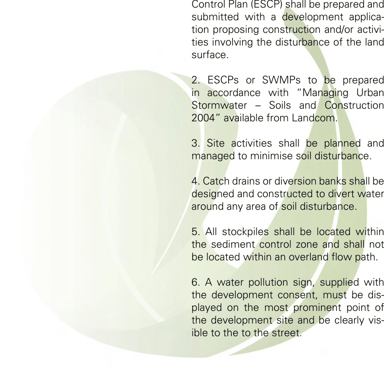

> [Picture on page 27: a picture, saved as a picture (images/vol-2-part-01-minto-renewal-dcp-page-27-16.gif, 150 dpi).]

Control Plan (ESCP) shall be prepared and submitted with a development applica-tion proposing construction and/or activi-ties involving the disturbance of the land surface.

2\. ESCPs or SWMPs to be prepared in accordance with “Managing Urban Stormwater – Soils and Construction 2004” available from Landcom.

3\. Site activities shall be planned and managed to minimise soil disturbance.

4\. Catch drains or diversion banks shall be designed and constructed to divert water around any area of soil disturbance.

5\. All stockpiles shall be located within the sediment control zone and shall not be located within an overland flow path.

6\. A water pollution sign, supplied with the development consent, must be dis-played on the most prominent point of the development site and be clearly vis-ible to the to the street.

### 2.9 Cut, Fill and Flooring

### Levels

#### Objectives:

• To minimise the extent of earth works associated with dwelling development;

• To ensure that the design of all dwell-ings respond to the site conditions with appropriate consideration to the land ca-pability, privacy and amenity of adjoining properties;

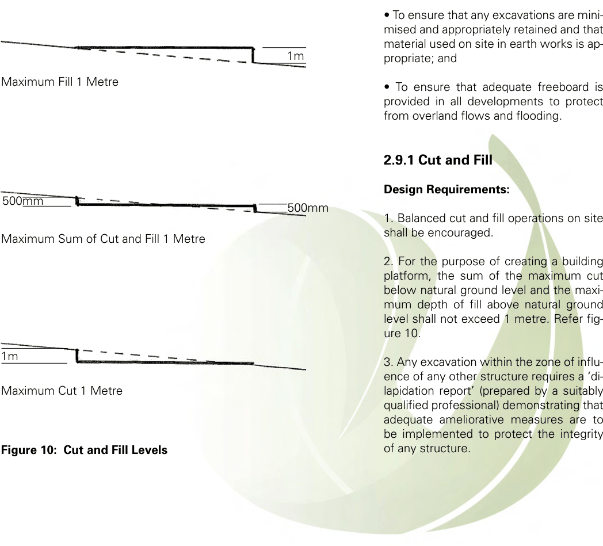

> [Picture on page 28: a picture, saved as a picture (images/vol-2-part-01-minto-renewal-dcp-page-28-11.gif, 150 dpi).]
> Words printed on the picture (title and legend, copied from the PDF):
> 1m
> Maximum Fill 1 Metre
> 500mm
> 500mm
> 1m
> Maximum Cut 1 Metre

Figure 10:  Cut and Fill Levels

• To ensure that any excavations are mini-mised and appropriately retained and that material used on site in earth works is ap-propriate; and

• To ensure that adequate freeboard is provided in all developments to protect from overland flows and flooding.

#### 2.9.1 Cut and Fill

#### Design Requirements:

1\. Balanced cut and fill operations on site shall be encouraged.

Maximum Sum of Cut and Fill 1 Metre

2\. For the purpose of creating a building platform, the sum of the maximum cut below natural ground level and the maxi-mum depth of fill above natural ground level shall not exceed 1 metre. Refer fig-ure 10.

3\. Any excavation within the zone of influ-ence of any other structure requires a ‘di-lapidation report’ (prepared by a suitably qualified professional) demonstrating that adequate ameliorative measures are to be implemented to protect the integrity of any structure.

#### 23

draft dcp

#### M i n t o  R e n e w a l   . . .

#### 2.9.2 Floor Levels

1\. All development shall satisfy the rel-evant floor level requirement as specified in Figure 11.

4\. Development incorporating fill shall comply with the following requirements:

i) minimum cross fall of 1% to any adjoin-ing waterway; and

ii) batters to be no steeper than 2:1. 2. Any solid fence constructed across an

overland flow path shall be a minimum 100mm above the finished surface level of the overland flow path or higher as de-termined by Council.

5\. Any proposed fill must be Virgin Exca-vated Natural Material (VENM) and/or fill that has been suitably validated as clean by a qualified environmental consultant.

6\. All fill deposited in the vicinity of en-demic vegetation shall comprise local ma-terial.

3\. Proposed finished floor levels to non habitable rooms, including garages and domestic out buildings, must satisfy the relevant floor level requirement as specified in Figure 11 for all sides except their entrances where a 20mm lip or ease will be provided in the freeboard.

7\. All filling works shall have regard to Council’s Specification for Construction of Subdivision Roads and Drainage Works and AS 3798 Guidelines for Earthworks for Commercial and Residential Develop-ment.

4\. Any allotments located on land that has been filled, shall be burdened by a 88B restriction regarding that fill and shall be noted on the respective Section 149 certificate.

#### CRITERIA

#### CONTROLS

Major Storm Water or Detention Basins

100 year ARI Overland Flow Depth >=300mm

100 year ARI Overland Flow Depth <300mm

Habitable Rooms

300mm

300mm

500mm

Non Habitable

100mm

100mm

300mm

Rooms

100mm (min)

100mm (min)

100mm (min)

Underside of Solid Fencing

Figure 11:  Flooring Requirements Adjacent to Stormwater Facilities or Overland Flow Paths

### 2.10 Demolition

#### Objectives:

• To ensure that demolition is carried out in accordance with the relevant legislation and guidelines;

• To ensure that demolition does not have an adverse impact on the environ-ment, buildings, footpaths and roadways or upon the safety, health and well being of the community; and

• To ensure that demolition procedures are safe and environmentally efficient.

#### Design Requirements:

1\. A development application involving demolition shall be accompanied by fol-lowing information:

i) a detailed work plan prepared by a suit-ably qualified professional, in accordance with AS2601-2001 - The Demolition of Structures;

ii) details of the licensed demolition con-tractor engaged to carry out the work (including name, address and building li-cence number);

iii) details of methods to prevent air, noise and water pollution and the escape of hazardous substances into the public do-main;

iv) details of any asbestos or other hazard-ous substances to be removed from the site and/or damaged during demolition; and

v) a dilapidation report where any demoli-tion work is to be undertaken within the zone of influence of any other structure.

2\. Details of how waste materials shall be managed and recycled where possible.

3\. All demolition work shall comply with AS2601-2001 - The Demolition of Struc-tures.

### 2.11 Water Cycle

### Management

#### Objectives:

• To ensure all water cycle management proposals are consistent with the requirements of BASIX;

• To encourage features to be incorporated into site and building design to reduce potable water usage; and

• To increase the quality and reduce the quantity of stormwater leaving the site.

#### Design Requirements:

1\. Development shall not impact on ad-joining sites by way of overland flow of stormwater. All overland flow shall be

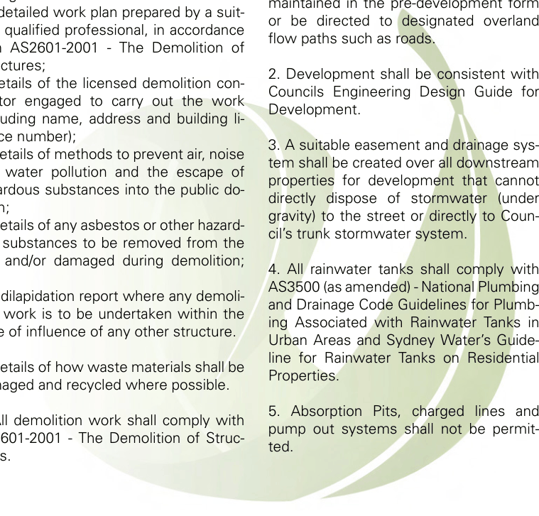

> [Picture on page 30: a picture, saved as a picture (images/vol-2-part-01-minto-renewal-dcp-page-30-56.gif, 150 dpi).]

maintained in the pre-development form or be directed to designated overland flow paths such as roads.

2\. Development shall be consistent with Councils Engineering Design Guide for Development.

3\. A suitable easement and drainage sys-tem shall be created over all downstream properties for development that cannot directly dispose of stormwater (under gravity) to the street or directly to Coun-cil’s trunk stormwater system.

4\. All rainwater tanks shall comply with

AS3500 (as amended) - National Plumbing and Drainage Code Guidelines for Plumb-ing Associated with Rainwater Tanks in Urban Areas and Sydney Water’s Guide-line for Rainwater Tanks on Residential Properties.

5\. Absorption Pits, charged lines and pump out systems shall not be permit-ted.

### 2.12  Fencing and

### Retaining Walls

#### Objectives:

•  To ensure that fencing/retaining walls are compatible with the character and scale of development within the street-scape and other public domain areas in the locality;

• To provide clear definition between the public and private domain while encour-aging casual surveillance; and

• To create strong, visually integrating ele-ment along street frontages.

#### Design Requirements:

1\. All fencing and retaining wall details must be submitted to Council for ap-proval as part of any new development application.

2\. All front fencing, secondary street fencing and fencing adjoining common boundaries with public open space areas must be constructed in accordance with the relevant Fencing Strategy for that de-velopment stage.

3\. Front fencing (ie. located forward of the front building line including those on corner lots) shall be provided on all de-velopment proposals and constructed to a maximum height of 1.2 metres and in accordance with the Fencing Strategy for that development stage.

4\. In lieu of actual fencing provision, Council may also consider mass plant-ings in the form of a hedge, positioned behind a course of bricks constructed on the property boundary line and in accord-ance with the Fencing Strategy for that development stage. Plant species shall be selected from the Front Hedge Spe-cies Schedule provided in Appendix F.

5\. Fencing to all side and rear property boundaries (ie. to those property bound-aries that are not publicly visible) shall be provided. Such fencing shall have a maximum height of 1.8 metres and shall consist of lapped and capped hardwood timber.

6\. Fencing to any secondary street front-age shall comply with the requirements listed above for front fencing. However, where such fencing encloses the rear private open space area, the maximum height of the fencing may be increased to 1.8 metres.

7\. Fencing shall not obstruct power, wa-

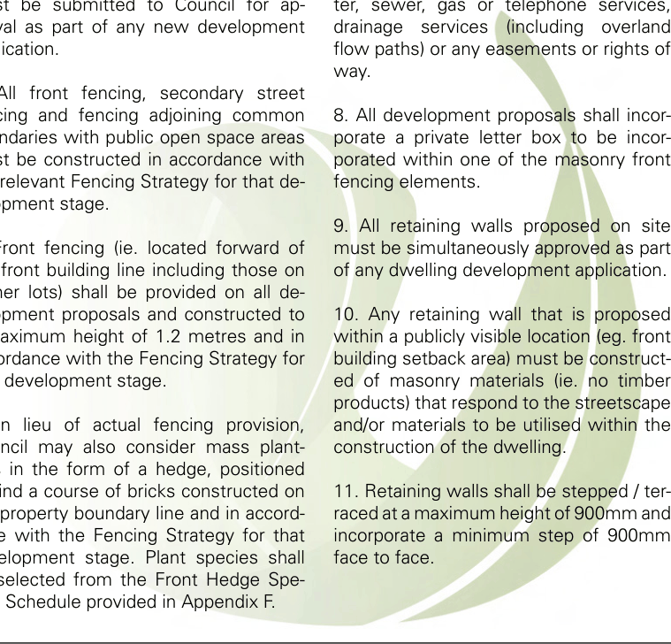

> [Picture on page 31: a picture, saved as a picture (images/vol-2-part-01-minto-renewal-dcp-page-31-56.gif, 150 dpi).]

ter, sewer, gas or telephone services, drainage services (including overland flow paths) or any easements or rights of way.

8\. All development proposals shall incor-porate a private letter box to be incor-porated within one of the masonry front fencing elements.

9\. All retaining walls proposed on site must be simultaneously approved as part of any dwelling development application.

10\. Any retaining wall that is proposed within a publicly visible location (eg. front building setback area) must be construct-ed of masonry materials (ie. no timber products) that respond to the streetscape and/or materials to be utilised within the construction of the dwelling.

11\. Retaining walls shall be stepped / ter-raced at a maximum height of 900mm and incorporate a minimum step of 900mm face to face.

### 2.13 Safety and Security

#### Objectives:

• Ensure that development incorporates security features in accordance with the principles of Crime Prevention through Environmental Design (CPTED) to:

- minimise opportunities for crime

- enhance public security

#### Design Requirements:

1\. Maximise casual surveillance opportu-nities to the street and surrounding public places and car courts.

2\. Prevent entrapment areas.

3\. Clearly identify and illuminate access points to dwellings.

4\. Clearly differentiate between private and public space.

5\. Dwelling entrances shall be visible from the street.

6\. Development shall incorporate ap-propriate landscaping, fencing and secu-rity devices to assist in crime prevention. Landscaping and fencing shall not ob-scure doors, windows or access routes.

7\. Minimise the use of external grilles, roller doors, downpipes and shelves which allow access to upper stories.

8\. All dwellings shall be clearly numbered for identification.

### 2.14 Privacy

#### Objectives:

• Provide adequate visual and acoustic privacy for residents of new and existing development.

#### Design Requirements:

1\. No window of an upper level habitable room or balcony  shall directly face a window of another habitable room, balcony or private open space of another dwelling located within 6 metres of the proposed window or balcony. Notwithstanding, any window of a habitable room located on an upper level will be considered only where it:

i) is offset to limit views between windows; or

ii) has a sill height 1.7 metres above the

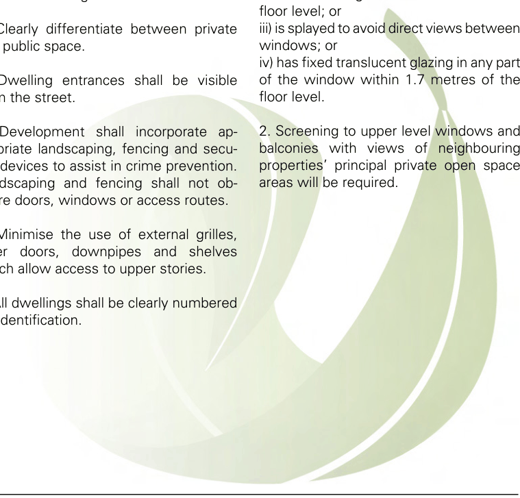

> [Picture on page 32: a picture, saved as a picture (images/vol-2-part-01-minto-renewal-dcp-page-32-48.gif, 150 dpi).]

floor level; or

iii) is splayed to avoid direct views between windows; or

iv) has fixed translucent glazing in any part of the window within 1.7 metres of the floor level.

2\. Screening to upper level windows and balconies with views of neighbouring properties’ principal private open space areas will be required.

### 2.15  Location and

Treatment of

### Services

#### Objectives:

• To minimise the visual and acoustic im-pact of on site services.

#### Design Requirements:

1\. All metre boxes and services plant shall be treated to reduce their visual promi-nence from the public domain by screen-ing, recessing or colour treatments.

2\. TV aerials shall be located to the rear of the dwelling, whilst satellite dishes may only be erected if they are suitably screened from view of the public and neighbours.

3\. Letter boxes shall be located visible from the street and accessible from the public footpath. If no footpath is present access shall be provided accessible from outside the front boundary of the prop-erty.

4\. Air-conditioning units shall be located a minimum of 4 metres from the site bound-ary or screened for visual and acoustic pri-

vacy. They shall not be located along the front site boundary.

### 2.16 Salinity

#### Objectives:

• To ensure that the development is not adversely impacted on by salinity and does not adversely impact on salinity in the area.

#### Design Requirements:

1\. Native vegetation and deep rooted trees shall be incorporated in gardens. Refer to Section 2.7 Landscaping.

2\. Damp proof membranes shall be used in building construction for slabs on ground with a 50mm thick layer of sand.

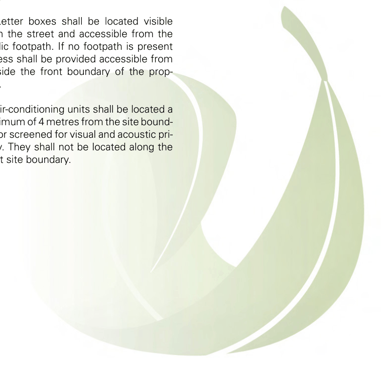

> [Picture on page 33: a picture, saved as a picture (images/vol-2-part-01-minto-renewal-dcp-page-33-41.gif, 150 dpi).]

### 2.17 Bushfire

#### Objectives:

• To ensure the risk of damage to proper-ty and danger to people through bush fire is minimised through design and manage-ment of mitigation systems.

#### Design Requirements:

1\. All buildings and improvements shall be located to minimise the risk of loss from bushfire.

2\. Development on bush fire prone land (as detailed on the Campbelltown Bush Fire Prone Lands Map) shall comply with the requirements of Planning for Bushfire Protection 2001.

3\. Development applications relating to land identified on the Bushfire Prone Land Map shall be accompanied by a bushfire hazard assessment report prepared by a suitably qualified professional.

4\. All ‘asset protection zones’ shall be pro-vided within the boundary of the subject

land. The owner of the land will have on-going liability to ensure the management of all protection areas.

5\. Adequate water reserves for fire fight-ing shall be available and accessible on site as specified in Planning for Bushfire Protection, 2001.

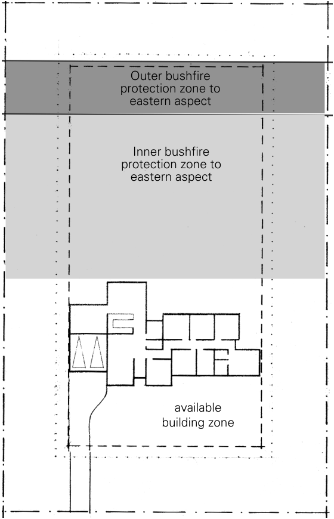

> [Picture on page 34: a picture, saved as a picture (images/vol-2-part-01-minto-renewal-dcp-page-34-30.gif, 150 dpi).]
> Words printed on the picture (title and legend, copied from the PDF):
> Outer bushfire
> protection zone to
> eastern aspect
> Inner bushfire
> protection zone to
> eastern aspect
> available
> building zone

#### Figure 12:  Typical  Principles for Bushfire Protection Zones

6\. The eastern elevation of any dwelling located in the area notes as ‘3b’ in Appen-dix A, shall comply with Level 2 construc-tion standards in AS3959 (as amended) ‘Construction of buildings in Bush Fire Prone Areas’ and section 2.3.4 of the Building Code of Australia.

7\. Roof gutters and valleys shall be leaf proofed. Protection system to use only materials with a flammability index of no greater than 5, as measured by AS 1530.2 Flamability of Materials (as amended).

### 2.18 Waste Management

#### Objectives:

• To ensure waste systems are easy to use and are accessible by collection ve-hicles;

• To ensure healthy and safe practices for the storage, handling and collection of waste and recycling materials;

• To prevent stormwater pollution that may occur as a result of poor waste stor-age and management arrangements;

• To promote the principles of ESD through appropriate resource recovery and recycling, leading to a reduction in the consumption of finite natural resourc-es; and

• Minimise the creation of noise during the collection of waste and recyclables.

#### Design Requirements: Construction

1\. A Waste Management Plan (WMP) shall accompany development applications for construction of dwellings.

2\. On site storage areas / containers for all waste and recycling streams, including waste to a landfill, reuse materials, recy-clable materials and excavations, shall be detailed on development plans.

3\. The removal of hazardous materials such as asbestos, lead paint or dust in roof cavities shall be carried out in accord-ance with WorkCover NSW guidelines.

#### Dwellings

4\. Provision shall be made for all waste and recycling storage containers to be located behind the primary and second-ary building alignment and out of public view.

5\. Space shall be allocated behind the pri-mary and secondary building alignments and out of public view to store the follow-ing bins:

i) a 140 litre/dwelling/week for household garbage;

ii) a 240 litre/dwelling/fortnight for dry re-cyclables; and

iii) a 240 litre/dwelling/fortnight for garden organics.

6\. Any area for storing garbage and recy-cling shall be located in a position that is

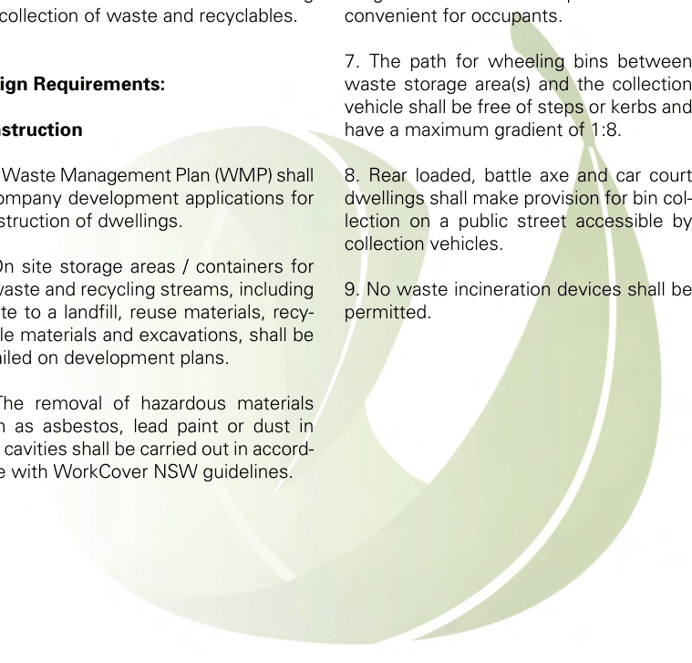

> [Picture on page 35: a picture, saved as a picture (images/vol-2-part-01-minto-renewal-dcp-page-35-51.gif, 150 dpi).]

convenient for occupants.

7\. The path for wheeling bins between waste storage area(s) and the collection vehicle shall be free of steps or kerbs and have a maximum gradient of 1:8.

8\. Rear loaded, battle axe and car court dwellings shall make provision for bin col-lection on a public street accessible by collection vehicles.

9\. No waste incineration devices shall be permitted.

### dwelling development 3

### 3.1 Detached Dwellings

#### Objectives:

• To encourage quality-designed dwelling houses that make a positive contribution to the streetscape and amenity of the neighbourhood;

• To provide definition of the public do-main by ensuring development addresses the streets and open spaces; and

• To ensure new development and rede-velopment of dwellings in existing resi-dential areas is integrated with the exist-ing dwellings.

#### Design Requirements:

1\. Compliance with relevant development criteria contained in Part 2 All Types of Development.

2\. Detached dwellings shall be construct-ed in areas identified in Appendix A.

3\. A detached dwelling shall not be erect-ed on land with an area of less than 300 square metres and with an average width of not less than 10 metres (measured at the primary building alignment) unless the allotment was in existence at the date upon which the DCP came into effect.

4\. Studio Apartments are permissible where the dwelling has a garage front-ing a car court or secondary street. Refer Section 3.5 for design requirements.

5\. Development shall be in accordance with the general development criteria outlined in Figure 13.

#### 3.1.1  Dwellings in Existing Residential Areas

The existing residential areas are defined in Appendix B.

#### Design Requirement:

1\. A new dwelling to be constructed ad-jacent to an existing dwelling(s), the front building line setback shall be in accord-ance with Figure 14 or 15 as applicable.

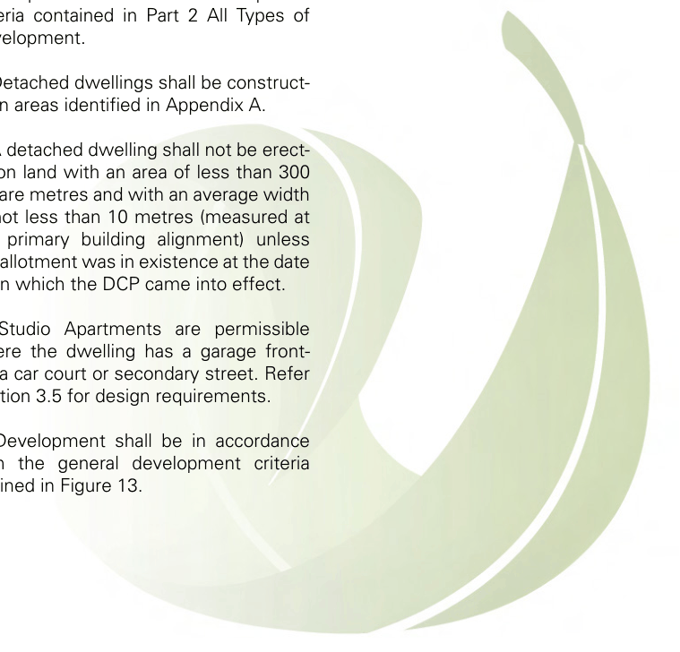

> [Picture on page 36: a picture, saved as a picture (images/vol-2-part-01-minto-renewal-dcp-page-36-44.gif, 150 dpi).]

#### CONTROLS

#### CRITERIA

#### Figure 13:

#### Detached Dwelling

#### Development Criteria

Minimum Front Building Line Setback

4 metres *

Minimum Secondary Building Line Setback

2 metres

Minimum Side Setback

0.9 metres

Minimum Rear Building Line Setback (excluding garages)

4 metres

Minimum Garage Setback

5.5 metres **

Minimum Setback for Lightweight

3 metres

Projections

(i.e. balconies / verandahs / porches excluding car ports)

Maximum Building Height

2 storeys ***

Minimum Total Private Open

70 square metres

Space Area

5 x 5 metres

Principal Private Open Space Area

\* Refer to Figure 14 or 15 as applicable for dwellings in existing residential areas.

\** Garage setback from secondary street frontages can be reduced to 2m and 1m in car courts

\*** 3 storey corner elements are permitted on sites identified at Appendix D (Refer Section 2.5).

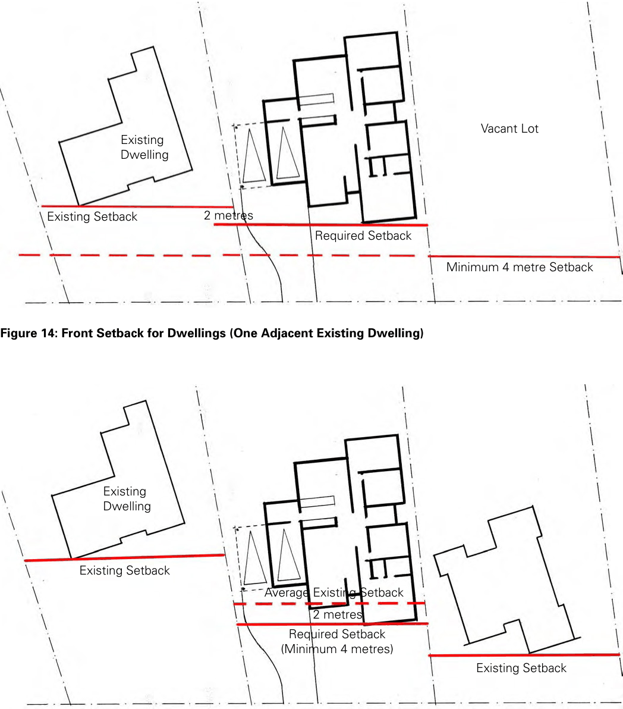

> [Picture on page 38: a picture, saved as a picture (images/vol-2-part-01-minto-renewal-dcp-page-38-1.gif, 150 dpi).]
> Words printed on the picture (title and legend, copied from the PDF):
> Existing
> Dwelling
> 2 metres
> Existing Setback
> Vacant Lot
> Required Setback
> Minimum 4 metre Setback

#### Figure 14: Front Setback for Dwellings (One Adjacent Existing Dwelling)

> Words printed on the picture (title and legend, copied from the PDF):
> Average Existing Setback
> (Minimum 4 metres)

#### Figure 15:  Front Setback for Dwellings (Two Adjacent Existing Dwellings)

### 3.2 Rural Dwellings

#### Objectives:

• To encourage quality-designed dwelling houses that make a positive contribution to the streetscape and amenity of the neighbourhood;

• To provide definition of the public do-main by ensuring development addresses the streets and open spaces; and

• To maintain the character of the ‘Green’ ridge top.

#### Design Requirements:

1\. Compliance with all relevant develop-ment criteria contained in Part 2 All Types of Development.

2\. Rural dwellings shall be constructed in areas as defined in Appendix A.

3\. A rural dwelling shall not be erected on land with an area of less than 4000 square metres.

4\. A minimum setback of 10 metres shall be incorporated for all front and rear build-ing lines.

5\. The side building setback shall be a minimum of 3 metres.

6\. The height of a development shall re-late to the natural landform and ridge top setting – i.e. split-level designs in sloping areas.

7\. All fencing shall be provided in accord-ance with the Fencing Strategy for the stage which will have regard to the rural setting.

8\. For development on lots located in the area noted as ‘3b’ in Appendix A,  refer to Section 2.17 Bushfire.

9\. Significant existing trees shall be re-tained where possible. Building design and associated site grading shall give con-sideration to the retention of such trees.

10\. The first 8 metres of the front setback and 8 metres from the rear boundary shall be landscaped with native and endemic vegetation to create of a vegetative cor-ridor along the ridge line. Exotic tree spe-cies shall only be considered where it will permit better solar access to a residence. Refer to Section 2.17 for bushfire require-ments.

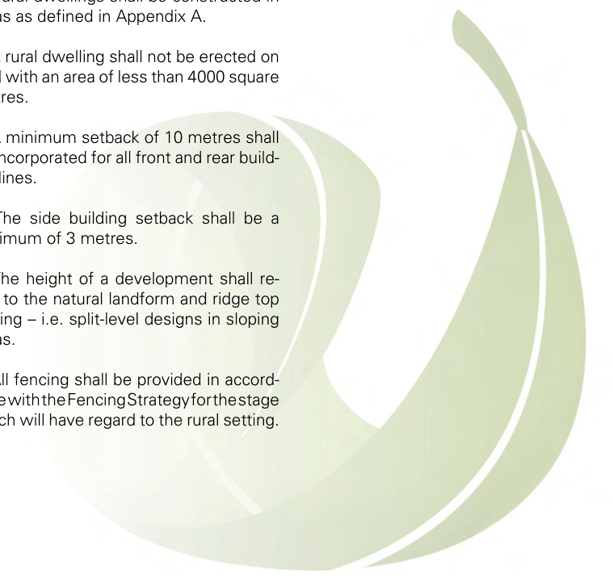

> [Picture on page 39: a picture, saved as a picture (images/vol-2-part-01-minto-renewal-dcp-page-39-49.gif, 150 dpi).]

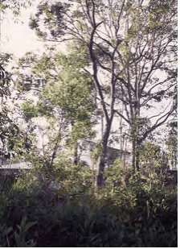

> [Picture on page 39: a picture, saved as a picture (images/vol-2-part-01-minto-renewal-dcp-page-39-50.gif, 150 dpi).]

### 3.3 Semi Attached

### Dwellings

Semi attached dwellings will provide addi-tional housing choice by allowing smaller dwellings. By locating these dwellings on corner sites they will strengthen the over-all built form by acting as ‘book ends’ to streets and vistas.

#### Objectives:

• To encourage quality-designed dwelling houses that make a positive contribution to the streetscape and amenity of the neighbourhood;

• To provide definition of the public do-main by ensuring development addresses the streets and open spaces;

• To promote housing choice / variety / af-fordability; and

• To strengthen the built form on corner sites.

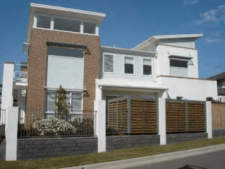

> [Picture on page 40: a picture, saved as a picture (images/vol-2-part-01-minto-renewal-dcp-page-40-21.gif, 150 dpi).]

#### Design Requirements:

1\. Compliance with all relevant develop-ment criteria contained in Part 2 All Types of Development.

2\. Semi attached dwellings may be con-structed in areas identified in Appendix A.

3\. Semi attached dwellings shall be con-structed on corner lots having a minimum site area of 600 square metres.

4\. Sites containing semi attached dwell-ings can be subdivided into two allot-ments each having a minimum site area of 300 square metres, in accordance with the subdivision criteria as described in Section 4.1.2.

5\. The two dwelling houses comprising a semi attached dwelling shall address each street frontage and shall have ga-rages fronting each street.

6\. Development shall be in accordance with the general development criteria outlined in Figure 16.

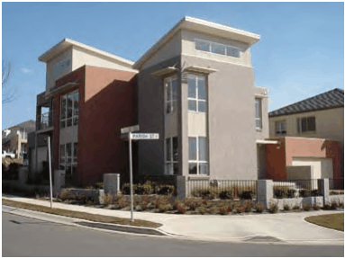

> [Picture on page 40: a picture, saved as a picture (images/vol-2-part-01-minto-renewal-dcp-page-40-45.gif, 150 dpi).]

### 3.4 Integrated Housing

#### Objectives:

• To encourage quality-designed dwelling houses that make a positive contribution to the streetscape and amenity of the neighbourhood;

• To provide definition of the public do-main by ensuring development addresses the streets and open spaces;

• To promote housing choice / variety / affordability; and

• To provide higher density dwellings around parks and close to community fa-cilities, increasing casual surveillance and activity to improve safety and security in public areas.

#### Design Requirements:

1\. Compliance with all relevant develop-ment criteria contained in Part 2 All Types of Development.

2\. Integrated housing may be constructed in areas identified in Appendix A.

3\. Integrated housing shall contain a minimum of three and a maximum of six attached dwellings in any continuous row.

4\. Integrated housing shall be subdivid-ed into allotments of not less than 225 square metres with a minimum width of not less than 7.5 metres.

5\. Dwellings shall be attached or built to incorporate at least 1 zero lot line.

6\. Where zero lot line walls are utilised appropriate easements for services, ac-cess and maintenance shall be provided.

7\. Where a side dwelling wall is not attached (ie. located on a corner allot-ment or mid block) that building line wall shall be setback a minimum distance of 2 metres from the property boundary.

8\. Integrated housing is encouraged to have garages accessible from a car court, rear or secondary street frontage.

9\. A single garage only shall be provided within the front elevation of a dwelling with a lot frontage of less than 12 me-tres.

10\. Any proposal for integrated housing shall be designed by an architect regis-tered with The Royal Australian Institute

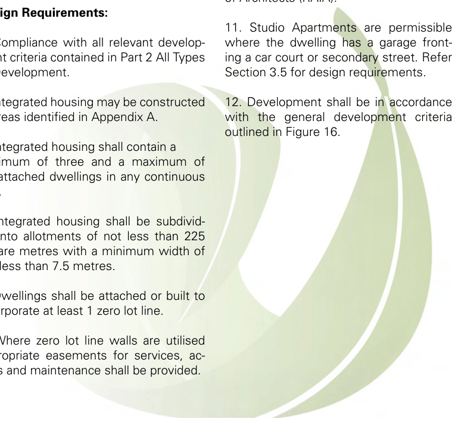

> [Picture on page 41: a picture, saved as a picture (images/vol-2-part-01-minto-renewal-dcp-page-41-51.gif, 150 dpi).]

of Architects (RAIA).

11\. Studio Apartments are permissible where the dwelling has a garage front-ing a car court or secondary street. Refer Section 3.5 for design requirements.

12\. Development shall be in accordance with the general development criteria outlined in Figure 16.

#### CRITERIA

#### CONTROLS

Minimum Front Building Line Setback

3 metres

Minimum Building Line Setback for Non Attached Wall

Minimum Rear Building Line Setback (excluding garages)

Minimum Garage Setback

2 metres

4 metres

5.5 metres *

Minimum Setback for Lightweight

1 metre

Projections

(i.e. balconies / verandahs / porches excluding car ports)

Maximum Building Height

Minimum Private Open Space Area

Principal Private Open Space Area

2 storeys **

50 square metres

4 x 4 metre square

\* Garage setback from secondary street frontages can be reduced to 2m and 1m in car courts

\** 3 storey corner elements are permitted on sites identified at Appendix D (Refer Section 2.5)

#### Figure 16:  Semi Attached and Integrated Housing Development Criteria

### 3.5 Studio Apartments

Studio apartments promote casual surveillance over car courts, rear access garages and secondary streets. Studio apartments are “self - contained” and therefore include a combined living / bedroom area, a bathroom, maisonette kitchen and a separate on site car parking space.

#### Objectives:

• To provide housing choice / diversity for families;

• To provide the opportunity for rental ac-commodation for single occupants; and

• To provide casual surveillance over rear access points.

#### Design Requirements:

1\. Studio apartments shall not be erect-ed on land with an area of less than 350 square metres.

2\. Studio apartments shall be located on top of detached double garages acces-sible from car courts or secondary street frontages.

3\. Studio apartments shall be setback a minimum of 2 metres from and second-ary street frontage and 1 metre from a car court.

4\. Studio apartments shall not be subdi-vided into a separate allotment.

5\. A separate off-street car parking space

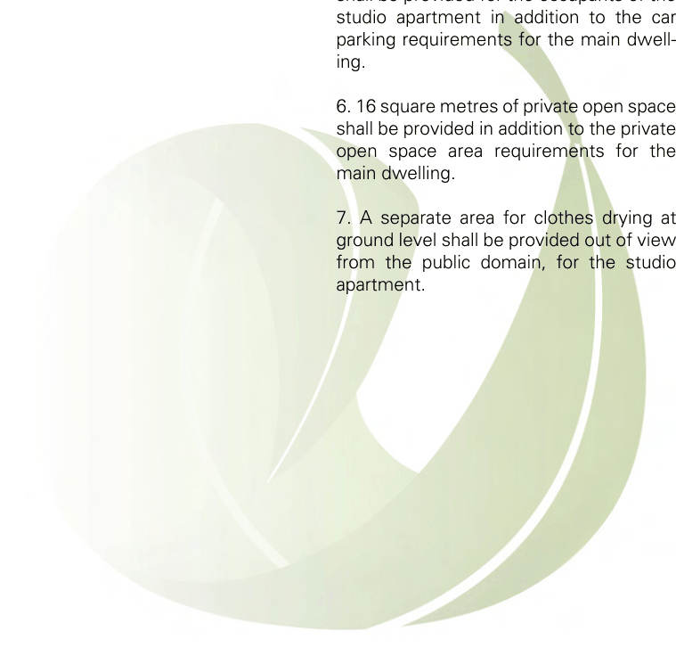

> [Picture on page 43: a picture, saved as a picture (images/vol-2-part-01-minto-renewal-dcp-page-43-32.gif, 150 dpi).]

shall be provided for the occupants of the studio apartment in addition to the car parking requirements for the main dwell-ing.

6\. 16 square metres of private open space shall be provided in addition to the private open space area requirements for the main dwelling.

7\. A separate area for clothes drying at ground level shall be provided out of view from the public domain, for the studio apartment.

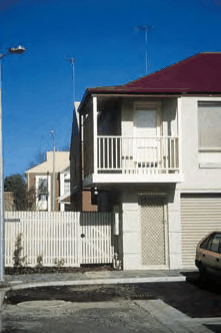

> [Picture on page 43: a picture, saved as a picture (images/vol-2-part-01-minto-renewal-dcp-page-43-45.gif, 150 dpi).]

### subdivision standards 4

### 4.1 Subdivision

#### Objectives:

• To ensure that land once subdivided, contributes positively to the desired character of the locality and provides for the safe and attractive integration of existing and new development;

• To ensure that subdivision responds to the physical characteristics of the land, its landscape setting, orientation, landmarks and key vistas to and from that land;

• To ensure that subdivision provides safe connections with and extension of existing street patterns, as well as any pedestrian, cycleway and public open space networks;

• To promote walking and cycling as the primary mode of travel within a residential neighbourhood; and

• To encourage subdivision that results in allotments orientated, dimensioned and configured to facilitate the siting, design and construction of development appropriate to the environmental attributes of the land.

#### 4.1.1 Neighbourhood Subdivision

#### Design Requirements:

1\. All neighbourhood subdivisions shall be generally consistent with the Concept Plan as illustrated in Figure 3 regarding the location of open space areas, public roads and proposed residential develop-ment.

2\. Final design of residential allotments shall have regard for the impact of orien-tation, slope, and aspect to maximise so-lar access to future development.

3\. Compliance with the development cri-teria contained in Sections 4.2, 4.3, 4.4,

5.1 and 5.3.

4\. Subdivisions shall promote through street access and minimise the number of cul-de-sacs.

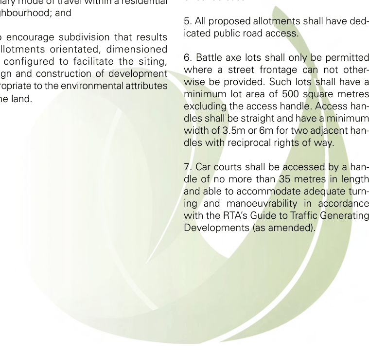

> [Picture on page 44: a picture, saved as a picture (images/vol-2-part-01-minto-renewal-dcp-page-44-45.gif, 150 dpi).]

5\. All proposed allotments shall have ded-icated public road access.

6\. Battle axe lots shall only be permitted where a street frontage can not other-wise be provided. Such lots shall have a minimum lot area of 500 square metres excluding the access handle. Access han-dles shall be straight and have a minimum width of 3.5m or 6m for two adjacent han-dles with reciprocal rights of way.

7\. Car courts shall be accessed by a han-dle of no more than 35 metres in length and able to accommodate adequate turn-ing and manoeuvrability in accordance with the RTA’s Guide to Traffic Generating Developments (as amended).

#### 4.1.2 Allotment Subdivision

The subdivision pattern within the DCP shall be in accordance with the Concept Plan (Figure 3) and Section 4.1.1. No further subdivision of allotments following the neighbourhood subdivision, shall be permitted unless:

1\. That allotment has been identified at Appendix A as a semi attached dwelling

site. Semi attached dwellings may be subdivided into allotments of not less than 300 square metres.

2\. That allotment has been identified at Appendix A as an integrated housing site. Integrated housing shall be subdivided into allotments of not less than 225 square metres with a minimum width of not less than 7.5 metres.

In these circumstances, the subdivision

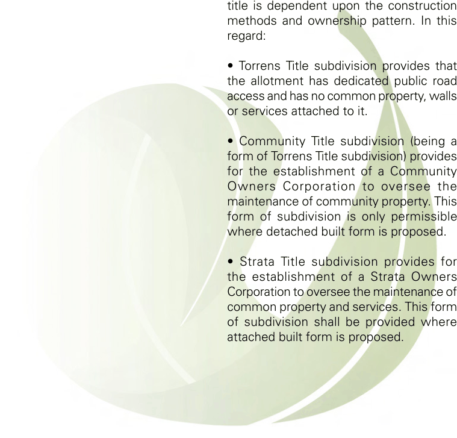

> [Picture on page 45: a picture, saved as a picture (images/vol-2-part-01-minto-renewal-dcp-page-45-20.gif, 150 dpi).]

title is dependent upon the construction methods and ownership pattern. In this regard:

• Torrens Title subdivision provides that the allotment has dedicated public road access and has no common property, walls or services attached to it.

• Community Title subdivision (being a form of Torrens Title subdivision) provides for the establishment of a Community Owners Corporation to oversee the maintenance of community property. This form of subdivision is only permissible where detached built form is proposed.

• Strata Title subdivision provides for the establishment of a Strata Owners Corporation to oversee the maintenance of common property and services. This form of subdivision shall be provided where attached built form is proposed.

### 4.2 Streets

#### Objectives:

• To create a legible and functional road network which provides good connections with the surrounding areas and encourages safe and convenient access throughout the site; and

• To establish quality streetscapes which add to the visual and environmental amenity of the site.

#### Design Requirements:

1\. The proposed street network shall be constructed in accordance with the Road Hierarchy attached at Appendix G.

2\. Individual road design and construction shall be in accordance with the table at Appendix H and have regard to Council’s Specification for Construction of Subdivi-sion Roads and Drainage Works. Illustrat-ed cross-sections and typical plans of the agreed road formations are contained at Appendix I.

3\. Appropriate traffic calming measures shall be installed to ensure a safe speed environment and denote traffic priority.

4\. Kerbing throughout shall generally be upright kerbing and not roll over.

5\. The street planting strategy contained

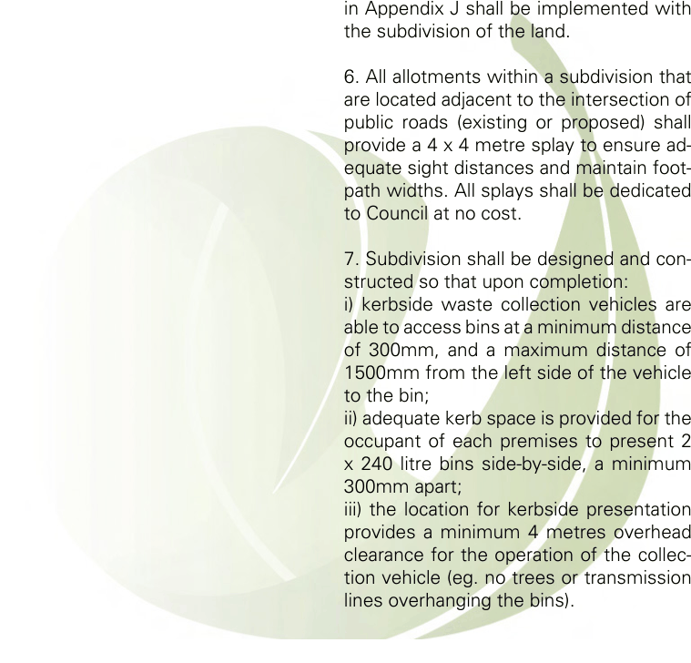

> [Picture on page 46: a picture, saved as a picture (images/vol-2-part-01-minto-renewal-dcp-page-46-29.gif, 150 dpi).]

in Appendix J shall be implemented with the subdivision of the land.

6\. All allotments within a subdivision that are located adjacent to the intersection of public roads (existing or proposed) shall provide a 4 x 4 metre splay to ensure ad-equate sight distances and maintain foot-path widths. All splays shall be dedicated to Council at no cost.

7\. Subdivision shall be designed and con-structed so that upon completion:

i) kerbside waste collection vehicles are able to access bins at a minimum distance of 300mm, and a maximum distance of 1500mm from the left side of the vehicle to the bin;

ii) adequate kerb space is provided for the occupant of each premises to present 2 x 240 litre bins side-by-side, a minimum 300mm apart;

iii) the location for kerbside presentation provides a minimum 4 metres overhead clearance for the operation of the collec-tion vehicle (eg. no trees or transmission lines overhanging the bins).

### 4.3 Access

#### Objectives:

• To provide for a network of pedestrian and cycle routes within the public domain which connect open space areas and community facilities and encourage alternative modes of transport.

#### Design Requirements:

1\. A network of pedestrian footpaths and cycle ways shall be provided within the estate in accordance with the Access Plan attached as Appendix K.

2\. A continuous shared bicycle and pedes-trian access way shall be provided linking all major public open spaces and com-munity facilities. Pedestrian footpaths shall be provided to encourage a walkable suburb, in accordance with Council’s En-gineering Guide for Development.

3\. Establish a palette of street lighting to current Australian Standards and furniture including garbage bins, seating, bollards, signage etc, which relate to the street hierarchy and enhances the character of the development.

4\. Bus stopping shall be located in the carriageway to assist in traffic calming. Bus shelters shall be provided in areas determined to have high use.

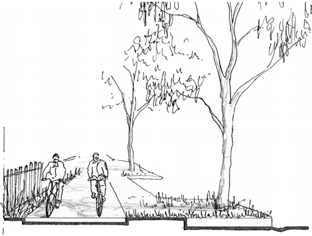

> [Picture on page 47: a picture, saved as a picture (images/vol-2-part-01-minto-renewal-dcp-page-47-30.gif, 150 dpi).]

Shared way

### 4.4 Stormwater

#### Objectives:

• To ensure that water cycle management appropriately responds to site and water catchment conditions and is delivered as an integrated site wide strategy; and

• To ensure that Water Sensitive Urban Design (WSUD) principles are incorporated into development wherever possible.

#### Design Requirements:

1\. Stormwater systems and drainage works shall be designed and constructed in accordance with Council’s Specification for Construction of Subdivision Roads and Drainage Works.

2\. All stormwater systems shall be sized to accommodate the 100-year ARI event.

3\. The design and certification of any stormwater system shall be undertaken by a suitably qualified professional.

4\. The water cycle management will be appropriate to the prevailing site con-ditions, delivered as an integrated site wide strategy, increase the quality and reduce the quantity of stormwater leav-ing the site. This shall be achieved by the incorporation of swales, buffer strips, bio retention, storage tanks and other meas-ures as appropriate.

5\. Safe passage of the Probable Maxi-mum Flood (PMF) shall be demonstrated for major systems.

6\. A treatment train approach to water quality shall be incorporated into the de-sign and construction of major systems.

7\. A major (flood/minor piped flow) ap-proach to drainage is to be taken for flows within the road reserve.  Generally the piped drainage system shall be sized to accommodate the difference between the 100-year ARI flow and the maximum allowable overland flow.

8\. A suitable easement shall be created over all downstream properties for devel-opment that cannot directly dispose of stormwater (under gravity) to the street or directly to Council’s trunk stormwater system.

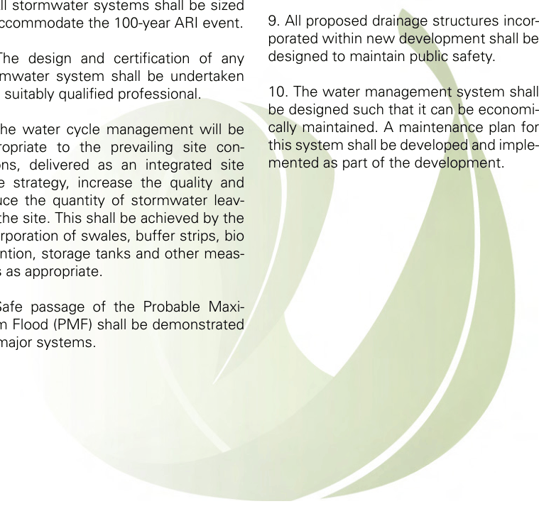

> [Picture on page 48: a picture, saved as a picture (images/vol-2-part-01-minto-renewal-dcp-page-48-49.gif, 150 dpi).]

9\. All proposed drainage structures incor-porated within new development shall be designed to maintain public safety.

10\. The water management system shall be designed such that it can be economi-cally maintained. A maintenance plan for this system shall be developed and imple-mented as part of the development.

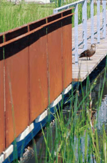

> [Picture on page 48: a picture, saved as a picture (images/vol-2-part-01-minto-renewal-dcp-page-48-58.gif, 150 dpi).]

### public domain 5

### 5.1 Public Open Space

4\. Lighting shall conform with the curremt Australian Standards, including AS1158,

AS1680 and AS2890 (as amended).

The public open spaces will be diverse and interesting, providing high quality public amenity. Facilities shall be incorpo-rated for active and passive recreation for people of all ages and abilities. The parks will act as the focus of individual neigh-bourhoods and of the wider Minto com-munity.

5\. Landscaping and structures shall not create obscured areas. Ensure tree spe-cies selected in public areas can be main-tained with a clear trunk to a minimum of 2 metres.

#### Objectives:

6\. Incorporate planting of indigenous spe-cies and vegetation communities to en-hance native fauna habitats.

• To use parks to maintain view corridors and act as orientation elements through-out the site. Parks should strengthen the character and create a point of difference between different precincts within the site;

7\. Reduce water usage by using indige-nous and low water tolerant species and efficient irrigation systems.

8\. Native planting should be considered as deep root planting to reduce salinity risk.

• To encourage community interaction and ownership by creating desirable gathering spaces, using parks central to residential

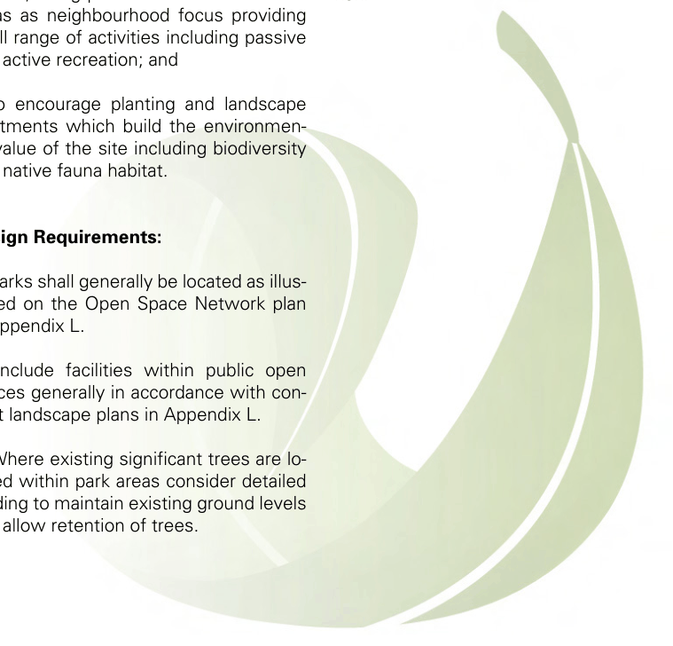

> [Picture on page 49: a picture, saved as a picture (images/vol-2-part-01-minto-renewal-dcp-page-49-38.gif, 150 dpi).]

areas as neighbourhood focus providing a full range of activities including passive and active recreation; and

• To encourage planting and landscape treatments which build the environmen-tal value of the site including biodiversity and native fauna habitat.

#### Design Requirements:

1\. Parks shall generally be located as illus-trated on the Open Space Network plan in Appendix L.

2\. Include facilities within public open spaces generally in accordance with con-cept landscape plans in Appendix L.

3\. Where existing significant trees are lo-cated within park areas consider detailed grading to maintain existing ground levels and allow retention of trees.

### 5.2 Community Facility

#### Objectives:

• Create a central gathering place for all members of the Minto community acting as the main focus for the Minto Renewal area and the surrounding suburbs; and

• To ensure the facility can accommodate a wide variety of uses for a broad cross section of community groups.

#### Design Requirements:

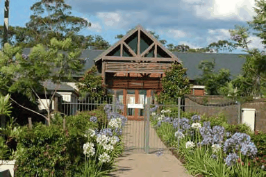

> [Picture on page 50: a picture, saved as a picture (images/vol-2-part-01-minto-renewal-dcp-page-50-11.gif, 150 dpi).]

6\. Materials are to be low maintenance, hard wearing, vandal resistant and in keeping with the character of those used across the Minto Renewal area.

1\. The community facility shall be appro-priately located and treated so that im-pacts, particularly of noise are minimised to the surrounding residents.

7\. Adequate car parking shall be provided to service the facility in accordance with Council’s requirements, including allow-ance for mini bus drop off.

8\. The facility shall be designed to com-ply with occupational health and safety requirements and Australian Standard

1428.1 - 4 (as amended).

2\. The design of the community facility shall allow broad use by creating flexibility of spaces. The facility shall include offic-

> [Picture on page 50: a picture, saved as a picture (images/vol-2-part-01-minto-renewal-dcp-page-50-31.gif, 150 dpi).]

es, consulting rooms, interview rooms, a multi-use hall, adequate storage, kitchen and toilet amenities and outdoor court-yard and play areas. Dedicated rooms will be provided for uses which require func-tional separation or specific facilities such as youth services, day care and family centre clinics.

3\. The facility shall be capable of catering for the future communities needs includ-ing but not limited to a range of cultural and religious groups, family care, child care, community activities, functions, aged citizens and youth groups.

4\. The facility shall be located at a reason-able distance from surrounding housing and orient activity spaces likely to create noise issues away from residential devel-opment.

5\. Ensure surveillance of the public do-main surrounding the facility by creating active facades. No blank walls shall be presented on any facade.

### 5.3 Safety and Security

#### Objectives:

9\. Entrances shall be visible from the street.

• Ensure that development incorporates security features in accordance with the principles of Crime Prevention through Environmental Design (CPTED) to:

- Minimise opportunities for crime; and

- Enhance public security.

10\. External lighting shall be designed to:

i) encourage the use of safe areas;

ii) define safe corridors for movement of people; and

iii) allow facial recognition of approaching pedestrians at 15 metres.

#### Design Requirements:

11\. Minimise the use of external grilles, roller doors, downpipes and shelves which allow access to upper stories.

1\. Maximise casual surveillance opportu-nities to the street and surrounding public places. Active frontages shall be incorpo-rated into all public buildings.

2\. Minimise dead ends and other possible entrapment areas.

> [Picture on page 51: a picture, saved as a picture (images/vol-2-part-01-minto-renewal-dcp-page-51-27.gif, 150 dpi).]

3\. Clearly identify and illuminate access points.

4\. A sense of ownership for the public do-main shall be created to encourage com-munity guardianship.

5\. The public domain shall be attractive to encourage use and activity.

6\. Signage shall be used to make orienta-tion and identification of public buildings and facilities clear.

7\. Sight lines to all public areas shall be maintained. Concealed areas for possible hiding shall be avoided. Building designs shall minimise built elements which as-sist in providing illegitimate access. Serv-ice areas shall be secured or have surveil-lance.

8\. Surfaces which will attract graffiti shall not be permitted.

### 5.4 Principles for

### Adjoining Development

Whilst it is recognised that the Minto Mall, the schools and Campbellfield’s Homestead are not within the Minto Renewal Area, it is important to consider them as they form an important part of the context of the development.

The following principles are provided to provide an understanding of their intended relationship to the development:

#### 5.4.1 Minto Mall

• Present active facades to surrounding streets to provide casual surveillance and increased connection to the surrounding areas. Encourage a strong built edge to

> [Picture on page 52: a picture, saved as a picture (images/vol-2-part-01-minto-renewal-dcp-page-52-17.gif, 150 dpi).]

the Mall precinct with mixed use develop-ment to create activity.

• Provide adequate acoustic and visual buffer from the surrounding residential areas.

• Emphasise the important junction of Ben Lomond Road and Pembroke Road as an important entry point into Minto.

• Create a “Main Street” precinct along Stafford Street between Guernsey Av-enue and Pembroke Road with a strong pedestrian focus and incorporating the shared pedestrian / bicycle link.

#### 5.4.2 The Schools

• Ensure buildings and active uses ad-dress the surrounding street frontages so as to provide casual surveillance of the streets.

• Ensure safe and convenient access to the schools from the surrounding resi-dential areas.

• Create strong links to the schools which

> [Picture on page 53: a picture, saved as a picture (images/vol-2-part-01-minto-renewal-dcp-page-53-10.gif, 150 dpi).]

allow their incorporation in the Minto Re-newal Project as major community facili-ties.

• Recognise the role of the shared library facility and ensure access is maintained.

• Recognise the value of schools as trip generators and locate associated facili-ties on major access routes to enhance the amenity of the area.

• Allowance for adequate parking and drop off zones shall be incorporated.

• Allowance for bus drop off at school sites shall be maintained and safe and di-rect access to the railway station should be strengthened.

• The shared pedestrian / bicycle link should provide direct link from the devel-opment area to the schools.

• The address to the south of Sarah Redfern School shall be strengthened to create strong linkages to the Minto Mall and the proposed Main Street along Staf-ford Street.

#### 5.4.3 Campbellfield’s Cottage

• Be sensitive to the homestead and link it strongly into the wider Master Plan area by providing a visual link from Redfern Park to the cottage.

• Ensure the community has the ability to appreciate the heritage value of the cot-tage.

• Encourage an appropriate economic use of the cottage to enable its long term conservation.

• Explore opportunities of incorporating elements of the cottage building (e.g. sandstone and corrugated metal sheet-

ing) into any future redevelopment of the lands comprising the Minto Mall, Camp-bellfield’s Cottage and the Catholic Edu-cation Office.

> [Picture on page 54: a picture, saved as a picture (images/vol-2-part-01-minto-renewal-dcp-page-54-19.gif, 150 dpi).]

> [Picture on page 54: a picture, saved as a picture (images/vol-2-part-01-minto-renewal-dcp-page-54-20.gif, 150 dpi).]

### appendices

#### Appendix A –  Dwelling Type

#### Locations

#### Appendix B –  Existing Residential

#### Areas

#### Appendix C – Examples of Suitable

#### Natural Colours

#### Appendix D –  Three Storey

#### Development Sites

#### Appendix E –  Suggested Species

#### Schedule

#### Appendix F –  Front Hedge Species

#### Schedule

#### Appendix G –  Road Hierarchy Plan Appendix H –  Road Hierarchy

> [Picture on page 55: a picture, saved as a picture (images/vol-2-part-01-minto-renewal-dcp-page-55-16.gif, 150 dpi).]

#### Schedule

#### Appendix I –  Subdivision Road

#### Network Design Requirements.

#### Appendix J –  Street Planting

#### Strategy

#### Appendix K –  Site Access Plan Appendix L – Open Space Network

Campbelltown (Sustainable City) Development Control Plan 2012    Effective: 03/07/13

### appendix A

#### Dwelling Type Locations

> [Picture on page 56: a map, saved as a picture (images/vol-2-part-01-minto-renewal-dcp-page-56-3.gif, 150 dpi); the street names and other small labels are on the picture.]
> Words printed on the picture (title and legend, copied from the PDF):
> Ben Lomond Road

### appendix B

#### Existing Residential Areas

> [Picture on page 57: a map, saved as a picture (images/vol-2-part-01-minto-renewal-dcp-page-57-3.gif, 150 dpi); the street names and other small labels are on the picture.]
> Words printed on the picture (title and legend, copied from the PDF):
> Ben Lomond Road

Campbelltown (Sustainable City) Development Control Plan 2012    Effective: 03/07/13

### appendix C

#### Examples of Suitable Natural Colours

> [Picture on page 58: a picture, saved as a picture (images/vol-2-part-01-minto-renewal-dcp-page-58-3.gif, 150 dpi).]

### appendix D

#### Three Storey Development Sites

> [Picture on page 59: a picture, saved as a picture (images/vol-2-part-01-minto-renewal-dcp-page-59-3.gif, 150 dpi).]
> Words printed on the picture (title and legend, copied from the PDF):
> Sarah Redfern
> School
> Minto Mall
> Townson Avenue
> Benham Road
> Guernesy Avenue
> Ben Lomond Road
> Eagleview Road
> Eagleview Road

Campbelltown (Sustainable City) Development Control Plan 2012    Effective: 03/07/13

### appendix E

#### Suggested Species Schedule

| Common Name | Mature Size (Height x Spread) |
|---|---|
| Black Wattle Sydney Green Wattle Japanese Maple Trident Maple Narrow-leaved Apple Rough Barked Apple Gum Broad-leaved Apple Hoop Pine Grey Myrtle | 15 x 5 10 x 4 4 x 3 4 x 3 20 x 6 20 x 6 20 x 6 30 x 6 6 x 5 |
| Coast Banksia Australian Flame Tree Cape Chestnut Lemon scented Bottlebrush Swamp Oak Spotted Gum Tuckeroo Blueberry Ash Cabbage Gum Camden White Gum Narrow Leafed Red Ironbark Thin Leaf Stringy Bark Red Flowering Gum Bloodwood | 15 x 5 10 x 5 10 x 4 3 x 3 20 x 10 20 x 8 10 x 5 8 x 4 20 x 8 30 x 15 20 x 10 20 x 10 10 x 5 20 x 10 |
| Scribbly Gum Pink Flowering Yellow Gum Grey Box Coastal Blackbutt | 15 x 5 12 x 6 40 x 5 20 x 8 |
| Swamp Mahogany Sydney Blue Gum Ironbark Forest Red Gum Coral Gum Port Jackson Fig Australian Teak Golden Ash Claret Ash Cheese Tree Kaffir Plum | 15 x 7 30 x 15 30 x 5 40 x 5 10 x 5 12 x 7 15 x 6 16 x 12 16 x 12 4 x 3 10 x 5 |
| Native Frangipani Jacaranda Crepe Myrtle Sweet Gum | 7 x 4 12 x 6 6 x 3 20 x 10 |
| Brush Box Southern Magnolia Prickly Leafed Paper Bark Paperbark Paperbark Pistacio Manchurian Pear | 12 x 6 12 x 8 7 x 2 7 x 2 10 x 4 12 x 6 10 x 5 |

Botanical Name

#### Trees

Acacia decurrens Acacia parramattensis Acer palmatum Acer bergeranum Angophora bakeri Angophora floribunda Angophora subvelutina Araucaria cunninghamii Backhousia myrtifolia Banksia integrifolia Brachychiton acerifoliusa Calodendrum capense Callistemon  citrinus Casurina glauca Corymbia maculata Cupaniopsis anacardioides Elaeocarpus reticulatus Eucalyptus amplifolia Eucalyptus benthamii Eucalyptus cerbra Eucalyptus eugenoides Eucalyptus ficifolia Eucalyptus gummifera Eucalyptus haemostoma Eucalyptus leucoxylon ‘Rosea’ Eucalypyus moluccana Eucalyptus paniculata Eucalyptus robusta Eucalyptus saligna Eucalyptus sideroxylon Eucalyptus tereticornis Eucalyptus torquata Ficus rubiginosa Flindersia australis Fraxinus oxycarpa Fraxinus oxycarpa ‘Raywood’ Glochidion ferdinandi Harpephyllum caffrum Hymenosporum flavum Jacaranda mimosifolia Lagestroemia indica Liquidambar styraciflua Lophostemon confertus Magnolia grandiflora Melaleuca styphelioides Melaleuca decora Melaleuca linariifolia Pistacio chinensis Pyrus calleryana “Chanticlaire’

#### Suggested Species Schedule

| Golden Robinia Chinese Tallow Tree West African Tulip Tree Turpentine Water Gum | 10 x 5 10 x 5 10 x 5 50 x 5 6 x 4 |
|---|---|
| Small leaved Linden Chinese Elm Lilly Pilli | 8 x 4 8 x 4 |

Robinia pseudoacia ‘Frisa’ Sapium sebiferum Spathodia campanulata Syncarpia glomulifera Tristaniopsis laurina Tilia cordata ‘Green Spire’ Ulmus parvifolia Waterhousia floribunda

#### Shrubs

Acacia floribunda

White Sallow Wattle 3 x 3

Acacia terminalis

Sunshine Wattle

1.5 x 1.5

Acmena Smithii “Minor” Narrow Leafed Lillypilly         3 x 3 Agapanthus orientalis

Blue African Lily

0.6 x 0.6

Agapanthus orientalis ‘Alba’ White African Lily

0.6 x 0.6

Agapanthus orientalis ‘Pantha’ White African Lily

0.6 x 0.6

Agapanthus ‘Snow Drift’ Minature White African Lily 0.3 x 0.3 Anigozanthus flavidus

Dwarf Kangaroo Paw 0.6x 0.6

Banksia ‘Candlesticks’

Banksia ‘Candlesticks’ 0.4 x 1

Banksia spinuosa

Honey suckle banksia 4 x 2

Berberis

Berberis

2 x 2

Breynia oblongifolia

Coffee Bush

2 x 2

Bursaria spinosa

Sweet Bursaria

1.5 x 1.5

Callistemon citrinus

Lemon-scented Bottlebrush 2.5 x 2.0

Callistemon linearis

Narrow-leaved Bottlebrush 2 x 2

Callistemon salignus

Willow Bottlebrush 9 x 4

Callistemon viminalis

Weeping Bottlebrush 3 x 3

Camellia sasanqua

Sasanqua

5 x 5

Clivea nobilis

Clivea

0.6 x 0.6

Correa alba

White Native Fushia 1.5 x 1

Correa reflexa

Correa

1 x 1

Crinum Pedunculatum River Lily

1 x 1

Dietes grandiflora

Wild Iris

0.6 x 0.6

Dianella revoluta

Flax Lily

0.6 x 0.6

Dietes bicolour

Yellow Native Lily

0.7 x 0.7

Dietes grandiflora

Blue Native Lily

0.7 x 0.7

Dillwynia juniperina

Prickly Parrot- Pea

1.0 x 1.0

Doryantes excelsa

Gymea Lily

1.5 x 0.6

Gahnia aspera

Rough Saw Sedge

0.6 x 0.6

Grevillea ‘Misty Pink’

Grevillea ‘Misty Pink’ 3 x 2

Grevillea ‘Robyn Gordon’ Grevillea ‘Robyn Gordon’ 1.5 x 2 Grevillea ‘Superb’

Grevillea ‘Superb’

1.5 x 2

Grevillea ‘Moonlight’

Grevillea ‘Moonlight’ 4 x 2

Hebe ‘Autumn Glory’

Violet Hebe

1 x 1

Hebe speciosa

Veronica

1.5 x 1.5

Jacksonia scoparia

Dogwood

1 x 1

Juncus usitatus

Common Rush

1.0 x 0.6

Kunzea ambigua

Tick Bush

2.5 x 1.5

Leptospermum attenuatum Tea Tree

2 x 1.5

Leptospermum flavescens Lemon Tea Tree

4 x 2

Campbelltown (Sustainable City) Development Control Plan 2012    Effective: 03/07/13

#### Suggested Species Schedule

| Lomandra longifolia Lomandra multiflora Lomatia silaifolia Melaleuca nesophila Melaleuca nodosa Melaleuca styphelioides Melaleuca thymifolia Metrosideros “Fiji” Murraya paniculata Notolaea longifolia Osteospermum barberae Pennisetum aloepecuroides Pennisetum ‘Burgandy giant’ Persoonia linearis Pittosporum revolutum Pittosporum Green Pillar Plumbago auriculata ‘Blue’ Phormium tenax ‘Maori Maiden’ Phormium tenax ‘Bronze Baby’ | Mat Rush 0.7 x 0.7 Spiny Leafed Mat Rush 0.8 x 0.8 Crinkle Bush 2 x 2 Showy Honey Myrtle 4 x 2 Ball Honeymyrtle 4 x 2 Prickly-leaved Paperbark 5 x 3 Prickly Paperbark 1 x 1 Newzealand Christmas Bush 2 x 2 Mock Orange 2 x 2 Mock Olive 2 x 2 Pink African Daisy 1 x 1 Fountain Grass 0.6 x 0.6 Pennisetum ‘Burgandy giant’ 1.2 x .7 Narrow Leaved Geebung 3 x 3 Rough Fruit Pittosporum 2 x 1.5 Pittosporum 2 x 2 Blue Plumbago 1.2 x 1.2 Yellow Leaf Flax 0.6 x 0.6 Brown NZ Flax 0.9 x 0.9 |
|---|---|
| Phormium tenax ‘Dazzler’ Phormium tenax ‘Flamingo’ Phormium tenax ‘Purpleum’ Phormium tenax ‘Lime light’ Phormium tenax ‘Jack Spratt’ Phormium tenax ‘Black Magic’ Poa labillardieri Syzigium Australe Syzigium Dusky Syzigium Pink Cascade | Striped NZ Flax 0.7 x 0.7 Pink NZ Flax 0.7 x 0.7 Purple NZ Flax 0.9 x 0.9 Lime NZ Flax 0.5 x 0.5 Dwarf NZ Flax 0.3 x 0.3 Purple NZ Flax 0.6 x 0.6 Native Tussock 0.8 x 0.8 Lillypilly 3 x 3 Bronze Tip Lillypilly 2 x 2 Pink Tip Lillypilly 2 x 2 |
| Thryptomene saxicola Themeda ‘Bush Joey’ Verbimum Tinus Westringa fructosia Westringia glabra Westringia Jervis Gem Xylosma senticosa | Rock Heath Myrtle 1 x 1 Themeda ‘Bush Joey’ 0.4 x 0.4 Vibernum 2 x 2 Coastal Rosemary 1.5 x 1 Westringia 1.2 x 1.0 Jervis Gem 1.5 x 1.5 Shiny Xylosma 1.5 x 1.5 |

#### Groundcovers and Climbers

Brachychiton multifida Happy Face

0.2 x 0.4

Clematis aristata

Old Man’s Beard

0.3 x 1.0

Dampiera purpurea

Purple Dampiera

0.5 x 0.5

Festuca glauca

Blue Fescu

0.2 x 0.3

Gazania regens

Treasure Flower 0.2 x 0.4

Hardenbergia violacea

Native Sarsparella

0.3 x 1.0

Hibbertia aspera

Rough Guinea Flower 0.3 x 1.0

Kennedia rubicunda

Dusky Coral Pea

0.3 x 1.0

Liriope muscari

Lily Turf

0.3 x 0.4

Trachelospermun jasminiodes Star Jasmine

0.5 x 1.0

Viola hederacea

Native Violet

0.3 x 0.3

> [Picture on page 63: a picture, saved as a picture (images/vol-2-part-01-minto-renewal-dcp-page-63-1.gif, 150 dpi).]

Botanical Name

Acmena Smithii “Minor” Berberis

Callistemon viminalis Correa alba

Grevillea ‘Robyn Gordon’ Grevillea ‘Superb’ Hebe ‘Autumn Glory’

### appendix F

#### Front Hedge Species Schedule

> [Picture on page 63: a picture, saved as a picture (images/vol-2-part-01-minto-renewal-dcp-page-63-12.gif, 150 dpi).]

Common Name Mature Size

(Height x Spread)

Narrow Leafed Lillypilly           3 x 3 Berberis

2 x 2

Weeping Bottlebrush 3 x 3 White Native Fushia 1.5 x 1 Grevillea ‘Robyn Gordon’ 1.5 x 2 Grevillea ‘Superb’

1.5 x 2

Violet Hebe

1 x 1

> [Picture on page 63: a map, saved as a picture (images/vol-2-part-01-minto-renewal-dcp-page-63-25.gif, 150 dpi); the street names and other small labels are on the picture.]
> Words printed on the picture (title and legend, copied from the PDF):
> Pittosporum Green Pillar
> Syzigium Pink Cascade
> Westringia Jervis Gem
> 1.5 x 1.5
> 2 x 2
> 2 x 2
> 3 x 3
> 2 x 2
> 2 x 2
> 1.5 x 1
> 1.2 x 1.0
> 1.5 x 1.5
> 1.5 x 1.5

Veronica

Newzealand Christmas Bush 2 x 2 Mock Orange

Rough Fruit Pittosporum 2 x 1.5 Pittosporum

Lillypilly

Bronze Tip Lillypilly 2 x 2 Pink Tip Lillypilly

Vibernum

Coastal Rosemary

Westringia

Jervis Gem

Shiny Xylosma

Campbelltown (Sustainable City) Development Control Plan 2012    Effective: 03/07/13

### appendix G

> [Picture on page 64: a map, saved as a picture (images/vol-2-part-01-minto-renewal-dcp-page-64-2.gif, 150 dpi); the street names and other small labels are on the picture.]
> Words printed on the picture (title and legend, copied from the PDF):
> Ben Lomond Road
> Access Street Lots Under 12m
> Access Street Lots Over 12m
> Street with Swale
> Ben Lomond Road
> Eagleview Half Road Upgrade
> Existing Access Place
> Access Lane at Parks

#### Road Hierarchy Plan

Existing Upgraded to Minor Collector

Existing Upgraded to Access Street

Existing Half Road Verge Upgrade

Increases in width where lot frontage is above 6

1.

Includes fully paved 5.5 wide streetscape for café seating

2.

### appendix H

#### Road Hierarchy Schedule

| Hierarchy Type Road and | Reserve (m) Road Width | Carriageway (m) Width | Width Left/Right (m/m) Verge | Type Kerb | Foot Concrete Paving | Path Cycle | Street Bays On Parking |
|---|---|---|---|---|---|---|---|
| Road Type 1 Access Place | 12.5 13.0 (1) | 5.5 6.0 (1) | 3.5/3.5 | Roll | No | No | No |
| Road Type 2 Access St Under 12m Lots | 16.6 | 5.4 | 3.5/3.5 | Standard K & G | Yes Both Sides | No | Yes |
| Road Type 2 Access St Lots at Parks | 11.7 | 7.2 | 0.5/4.0 | Standard K & G | Yes One Side | No | No |
| Road Type 2 Access St with Shared Way | 17.6 | 5.4 | 4.5/3.5 | Standard K & G | Yes Both Sides | Yes Share way One Side | Yes |
| Road Type 3 Access St Over 12m Lots | 15.2 | 7.2 | 4.0/4.0 | Standard K & G | Yes Both Sides | No | No |
| Road Type 3 Lots at Parks | 13.6 | 5.4 | 0.5/3.5 | Standard K & G | Yes One Side | No | No |
| Road Type 4 Upgrading Existing to Minor Collector | 20.0 | 6.0 6.5 | 4.5/4.5 | Standard K & G | Yes Both Sides | Yes Share way One Side | Yes Both Sides 2.5/2.25 |
| Road Type 5 Minor Collector | 18.7 | 6.5 | 3.5/4.5 | Standard K & G | Yes Both Sides | Yes Share way One Side | Yes Both Sides |
| Road Type 6 Upgrading Existing to Access Street | 20.0 | 6.0 6.5 | 4.5/4.5 | Standard K & G | Yes Both Sides | Yes Share way One Side | Yes Both Sides 2.5/2.25 |
| Road Type 7 Swale Street | 22.2 | 2 x 3.0 | 3.5/3.5 | Standard K & G | Yes Both Sides | No | Yes Both Sides |
| Road Type 8 Oval Parking | 21.3 | 5.4 | 0.5/3.5 | Standard K & G | Yes One Side | No | Yes + 45q Parking Next to Oval |
| Road Type 9 Existing Road Reserve (Monaghan Street) | 19.6 | 5.4 | 4.5/5.5 | Standard K & G | Yes Both Sides | Yes (2) Share way | Yes Both Sides |
| Road Type 10 Existing Road Reserve (Ben Lomond Rd) | 21.5 | 2 x 4.4 | 3.5/3.5 | Standard K & G | Yes Both Sides | Yes Marked Both Sides of Road | Yes Both Sides |
| Road Type 11 Eagleview Road Half Road Works | 20 | 3.25 | 4.65 | Standard K & G | Yes One Side | Yes Share way One Side | Yes One Side |
| Road Type 12 Existing Road Verge Works | 20 | 3.0 | 4.5 | Standard K & G | Yes One Side | Yes Share way One Side | Yes One Side |
| Road Type 13 Existing Access Place Road Works | 10.57 5 | 5.975 | 2.3/2.3 | Standard K & G | No | No | No |
| Road Type 14 Eagleview Rd Half Road Works With Parking and Shared Way | 30.25 (3) | 3.25 | Eagleview 3.5 Shareway 2.0 | Standard K & G | No | Yes Shareway | Yes |

Measured to include landscaped strip between Eagleview and shared way adjacent to Valley

3\. Vista Park.

Campbelltown (Sustainable City) Development Control Plan 2012    Effective: 03/07/13

### appendix I

#### Subdivision Road Network Design Requirements.

> [Picture on page 66: a picture, saved as a picture (images/vol-2-part-01-minto-renewal-dcp-page-66-3.gif, 150 dpi).]

> [Picture on page 66: a picture, saved as a picture (images/vol-2-part-01-minto-renewal-dcp-page-66-4.gif, 150 dpi).]

> [Picture on page 66: a picture, saved as a picture (images/vol-2-part-01-minto-renewal-dcp-page-66-5.gif, 150 dpi).]

#### Subdivision Road Network Design Requirements.

> [Picture on page 67: a picture, saved as a picture (images/vol-2-part-01-minto-renewal-dcp-page-67-2.gif, 150 dpi).]

Campbelltown (Sustainable City) Development Control Plan 2012    Effective: 03/07/13

#### Subdivision Road Network Design Requirements.

> [Picture on page 68: a picture, saved as a picture (images/vol-2-part-01-minto-renewal-dcp-page-68-2.gif, 150 dpi).]

#### Subdivision Road Network Design Requirements.

> [Picture on page 69: a picture, saved as a picture (images/vol-2-part-01-minto-renewal-dcp-page-69-2.gif, 150 dpi).]

> [Picture on page 69: a picture, saved as a picture (images/vol-2-part-01-minto-renewal-dcp-page-69-3.gif, 150 dpi).]

Campbelltown (Sustainable City) Development Control Plan 2012    Effective: 03/07/13

#### Subdivision Road Network Design Requirements.

> [Picture on page 70: a picture, saved as a picture (images/vol-2-part-01-minto-renewal-dcp-page-70-2.gif, 150 dpi).]

> [Picture on page 70: a picture, saved as a picture (images/vol-2-part-01-minto-renewal-dcp-page-70-3.gif, 150 dpi).]

> [Picture on page 70: a picture, saved as a picture (images/vol-2-part-01-minto-renewal-dcp-page-70-4.gif, 150 dpi).]

#### Subdivision Road Network Design Requirements.

> [Picture on page 71: a picture, saved as a picture (images/vol-2-part-01-minto-renewal-dcp-page-71-2.gif, 150 dpi).]

> [Picture on page 71: a picture, saved as a picture (images/vol-2-part-01-minto-renewal-dcp-page-71-3.gif, 150 dpi).]

> [Picture on page 71: a picture, saved as a picture (images/vol-2-part-01-minto-renewal-dcp-page-71-4.gif, 150 dpi).]

Campbelltown (Sustainable City) Development Control Plan 2012    Effective: 03/07/13

#### Subdivision Road Network Design Requirements.

> [Picture on page 72: a picture, saved as a picture (images/vol-2-part-01-minto-renewal-dcp-page-72-2.gif, 150 dpi).]

#### Subdivision Road Network Design Requirements.

> [Picture on page 73: a picture, saved as a picture (images/vol-2-part-01-minto-renewal-dcp-page-73-2.gif, 150 dpi).]

> [Picture on page 73: a picture, saved as a picture (images/vol-2-part-01-minto-renewal-dcp-page-73-3.gif, 150 dpi).]

Campbelltown (Sustainable City) Development Control Plan 2012    Effective: 03/07/13

#### Subdivision Road Network Design Requirements.

> [Picture on page 74: a picture, saved as a picture (images/vol-2-part-01-minto-renewal-dcp-page-74-2.gif, 150 dpi).]

#### Subdivision Road Network Design Requirements.

> [Picture on page 75: a picture, saved as a picture (images/vol-2-part-01-minto-renewal-dcp-page-75-2.gif, 150 dpi).]

Campbelltown (Sustainable City) Development Control Plan 2012    Effective: 03/07/13

#### Subdivision Road Network Design Requirements.

> [Picture on page 76: a picture, saved as a picture (images/vol-2-part-01-minto-renewal-dcp-page-76-2.gif, 150 dpi).]

#### Subdivision Road Network Design Requirements.

> [Picture on page 77: a picture, saved as a picture (images/vol-2-part-01-minto-renewal-dcp-page-77-2.gif, 150 dpi).]

Campbelltown (Sustainable City) Development Control Plan 2012    Effective: 03/07/13

#### Subdivision Road Network Design Requirements.

> [Picture on page 78: a picture, saved as a picture (images/vol-2-part-01-minto-renewal-dcp-page-78-2.gif, 150 dpi).]

#### Subdivision Road Network Design Requirements.

> [Picture on page 79: a picture, saved as a picture (images/vol-2-part-01-minto-renewal-dcp-page-79-2.gif, 150 dpi).]

Campbelltown (Sustainable City) Development Control Plan 2012    Effective: 03/07/13

#### Subdivision Road Network Design Requirements.

> [Picture on page 80: a picture, saved as a picture (images/vol-2-part-01-minto-renewal-dcp-page-80-2.gif, 150 dpi).]

### appendix J

#### Street Planting Strategy

• Street trees shall be planted to both sides of all streets.

• Use predominantly indigenous species for street tree plantings to enhance exist-ing character and diversity of native veg-etation.

• Use exotic species for street tree plant-ings to enhance orientation and allow winter solar access as appropriate, in par-ticular to frontages of north facing lots.

• Use species for street tree plantings which will reach a mature size appropri-ate to the scale of the street.

• Street tree planting shall be coordinated with subdivision layout, traffic plan and services layouts to ensure appropriate configuration with vehicle crossovers, sight lines, lighting and other services.

• Street trees to be planted between parking bays at a maximum of one per 10 spaces for 90deg parking and one per 3 spaces for parallel parking.

• 500mm planting zone between public footpath and lot boundary to be planted with species on the Verge Planting Pro-posed Species List following.

• All street trees to have root control bar-riers installed.

> [Picture on page 81: a picture, saved as a picture (images/vol-2-part-01-minto-renewal-dcp-page-81-31.gif, 150 dpi).]

Campbelltown (Sustainable City) Development Control Plan 2012    Effective: 03/07/13

> [Picture on page 81: a picture, saved as a picture (images/vol-2-part-01-minto-renewal-dcp-page-81-33.gif, 150 dpi).]

#### 9 3 16

#### Street Tree Planting Strategy North

> [Picture on page 82: a map, saved as a picture (images/vol-2-part-01-minto-renewal-dcp-page-82-3.gif, 150 dpi); the street names and other small labels are on the picture.]

#### 11 + 4

#### SPECIES LIST
