## 1. Acer palmatum

## 2. Acer buergerianum

## 3. Brachychiton acerifolius

## 4. Casurina galuca

## 5. Elaeocarpus reticulatus

## 6. Eucalyptus Crebra

## 7. Eucalyptus haemastoma

## 8. Eucalyptus sideroxylon rosea

## 9. Eucalyptus tereticornis

## 10. Ficus Hillii

## 11. Hymenosporum flavum

#### 15 3

#### 16 12

#### 7+ 19

#### 15 17 16

#### 7 + 19

#### Street Tree Planting Strategy South

## 12. Waterhousia floribunda

## 13. Lagestroemia indica

## 14. Lophostemon confertus

## 15. Pistacia chinensis

## 16. Pyrus calleryana ‘Chanticlaire’

## 17. Robinia pseudoacacia ‘Frisia’

## 18. Ulmus parvifolia

## 19. Tristaniopsis laurina

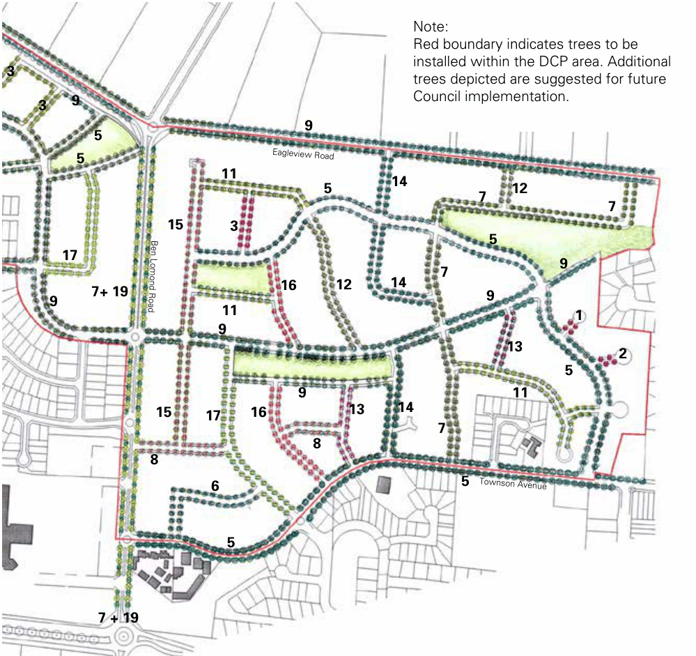

> [Picture on page 83: a map, saved as a picture (images/vol-2-part-01-minto-renewal-dcp-page-83-27.gif, 150 dpi); the street names and other small labels are on the picture.]
> Words printed on the picture (title and legend, copied from the PDF):
> Ben Lomond Road
> 5 Townson Avenue

Note:

Red boundary indicates trees to be installed within the DCP area. Additional trees depicted are suggested for future Council implementation.

Campbelltown (Sustainable City) Development Control Plan 2012    Effective: 03/07/13

Botanical Name

Agapanthus orientalis Agapanthus orientalis ‘Alba’ Agapanthus orientalis ‘Pantha’ Agapanthus ‘Snow Drift’ Brachychiton multifida Crinum Pedunculatum Dianella revoluta

Dietes bicolour

Dietes grandiflora

Gazania regens

Liriope muscari

Lomandra longifolia Phormium tenax ‘Bronze Baby’ Phormium tenax ‘Dazzler’ Phormium tenax ‘Flamingo’ Phormium tenax ‘Purpleum’ Phormium tenax ‘Lime light’ Phormium tenax ‘Jack Spratt’ Phormium tenax ‘Black Magic’ Westringia fructosia

#### Verge Planting Proposed Species List

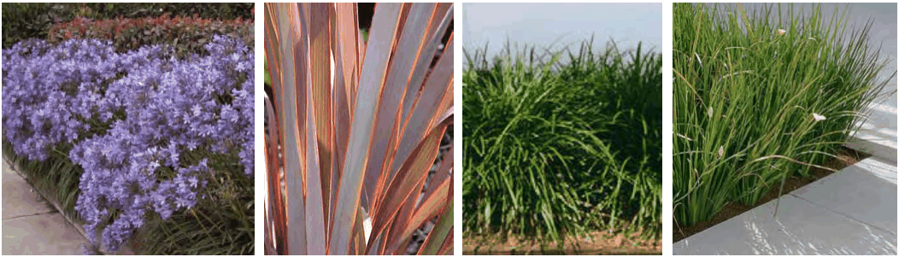

> [Picture on page 84: a picture, saved as a picture (images/vol-2-part-01-minto-renewal-dcp-page-84-23.gif, 150 dpi).]

Common Name

Mature Size (Height x Spread)

| Blue African Lily White African Lily White African Lily Minature White African Lily Happy Face | 0.6 x 0.6 0.6 x 0.6 0.6 x 0.6 0.3 x 0.3 0.2 x 0.4 |
|---|---|
| River Lily Flax Lily Yellow Native Lily Blue Native Lily Treasure Flower Lily Turf Mat Rush Brown NZ Flax Striped NZ Flax Pink NZ Flax Purple NZ Flax Lime NZ Flax Dwarf NZ Flax Purple NZ Flax | 1 x 1 0.6 x 0.6 0.7 x 0.7 0.7 x 0.7 0.2 x 0.4 0.3 x 0.4 0.7 x 0.7 0.9 x 0.9 0.7 x 0.7 0.7 x 0.7 0.9 x 0.9 0.5 x 0.5 0.3 x 0.3 0.6 x 0.6 |
| Coastal Westringia | 1 x 1 |

### appendix K

#### Site Access Plan

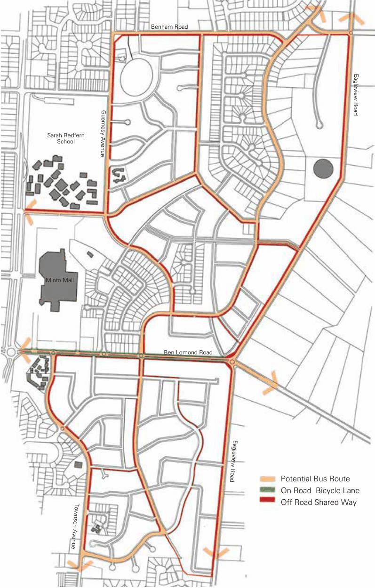

> [Picture on page 85: a map, saved as a picture (images/vol-2-part-01-minto-renewal-dcp-page-85-3.gif, 150 dpi); the street names and other small labels are on the picture.]
> Words printed on the picture (title and legend, copied from the PDF):
> Ben Lomond Road
> Potential Bus Route
> On Road  Bicycle Lane
> Off Road Shared Way

Campbelltown (Sustainable City) Development Control Plan 2012    Effective: 03/07/13

#### Rose Park

### appendix L

#### Open Space Network

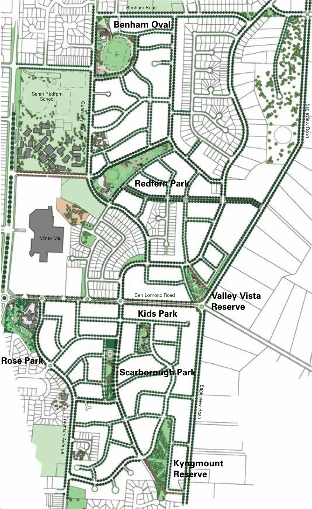

> [Picture on page 86: a picture, saved as a picture (images/vol-2-part-01-minto-renewal-dcp-page-86-4.gif, 150 dpi).]
> Words printed on the picture (title and legend, copied from the PDF):
> Sarah Redfern
> School
> Guernesy Avenue
> Minto Mall
> Townson Avenue
> Benham Road
> Eagleview Road
> Ben Lomond Road
> Eagleview Road

#### Benham Oval

#### Redfern Park

#### Valley Vista

#### Reserve

#### Kids Park

#### Scarborough Park

#### Kyngmount

#### Reserve

#### Scarborough Park Concept

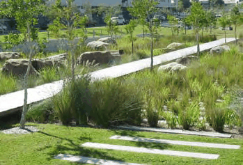

> [Picture on page 87: a picture, saved as a picture (images/vol-2-part-01-minto-renewal-dcp-page-87-2.gif, 150 dpi).]

1\. Grid of trees and grasses as strong entry statement.

2\. Active Play area with full size basketball court for informal games, and grassed kick about area.

3\. Feature planting of Exotic deciduous trees to create seasonal interest.

4\. Passive recreation area Open grassed space with seating.

5\. Timber boardwalk linking across rain garden area.

6\. Grid of trees and grasses as strong entry statement.

7\. Boundary and street tree plantings, spaced to the create interest and difference along the length of the park.

Minimum Development Area: 0.8Ha

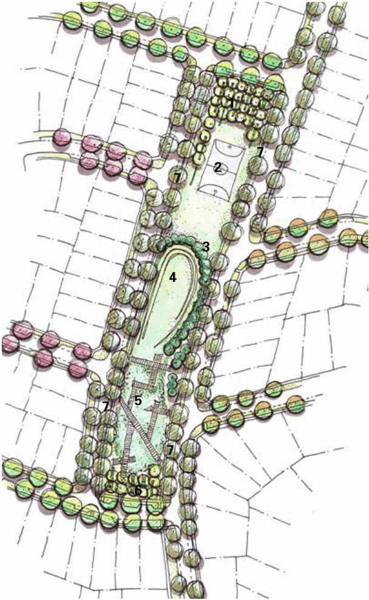

> [Picture on page 87: a picture, saved as a picture (images/vol-2-part-01-minto-renewal-dcp-page-87-23.gif, 150 dpi).]
> Words printed on the picture (title and legend, copied from the PDF):
> 1
> 7
> 2
> 7
> 3
> 4
> 5
> 7
> 7
> 6

Note: Design subject to separate Development Application

Campbelltown (Sustainable City) Development Control Plan 2012    Effective: 03/07/13

#### 1

Note: Design subject to separate Development Application

#### Benham Oval Concept

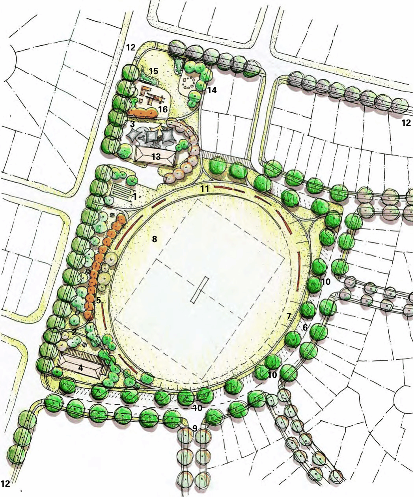

> [Picture on page 88: a map, saved as a picture (images/vol-2-part-01-minto-renewal-dcp-page-88-4.gif, 150 dpi); the street names and other small labels are on the picture.]

#### Benham Oval Concept

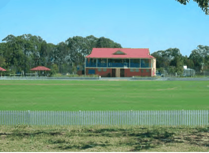

> [Picture on page 89: a picture, saved as a picture (images/vol-2-part-01-minto-renewal-dcp-page-89-2.gif, 150 dpi).]

1\. Cricket Practice Nets.

2\. Pedestrian path linking to school.

3\. Deciduous trees to north of building.

4\. Amenities and Kiosk facilities  5. Feature grove of flowering deciduous trees with table settings underneath.

6\. Adequate 45 degree on street parking provided street.

7\. Pedestrian footpath behind parking.

8\. Oval with retaining wall to low side

9\. Street tree plantings

10\. Low feature plantings to terminate view corridors.

11\. Bench seating for spectators.

12\. Connection to cross site shared way network.

13\. Existing childcare centre.

14\. Existing trees to be retained where possible. Existing stone feature retained, strengthen planting with clean trunked indigenous species.

15\. Entrance feature and ornamental planting.

16\. Existing Playground.

Minimum Development Area: 2Ha

> [Picture on page 89: a picture, saved as a picture (images/vol-2-part-01-minto-renewal-dcp-page-89-31.gif, 150 dpi).]

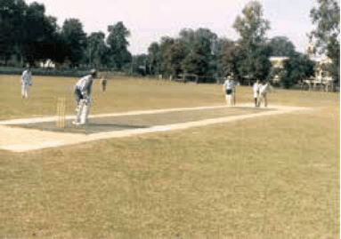

> [Picture on page 89: a picture, saved as a picture (images/vol-2-part-01-minto-renewal-dcp-page-89-32.gif, 150 dpi).]

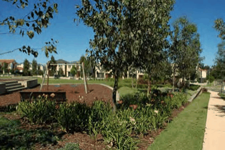

> [Picture on page 89: a picture, saved as a picture (images/vol-2-part-01-minto-renewal-dcp-page-89-33.gif, 150 dpi).]

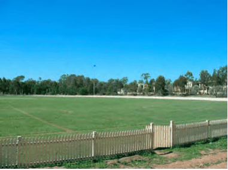

> [Picture on page 89: a picture, saved as a picture (images/vol-2-part-01-minto-renewal-dcp-page-89-34.gif, 150 dpi).]

Campbelltown (Sustainable City) Development Control Plan 2012    Effective: 03/07/13

#### Redfern Park Concept

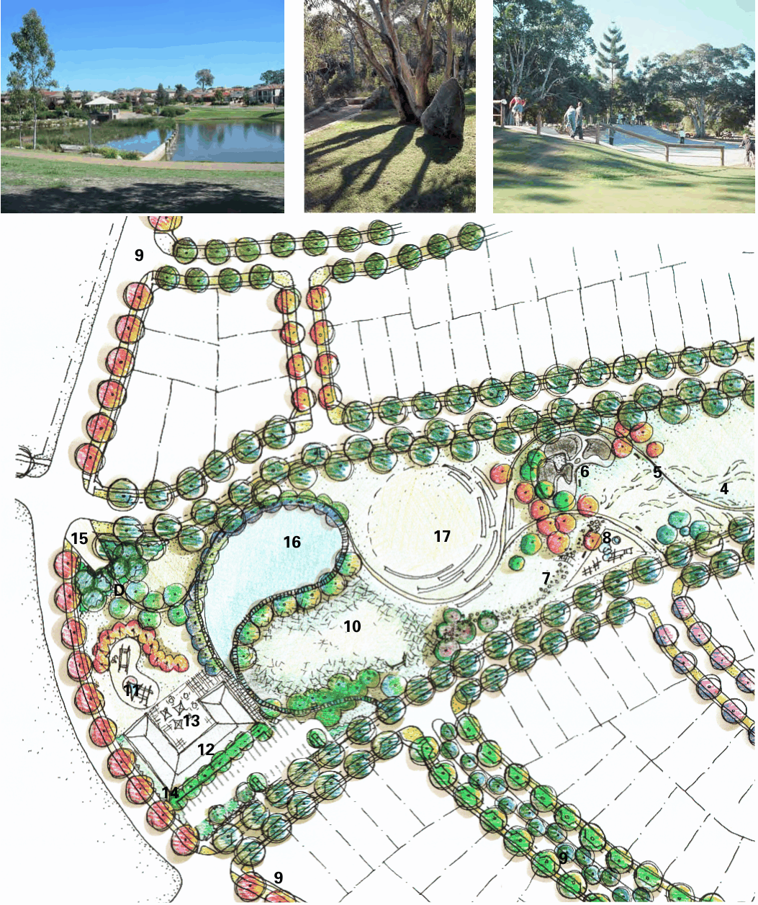

> [Picture on page 90: a map, saved as a picture (images/vol-2-part-01-minto-renewal-dcp-page-90-2.gif, 150 dpi); the street names and other small labels are on the picture.]

Note: Design subject to separate Development Application

#### Redfern Park Concept

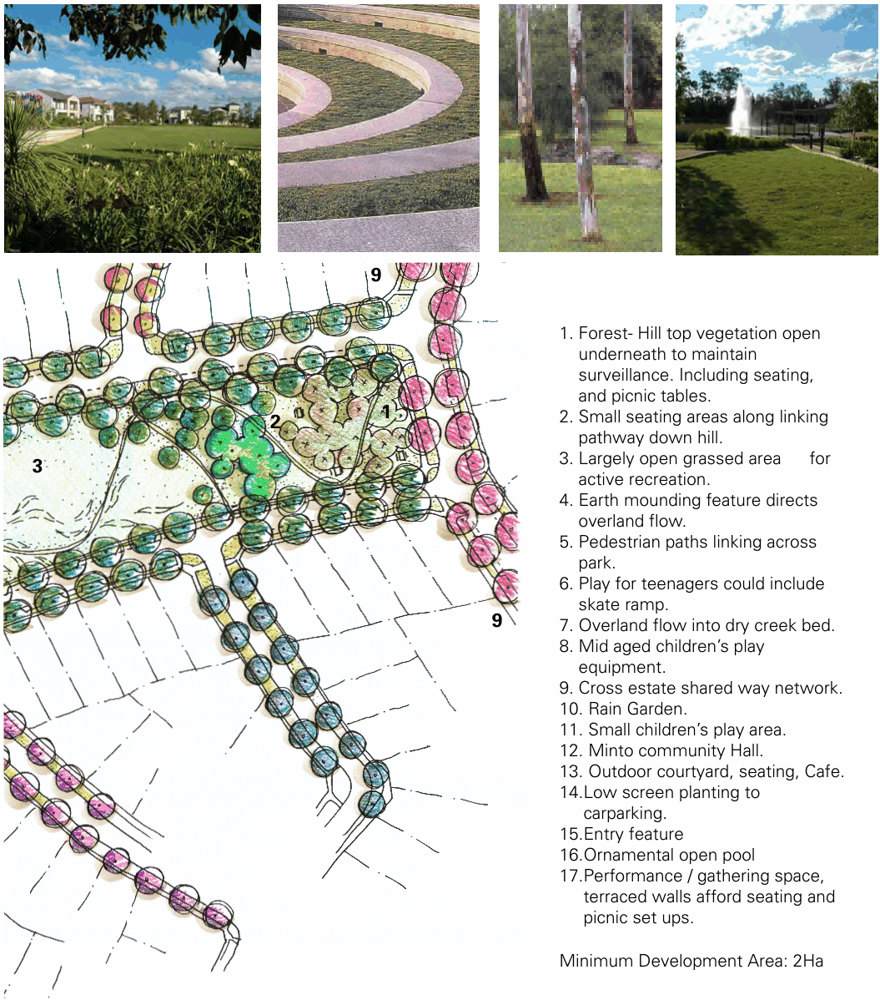

> [Picture on page 91: a picture, saved as a picture (images/vol-2-part-01-minto-renewal-dcp-page-91-2.gif, 150 dpi).]
> Words printed on the picture (title and legend, copied from the PDF):
> 9
> 1
> 2
> 3
> 9

1\. Forest- Hill top vegetation open underneath to maintain surveillance. Including seating, and picnic tables.

2\. Small seating areas along linking pathway down hill.

3\. Largely open grassed area for active recreation.

4\. Earth mounding feature directs overland flow.

5\. Pedestrian paths linking across park.

6\. Play for teenagers could include skate ramp.

7\. Overland flow into dry creek bed.

8\. Mid aged children’s play equipment.

9\. Cross estate shared way network.

10\. Rain Garden.

11\. Small children’s play area.

12\. Minto community Hall.

13\. Outdoor courtyard, seating, Cafe. 14.Low screen planting to carparking. 15.Entry feature 16.Ornamental open pool 17.Performance / gathering space, terraced walls afford seating and picnic set ups.

Minimum Development Area: 2Ha

Campbelltown (Sustainable City) Development Control Plan 2012    Effective: 03/07/13

#### Valley Vista Park Concept

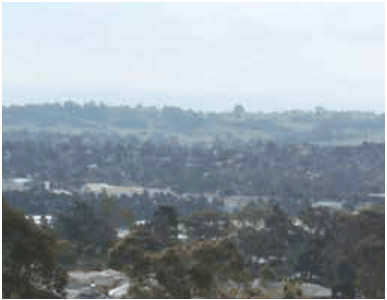

> [Picture on page 92: a picture, saved as a picture (images/vol-2-part-01-minto-renewal-dcp-page-92-2.gif, 150 dpi).]

1\. Possible incorporation of public art work

2\. Feature trees shared way link

3\. Deciduous street trees

4\. Grove of tall clear trunked Indigenous trees along ridge line, maintaining open views out, and green views in.

5\. Picnic facilities under grove of clear trunked indigenous trees.

6\. Central access spine pathway linking discreet spaces.

7\. Small seating viewing areas, incorporated into level changes.

8\. Feature entry planting/ statement.

9\. Larger seating BBQ area.

10\. Mass planting on banks taking up level changes.

Minimum Development Area: 0.5Ha

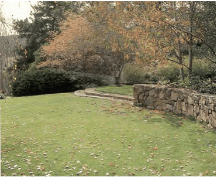

> [Picture on page 92: a picture, saved as a picture (images/vol-2-part-01-minto-renewal-dcp-page-92-22.gif, 150 dpi).]

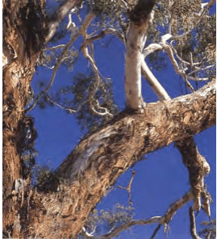

> [Picture on page 92: a picture, saved as a picture (images/vol-2-part-01-minto-renewal-dcp-page-92-23.gif, 150 dpi).]

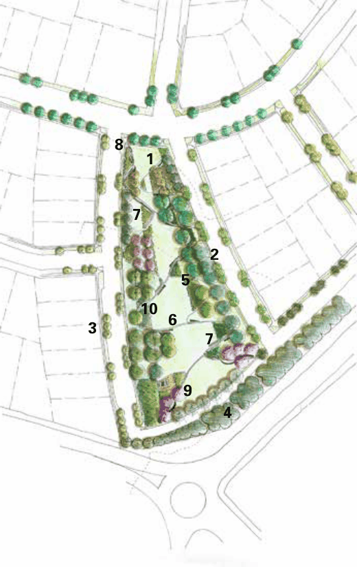

> [Picture on page 92: a picture, saved as a picture (images/vol-2-part-01-minto-renewal-dcp-page-92-24.gif, 150 dpi).]
> Words printed on the picture (title and legend, copied from the PDF):
> 8
> 1
> 7
> 2
> 5
> 10
> 6
> 3
> 7
> 9
> 4

Note: Design subject to separate Development Application

#### Kids Community Park Concept

1\. Young children’s play area, close to shelter and seating.

2\. Shelter to BBQ/ Toilets/ picnic facilities, Incorporating relocated community mural.

3\. Street Trees

4\. Performance/ Amphitheatre space

5\. Gentle grade pathway for easy access and children’s bike path.

6\. Incorporate memorial created by existing tenants to commemorate Minto Estate community. Including a stone wall feature.

7\. Concept for entire playground aims to illustrate the history of the area, starting with native bush, indigenous culture, through farming, housing and to the future.

8\. Older children’s playground, accommodating aged and disabilities.

Minimum Development Area: 0.5Ha

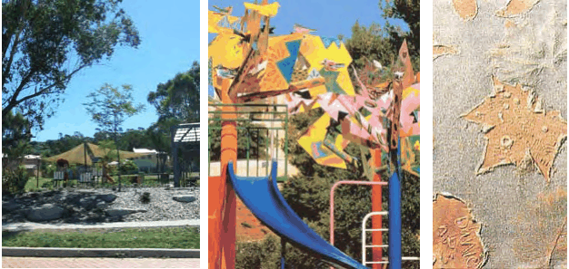

> [Picture on page 93: a picture, saved as a picture (images/vol-2-part-01-minto-renewal-dcp-page-93-23.gif, 150 dpi).]

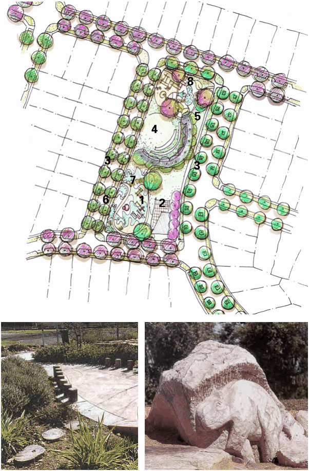

> [Picture on page 93: a picture, saved as a picture (images/vol-2-part-01-minto-renewal-dcp-page-93-24.gif, 150 dpi).]
> Words printed on the picture (title and legend, copied from the PDF):
> 8
> 5
> 4
> 3
> 3
> 7
> 6 1
> 2

Note: Design subject to separate Development Application

Campbelltown (Sustainable City) Development Control Plan 2012    Effective: 03/07/13

#### Kyngmount Reserve

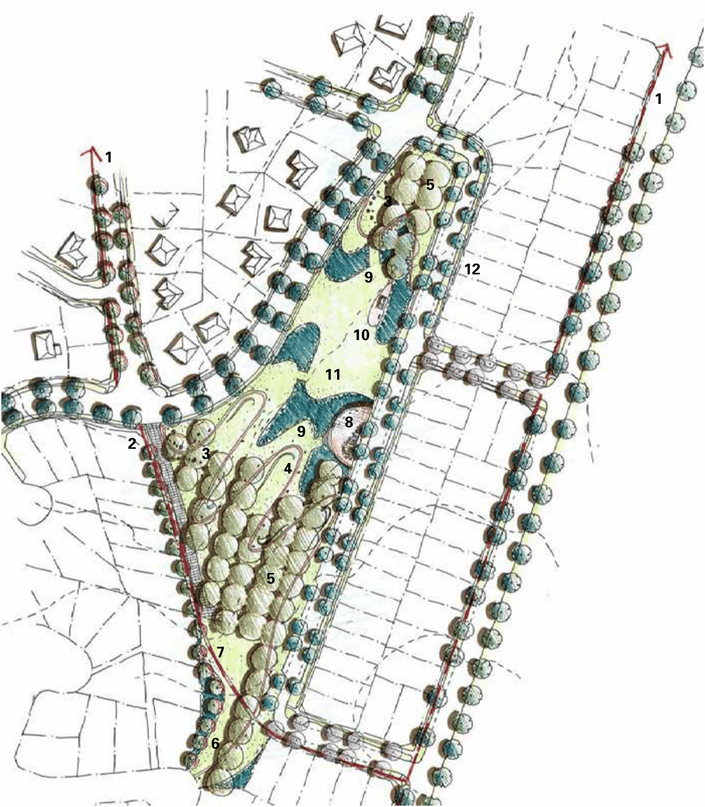

> [Picture on page 94: a map, saved as a picture (images/vol-2-part-01-minto-renewal-dcp-page-94-2.gif, 150 dpi); the street names and other small labels are on the picture.]

Note: Design subject to separate Development Application

#### Kyngmount Reserve

1\. Cross site shared bicycle and pedestrian way.

2\. Access lane to dwellings.

3\. Sculptural feature.

4\. Gently ramped path for equitable access with lighting and retaining walls along length.

5\. Tall clear trunked Eucalypt trees to maintain views to mountains under canopy.

6\. Pedestrian path access from neighbouring subdivision.

7\. Screen planting to back fences and seating area.

8\. Raised, paved lookout platform with shade structure and seating.

9\. Low dense planting to create a variety of spaces while maintaining views. 10.Seating area. 11.Open grassed area for open views and play. 12.Street tree planting and on street parking.

Minimum Development Area: 1.5Ha

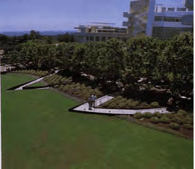

> [Picture on page 95: a picture, saved as a picture (images/vol-2-part-01-minto-renewal-dcp-page-95-27.gif, 150 dpi).]

Campbelltown (Sustainable City) Development Control Plan 2012    Effective: 03/07/13

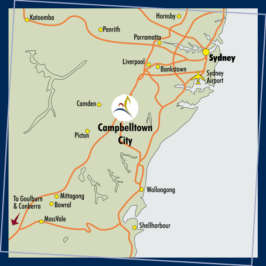

> [Picture on page 97: a picture, saved as a picture (images/vol-2-part-01-minto-renewal-dcp-page-97-1.gif, 150 dpi).]

#### campbelltown.nsw.gov.au

#### Campbelltown City Council, PO Box 57, Campbelltown, NSW 2560
