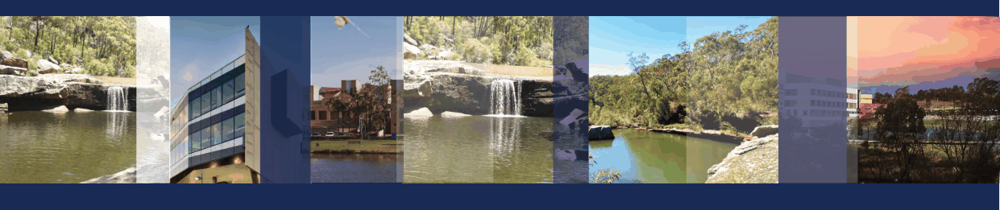
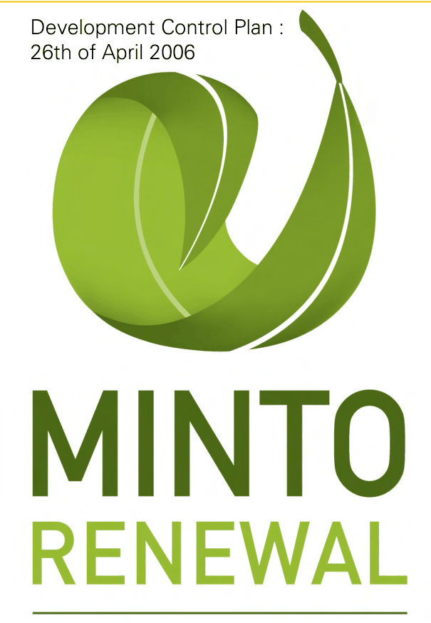

# Campbelltown Sustainable City Development Control Plan 2015 - Part 1 Minto Renewal DCP

> This chapter is split into 5 section file(s), one per numbered heading, in the order they appear in the PDF.

Source PDF: [volume-2-part-1-minto-renewal-dcp-with-cover.pdf](volume-2-part-1-minto-renewal-dcp-with-cover.pdf)

### Campbelltown (Sustainable City) Development Control Plan 2015

> [Picture on page 1: a picture, saved as a picture (images/vol-2-part-01-minto-renewal-dcp-page-1-5.gif, 150 dpi).]

### VOLUME 2

### Site Specific DCPs

## Part 1: Minto Renewal DCP

### Creating Campbelltown's Future 2025

#### Note:

#### The Minto Renewal DCP came into effect on 26 April 2006 and has been incorporated

#### as Part 1 , Volume 2 of Campbelltown (Sustainable City) DCP .

### Minto Renewal

> [Picture on page 3: a picture, saved as a picture (images/vol-2-part-01-minto-renewal-dcp-page-3-2.gif, 150 dpi).]

### Development Control Plan : 26th of April 2006

Prepared by:

On behalf of:

<!-- sections -->
## Sections

1. [1 Introduction](01-introduction.md)
2. [2 All Types of Development](02-all-types-of-development.md)
3. [3 Dwelling Development](03-dwelling-development.md)
4. [4 Subdivision Standards](04-subdivision-standards.md)
5. [19 Tristaniopsis laurina](05-19-tristaniopsis-laurina.md)
