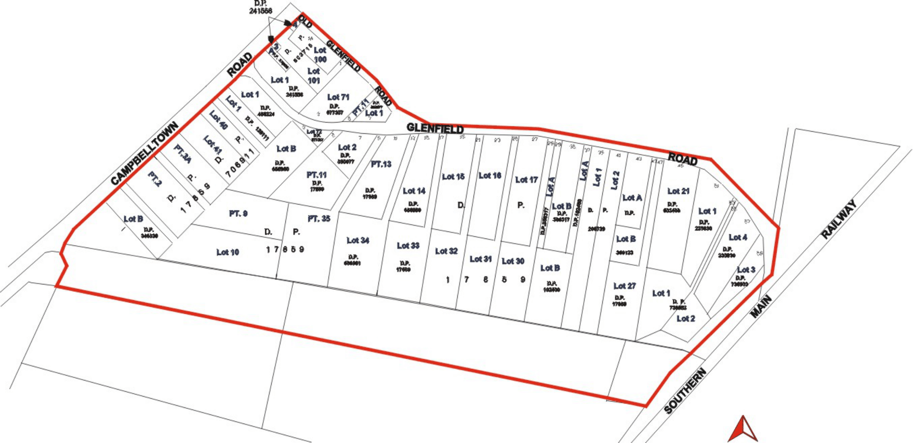
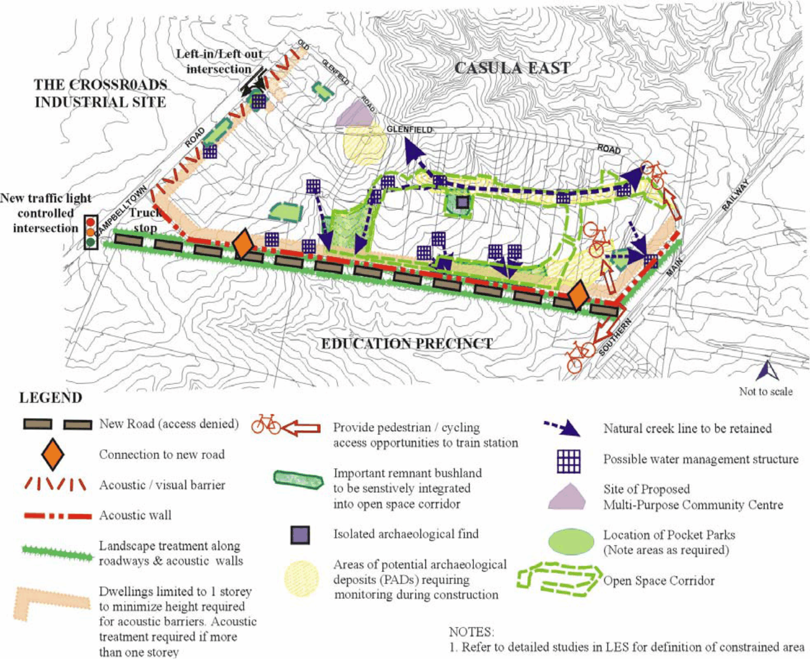
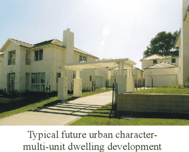

## Part 1 General Information

orientated approach to satisfy

predetermined objectives.

### 1.1 What is this plan

### called?

### 1.4 Where does the

### policy apply?

This Plan shall be known as the

“Campbelltown Development Control

Plan - Glenfield Road Area 2002”

(Glenfield Road Area DCP).

### 1.2 How is this plan

### made?

This Plan applies to that land within the

Campbelltown Local Government Area

(LGA) generally bound by

Campbelltown Road, Old Glenfield

Road, Glenfield Road, the Main South

Railway Line, as identified on Map 1.

1.2.1 This Plan is made by Council in

accordance with Section 72 of the

Environmental Planning & Assessment

Act, 1979, as amended (EP & Act) and

the associated Regulations.

### 1.5 What applications

### does the plan apply

### to?

#### 1.2.2 Notes are provided in italic text

within boxes throughout the Plan to

provide supplementary information and

explanation. These notes do not form

part of the DCP and may be altered by

Council as necessary without a formal

modification of the Plan, to update or

expand upon explanations.

This Plan provides criteria for the

assessment of all applications lodged

for the purposes of obtaining

development consent. The types of

development for which approval may be

sought will primarily relate to

subdivision, single dwelling houses and

multi-unit dwelling houses.

### 1.3 Why is the plan

### required?

### 1.6 What do the terms

### used in this plan

### mean?

For the purposes of this Plan, the

definitions outlined within the Dictionary

appended to the Plan as Schedule 1

have been adopted.

#### 1.3.1 This Plan is required to provide

detailed controls to supplement the

provisions of the Campbelltown Local

Environmental Plan 2002 (LEP 2002).

An objective of LEP 2002 specifically

recognises the role of DCPs to provide

detailed planning provisions to

supplement the broader planning

framework of the LEP.

#### 1.3.2 This Plan introduces

performance based criteria to ensure

that Council has the opportunity to

assess development with a merit

#### Glenfield Road Area 2002 DCP

Part 1 - General Information  Page 5

Date Dec 2002

### Map 1 – Areas Where the Policy Applies

> [Picture on page 8: a picture, saved as a picture (images/vol-2-part-02-glenfield-site-dcp-page-8-2.gif, 150 dpi).]

### Glenfield Road Area 2002 DCP

### Date Dec 2002

### 1.7 How does this plan

### relate to other plans

### and legislation?

1.7.1 This Plan should be read in

conjunction with the Campbelltown LEP

2002, the Environmental Planning and

Assessment Act, 1979 and associated

Regulations and applicable Regional

Environmental Plans and State

Environmental Planning Policies.

1.7.2 Reference should also be made to

other development control plans adopted by

Council. This Plan supersedes other DCPs

where inconsistencies arise.

#### 1.7.3 Approvals may also be required

from other government agencies. In some

cases, (refer to Schedule 2) the

development application must be made for

integrated development approval.

### 1.8 What are the

Objectives of the

### DCP?

The aim of this Plan is to provide detailed

planning guidelines and standards to ensure

the orderly, efficient and environmentally

acceptable development of a new urban

release area in a manner, which achieves

the following objectives:

a) To identify the criteria and process for

assessing applications and to outline the

responsibilities of both Council and

applicant.

b) To specify the minimum standard of

information to be submitted with a

development application.

c) To comprehensively outline all criteria

which will be relevant to the assessment

of development proposals, including

urban character, subdivision design,

building form, open space and

landscaping, transport, traffic and

access, car parking, ecologically

sustainable development, geotechnical

constraints, site contamination, noise,

water management and pollution

control.

Date Dec 2002

d) To specify criteria to ensure that such

development is consistent with the

planned character of the area.

e) To identify key principles associated

with the development of the area,

inclusive of land required for open

space/drainage management purposes

and major road connections.

f) To specify a requirement for Council to

approve a Masterplan for the study area

which details the manner in which

subdivision will proceed, prior to the

issuing of any development approvals.

### 1.9 How is the Plan to be

### applied to achieve its

### Objectives?

#### 1.9.1 The design elements within Part B

of this plan have three components:

• A set of objectives;

• Performance criteria; and

• Development Requirements. The "objectives" specified for each design

element represent the outcomes that

Council wishes to achieve.

The "performance criteria" represent a

means of assessing whether the desired

outcomes will be achieved. Council will

consider how well each of these criteria

(where relevant) has been addressed by the

applicant or designer when determining an

application under this Plan.

The "development requirements" are

possible ways of achieving the outcomes.

While these solutions may satisfy the

performance criteria, other solutions could

also be adopted.

#### 1.9.2 It is essential that all development

satisfies the performance criteria to meet the

objectives of those criteria, and in some

cases compliance with the development

standard may not be sufficient. The aim is to

suit the approach to the site while satisfying

market requirements and enable proponents

to develop a variety of design responses.

#### Glenfield Road Area 2002 DCP

Part 1 - General Information  Page 7

### 1.10 When did this plan

### come into force?

This plan came into force on 28 February

2003.

#### Glenfield Road Area 2002 DCP

Part 1 - General Information  Page 8

Date Dec 2002

### Development Control Plan Map

> [Picture on page 11: a picture, saved as a picture (images/vol-2-part-02-glenfield-site-dcp-page-11-2.gif, 150 dpi).]

### Glenfield Road Area 2002 DCP

### Date Dec 2002

### 1.10 What is a Site

### Analysis?

A site analysis is the process of

examining and recording the

opportunities and constraints to the

potential development of the site,

including consideration of how such

development may best and achieve

compatibility with the existing and likely

future urban character of the locality. A

thorough site analysis should form the

basis for the design of any development

proposal, to ensure that the best

possible design for a site is achieved. In some situations, a design for a

proposal may not be able to fully or

ultimately satisfy all the performance

criteria established in this Plan. It is

important for Council, developers and

designers to use the site analysis as the

basis for determining which objectives

and performance criteria are more

important. In these cases, consideration

to a trade-off between the critical criteria

of the Plan can be based on the

conclusions of the site analysis. Each application will need to

demonstrate that a site analysis has

been undertaken. The preferred means

to demonstrate that a site analysis has

been undertaken is to provide an

annotated diagram and, if appropriate,

commentary within an accompanying

Statement of Environmental Effects. An investigation of the site should

identify:

• Site dimensions:

• Topography: spot levels and/or

contours; north point; natural

drainage; and any contaminated

soils or filled areas.

• Services:  easements/connections

for drainage and utility services.

Date Dec 2002

• Existing vegetation: location; height;

spread of established trees; and

species.

• Micro climates: orientation; and

prevailing winds.

• Location of buildings and other

structures; heritage and

archaeological features; fences;

property boundaries; and pedestrian

and vehicle access.

• Views to and from the site.

• Overshadowing by neighbouring

structures.

Features of the surrounding locality that

should be considered within a site

analysis include:

• Neighbouring buildings:  location;

height; and use.

• Privacy:  adjoining private open

spaces; living room windows

overlooking site (particularly those

within 9m of the site); and location of

any facing doors and/or windows.

• Walls built to the site’s boundary:

location, height and materials.

• Difference in levels between the site

and adjacent properties at their

boundaries.

• Views and solar access enjoyed by

neighbouring properties.

• Major trees on adjacent properties,

particularly those within 9m of the

subject site.

• Street-frontage features:  poles;

trees; kerb crossovers; bus stops;

and other services.

• The built form and character of

adjacent development including:

architectural character; front fencing;

and garden styles.

• Heritage features of surrounding

locality and landscape.

#### Glenfield Road Area 2002 DCP

Part 1 - General Information  Page 10

• Direction and distance to local

facilities:  local shops; schools;

public transport; and recreation and

community facilities.

• Public open space:  location; and

use.

• Adjoining bushland or

environmentally sensitive land.

• Sources of nuisance:  noisy roads or

significant noise sources; and

polluting operations.

### 1.11 What is required to

### lodge a Development

### Application?

Applicants are encouraged to use the

services of architects, town planners,

engineers, landscape architects,

professional designers and other

specialists as required to undertake the

site analysis, design of development

and to prepare the supporting

documentation. Consultation with

neighbours and Council officers before

completing the proposal is highly

recommended.

The amount of information required for a

development or building application will

vary depending on location, scale and

complexity of the proposal. The following information must be

submitted as part of an application:

• a completed application form,

signed by the owner of the land or

accompanied by the written authority

of the owner to lodge the application

(including where appropriate the

company seal or seal of the body

corporate).

• application fees as advised by

Council.

Date Dec 2002

• A survey or site plan at a scale of

1:200 showing:

- site dimensions;

- changes of levels on the site;

- the position of buildings on the

site and adjoining sites and the

ridge-lines and eaves levels of

those buildings; (All levels

should be to AHD)

- existing vegetation, showing

canopy spread of trees and

ground levels at the base of the

trunk;

- spot levels of street frontage

including road gutter; and

- easements for drainage and

services affecting or benefiting

the subject property.

• a site analysis as outlined in

Section 1.11, including a statement

of how the proposed development

has addressed the site opportunities

and constraints identified.

• architectural plans (3 copies) at a

minimum scale of 1:200 showing:

- dimensions and reduced levels

of all floors and ridge-lines;

- detailed floor plans; and

- all elevations and relevant

sections.

• notification plans (A4 size)

showing the location, height and

external configuration of the

proposed development.

• a statement of environmental

effects (for all development

applications) which:

- explains how the proposal has

addressed the relevant

considerations contained in

section 79C of the

Environmental Planning and

#### Glenfield Road Area 2002 DCP

Part 1 - General Information  Page 11

Assessment Act 1979, and in

particular this Plan;

- explains how the project design

has responded to the information

contained in the site analysis;

and

- demonstrates that the intent of

the criteria has been satisfied.

• a landscape plan showing:

- proposed site contours and

reduced levels at embankments,

retaining walls and other critical

locations

- existing vegetation and the

proposed planting and

landscaping (including proposed

species)

- general arrangement of hard

landscaping elements on and

adjoining the site

- proposed lighting arrangements

- proposed maintenance and

irrigation systems.

• A stormwater management plan

specifying the proposed method of

draining the site and provision of on-

site stormwater detention. Location,

diameter, invert levels and

specification of all proposed piping

with supporting calculations are to

be included.

Other information may also be required,

including:

• shadow diagrams showing the

effect of 9am, 12 noon and 3pm

shadows during mid-winter.

• a species impact statement where

a threatened species, population or

community is identified in

accordance with the Threatened

Species Conservation Act.

Date Dec 2002

• a SEPP 1 Objection signed by the

applicant outlining why compliance

with a particular development

standard (contained in

Campbelltown (Urban Area) LEP

2002 or other applicable

environmental planning instrument)

is unreasonable or unnecessary.

Note: Refer to State Environmental

Planning Policy No. 1 – Development

Requirements

• soil and water management and

sediment control plan, for all

subdivisions requiring site works and

residential development sites with

gradients exceeding 15% or over

2000m2 in area.

• an environmental site assessment

(site contamination report), where it

is known or suspected that the site is

subject to site contaminants. Note: Reference should also be made

to State Environmental Planning Policy

No. 55 – Remediation of Land For further information, refer to Council’s

application form or enquire with

Council’s Planning and Environment

Division.

• a Salinity Hazard Assessment

assessing the Salinity Hazard

Potential and recommending how to

address  any on site salinity hazards.

• a Bushfire Hazard Assessment

where land is within 100 metres of

bushland  in accordance with

Planning for Bushfire Protection, as

produced by the NSW Rural Fire

Service  and which recommends

how to manage the risks.

#### Glenfield Road Area 2002 DCP

Part 1 - General Information  Page 12

• an Acoustic Assessment where

land is adjacent to an arterial road

and recommending measures

necessary to meet requirements of

the Environmental Protection

Authority for residential

development.

#### Glenfield Road Area 2002 DCP

Part 1 - General Information  Page 13

Date Dec 2002

### Criteria for Development

### 2.1 Masterplan

#### OBJECTIVES

a. To ensure that the area to which this plan applies is planned in a comprehensive

and integrated manner.

b. To provide details in regard to the urban form and design of the new residential

area in the form of a Masterplan, including the location of public open space,

roads, lot configurations, pedestrian access connections, drainage systems,

preservation of significant vegetation and the provision of community facilities

and services and public utilities.

c. To provide safe, convenient and effective new neighbourhoods that meet the

diverse and changing needs of the community.

#### Performance Criteria

#### Development Requirements

P1.1 Development must proceed in

accordance with a comprehensive

masterplan.

D1.1 Development must conform

to an adopted Masterplan.  No

development application will be

approved until a Masterplan has

been adopted in accordance with

the provisions of this Plan.

P1.2 The urban form and layout of the

new residential area is to create a

distinct and positive identity, by

responding to site characteristics, the

natural setting, landmarks and views

and through clearly readable street and

open space networks.

P1.3 While allowing for the creation of

its own identity, the new residential

area is to retain important linkages with

surrounding established areas, and is

not to result in any amenity impacts

upon these areas.

D1.2 A Masterplan is a document

adopted by a resolution of Council,

consisting of written information,

maps and diagrams that make more

detailed provisions relating to

development of the land.  A

Masterplan must be generally

consistent with this plan.

P1.4 Vehicle, cyclist and pedestrian

networks, land use mix and residential

density should minimise fossil fuel use

by reducing local vehicle trips, travel

D1.3 A draft Masterplan may be

prepared by or on behalf of the

owner or lessee of the land

concerned, or by Council.

#### Glenfield Road Area 2002 DCP

Part 2 –Criteria for Development Page 14

Date Dec 2002

#### Performance Criteria

distances and speeds, maximise public

transport effectiveness, and encourage

walking and cycling to daily activities.

P1.5 The site layout should retain

significant vegetation and habitat

areas, incorporate natural features,

minimises soil erosion and avoid

development on flood prone land.

Date Dec 2002

#### Development Requirements

D1.4 A draft Masterplan should be

prepared following consultation with

Council and is to illustrate and

explain, where appropriate,

proposals for the following:

• Phasing of development;

• Distribution of land uses;

• Pedestrian and cycle circulation

networks;

• Roads;

• Parking provision;

• Subdivision pattern;

• Infrastructure provision;

• Treatment proposed for road

corridors;

• A concept landscape plan;

• Decontamination of the site;

• Provision of public facilities;

• Provision of open space, its

function and landscaping;

• Any other matters stipulated by

the Council.

D1.5 The Masterplan must

incorporate a stormwater

management plan, which addresses

those issues identified in the local

environmental study, which

preceded the zoning of the land.

D1.6 Before the Council adopts a

Masterplan:

• The draft Masterplan must be

advertised, and exhibited for not

less than 21 days for public

comment;

• The Council must take into

account any written submissions

made about the content of the

plan during the exhibition period.

D1.7 A Masterplan may be

replaced or amended by the

preparation of a subsequent or

amending Masterplan, which

complies with the above

#### Glenfield Road Area 2002 DCP

Part 2 –Criteria for Development Page 15

#### Performance Criteria

#### Development Requirements

consultation and determination

process.

#### Glenfield Road Area 2002 DCP

Part 2 –Criteria for Development Page 16

Date Dec 2002

### Streetscape and Urban Character

### 2.2

#### OBJECTIVES

To ensure that all new development is compatible with the intended future

a.

character of the estate.

To ensure that new development is sensitive to the landscape setting and

b.

environmental conditions of the locality.

To ensure that the appearance of new development is of a high visual quality

c.

enhances the streetscape and compliments good quality surrounding

development.

#### Performance Criteria

Date Dec 2002

#### Development Requirements

#### Glenfield Road Area 2002 DCP

Part 2 –Criteria for Development Page 17

#### Performance Criteria Urban Character

P1. Development should be consistent

with the desired urban character for the

estate. Elements which describe the desired

urban character are as depicted by the

Masterplan and described as follows:

• To create a high quality masterplanned

residential estate.

• The creation of a legible, attractive and

inviting entry statement at the main

entries to the estate.

• To create a variety of housing choice,

inclusive of both standard detached

housing and multi-unit dwellings.

• Achievement of a net residential density

of 15 dwellings per hectare (exclusive of

open space and community facilities

land), so as to maximise the viability of

public transport.

• To ensure vehicular access is simple,

safe and direct and creates a pleasant

environment.

• To provide maximum connectivity

through the estate for pedestrians, with a

central pedestrian/cycle network, which

takes advantage of the attractiveness of

the proposed open space corridor, to

encourage pedestrian/cycle movements

throughout the estate, connecting to

Glenfield Railway Station and shops.

• The provision of community facilities

within the estate, which provides a focal

point for, the incoming population, linked

by the pedestrian/cycle and open space

system.

Date Dec 2002

#### Development Requirements

D1.1 The development should be

consistent with the desired urban

character of the estate and the

Masterplan.

D1.2 Those major elements site

opportunities and constraints to be

taken into consideration in the

formulation of the masterplan and

subsequent development proposals

are depicted upon the Development

Control Plan Map.

> [Picture on page 20: a picture, saved as a picture (images/vol-2-part-02-glenfield-site-dcp-page-20-50.gif, 150 dpi).]

#### Glenfield Road Area 2002 DCP

Part 2 –Criteria for Development Page 18

#### Performance Criteria Streetscape

P2.1 Development should positively

contribute towards the creation and

enhancement of the visual character of the

street with particular reference to

#### Development Requirements

D2.1 New buildings shall adhere

to a minimum front building line of

4.5 metres. A setback of 5.5 metres

applies to the face of garage doors

architectural themes, landscape themes and

fencing styles.
