#### P3. Front Fences

Front fences and walls should maintain the

or carports.

D2.2 Subdivision proposals shall

provide for street tree planting

consistent with the Masterplan.

D2.3 Landscaping shall be

provided with all developments,

which is consistent with the

Masterplan and incorporate existing

trees where possible.

D3.1 Front fences (or absence

streetscape character and be consistent with thereof) should be consistently

the established style and pattern of fences in

the locality.

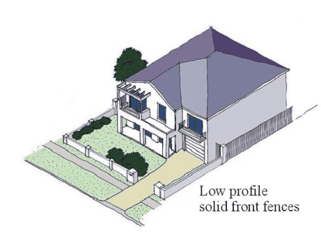

> [Picture on page 21: a picture, saved as a picture (images/vol-2-part-02-glenfield-site-dcp-page-21-29.gif, 150 dpi).]

provided in accordance with a

theme specified by the Masterplan.

D3.2 Visually impenetrable solid

forms of front fences (such as

masonry or timber fences) should

not exceed a height of 0.9 m.

D3.3 Visually penetrable front

fences (such as pre-painted metal

grill or timber picket fences) should

not exceed a height of 1.2 metres.

D3.4 Front fences of a height

exceeding 1.2 metres in height are

permitted only where required to

satisfy acoustic abatement criteria

and should be provided with a

landscaped area of not less than

600mm wide on the street side of

the fence and should not exceed 10

metre in length without some

articulation or detailing to provide

visual interest.

#### Glenfield Road Area 2002 DCP

Part 2 –Criteria for Development Page 19

Date Dec 2002

### 2.3 Subdivision Design

#### OBJECTIVES

a. To encourage a variety of lot sizes to promote housing choice.

b. To develop a subdivision and lot size pattern that will reinforce the desired future

character of the estate.

c. The ensure the future allotments are of a size and configuration to

accommodated future intended housing, in recognition of any constraints that

may exist on the land.

d. To provide usable allotments which maximise energy efficiency and mitigate

environmental impacts.

e. To design roads which balance the functions of traffic movement and pedestrian

and residential amenity.

#### Performance Criteria

#### Development Requirements

#### Glenfield Road Area 2002 DCP

Part 2 –Criteria for Development Page 20

Date Dec 2002

#### Performance Criteria P1 Minimum Allotment Sizes

Lot size and dimensions should be

capable of accommodating a dwelling

or a multi-unit housing development

where consistent with the Masterplan,

in a manner which complies with all

other requirements of this DCP,

inclusive of the provision of adequate

landscaped area, private open space

and car accommodation.

Date Dec 2002

#### Development Requirements

D1.1 The minimum lot size for each

dwelling type shall be as follows:

| Housing Type | Minimu m Lot Size | Site Width at the Building Line |
|---|---|---|
| Single Detached Dwelling | 450m2 | 15m |
| Zero lot line or semi-detached dwelling | 350m2 | 7.5m |
| Terraces | 240m2 1 | 7.5m |
| Multi-unit housing developments | 1500m2 | 25m |

1 The development of terrace houses is only

permitted in a minimum group of 6 dwellings

(which may include other dwelling forms). A

combined minimum development site of 1500m 2 is

therefore required for terrace developments

D1.2 Lots to be created for single

detached dwellings should be able

to accommodate a building

envelope of 200m2 with a minimum

dimension of 10 metres.

D1.3 Subdivision proposals for zero

lot line, semi-detached and terrace

housing must be accompanied by

development plans for the proposed

housing, to be approved by Council

in conjunction with the subdivision.

#### Glenfield Road Area 2002 DCP

Part 2 –Criteria for Development Page 21

#### Performance Criteria P2 Rear accessways

Rear accessways may be provided as

part of a subdivision, but shall not be

dedicated as a public road.

Date Dec 2002

#### Development Requirements

D2.1 All rear accessways shall not

be dedicated as public roads but

rather shall be a common lot in a

community title subdivision

incorporating those lots to which are

provided rear access.

#### Glenfield Road Area 2002 DCP

Part 2 –Criteria for Development Page 22

### 2.4 Building Form

#### OBJECTIVES

To ensure that the bulk, scale and height of proposed development provides

a.

reasonable neighbour amenity and maintains an appropriate residential character.

To ensure that adequate sunlight access and ventilation for living areas and private

b.

open spaces of new and neighbouring dwellings is provided for.

#### Performance Criteria Building Size and Setbacks

P1.1 The form of proposed buildings,

which is controlled by setbacks, height,

the extent of cut and fill and achievable

floorspace should be consistent with

the intended character of the locality

within which it is located.

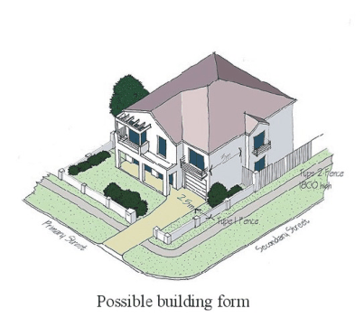

> [Picture on page 25: a picture, saved as a picture (images/vol-2-part-02-glenfield-site-dcp-page-25-17.gif, 150 dpi).]

Date Dec 2002

#### Development Requirements

D1.1 The maximum height of

buildings should not exceed 2

storeys in height. A third storey, in

the form of attic rooms, may be

provided in terrace housing or

required for architectural articulation

of buildings (eg. in a street corner

situation).

D1.2 The maximum floorspace ratio

(FSR) of buildings shall not exceed

the following:

| Location Maximum FSR for sites less than 1,500m2 | Maximum FSR for sites equal to or greater than 1,500m2 |
|---|---|
| 0.5:1 | 0.6:1 |

#### Glenfield Road Area 2002 DCP

Part 2 –Criteria for Development Page 23

#### Performance Criteria

#### Building Design

P2. The building design, detailing and

finish should provide an appropriate

scale to the street; add visual interest

when viewed from public streets.

Date Dec 2002

#### Development Requirements

D1.3 Setbacks from side and rear

boundaries to be as follows: -

D1.4 Walls with windows or other

openings are to have a minimum

setback of 1.0m.  Variations will be

considered on their merits.

D1.5 Walls built to site boundaries

to have a maximum wall height of

3.5 metres and a maximum wall

length of 40% of the abutting

property boundary (unless matching

an existing or simultaneously

constructed wall, eg. semi detached

house or terrace building). Where

dwellings proposed in a minimum

group of 6, the 2 storey dwellings

may be constructed with a nil

setback to the boundary for a

maximum length of 10 metres for

the 2 storey section.  Variations will

be considered on their merits.

D1.6 A minimum side setback of

1.5m applies to corner lots.

D2.1 The frontage of buildings and

their entries should address the

street, including Old Glenfield Road

and Glenfield Road.  Vehicular

access to lots having frontage to Old

Glenfield Road and Glenfield Road

shall be from adjoining streets in

accordance with the Masterplan.

D2.2 A maximum unarticulated

length of a wall facing a public street

to be 6.5 metres.

Note: Punctuation by bay windows,

verandahs, balconies or wall offsets

may be considered to be adequate

articulation.

#### Glenfield Road Area 2002 DCP

Part 2 –Criteria for Development Page 24

### 2.5 Open Space and Landscaping

#### OBJECTIVES

a. To provide sufficient and accessible open space for the reasonable recreation

needs of the likely residents of the proposed dwelling.

b. To provide private outdoor living areas that relate well to the living areas of

dwellings.

c. To enhance the appearance, amenity, energy and water efficiency of

developments through integrated landscape design.

#### Performance Criteria

#### Development Requirements

#### Private Outdoor Living Areas

P1.1 Each dwelling to have access to

some usable and private external area.

D1.1 All dwellings shall be provided

with some form of outdoor living

area such as either private open

space, balconies or roof terraces.

P2.1 Private outdoor living areas are

clearly defined and screened for private

use.

D2.1 Private outdoor living areas

located at ground level should be:

• Bound by buildings, fencing or

dense landscaping which will

restrict views to a height of 1.8m

• a minimum area of 20% of the

site area of each allotment with

a minimum dimension of 2.5m

• one area with a minimum

dimension of 4m x 4m

• directly accessible from a living

area of the dwelling

• a maximum gradient of 1 in 10

P2.2 Private outdoor living areas are

D2.2 Private open space and

balconies shall take advantage of

mid and long distance views where

privacy impacts will not arise.

D2.3 Fencing of private open

space, where abutting public open

space, shall be provide for some

cross viewing.

located to:

• take advantage of available

outlooks or views and natural

features of the site

• reduce adverse impacts of adjacent

buildings on privacy and

overshadowing

• resolve surveillance, privacy and

security issues when private open

space abuts public space.

#### Glenfield Road Area 2002 DCP

Part 2 –Criteria for Development Page 25

Date Dec 2002

#### Performance Criteria

•

P3. Orientation of the private outdoor

living areas should achieve comfortable

year round use.

#### Landscaping

P4. The landscape design specifies

landscape themes, vegetation (location

and species), paving and lighting that

provide a safe, attractive and functional

environment for residents, integrates

the development with the

neighbourhood and contributes to

energy efficiency and water

management.

P5. Major existing trees are

retained in viable condition wherever

practicable through appropriate siting

of buildings, accessways and parking

areas and appropriate landscape

treatment.

Date Dec 2002

#### Development Requirements

D3.1 Compliance with the

provisions of Section 2.5 of this

Plan.

D4.1 The submission of a

landscape plan.

D4.2 A minimum of 20% of

landscaped area in residential

zoned areas should consist of deep

rooted tree plantings.

D4.3 The proposed landscaping to

comply with the minimum

specification requirements outlined

as Schedule C.

P5.1 No building structures or

disturbance to existing ground levels

are proposed within the drip line of

existing significant trees to be

retained as recommended in a

report submitted by a qualified

horticulturist.

Note: Council has an existing Tree

Preservation Order and approval

should be sought for any lopping,

major pruning or removal of existing

trees.

#### Glenfield Road Area 2002 DCP

Part 2 –Criteria for Development Page 26

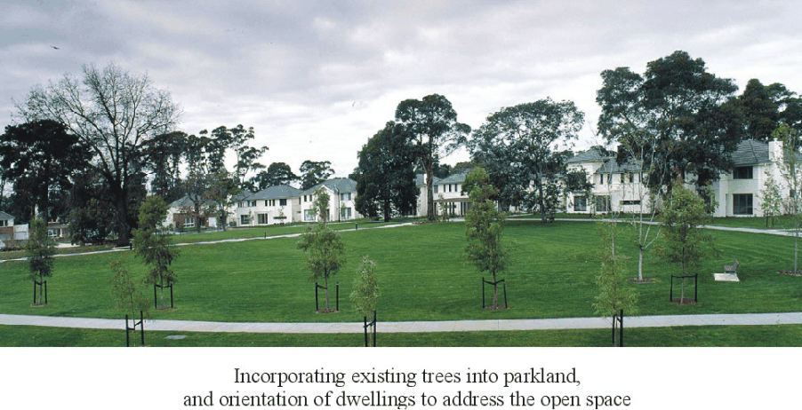

> [Picture on page 29: a picture, saved as a picture (images/vol-2-part-02-glenfield-site-dcp-page-29-1.gif, 150 dpi).]

#### Glenfield Road Area 2002 DCP

Part 2 –Criteria for Development Page 27

Date Dec 2002

### Ecologically Sustainable Development

### 2.6

#### OBJECTIVES

To reduce the demand for waste disposal by maximising the reuse and recycling of

a.

building/ construction materials.

To promote development which maximises the opportunities for energy efficient

b.

uses of resources, particularly in regard to solar power and water management.

To encourage the protection and conservation of native animals and plants,

c.

including threatened species, populations and ecological communities and their

habitat.

To ensure that redevelopment of contaminated or potentially contaminated land

d.

does not pose a risk to public health or the environment, is suitably assessed to

determine the extent of contamination, and is remediated to render the site

suitable for the proposed use.

#### Performance Criteria Waste Management

P1. Provide procedures to facilitate

waste minimisation and materials

recycling as part of the demolition and

construction process.

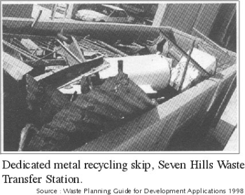

> [Picture on page 30: a picture, saved as a picture (images/vol-2-part-02-glenfield-site-dcp-page-30-25.gif, 150 dpi).]

Date Dec 2002

#### Development Requirements

D1.1 Identify and nominate

opportunities to reuse materials

from the demolition and excavation

phase for the proposed new use as

well as potential waste materials

(such as recyclable packaging, off

cuts and other excess materials as

part of the construction process.

Note: A list of premises which take

recyclable material can be accessed

through the Waste Board’s internet

web site in

www.wasteboard@nsw.gov.au

#### Glenfield Road Area 2002 DCP

Part 2 –Criteria for Development Page 28

#### Performance Criteria

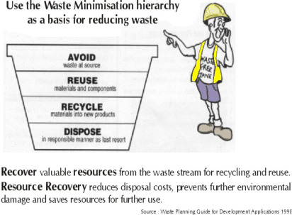

> [Picture on page 31: a picture, saved as a picture (images/vol-2-part-02-glenfield-site-dcp-page-31-2.gif, 150 dpi).]

#### Development Requirements

D1.2 Provision of designated areas

on the site sufficient for colour

coded or labelled storage bins,

containers or stockpiles for

separated and any left-over waste

from the construction process in

locations with convenient vehicular

access for removal by the waste

contractor.

#### Glenfield Road Area 2002 DCP

Part 2 –Criteria for Development Page 29

Date Dec 2002

#### Performance Criteria

#### Development Requirements

#### Energy Efficiency

P2 Design developments so as to

facilitate the use of renewable energy

sources wherever possible.

D2.1 Provide for solar water

heaters where hot water supply is

necessary. Where possible, solar

water heaters should be installed to

face directly north for maximum

efficiency. Alternatively, place solar

panels facing east to west (which

still achieves 88% of the efficiency

of a north-facing panel).  If solar

water heaters are not installed the

design of new buildings must ensure

there is the ability to install a

suitable system at a later date.

D2.2 Solar hot water panels should

be mounted at a 30o angle from the

horizontal.

D2.3 All solar water heaters need

to comply with the relevant

Australian Standards for their

installation (refer to AS 3500.4 –

1990 National Plumbing and

Drainage Code, Part 4, Hot Water

Supply Systems) and for their

design and manufacture (refer to

AS 2712 – 1993 Solar Water

Heaters, Design and Construction).

D2.4 Solar collectors on proposed

buildings or existing buildings on

adjoining properties, or a minimum

3m2 of north facing roof (in the event

that there are no existing solar

collectors on proposed or

neighbouring buildings) should have

unimpeded solar access between

the hours of 9 am and 3 pm on June

21.

#### Glenfield Road Area 2002 DCP

Part 2 –Criteria for Development Page 30

Date Dec 2002

#### Performance Criteria

P3 Subdivisions to facilitate

maximum solar access to future

residential development.

P4 Residential buildings and

private or communal open space

should be designed to control summer

sun and allow the penetration of winter

sun to ensure reasonable access to

sunlight or daylight for living spaces

within buildings and open space

around buildings.

Date Dec 2002

#### Development Requirements

D3.1 Orient the majority of streets

within 200 west of north and 300 east

of north.

D3.2 Maximise streets with

predominantly north-south

orientation or lots with

predominantly east-west orientation

to maximise solar access to lots and

facilitate installation of solar

collectors.

D4.1 At least one internal living

area and a minimum of 50% of the

principal area of ground level private

open space (ie. that part which

complies with D2.1 of Section 2.5)

to have access to a minimum of 2

hours of direct sunlight between the

hours of 9 am and 3 pm on June 21.

|  | D4.2 Where existing overshadowing is greater than what is required in D4.1 then the proposed development shall not cause a further reduction in solar |
|---|---|
|  | access. |
|  | D4.3 The western walls of a residence should be suitably screened (with pergolas, other shading devices or vegetation) or alternatively, the number of window openings should be minimised. |
| P5. Provide insulation so as to minimise the need for artificial heating and cooling to provide adequate comfort level for occupants. | D5.1 Insulation for all dwellings to achieve a recommended ”R” value for external walls of R1.0 and for roofs and R1.5 ceilings. In this regard, compliance with AS 2627- 1993 Thermal Insulation of Dwellings Part 1 is recommended. Note: The effectiveness of insulation to resist heat flow through its fibres, particles, etc. is known as its “R” value. |

#### Glenfield Road Area 2002 DCP

Part 2 –Criteria for Development Page 31

#### Performance Criteria

P6. New buildings should incorporate

sufficient thermal massing (heat bank

storage) to reduce the need for

additional heating.

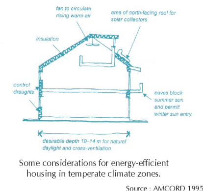

> [Picture on page 34: a picture, saved as a picture (images/vol-2-part-02-glenfield-site-dcp-page-34-6.gif, 150 dpi).]

P7 New buildings should provide for

the use of water efficient fixtures to

reduce the demand for (mains) water

and wastewater discharge.

P8 Development should be

designed to maximise the utilisation of

natural winds for air conditioning

purposes to reduce the need for

electrical air conditioning systems. Note: This is where cool air enters

a building from one side and exits

via another. This movement of air

will allow warmer inside air to be

replaced with cooler outside air.

Date Dec 2002

#### Development Requirements

D6.1 Detail consideration in the

design of buildings to be provided in

regard to the position and level of

glazing on the external walls to

assist the use of thermal massing.

Generally, a relatively large

proportion of glazing is required on

the northern side of buildings to

enable the heavy weight of

materials of the building to directly

absorb heat from the winter sun.

D6.2 Glazing should be positioned

to allow the lower angle of the winter

sun to penetrate the internal areas

of buildings while excluding a

greater proportion of the higher

angled summer sun.

D6.3 Maximise the thermal mass of

walls and floors by utilising materials

such as bricks, stone etc. for walls

and a concrete slab on ground floor

for flooring.

D7.1 New development to provide

a minimum of 2 water efficient

fixtures per residential dwelling.

D8.1 Developments should seek to

utilise or be sheltered from

prevailing winds, as appropriate, (in

Campbelltown during the summer

season, use can be made of the

cooling prevailing afternoon winds

which come from an east/north-east

direction).

D9.1 Early consideration of window

placement can permit cross

ventilation.

#### Glenfield Road Area 2002 DCP

Part 2 –Criteria for Development Page 32

#### Performance Criteria

P9 The design and management of

landscaping should reduce the

consumption of mains water that would

otherwise normally be required.

#### Flora and Fauna Conservation

P10 Development should not affect

threatened species, populations or

ecological communities and their

habitats in any way, including:

• their removal or destruction;

• an alteration to drainage patterns,

water quality, solar access or

potential for weed invasion in a

manner, which would critically

affect their long-term survival. Note: Reference should be made to the

provisions of the Environmental Planning

& Assessment Act, 1979 and the

Threatened Species Conservation Act in

regard to the requirements for the

protection of rare, threatened or

d d i

#### Site Contamination

P11 All land that is known or is

subject to potential contaminants is to

Date Dec 2002

#### Development Requirements

D9.1 Landscape design should:

• Choose species of plants which

are suited to the soil type and

aspect of the area, thereby

reducing the need for

supplementary watering;

• Provide a minimum cover of

75mm to 100mm of mulch on

garden areas;

• Minimise the area of lawn and

substitute with ground cover or

native grasses.

D10.1 The proposed development

should not affect the endangered

ecological community known as

Cumberland Plain Woodland, the

area of which is delineated upon the

DCP Map.

D10.2 A plan of management to be

adopted by Council for the

Woodland area and riparian

corridors to be conserved prior to

development works proceeding.

D10.3 Where there is potential for

scheduled species to be threatened

by a proposed development, an 8-

part test shall be undertaken to

confirm the existence or otherwise

of threatened species.

D10.4 Where confirmed by 8-part

test, or where the existence of

threatened species is known, a

Threatened Species Impact

Statement shall be provided with the

Development Application, and the

design of the development shall

take into consideration the findings

of that statement.

D11.1 A detailed contamination

assessment be completed and

#### Glenfield Road Area 2002 DCP

Part 2 –Criteria for Development Page 33

#### Performance Criteria

be remediated prior to occupation in a

manner, which will reduce the risk of

harm to human health or any aspect of

the environment to accepted EPA

standards.

Date Dec 2002

#### Development Requirements

submitted with any development

applications, focusing on the areas

categorised as medium or high risk

within the report prepared by

Sinclair Knight Merz (Ref EN01176,

November 2001) prepared as part of

the LES.

#### Glenfield Road Area 2002 DCP

Part 2 –Criteria for Development Page 34

#### Performance Criteria

#### Bushfire Risk

P12 Development on land that is

subject to bushfire risk shall be

designed so that the development is

not subject to risk from bushfire.

#### Salinity

P13 All land that is known or is subject

to potential salinity shall be remediated

to minimise the impact of salinity.

Date Dec 2002

#### Development Requirements

D11.2 A detailed Stage 2

contamination investigation to be

undertaken in areas identified as

likely to be contaminated. This will

require an intrusive investigation

involving soil sampling and analysis,

focussing on the results from the

previous studies, to assess the

nature and extent of any

contamination on the site in

accordance with ANZECC, NHMRC

and NSW EPA Guidelines.

D11.3 In the event of contamination

being found at the site, a remedial

action plan (RAP) is to be prepared

and submitted to Council for

approval prior to the issue of

development approvals.  The RAP

must identify options for treatment

or disposal of contamination on, or

off-site.

D12 Where land is subject to

bushfire risk the development shall

be constructed to satisfy the

requirements of Planning for

Bushfire Protection, as produced by

the NSW Rural Fire Service.

D13 In the event of salinity being

found at the site, a remedial action

plan (RAP) is to be prepared and

submitted to Council for approval

prior to the issue of development

approvals.  The RAP must identify

options for treatment of salinity.

#### Glenfield Road Area 2002 DCP

Part 2 –Criteria for Development Page 35

### 2.7 Aboriginal Heritage

#### OBJECTIVES

To conserve sites or relics of significance to Aboriginal Heritage.

a.

#### Performance Criteria

P1.1 No development or associated

site works are to result in the

disturbance of any known artifact or

area of potential aboriginal archaeology

deposit (PAD) without the prior

approval of the NPWS and Local

Aboriginal representatives.

Date Dec 2002

#### Development Requirements

D1.1 The identified isolated artifact

shown on the DCP Map shall not be

subject to any disturbance, unless a

written permit to collect from the

Director of the NPWS is obtained. If

to be disturbed, arrangements shall

be made with the Cubbitch Barta

Native Title Claimants Aboriginal

Corporation to obtain custody of the

relic after collection.

D.1.2 During the initial phases of

development construction, affecting

areas of potential archeological

deposits (PADs), as depicted upon

the DCP Map, shall be monitored by

Local Aboriginal representatives, as

required. In this regard, the

requirements of the Tharawal Local

Aboriginal Land Council and

Cubbitch Barta Native Title

Claimants Aboriginal Corporation,

shall be confirmed and

communicated to Council.

Note: It is an offence under the terms of

the National Parks & Wildlife Act, 1974

(as amended) to damage, deface or

destroy an Aboriginal relic or place

without obtaining the written consent of

the Director, National Parks & Wildlife

Service NSW.

#### Glenfield Road Area 2002 DCP

Part 2 –Criteria for Development Page 36

### 2.8

### Water Management

#### OBJECTIVES

To provide drainage systems which adequately protect people and the natural and

a.

built environments at an acceptable level of risk and in a cost effective manner and

which contribute positively to the environmental enhancement of catchment areas

To ensure effective and adequate drainage is provided for new development sites.

b.

To ensure development is designed in consideration of potential flood hazards.

c.

d. To maximise conservation of water.

#### Performance Criteria

Date Dec 2002

#### Development Requirements

#### Glenfield Road Area 2002 DCP

Part 2 –Criteria for Development Page 37

#### Performance Criteria Floodplain Management

P1.1 The proposed development

should not result in any increased risk

to human life.

P1.2 Potential economic and social

costs, which may arise from damage to

property from flooding, should not be

greater than that which can reasonably

be managed by the property owner and

general community.

#### Stormwater Drainage

P2 Stormwater runoff generated by

new development should be managed

to protect any potential damage to

persons or property.

Date Dec 2002

#### Development Requirements

D1.1 Compliance with Council's

Flood Policy and the provisions of

the State Government 's "Floodplain

Development Manual" available

from the NSW Department of Land

and Water Conservation.

D2.1 All properties, subject to D3.1

shall be piped to the stormwater

system as depicted in the Water

Management Plan forming part of

the adopted Masterplan. Where

properties fall away from the street

and/or are unable to drain to a trunk

drainage system, an easement for

draining stormwater is required

through downstream properties.

D2.2 Where a drainage easement

is required, written agreement from

the downstream owner shall be

submitted with the development

application and the easement shall

be registered prior to issue of the

construction certificate.

#### Glenfield Road Area 2002 DCP

Part 2 –Criteria for Development Page 38

#### Performance Criteria

#### Development Requirements

#### Rainwater Tanks

P3. Maximum reuse of stormwater

should be achieved.

D3.1 A rainwater tank shall be

provided in conjunction with each

dwelling in accordance with the

following requirements:

• the tank shall have a minimum

capacity of 5,000 litres,

• the tank shall be used for toilet

flushing and other non potable

domestic water uses such as

gardens etc,

• the tank must be designed to

capture and store roof water

from gutters or downpipes on a

building and not from another

source other than a water supply

service pipe,

• the tank must be fitted with a

first-flush device, being a device

that causes the initial run-off of

any rain to bypass the tank to

reduce pollutants entering the

tank,

• the tank must be provided with a

backflow prevention device

where it is also connected to a

water supply service pipe,

• the tank must be structurally

sound,

• the tank must be prefabricated,

or be constructed from

prefabricated elements that were

designed and manufactured for

the purpose of the construction

of a rainwater tank,

• the tank must be assembled and

installed in accordance with the

instructions of the manufacturer

or designer of the tank,

• the tank, and any stand for the

tank, must be installed and

maintained in accordance with

any requirements of Sydney

Water,

#### Glenfield Road Area 2002 DCP

Part 2 –Criteria for Development Page 39

Date Dec 2002

#### Glenfield Road Area 2002 DCP

Part 2 –Criteria for Development Page 40

Date Dec 2002

| Performance Criteria | Development Requirements |  |
|---|---|---|
|  | • | the installation of the tank must not involve the excavation of more than 1 m from the existing ground level, or the filling of more than 1 m above the existing ground level, |
|  | • | the tank must not be installed |
|  | • | over or immediately adjacent to a water main or a sewer main or over any structure or fittings used by Sydney Water unless it is installed in accordance with any requirements of Sydney Water, no part of the tank or any stand for the tank may rest on a footing of any building or other structure, including a retaining wall, |
|  | • | the tank must be located behind the front alignment to the street of the building to which the tank is connected (or, in the case of a building on a corner block, the tank must be located behind both the street front and street side alignments of the building), |
|  | • | the tank must not exceed 2.4 m in height above ground level, including any stand for the tank, |
|  | • | the tank must be located at least |
|  | • | 450 mm from any property boundary, a sign must be affixed to the |
|  | • | tank clearly stating that the water in the tank is rainwater, any overflow from the tank must be directed into an existing stormwater system, |
|  | • | the tank must be enclosed, and any inlet to the tank must be screened or filtered, to prevent the entry of foreign matter or creatures, |
|  | • | the tank must be maintained at all times so as not to cause a |

#### Glenfield Road Area 2002 DCP

Part 2 –Criteria for Development Page 41

Date Dec 2002

nuisance with respect to

mosquito breeding or overland

flow of water,

#### Glenfield Road Area 2002 DCP

Part 2 –Criteria for Development Page 42

Date Dec 2002

#### Performance Criteria

#### Development Requirements

• any plumbing work undertaken

on or for the tank that affects a

water supply service pipe or a

water main must be undertaken:

(i)  with the consent of Sydney

Water, and

(ii)  in accordance with any

requirements by Sydney Water

for the plumbing work, and

(iii)  by a licensed plumber in

accordance with the New South

Wales Code of Practice—

Plumbing and Drainage

produced by the Committee on

Uniformity of Plumbing and

Drainage Regulations in New

South Wales,

• any motorised or electric pump

used to draw water from the tank

or to transfer water between

tanks:

(i)  must not create an offensive

noise, and

in the case of a permanent

electric pump, must be installed

by a licensed electrician.

• all residential lots created shall

carry an S88B restriction

specifying that a rainwater tank

shall be installed in conjunction

with a dwelling in accordance

with the requirements of Council

and Sydney Water.

#### Glenfield Road Area 2002 DCP

Part 2 –Criteria for Development Page 43

Date Dec 2002

### 2.9

### Transport

#### OBJECTIVES

a. To increase opportunities for choice in mode of transport and to assist in facilitating

cost effective and energy efficient public transport services that are acceptable and

convenient to the community.

b. To encourage walking and cycling by providing safe, convenient and legible

movement networks to points of attraction within and beyond the development and

facilities for the secure temporary storage of bicycles.

c. To provide convenient and safe access and parking to meet the needs of all

residents and visitors.

d. To provide access arrangements which do not impact upon the efficient or safe

operation of the surrounding road system.

d. To encourage the integrated design of access and parking facilities to minimise

visual and environmental impacts.

#### Performance Criteria

#### Development Requirements

#### Glenfield Road Area 2002 DCP

Part 2 –Criteria for Development Page 44

Date Dec 2002

#### Performance Criteria Public Transport

P1. Site layout and location should

maximise opportunities for use of

public transport.

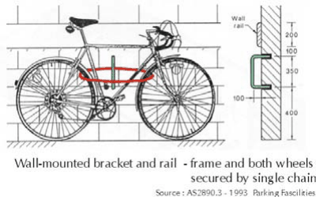

> [Picture on page 47: a picture, saved as a picture (images/vol-2-part-02-glenfield-site-dcp-page-47-6.gif, 150 dpi).]

Date Dec 2002

#### Development Requirements

D1.1 All future dwellings are to be

within 400 metres walking distance

of a bus route.

D1.2 Where opportunities exist,

pedestrian and cycle links should be

provided to public transport facilities,

a bus route and the Glenfield

Railway Station.

D1.3 Pedestrian and cycle links are

to be well lit and benefit from casual

surveillance from surrounding

development or vehicular routes in

regular use (eg. bus routes).

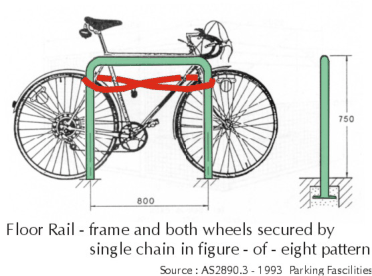

> [Picture on page 47: a picture, saved as a picture (images/vol-2-part-02-glenfield-site-dcp-page-47-22.gif, 150 dpi).]

#### Glenfield Road Area 2002 DCP

Part 2 –Criteria for Development Page 45

#### Performance Criteria

#### Access and Circulation Design

P3. Vehicular movement to and from

the site and within the site, should be

designed to reduce potential conflict

with other vehicles and pedestrians.

P4. Accessways, driveways and

open parking areas are suitably

landscaped to enhance amenity while

providing for security and accessibility

of all residents and visitors.

Date Dec 2002

#### Development Requirements

D1.4 Bicycle racks in safe and

convenient locations are to be

provided in multi-dwelling housing

developments with a total gross

floor area exceeding 1,000m2, at the

rate of one rack per 5 dwellings.

D3.1 No direct vehicular access to

Campbelltown Road, Old Glenfield

Road, Glenfield Road or any

possible future link road adjacent to

the southern boundary of the estate.

A S88B restriction shall be placed

on each lot having frontage to these

roads prohibiting access to these

roads.

D3.2 Accessways and driveways

for multi-unit dwelling developments

with common driveways:

• Are designed to enable vehicles

to enter the parking space in a

single turning movement;

• Leave the parking space in no

more than two turning

movements;

• Comply with AS 2890 – 1993

(Parts 1 to 5) Parking Facilities

• Comply with AS 1428.1 – 1993

Design for Access and Mobility

D4.0 Landscaping along driveways

and accessways to be provided as

required to a minimum standard

which complies with the

specification provided as Schedule

C.

#### Glenfield Road Area 2002 DCP

Part 2 –Criteria for Development Page 46

#### Performance Criteria Vehicular Parking

P6. Parking facilities are designed

and located to:

• conveniently and safely serve

users; provide designated car

parking spaces for people with

disabilities;

• enable the efficient use of car

spaces and accessways;

• use innovative solutions to car

parking (underground, semi-

basement or dual use) particularly

where site conditions permit; and

• reduce the visual dominance of car

parking areas and accessways.

Date Dec 2002

#### Development Requirements

D6.1 Designated car parking

spaces comply with the

requirements of parking for persons

with disabilities specified by

AS 2890.1 and AS 1428.2.

D6.2 Car parking spaces and areas

to be designed to comply with

AS 2890 – 1993 (Parts 1 to 5)

Parking Facilities.

#### Glenfield Road Area 2002 DCP

Part 2 –Criteria for Development Page 47

#### Performance Criteria

P7. Car parking is provided with

regard to the:

• likely parking demand generation of

the development;

• availability of public transport

• availability of on-street car parking

• locations of schools and local

shops

• possible demand for car parking

space from adjoining localities;

• occasional need for overflow car

parking;

• requirements of people with a

limited mobility, sensory impairment

and at different stages of the family

life cycle.

#### Design of Parking Spaces

P8. The size of parking spaces and

structures should reflect:

• functional requirements;

• the amount of space available (for

example, having regard to the

location of existing buildings or

trees); and

• bulk/scale relationship with

adjacent development on-site.

Date Dec 2002

#### Development Requirements

D7.1 Accommodation on-site for 2

cars provided for single detached

dwelling-houses.

D7.2 Car parking is provided for

multi-unit dwelling developments at

the following rates

| Number of Bedrooms per Dwelling | Car Parking Spaces per dwelling |
|---|---|
| Bedsitter or 1 bedroom | 0.75 |
| 2 bedroom | 1.00 |
| 3 or more bedrooms | 1.50 |
| Visitor spaces | 0.20 |

Notes:

• Visitor spaces are required for

all multi-unit dwelling

developments in addition to

resident spaces

• Car parking calculations are to

be rounded up

D7.3 Stacked parking, for a

maximum of 2 car parking spaces,

may be provided only for use by the

same dwelling.

D8.1 Car parking structures to be

incorporated into the design of

residential buildings, so to not

dominate the appearance of the

building when viewed from public

streets or internal private roadways.

D8.2 The openings of undercover

parking spaces should not occupy

more than 45% of the street

elevation of the building.

#### Glenfield Road Area 2002 DCP

Part 2 –Criteria for Development Page 48

#### Performance Criteria

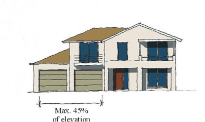

> [Picture on page 51: a picture, saved as a picture (images/vol-2-part-02-glenfield-site-dcp-page-51-2.gif, 150 dpi).]

#### Glenfield Road and Old Glenfield

#### Road

P9. The street pavement should match

that provided elsewhere in the urban

release area.

#### Local street frontage to open space

P10.  Local streets should be fully

constructed adjacent to open space.

Date Dec 2002

#### Development Requirements

D8.3 The design of car parking

structures shall be integrated with

the design of the proposed

development, and be in sympathy

with the appearance of adjacent

development by:

• the use of similar materials,

colours, height and roof pitch;

• integrating the structure within

the development;

• breaking up structures with

different surface and wall

treatments and landscaping;

• locating car parking at the rear

of the site where rear access is

available; and

• limit the number of adjoining

garages to single or double,

without some form of articulation

or break.

D9. Kerb and guttering and road

shoulder shall be provided along the

frontage to Glenfield Road and Old

Glenfield Road in conjunction with

subdivision of land having frontage

to those roads.

D10. All local streets having

frontage to open space shall be

constructed to their full width and

dedicated as a public road at no

cost to Council.

#### Glenfield Road Area 2002 DCP

Part 2 –Criteria for Development Page 49

### 2.10 Security, Privacy and Acoustic Amenity

#### OBJECTIVES

To ensure the siting and design of buildings provide visual and acoustic privacy for

a.

residents and neighbours in their dwellings and private open spaces.

To provide personal and property security for residents and visitors and enhance

b.

perceptions of community safety.

To ensure that all future occupants are provided with appropriate acoustic amenity.

c.

#### Performance Criteria Overlooking

P1. Private external living spaces and

internal living areas of adjacent

dwellings should be protected from

overlooking.

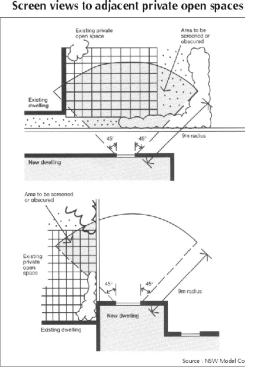

> [Picture on page 52: a picture, saved as a picture (images/vol-2-part-02-glenfield-site-dcp-page-52-17.gif, 150 dpi).]

Date Dec 2002

#### Development Requirements

D1.1 Site layout and building

design ensures that windows do not

provide direct and close views into

windows, or private external living

spaces of adjoining dwellings.

D1.2 Habitable room windows

(other than bedroom windows) of

adjacent dwellings within a distance

of 9 metres are:

• Offset by a distance sufficient to

limit views between windows; or

• Have sill heights of 1.7 metres

above floor level; or

• Have fixed obscure glazing in

any part of the window within

1.7 metres of the floor level.

D1.3 Direct views onto adjoining

private external living spaces are

obscured by:

• Screening that has a maximum

area of 25% openings, is

permanently fixed and made of

durable materials; or

• Existing dense vegetation or

new planting.

#### Glenfield Road Area 2002 DCP

Part 2 –Criteria for Development Page 50

#### Performance Criteria

#### Development Requirements

#### Noise

P2. The transmission of noise

between adjoining properties should be

minimised.

D2.1 New dwellings should be

protected from existing and likely

future noise sources emanating

from adjoining residential properties

and other high noise sources (such

as busy roads, railway lines and

industries) and minimise the

transmission of intrusive noise to

adjoining residential properties.

D2.2 No occupation of residential

dwellings will be permitted until the

construction of noise abatement

barriers as specified upon the

adopted Masterplan. The noise

abatement barriers and dwellings

will need to be designed to comply

with the recommendations of the

noise planning report prepared by

Atkins Acoustics (ref:

31.5316.R1:DD21, Nov 2001) as

part of the Local Environmental

Study, except that noise walls will

not generally be permitted along

Glenfield Road.  Where dwellings

are constructed adjacent to

Glenfield Road, acoustic measures

will need to be designed as part of

the design of the dwelling.

D2.3 Compliance with the

provisions of the Environmental

Noise Control Manual published by

the NSW Environment Protection

Authority.

#### Glenfield Road Area 2002 DCP

Part 2 –Criteria for Development Page 51

Date Dec 2002

#### Performance Criteria Security

P3. Site layout and design of the

dwellings, including height of front

fences and use of security lighting,

should minimise the potential for crime,

vandalism and fear.

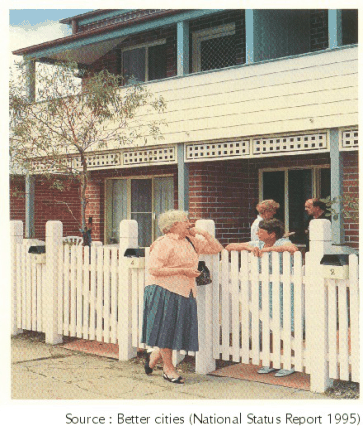

> [Picture on page 54: a picture, saved as a picture (images/vol-2-part-02-glenfield-site-dcp-page-54-8.gif, 150 dpi).]

Date Dec 2002

#### Development Requirements

D3.1 Shared pedestrian entries to

multiple dwelling complexes should

be lockable.

D3.2 Buildings adjacent to streets

or public spaces are designed to

allow casual surveillance and should

have at least one habitable room

window facing that area.

#### Glenfield Road Area 2002 DCP

Part 2 –Criteria for Development Page 52

### 2.11 Ancillary Site Facilities

#### OBJECTIVES

To ensure that site facilities are effectively integrated into the development and are

(a)

unobtrusive. To ensure site facilities are adequate, accessible to all residents and easy to

(b)

maintain. To ensure facilities are provided for efficient solid waste management.

(c)

#### Performance Criteria Waste Disposal

P1.1 Provisions of waste and recycling

bin enclosures which are:

• adequate in size

• durable and waterproof

• blend in with the development

• avoid visual clutter

• easy to maintain in a clean and

hygienic condition.

P1.2 Waste and recycling bin

enclosures are located for convenient

access by residents and collection

vehicles.

#### Clothes Drying Areas and Other Site

#### Facilities

P2. Adequate clothes drying facilities

are provided for all residents, easily

accessible to all residents.

Date Dec 2002

#### Development Requirements

D1.1 Nomination of a waste and

recycling bin storage area which is

capable of accommodating one 120-

litre bin per dwelling with easy

access to the public street frontage

and which is located within 60m

walking distance from each

dwelling.

D1.2 If the area is to be a bin

storage area for more than one

dwelling it should be adequately

screened.

#### Glenfield Road Area 2002 DCP

Part 2 –Criteria for Development Page 53

## PART 3 Schedules

#### SCHEDULE A Dictionary

"floorspace ratio" is the ratio of gross floor

area of the building to the area of the land

on which the building is proposed to be

erected.

“AMCORD” means the national resource

document for residential development

published by the Commonwealth

Government and entitled “Australian Model

Code for Residential Development” (1997

Edition). “amenity” means features, facilities or

services of a house, locality or district, which

make for a pleasant and comfortable life.

"gross floor area" means that some of the

areas of each floor of a building where the

area of each floor is taken to be the area

within the outer face of the external

enclosing walls as measured at a height of

1400mm above each floor level excluding:

“biodiversity” means variety of life forms,

plants, animals and microorganisms. It is

usually considered at three levels:

(a) genetic diversity;

(i) Columns, fin walls, sun control

devices and any elements,

projections or works outside the

general line of  the outer face of the

external wall;

(b) species diversity; and

(c) ecosystem diversity. (See also ecologically sustainable

development).

(ii) Lift towers, cooling towers,

machinery and plan rooms and

ancillary storage space and vertical

air-conditioning ducts;

(iii) Car-parking needed to meet any

requirements of Council and any

internal access thereto;

(iv) Space for the loading and unloading

of goods.

“conservation” means all of the processes

of looking after a place so as to retain its

cultural significance. It includes maintenance

and may, according to circumstance, include

preservation, restoration, reconstruction and

adaptation and will be commonly a

combination of more than one of these.

(Source: The Burra Charter)

“ground level” means the level of a site

before development is carried out on the site

under this Plan. This does not include any

level that has been created without the

approval of the Council where this would

otherwise be required. "height" means the vertical distance

between natural ground level and the top

most point of a structure, excluding minor

attachments and architectural detailing such

as television aerials and fenestration. "Multi-unit dwelling housing" is as defined

by Campbelltown LEP 2001. Note: Schedule 1 of Campbelltown LEP

2001 defines multi dwelling housing as

#### “ecologically sustainable development

(ESD)” means development that uses,

conserves and enhances the community’s

resources so that ecological processes, on

which life depends, are maintained and the

total quality of life now and in the future can

be increased. (Source: National Strategy for

Ecologically Sustainable Development,

1992\) ESD is essentially about creating a

system, which is self sustaining in the long

term. It is more a process than a product. It

incorporates conservation principles and

practices into the development process, so

that a sustainable balance between

environmental and economic objectives can

be achieved.

#### Glenfield Road Area 2002 DCP

Part 3 - Schedules   Page 54

Date Dec 2002

development involving the erection of three

or more dwellings on a site. "Public Domain" is the shared urban areas

and spaces, the structures that relate to

those spaces and the infrastructure that

serves them, which is accessible or

available to the general public, regardless of

whether they are in public ownership, or not. “Semi-detached dwelling” means a single

free-standing dwelling sharing a common

boundary with the adjoining neighbour,

generally described as two dwellings made

to look like one larger building. “Single detached dwelling” is a free-

standing residential building which contains

one, but not more than one, dwelling on its

own allotment generally set within a

landscaped garden. "Storeys, and the number of storeys" are

as defined by Clause 6 of State

Environmental Planning Policy No. 6 –

Number of Storeys in the Building (SEPP

No. 6). Note: SEPP 6 generally defines the number

of storeys in a building as follows:

• the maximum number of storeys, floors

or levels as the case may be, of the

building which may be intersected by

the same vertical line, not being a line

which passes through any wall of the

building; but

• excluding the whole or any part of a roof

used as an uncovered garden, terrace

or deck. “Terrace” means a single dwelling, which

shares both side boundary lines with

adjoining neighbours, and is generally built

from side boundary to the other side

boundary. This building type is repeated to

form a row of attached dwellings. “Zero lot line dwelling” means a dwelling

built to one side boundary line. The planned

configuration shall form a courtyard space

usually to the rear of the allotment.

#### Glenfield Road Area 2002 DCP

Part 3 - Schedules   Page 55

Date Dec 2002

#### SCHEDULE B

#### List of Approvals That May be required

#### From Other Government Agencies

(will require submission of an integrated development application)

| AGENCY | LEGISLATION | SECTION | APPROVAL FOR |
|---|---|---|---|
| NSW Fisheries | Fisheries Management Act | 144 201 205 | Aquaculture permit Permit to dredge or reclamation work Permit to cut, remove, damage or destroy marine vegetation |
| Heritage Council (Heritage Office) | Heritage Act | 58 | Approval to damage, move, alter or undertake any development on an item protected by a Permanent or Interim Conservation Order |
| National Parks & Wildlife Service | National Parks and Wildlife Act | 90 | Consent to knowingly destroy, deface, or damage to an Aboriginal Relic or an Aboriginal Place1 |
| Environment Protection Authority | Protection of the Environment Operations Act | 43(a) and 47 43(b) and 48 43(d) and 1223 | Licence to carry out scheduled development work (work that is designed to enable a scheduled activity to be carried out) Licence to carry out a scheduled activity (excluding a waste activity but including a waste facility) Licence to control the carrying out of non-scheduled activities for the purpose of regulating any water pollution |
| Department of Land and Water Conservation | Rivers and Foreshores Improvement Act Water Act | Part 3A (section 22B) 10, 13A, 18F, 20B, 20CA, and 20L4 Part 8 | Permit required to make an excavation or remove material within 40 metres of a river, lake or lagoon or do anything that obstructs or detrimentally affects the flow of water on a river, lake or lagoon Licence or permit to construct a work and to take water Approval to construct an earthwork, embankment or levee on the bank of a river or lake, or within a floodplain |

#### Glenfield Road Area 2002 DCP

Part 3 - Schedules   Page 56

Date Dec 2002

| Roads and Traffic Authority | Roads Act | 138 | A consent (from the RTA only) to erect or alter structures or works, or connect a public road to a classified road or tollway |
|---|---|---|---|
| Rural Fire Service | Rural Fires Act | 100B | Authorisation under section 100B in respect of bush fire safety of subdivision of land that could lawfully be used for residential or rural residential purposes or development of land for special fire protection purposes |

#### NOTES

1\. Development is not integrated development unless a relic referred to in section 90 of the

National Parks and Wildlife Act is known, immediately before the development application

is made, to exist on the land to which the development application applies.

2\. The Protection of the Environment Operations Act contains a schedule of activities that

the EPA will licence. List A provides the short description of the list of scheduled activities

listed in Schedule 1 of the POEO Act. It should be noted that activities below certain

thresholds do not need a licence.

3\. It is a defence in proceedings relating to the pollution of waters that the pollution was

regulated by an environmental protection licence and the conditions of that licence were

not breached.

5\. Please note that other requirements apply to the gaining of an entitlement to take water

under these sections.

#### Glenfield Road Area 2002 DCP

Part 3 - Schedules   Page 57

Date Dec 2002

#### SCHEDULE C

#### Minimum Landscaping Specification

### 1.0 SITE MANAGEMENT CONDITION

#### Site Condition

1.1 Areas to be landscaped should be left clean of building materials and rubbish.

#### Existing Plant Material

1.2 All existing trees, shrubs, ground covers, perennial plants and lawn areas except those

indicated to be removed shall be retained irrespective of size. Ensure that trunks, branches and

roots are protected against damage.

1.3 Special care is to be taken when cultivating around existing plant material.

#### Tree Protection

1.4 Protect all trees to be retained on site and their root systems from damage caused by or

arising from the course of the carrying out of works.

1.5 Before commencing any other work, surround each tree or group of trees on site with a

2 metre high light gauge reinforcing mesh fence supported and tied to 50mm diameter galvanised

steel posts firmly driven into the ground at not less than 1.5 metre spacings.

1.6 The fences shall be not less than 2 metres from any tree trunk and no materials,

equipment, machinery, rubbish and other items shall be stored within the fence. Remove any

materials, rubbish, etc. that may be within the fences at any time.

1.7 Should any minor trimming or removal of lower branches be necessary, this shall comply

with the requirements of the Council’s Tree Preservation.

#### Weed Eradication

1.8 Eradicate weeds by environmentally acceptable methods, using a non-residual

glyphosate herbicide in any of its registered formulas.

1.9 Regularly remove by hand rubbish and weed growth or regrowth that may occur

throughout the grassed, planted and mulched areas.

### 2.0 SITE PREPARATION

2.1 All garden areas shall have a minimum depth of 300mm of topsoil, being either suitably

improved and cultivated insitu soil or imported topsoil. Add organic matter in the form of compost

to a depth of 75mm over the entire areas previously cultivated as specified. Organic matter shall

be thoroughly mixed through the prepared soil before planting out.

#### Glenfield Road Area 2002 DCP

Part 3 - Schedules   Page 58

Date Dec 2002

2.2 Insitu topsoil in garden areas shall be free from grass, weeds, stumps or materials toxic

to plant growth, and appropriately cultivated and fertilised.

2.3 Imported topsoil shall be of a horticulturally suitable quality sandy loam comprising 85%

coarse and fine sands and no more than 15% humus and fine materials. It shall be in a friable

state and free from any materials toxic to plant growth, and free from stumps, roots, clay lumps or

similar material. It shall be entirely free from noxious weeds and free from grass. Topsoil shall

only be worked whilst in a moderately moist condition.

2.4 Level the site so that the contours are as shown on the plan. The surface shall be left

smooth and free of all foreign material. The contours shall be within plus or minus 150mm of

those shown on the plan.

### 3.0 FERTILISER

3.1 The areas to be turfed shall first be fertilised with a complete lawn fertiliser with a N:P:K

ratio of 10:9:8 such as “Shirley’s No. 17” applied evenly by a fertiliser spreader at the rate of

4kg/100m2.

3.2 Plants are to be fertilised with a slow release fertiliser of 20g per hole.

### 4.0 TURFING

4.1 Provide 75mm depth of topsoil for lawn areas. Level, compact lightly and rake to a

smooth surface prior to turf laying. Ensure that turf finishes flush with kerbs and pavements and

no ponding occurs as a result of turf levels.

4.2 Turf shall be obtained from an approved commercial grower of cultivated turf. It shall be

free of lawn pests, diseases and reasonably weed free. Before cultivating, turf shall be mown to a

height of 12mm to give a close sward. Turf shall be machine cut, of even thickness in either

squares or rolls. After cutting, it shall not be stacked or rolled for more than 48 hours.

4.3 Prior to final raking, apply fertiliser as specified elsewhere evenly over levelled surfaces.

Lay turf sods without excessive joints, thoroughly water without delay and roll with light roller to

bring into firm contact with soil.

4.4 Top-dress joints with sandy loam to give good cover whilst still revealing the grass

shoots.

4.5 Maintain lawn areas during construction with regular watering and mowing.

### 5.0 EDGINGS

5.1 Timber edgings shall consist of 300mm x 150mm hardwood edgings that have been

treated with one coat of creosote. Edgings to be fixed at 5 metre centres using 50mm x 50mm

hardwood pegs nailed to the edge board with a 40mm galvanised clout. Edge boards are to be

approximately 10mm below all grass areas.

5.2 Brick edgings shall consist of well baked selected common bricks placed on edge 10mm

below existing ground or grass level. A 10mm wide cement mortar joint shall be applied between

each brick.

#### Glenfield Road Area 2002 DCP

Part 3 - Schedules   Page 59

Date Dec 2002

### 6.0 PLANTING

6.1 Planting holes shall be at least 450mm square and dug to a depth of 75mm more than

the depth of the root ball.

6.2 All surplus material shall be removed and replaced with planting soil as specified

previously. The bottom of each hole shall be loosened to a further 150mm to assist drainage.

6.3 A slow release fertiliser at the rate of 20g/hole shall be placed at the bottom of each hole

before planting. Stake and tie as specified elsewhere. If planted in lawn areas, leave a neat

600mm square opening in turf after planting is completed. Form a shallow saucer-like depression

in soil around base of plant.

6.4 Planting shall not be carried out in dry soil or in extreme weather conditions.

6.5 Avoid hilling up of soil around young plant stem. Firm soil around the root ball and

thoroughly soak the areas after planting. On completion, cultivate, rake and leave all gardens

areas in a neat and tidy condition. Remove all containers from site.

### 7.0 PLANTING MATERIALS

7.1 Trees and shrubs shall be true to name and variety. Substitutes in size and variety shall

not be made without approval.

7.2 All plants shall be true to size, in well developed, healthy condition, free from insects and

diseases with well established root systems.

7.3 Advanced sizes shall be grown in a container of minimum 5 litre capacity. Semi-mature

sizes shall be grown in a container of minimum 3.5 litre capacity. Ground cover plants shall be in

150mm pots.

### 8.0 STAKING

8.1 Provide stakes for all trees and shrubs.

8.2 All trees shall have one (1) 40mm x 40mm x 1.5m straight hardwood stake, pointed at

one end. Tall shrubs shall have one (1) 25mm x 25mm x 1.2m stake pointed at one end.

8.3 Firmly install stakes to each tree/shrub taking care not to damage the root system.

8.4 Ties shall be of plastic strips of webbing material or hessian tie.

8.5 Securely tie plant to the stake in a way to avoid damage to the stem whilst allowing a

small degree of movement.

8.6 Labels shall be entirely removed from the plants.

### 9.0 MULCH

#### Glenfield Road Area 2002 DCP

Part 3 - Schedules   Page 60

Date Dec 2002

9.1 Spread mulch to all areas indicated on plan. Mulch shall be of commercial quality, free

from foreign debris and without potential to initiate weed growth.

9.2 After planting the areas indicated, spread the material to an even depth of 75mm to

100mm on the surface of the topsoil so the refinished levels are flush with surrounding kerbs,

edges or paths.
