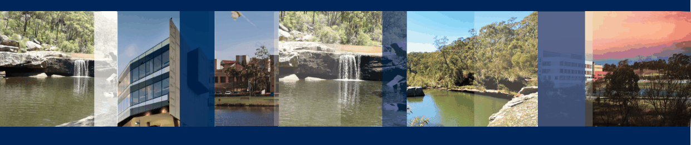
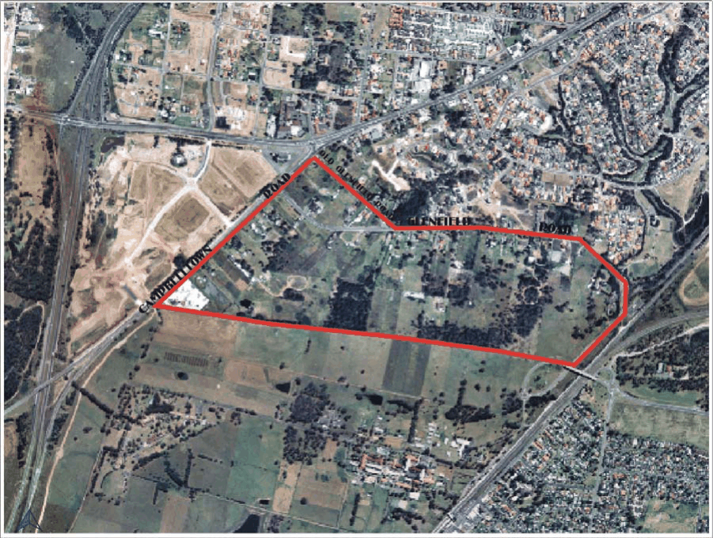

# Campbelltown Sustainable City Development Control Plan 2015 - Part 2 Glenfield Site DCP

> This chapter is split into 3 section file(s), one per numbered heading, in the order they appear in the PDF.

Source PDF: [volume-2-part-2-glenfield-site-dcp-with-cover.pdf](volume-2-part-2-glenfield-site-dcp-with-cover.pdf)

### Campbelltown (Sustainable City) Development Control Plan 2015

> [Picture on page 1: a picture, saved as a picture (images/vol-2-part-02-glenfield-site-dcp-page-1-5.gif, 150 dpi).]

### VOLUME 2

### Site Specific DCPs

## Part 2:  Glenfield Road Urban Area DCP

### Creating Campbelltown's Future 2025

Note: The Glenfield Road Area DCP came into effect on 28 February 2002 and has now been incorporated as Part 2 , Volume 2 of Campbelltown (Sustainable City) DCP.

Page ii

### Campbelltown City Council

> [Picture on page 3: a picture, saved as a picture (images/vol-2-part-02-glenfield-site-dcp-page-3-2.gif, 150 dpi).]

### Glenfield Road Area

### development control

### plan

### Glenfield Road Area

### development control plan

### TABLE OF CONTENTS

## PART 1 GENERAL INFORMATION

| 1.1 1.2 1.3 1.4 1.5 1.6 1.7 | What is this plan called?.....................................................5 How is this plan made?.......................................................5 Why is the plan required?...................................................5 Where does the policy apply?............................................5 What applications does the plan apply to?.......................5 What do the terms used in this plan mean? .....................5 How does this plan relate to other plans and legislation? |
|---|---|
| 1.8 1.9 1.10 1.10 1.11 | What are the Objectives of the DCP? ................................7 How is the Plan to be applied to achieve its Objectives?7 When did this plan come into force?..............................8 What is a Site Analysis? ................................................10 What is required to lodge a Development Application? |

#### 7

#### 11

## PART 2 CRITERIA FOR DEVELOPMENT

2.1 Masterplan..........................................................................14

2.2 Streetscape and Urban Character...................................17

2.3 Subdivision Design ...........................................................20

2.4 Building Form ....................................................................23

2.5 Open Space and Landscaping .........................................25

2.6 Ecologically Sustainable Development..........................28

2.7 Aboriginal Heritage ...........................................................36

2.8 Water Management...........................................................37

2.9 Transport...........................................................................44

2.10 Security, Privacy and Acoustic Amenity......................50

2.11 Ancillary Site Facilities ..................................................53

## PART 3 SCHEDULES

<!-- sections -->
## Sections

1. [1 General Information](01-general-information.md)
2. [P3 Front Fences](02-p3-front-fences.md)
3. [10 MAINTENANCE](03-10-maintenance.md)
