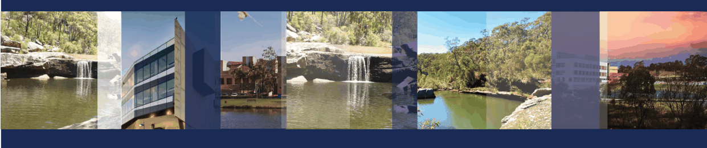
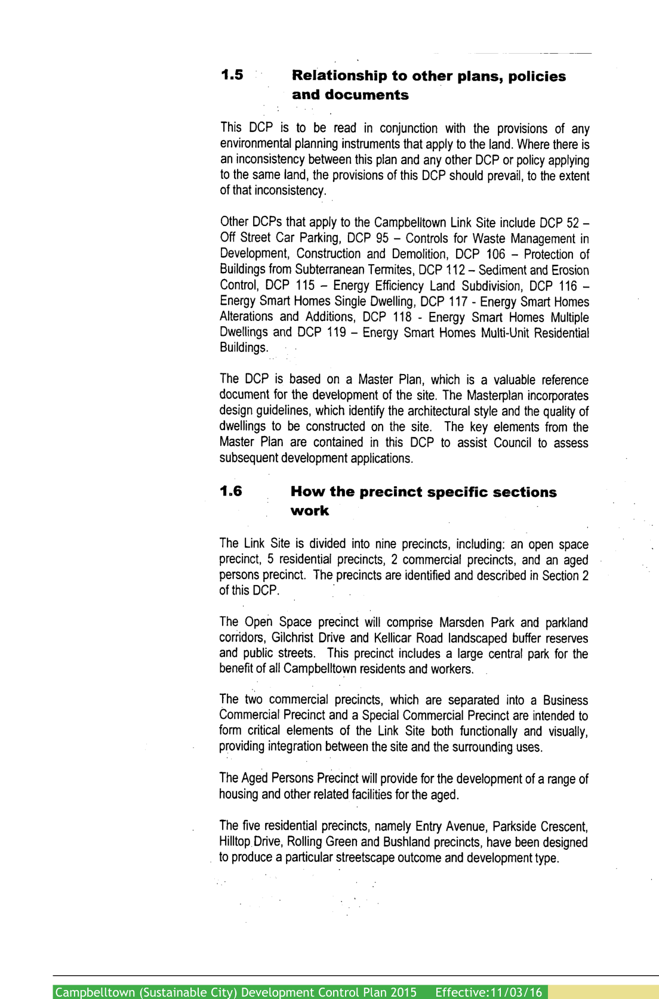
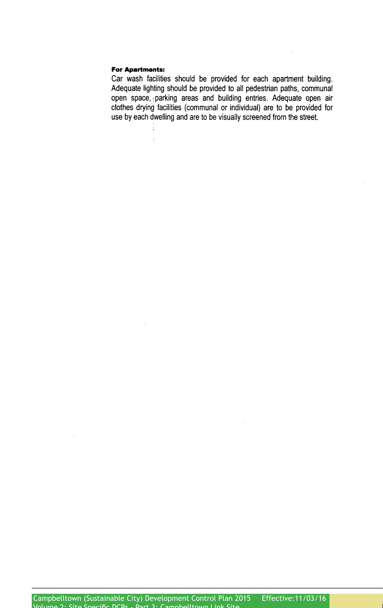
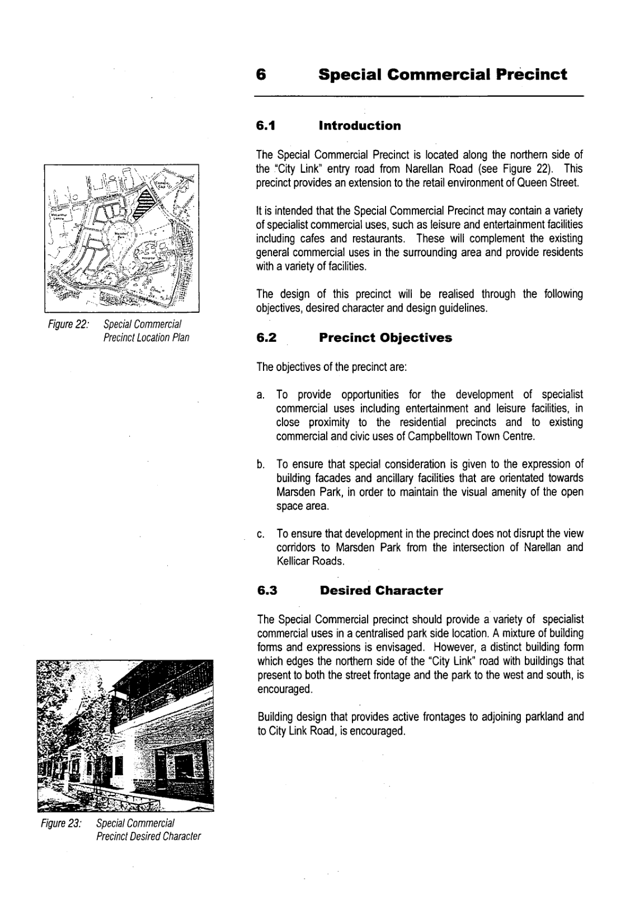
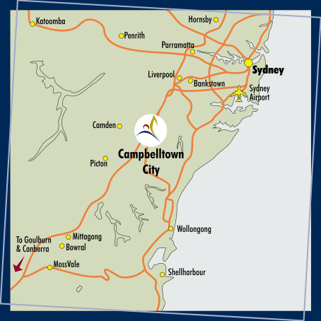

# Campbelltown Sustainable City Development Control Plan 2015 - Part 3 Campbelltown Link Site

Source PDF: [volume-2-part-3-campbelltown-link-site-dcp-with-cover.pdf](https://planfortomorrow.sharepoint.com/sites/Planfortomorrow/Shared%20Documents/00%20NSW-Planning-Resources/dcp/campbelltown-sustainable-city-development-control-plan-2015/vol-2-part-03-campbelltown-link-site/volume-2-part-3-campbelltown-link-site-dcp-with-cover.pdf)

### Campbelltown (Sustainable City) Development Control Plan 2015

> [Picture on page 1: a picture, saved as a picture (images/vol-2-part-03-campbelltown-link-site-page-1-5.gif, 150 dpi).]

### VOLUME 2

### Site Specific DCPs

## Part 3: Campbelltown Link Site

### Creating Campbelltown's Future 2025

#### Note:

#### The Campbelltown Link Site DCP came into effect on 09 January 2002 and has

#### been incorporated as Part 3 , Volume 2 of Campbelltown (Sustainable City) DCP.

> [Page 3 is a scanned picture of text. The text below was read by OCR (machine reading) and may contain errors; check it against the original PDF.]

CAMPBELLTOWN LINK SITE

DEVELOPMENT CONTROL PLAN

Prepared for
BUSINESS LAND GROUP

Prepared by
GARY SHIELS & ASSOCIATES PTY LTD
Environmental & Traffic Planners
95 Paddington Street
Paddington NSW 2021

[End of OCR text from page 3.]

Page iv

Page v

Page vi

Page vii

Page viii

Page ix

> [Picture on page 10, not reproduced as text; see the original PDF.]
> Words on this picture, read by OCR (may contain errors): PART 1

> [Page 12 is a scanned picture of text. The text below was read by OCR (machine reading) and may contain errors; check it against the original PDF.]

#### ot

#### —

#### Ka

c

#### YZ

#### Part'Lot 55 in DP714210

#### 21'and.22

and 2 in

Not to Scale

#### FIGURE 1

#### SITE PLAN

CAMPBELLTOWN LINK SITE DCP

> [End of OCR text from page 12.]

> [Picture on page 14: a picture, saved as a picture (images/vol-2-part-03-campbelltown-link-site-page-14-1.gif, 150 dpi).]

> [Page 18 is a scanned picture of text. The text below was read by OCR (machine reading) and may contain errors; check it against the original PDF.]

Not to Scale

FIGURE 3 PRECINCT PLAN CAMPBELLTOWN LINK SITE DCP

Rolling Green Hilltop Drive

a = x = w =] a

p=] Parkside Crescent ==

4 Business Commercial

LEGEND == Open Space

> [End of OCR text from page 18.]

> [Picture on page 29: a picture, saved as a picture (images/vol-2-part-03-campbelltown-link-site-page-29-1.gif, 150 dpi).]

> [Picture on page 30, not reproduced as text; see the original PDF.]
> Words on this picture, read by OCR (may contain errors): PART 2

> [Picture on page 36: a picture, saved as a picture (images/vol-2-part-03-campbelltown-link-site-page-36-1.gif, 150 dpi).]

> [Page 38 is a scanned picture of text. The text below was read by OCR (machine reading) and may contain errors; check it against the original PDF.]

5 4 ms Bes, sight line ‘, ‘ from comer across pen park to be maintained N 6,227,645 E 297,518 eos ra

rectalinear building corner offset / from sight line

foe 7 yi 8 “COMMERCIAL PRECINCT

ne y..

N 6,227,313

#### FIGURE 27

SETBACK CONTROL DIAGRAM SPECIAL COMMERCIAL PRECINCT

CAMPBELLTOWN LINK SITE DCP

> [End of OCR text from page 38.]

> [Picture on page 64: a picture, saved as a picture (images/vol-2-part-03-campbelltown-link-site-page-64-1.gif, 150 dpi).]

#### campbelltown.nsw.gov.au

#### Campbelltown City Council, PO Box 57, Campbelltown, NSW 2560
