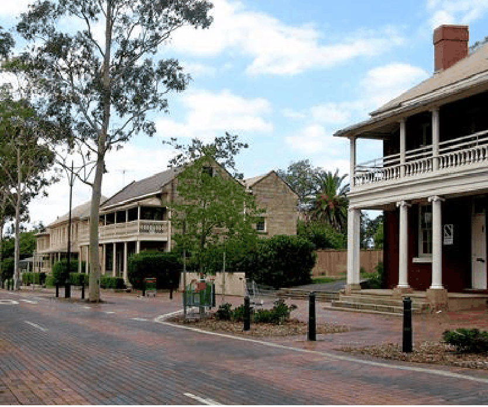

### 4.1 Application

#### Application

This Part sets out controls relating to proposed development within the heritage curtilage of the following heritage items:

• Queen Street Heritage Conservation Area;

• Woodcrest Heritage Item; and

### • Raith

The design requirements contained within this part complement the provisions contained in Part 2 and Volume 1.

> [Picture on page 2: a picture, saved as a picture (images/vol-2-part-04-site-specific-development-controls-for-certain-page-2-10.gif, 150 dpi).]

Figure 4.1.1 – Queen Street Heritage Conservation Area
