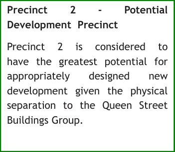

#### 4.2.2  Specific  Conservation Requirements for Precinct 1 - Heritage Precinct

a)	 Development within Precinct 1 shall be generally limited to the restoration of the heritage significant buildings and works associated with the adaptive reuse of these buildings.

b)	 New work or repair of the existing building elements shall be in keeping with the original design.

c)	 Missing or damaged building elements such as verandah brackets, fences and chimneys shall be copied carefully and reinstated to their original style.

d)	 The introduction of new building

#### Queen Street

#### Heritage

elements, such as aluminium lace or shutters shall be avoided as it can detract from the appearance and authenticity of the item.

#### Precinct

e)	 Any subdivision of land within Precinct 1 shall generally be limited to historic boundaries except where this could prejudice the sustainable conservation of the heritage buildings.

f) Vacant land at the corner of Queen and Allman Streets, and No. 296 Queen Street shall be generally retained as open landscaping.

> [Picture on page 5: a picture, saved as a picture (images/vol-2-part-04-site-specific-development-controls-for-certain-page-5-17.gif, 150 dpi).]

#### Precinct 2 - Potential Development  Precinct
