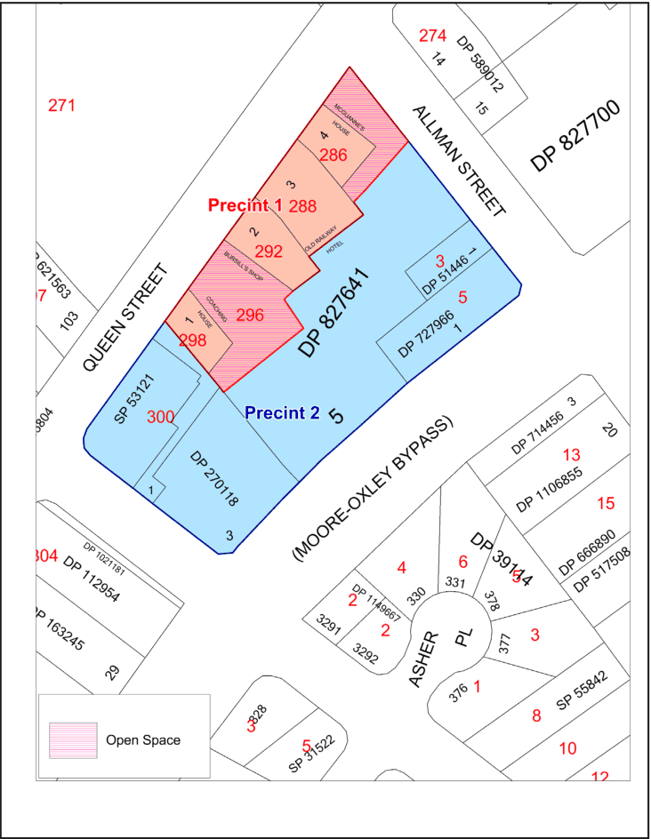

#### 4.2.3  Specific  Conservation Requirements for Precinct 2 - Potential Development Precinct

a)	 All new buildings within Precinct 2

Precinct 2 is considered to have the greatest potential for appropriately designed new development given the physical separation to the Queen Street Buildings Group.

shall be designed by an appropriately qualified heritage architect so as to ensure a high quality outcome that is compatible with the important heritage setting of the Queen Street Heritage Conservation Area.

b)	 The scale and siting of new development shall not detract from the heritage significance of the place, particularly when viewed from the public domain of Queen Street.

c)	 New development shall respect and complement the built form character of the Queen Street buildings group in terms of scale, setback, siting, external materials, finishes and colour.

d)	 New development shall avoid replicating the architectural elements within the heritage building to prevent creating a false impression of historical development on the site. In this respect, new development may be contemporary in design provided that it is well integrated with and relates harmoniously to the Queen Street Building Group.

e)	 Design elements such as verandahs, balconies, and articulated building

#### Queen Street

#### Heritage

edges are encouraged to reduce the perceived massing of new buildings and improve their visual relationship with the Queen Street Buildings Group.

#### Precinct

f) External colours and materials of new development shall be recessive in nature.

g)	 Direct vehicular access to the site is generally restricted to Allman Street and Bradbury Avenue.

h)	 Car parking areas shall be located and designed so as to be screened from surrounding public spaces.

> [Picture on page 6: a picture, saved as a picture (images/vol-2-part-04-site-specific-development-controls-for-certain-page-6-16.gif, 150 dpi).]

Map 4.2.1 – Queen Street Heritage Conservation Area
