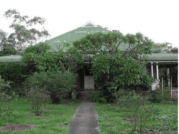
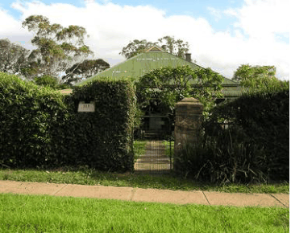

### 4.3 Woodcrest Heritage Item

#### Woodcrest

#### Heritage Item

This Section applies to  Woodcrest heritage item and its curtilage.

#### Objective:

■

■ Ensure that Woodcrest heritage item is not dwarfed by future residential development.

■

■ Ensure that development within the curtilage of Woodcrest House is of appropriate scale, form, colour and siting so as not to significantly impact on

> [Picture on page 7: a picture, saved as a picture (images/vol-2-part-04-site-specific-development-controls-for-certain-page-7-12.gif, 150 dpi).]

> [Picture on page 7: a picture, saved as a picture (images/vol-2-part-04-site-specific-development-controls-for-certain-page-7-13.gif, 150 dpi).]

the heritage significance of Woodcrest House.

a)	 Proposed dwelling houses within the curtilage of Woodcrest heritage item shall:

i)	 be limited to a single storey  in height;

ii)	 have a maximum 3 metre floor to ceiling height; and

iii)	incorporate front verandahs.

b)	 Any dividing fence immediately adjacent to Woodcrest heritage site or a continuation of  a fence located on the boundary of Woodcrest heritage item shall be of similar colour, material, height and style to the existing heritage fence in that location.

c)	 External colour and material os new development shall be recessive  in nature.

Figure 4.3.1 – Photos of Woodcrest Heritage Item

d)	 New development shall avoid replicating the architectural elements within the heritage building to prevent creating a false impression of historical development on the site.

e)	 The erection of pergolas, outbuildings and the like shall only be permitted where Council is satisfied that such development is of appropriate height, scale, colour and material so as not to detract from the significance of Woodcrest heritage item.
