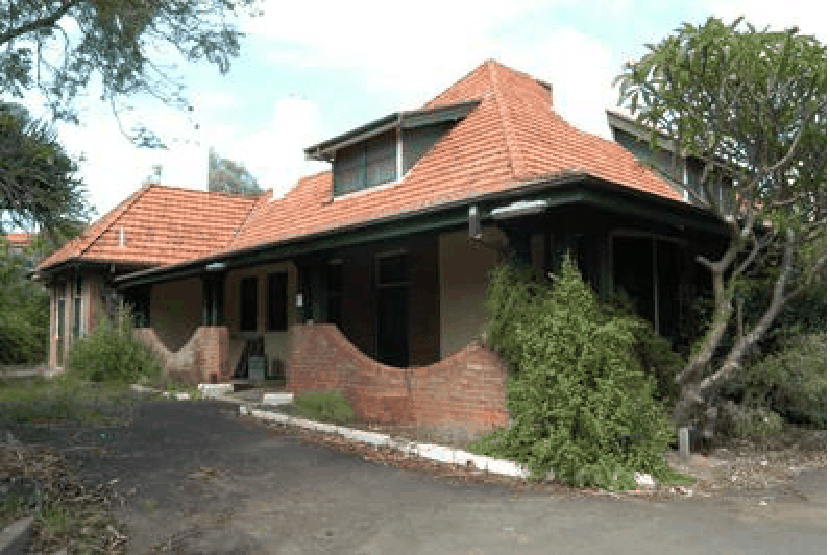
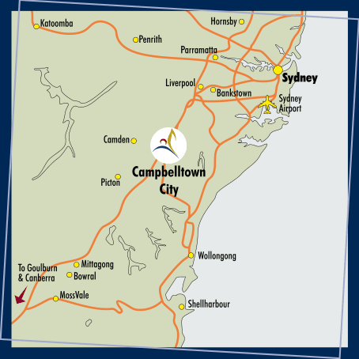

### 4.4 Raith

This Section applies to Raith heritage item and its curtilage.

#### Raith

#### Heritage Item

#### Objective:

■

■ Conserve the views to and from Raith from Fern Avenue Bradbury.

a)	 Land between Raith and Fern Avenue shall be maintained as open space.

#### Heritage Significance

“Raith”, built 1903, is of historical significance as the rural estate of the family of Herbert Merewether, a prominent local family, from 1903 to 1927 , and for its role as a child welfare institution from 1964 till the early 1990s. The site is listed by Campbelltown City Council as an item of local heritage, given its historic, architectural and aesthetic significance. The building has been the subject of extensive restoration works undertaken in early 2015 following a number of years of vacancy and neglect, including vandalism and fire damage.

> [Picture on page 8: a picture, saved as a picture (images/vol-2-part-04-site-specific-development-controls-for-certain-page-8-18.gif, 150 dpi).]

Figure 4.4.1 – A photo of Raith Heritage Item

> [Picture on page 10: a picture, saved as a picture (images/vol-2-part-04-site-specific-development-controls-for-certain-page-10-1.gif, 150 dpi).]

#### campbelltown.nsw.gov.au

#### Campbelltown City Council, PO Box 57, Campbelltown, NSW 2560
