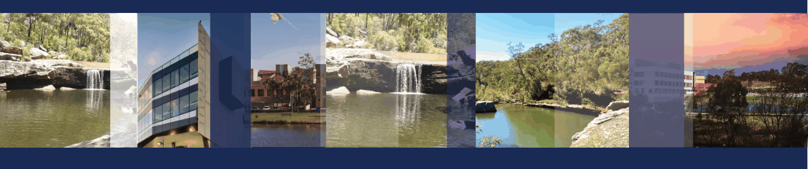

# Campbelltown Sustainable City Development Control Plan 2015 - Part 4 Site Specific Development Controls for Certain Heritage Items

> This chapter is split into 7 section file(s), one per numbered heading, in the order they appear in the PDF.

Source PDF: [volume-2-part-4-site-specific-development-controls-for-certain-heritage-items-with-cover.pdf](https://planfortomorrow.sharepoint.com/sites/Planfortomorrow/Shared%20Documents/00%20NSW-Planning-Resources/dcp/campbelltown-sustainable-city-development-control-plan-2015/vol-2-part-04-site-specific-development-controls-for-certain-her/volume-2-part-4-site-specific-development-controls-for-certain-heritage-items-with-cover.pdf)

### Campbelltown (Sustainable City) Development Control Plan 2015

> [Picture on page 1: a picture, saved as a picture (images/vol-2-part-04-site-specific-development-controls-for-certain-page-1-5.gif, 150 dpi).]

### VOLUME 2

### Site Specific DCPs

## Part 4: Site Specific DCP for Certain Heritage Items

### Creating Campbelltown's Future 2025

<!-- sections -->
## Sections

1. [4.1 Application](01-4-1-application.md)
2. [4.2 Queen Street Heritage Conservation Area](02-4-2-queen-street-heritage-conservation-area.md)
3. [4.2.1 General Conservation Requirements](03-4-2-1-general-conservation-requirements.md)
4. [4.2.2 Specific  Conservation Requirements for Precinct 1 - Heritage Precinct](04-4-2-2-specific-conservation-requirements-for.md)
5. [4.2.3 Specific  Conservation Requirements for Precinct 2 - Potential Development Precinct](05-4-2-3-specific-conservation-requirements-for.md)
6. [4.3 Woodcrest Heritage Item](06-4-3-woodcrest-heritage-item.md)
7. [4.4 Raith](07-4-4-raith.md)
