# Campbelltown Sustainable City Development Control Plan 2015 - Part 5 University of Western Sydney DCP

Source PDF: [volume-2-part-5-university-of-western-sydney-dcp-including-amendment-no-5-effective-25-april-2018-final.pdf](volume-2-part-5-university-of-western-sydney-dcp-including-amendment-no-5-effective-25-april-2018-final.pdf)

> [Page 1 is a scanned picture of text. The text below was read by OCR (machine reading) and may contain errors; check it against the original PDF.]

Campbelltown (Sustainable City) Development Control Plan 2015

VOLUME 2

Site Specific DCPs

Part 5: University of Western Sydney DCP

Creating Campbelltown's Future 2025

[End of OCR text from page 1.]

#### Note:

The University of Western Sydney DCP came into effect on 24 February 2009 and

#### has been incorporated as Part 5 , Volume 2 of Campbelltown (Sustainable City)

#### DCP . Amendment No 5 came into effect on 25 April 2018 and Section 1.2.3 Land

#### to which the DCP applies.

> [Page 3 is a scanned picture of text. The text below was read by OCR (machine reading) and may contain errors; check it against the original PDF.]

UNIVERSITY OF WESTERN SYDNEY CAMPBELLTOWN

Development Control Plan

October 2008

[End of OCR text from page 3.]

### UNIVERSITY OF

### WESTERN SYDNEY

### CAMPBELLTOWN

#### Development Control Plan

#### October 2008

Prepared on behalf of Landcom and University of Western Sydney

Prepared by MG Planning

in conjunction with Cox Richardson APP Corporation

#### Page II

#### contents

| PART 3: |  |
|---|---|
| CAmPUS/ACADemiC DeVelOPmenT | 3-1 |
| 3.1 Desired future Character | 3-2 |
| 3.2 Objectives | 3-2 |
| 3.3 Academic/Campus Development | 3-3 |

## PART 4: ReSiDenTiAl DeVelOPmenT

#### 4-1

### 4.1 Desired future Character

#### 4-2

### 4.2 Objectives

#### 4-2

### 4.3 Building form and Streetscape Character 4-3

### 4.4 Residential Development

#### 4-4

4.4.1 subdivision

4-4

#### 4.4.2  Residential Apartments

4-5

#### 4.4.3  Detached Dwellings

4-7

4.4.4  small Lot Housing

4-10

4.4.5  studio Apartments and Garden Duplexes

4-12

#### 4.5 mixed Use Development

#### 4-14

#### 4.6 landscaping (Private)

#### 4-16

### 4.7 Private Open Space

#### 4-16

### 4.8 Privacy

#### 4-16

#### 4.9 fencing and Retaining Walls

#### 4-17

### 4.10 Car Parking and Access

#### 4-18

### 4.11 Solar Access and energy efficiency 4-19

### 4.12 Waste management

#### 4-20

### 4.13 Services

#### 4-20

| APPenDiCeS |  | 5-1 |
|---|---|---|
| 1 | Dictionary | 5-2 |
| 2 | Species list | 5-5 |

iii

#### Page III

| PART 1: |  |
|---|---|
| PReliminARy | 1-1 |
| 1.1 Vision | 1-2 |
| 1.2 introduction | 1-2 |
| 1.2.1 name of the DcP | 1-2 |
| 1.2.2 Purpose of the DcP | 1-2 |
| 1.2.3 Land to which the DcP applies | 1-2 |
| 1.2.4 the consent Authority 1.2.5 Development categories 1.2.6 Monitoring and Review of the DcP | 1-2 1-4 1-4 |
| 1.2.7 Variation to Planning controls |  |
| and standards | 1-4 |
| 1.2.8 structure of the DcP | 1-4 |
| 1.2.9 Relationship to other Plans |  |
| and Documents | 1-5 |
| 1.2.10 How to Use the DcP | 1-5 |
| 1.2.11 Definitions | 1-5 |
| 1.3 Background | 1-5 |
| 1.4 DCP Objectives | 1-6 |
| 1.5 Design Approval Process | 1-6 |
| 1.5.1 standard Lot and Large Lot Housing | 1-6 |
| 1.5.2 small Lot Housing | 1-6 |

| PART 2: ReqUiRemenTS APPlying TO All TyPeS Of DeVelOPmenT | 2-1 |
|---|---|
| 2.1 Site Analysis | 2-2 |
| 2.2 Urban Structure | 2-3 |
| 2.3 The Public Domain | 2-3 |
| 2.4 Access and Circulation | 2-14 |
| 2.5 Streets | 2-14 |
| 2.6 landscape and Open Space | 2-15 |
| 2.7 Safety and Security | 2-18 |
| 2.8 Views and Vistas | 2-20 |
| 2.9 Controls on Sloping land | 2-20 |
| 2.10 Water Cycle management | 2-25 |
| 2.11 Risk management | 2-25 |
| 2.12 noise | 2-26 |

> [Picture on page 6: a picture, saved as a picture (images/vol-2-part-05-university-of-western-sydney-dcp-page-6-1.gif, 150 dpi).]

#### contents

figUReS

| 1 | Area to which this DcP applies | 1-3 |
|---|---|---|
| 2 | example site Analysis | 2-2 |
| 3 | Indicative Density Distribution | 2-4 |
| 4 | Indicative street Hierarchy | 2-5 |
| 5 | Indicative Pedestrian circulation Plan | 2-6 |
| 6 | Indicative cycle circulation Plan | 2-7 |
| 7 | Indicative Public transport network Plan | 2-8 |
| 8 | street type – collector street A | 2-9 |
| 9 | street type – collector street B | 2-9 |
| 10 | street type – collector street c | 2-10 |
| 11 | street type – collector street c at Park edge | 2-10 |
| 12 | street type – Local street at Park edge | 2-11 |
| 13 | street type – Local street at Reserve edge | 2-11 |
| 14 | street type – Minor Local street at Park edge | 2-12 |
| 15 | street type – Local street | 2-12 |
| 16 | street type – Inner Ring campus Road | 2-13 |
| 17 | Illustrative Landscape Master Plan | 2-19 |
| 18 | significant Panoramic View | 2-19 |

#### TABleS

| 2.1 | Park character and Activities | 2-16 |
|---|---|---|
| 2.2 | streetscape character | 2-17 |
| 2.3 | Floor level requirements for developments | 2-24 |
| 4.1 | Development standards for |  |
|  | residential apartments | 4-6 |
| 4.2 | Development standards for standard |  |
|  | detached dwellings | 4-8 |
| 4.3 | Development standards for large |  |
|  | detached dwellings | 4-9 |
| 4.4 | Development standards for small |  |
|  | lot housing | 4-11 |
| 4.5 | Development standards for studio |  |
|  | apartments and garden duplexes | 4-13 |
| 4.6 | Development standards for mixed |  |
|  | use developments | 4-15 |
| 4.7 | Required car parking spaces | 4-18 |
| 4.8 | car parking dimensions | 4-18 |

iv

#### Page IV

> [Picture on page 8: a picture, saved as a picture (images/vol-2-part-05-university-of-western-sydney-dcp-page-8-1.gif, 150 dpi).]

## PART 1: PRELIMINARY

### 1.1 VISION

### 1.2 INTRODUCTION

The vision for the DCP is:

This Development Control Plan is generally consistent with the Campbelltown (Sustainable City) Development Control Plan (CSCDCP).

#### 1.2.1 Name of the DCP

“To provide for a community which offers a

#### unique lifestyle of learning, living, working and playing within an education precinct.”

This Plan is called University of Western Sydney Campbelltown Development Control Plan (the DCP).

Supporting this vision the following aims and objectives have been identified for the site:

#### 1.2.2 PURPOSE OF THE DCP

The DCP has been prepared in accordance with Section 72 of the Environmental Planning and Assessment 1979 (the Act) and Clause Nos 16–24 of the Environmental Planning and Assessment Regulation 2000 (the Regulation). The DCP supplements the existing Campbelltown (Urban Area) Local Environmental Plan 2002 (LEP 2002).

• Develop a comprehensive framework that:

– provides for a residential community,

– provides for the long term needs of the academic campus,

– better connects the site to its surroundings,

– recognises the site’s location in relation to the Campbelltown City Centre and Macarthur Regional Centre,

– preserves the significant natural features of the site.

• Provide for quality urban design throughout the site.

• Develop a network of streets, pedestrian and open space linkages within the site and connecting to adjoining places.

Council (the consent authority) is required under Section 79C of the Act to take into consideration relevant provisions of the DCP in determining development applications on land located in the University of Western Sydney Campbelltown Campus lands and Landcom lands (herein referred to as ‘the site’) shown at Figure 1.

#### 1.2.3 Land to which the DCP applies

• Create high quality riparian corridors that integrate and consolidate the functions of drainage with the preservation of significant flora and fauna.

• Create an attractive landscape setting for the future residential community.

• Build on and improve links to Macarthur Station,

The DCP applies to all land contained within the development area as identified in Figure 1 known as ‘the site’FYDFQUGPSBOZQBSUPGUIFTJUFUIBUJT DVSSFOUMZ[POFE3.FEJVN%FOTJUZ3FTJEFOUJBMVOEFS $BNQCFMMUPXO-PDBM&OWJSPONFOUBM1MBO.

• Encourage commercial and research partners to the central academic precinct.

#### 1.2.4 The Consent Authority

• Provide high quality housing that will set a benchmark for development in the Campbelltown area.

Campbelltown City Council (Council) is the consent authority for ‘local’ development within the site.

• Provide public transport and vehicular linkages to the Macarthur Regional Centre.

9ROXPH6LWH6SHFLÀF'&3V'UDIW3DUW8QLYHUVLW\RI:HVWHUQ6\GQH\'&3

figure 1: Area to which this DCP applies

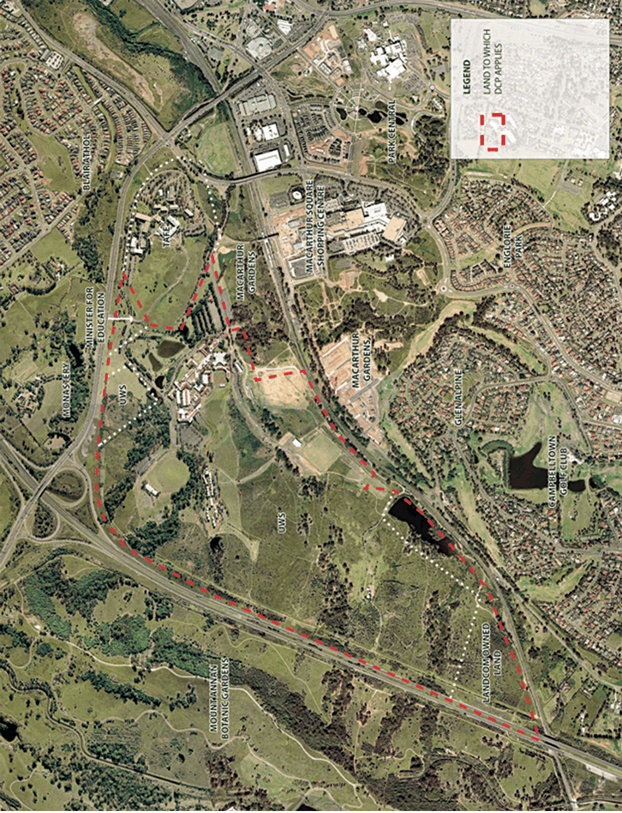

> [Picture on page 9: a picture, saved as a picture (images/vol-2-part-05-university-of-western-sydney-dcp-page-9-2.gif, 150 dpi).]

#### 1.2.5 Development Categories

#### 1.2.7 Variation to Planning Controls and Standards within the DCP

Anticipating the longevity of this DCP, there are 5 categories of development that Council is likely to experience.

#### Exempt Development

Exempt development is incidental development that is of minimal environmental impact and may be carried out without the need to obtain development consent from Council. The type of development that is exempt from the need to obtain development consent is set out in Campbelltown LEP No. 209 Exempt Development.

Council may consider variations to the requirements of this DCP in certain circumstances. Requests for variations are required to be in writing and shall clearly demonstrate the reason(s) why the variation sought would not adversely impact on the environment or local amenity, would not erode the relevant standard and requirement; and that compliance with the objectives and requirements of the DCP are unreasonable or unnecessary in the circumstances of the case. Council gives no assurance that it will permit any variation(s) to the requirements of this DCP. Variations will only be considered in exceptional circumstances.

#### Complying Development

Complying development is development that meets specific criteria set out in SEPP No 60 – Exempt and Complying Development.

#### Local Development

Compliance with any numerical provisions of the DCP does not guarantee the granting of development consent. Each application will be considered on its merits, having regard to the matters for consideration under Section 79C of the Act.

Local development requires development consent from Council.

Consistent application of the provisions of the DCP will be given high priority by Council.

#### Integrated Development

#### 1.2.8 Structure of the DCP

Integrated development is local development that requires the consent of another authority as well as Council.

The format of this DCP has been established to identify various objectives and general design requirements for each of the permissible development typologies. It comprises the following structure:

#### State Significant Development

Part 1: Preliminary

Part 2: Requirements applying to all types of development

State significant development is development that is listed under Schedule 3 of the Regulation and SEPP (Major Projects) 2005, for which the Minister of Planning is the consent authority.

Part 3: Campus/Academic Development

#### 1.2.6 monitoring and Review of the DCP

Part 4: Residential Development

Council is required to keep its LEP and DCPs under regular and periodic review to ensure that these Plans:

(a) continue to be useful and relevant;

(b) can be judged as to their effectiveness;

(c) reflect an adequate and appropriate capacity for development; and

(d) provide for the appropriate protection of the environment and natural resources.

This DCP shall be reviewed every five (5) years, or earlier, as considered necessary by Council.

#### 1.2.11 Definitions

#### 1.2.9 Relationship to other Plans

and Documents

The words used in the Plan have the meaning outlined in Appendix 1.

The provisions of this DCP are site-specific and reflect the planning and design objectives desired by the relevant stakeholder parties.

### 1.3 BACKgROUnD

This DCP has been prepared following a detailed analysis of the site’s environmental characteristics and capability (discussed in the UWS Background Environment Report) and the formulation of the UWS Campbelltown Master Plan which outlines the vision and development principles for the site.

The provisions contained in the DCP are in addition to the provisions within SEPPs, REPs and the LEP. In the event of any inconsistency between the DCP and SEPPs, REPs, and/or the LEP, the SEPPs, REPs and/or LEP will prevail. Where there is an inconsistency between this DCP and any other DCP to which the Plan applies, the provisions of this DCP shall prevail.

#### 1.2.10 how to use the DCP

The following steps provide a general guide of how to use this DCP:

#### STEP 1

• Check the permissibility of the development under the relevant EPI(s).

The development framework for the future development of the site including both residential and academic development is identified in the UWS Master Plan. It outlines the design intent for the evolving residential community to be accommodated within the site. The Master Plan illustrates how the vision for the site is to be achieved and details the:

(i) Overall structure and indicative subdivision layout

(ii) Proposed Network of Streets, Cycleways and

• Determine the category of the development by referring to Section 1.2.5.

• If the development is ‘exempt development’ refer to LEP No. 209 – Exempt Development.

Pedestrians Pathways

(iii) Location and character of Open Space Areas

(iv) General Building Character

(v) Building Typologies

• If the development is ‘complying development’ refer to SEPP No. 60 – Exempt and Complying Development.

• If the development is not exempt or complying development, proceed to Step 2.

The Master Plan provides the background to this DCP and includes the principles and rationale for the overall layout as well as the basis for the development controls contained herein.

#### STEP 2

• Read Part 2 (Requirements applying to All Types of Development) and observe the stated requirements for all development applications.

#### STEP 3

• Determine whether the proposed development is campus/academic development or residential development.

• Read the relevant part of the DCP that applies to the type of development proposed (Part 3 or 4);

• Ensure that the development satisfies the objectives and design requirement of each of the relevant sections of the DCP.

#### STEP 4

• Follow the process for seeking development consent from Council.

### 1.4 DCP OBJeCTiVeS

### 1.5 DeSign APPROVAl PROCeSS

#### The objectives of the DCP are:

#### 1.5.1 Standard lot and large lot housing

(i) Allow the University to develop to accommodate the education needs of the expanding local and regional community.

(ii) Provide for employment and economic

All Applicants that wish to develop Standard Lot and Large Lot Housing must comply with the provision of this Plan and any other design controls as specified in the sales contract.

#### 1.5.2 Small lot housing

development which will complement and create synergies, but not compete, with the University and Campbelltown CBD.

(iii) Provide for the enhancement of the environmental qualities of the site while at the same time accommodating the long term needs of the University and demand for housing by the wider community.

(iv) Provide for an environmentally sustainable

Prior to lodgement of a Development Application with Council, all applicants that wish to develop Small Lot Housing must first obtain approval from the UWS Design Review Panel (UWS DRP). There are specific requirements applying to land purchased in the UWS Campbelltown Lands area as specified in the sales contract.

residential community that is benefited by its proximity to and integration with the education facilities.

#### Responding to the objectives this DCP will guide:

The UWS DRP consists of representatives from the University, Landcom, Council and expert consultants having expertise in architecture, urban design, environmental planning, landscape architecture and building.

(i) the orderly expansion of the University,

(ii) the development of businesses and employment opportunities with close links to the University and research institutions,

(iii) the development of a residential community with

A design concept shall be prepared by the applicant and must address the relevant objectives and design requirements applying to the development. Subject to approval by the UWS DRP, applicants may then proceed to lodge their Development Application with Council.

strong physical and social links to the campus, and

(iv) the development of sport and recreation facilities to cater for the needs of the community.

To make an application to the UWS DRP, please refer to the contact details in the sales contract.

The objectives and development controls of this DCP are targeted at the creation of a vibrant and caring community that enjoys the stimulation of living and working with people of diverse cultural, social and demographic backgrounds. The creation of businesses and employment opportunities linked to the University will further contribute to the development of a strong and dynamic campus/community relationship. The campus core will be activated as a pedestrian place, creating more life and energy, connected to the community and public transport.

figure 2: example Site Analysis

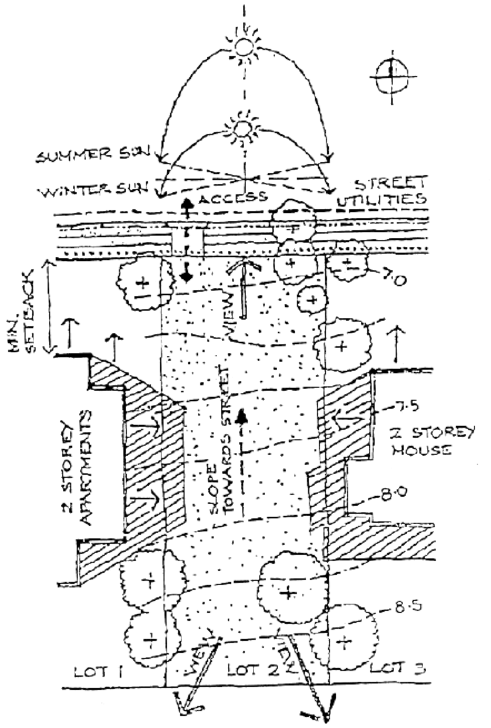

> [Picture on page 14: a picture, saved as a picture (images/vol-2-part-05-university-of-western-sydney-dcp-page-14-2.gif, 150 dpi).]

This part applies to all land covered by this DCP.

### 2.1 SiTe AnAlySiS

#### Objectives:

• Identify the constraints and opportunities for the development of the site.

• Identify the capability and suitability of the site for development.

#### Design Requirements:

1\. A site analysis shall be lodged with the development application for all development involving the construction of a building. The scope of the site analysis will depend on the scale and nature of the development and shall address:

(i) contours, slope and north point;

(ii) existing landscaping and vegetation;

(iii) existing buildings and structures;

(iv) roads, access points, parking, and traffic management devices and the like;

(v) linkages; open space networks, pedestrian/ cycle paths and the like;

(vi) easements, services, existing infrastructure and utilities;

(vii) hydraulic features; drainage lines, water features, drainage constraints, and the like;

(viii) natural hazards (e.g. flooding, slip);

(ix) solar orientation, overshadowing, prevailing winds, rainfall;

(x) views and vistas to, from and within the site; and

(xi) a streetscape analysis.

### 2.2 URBAn STRUCTURe

### 2.3 The PUBliC DOmAin

#### Objectives:

Figures 3 to 7 show the intended urban structure for the future development of the site. Medium and high density residential development areas have been identified in locations which are:

• adjacent to open space,

• Create a network of open spaces, focal points and recreation and community facilities which meet the needs of the new residential community as well as the University.

• along the main transport spine,

• near potential future mixed use precincts, and

• on the areas of lower slope.

• Establish quality public domain spaces which add to the visual and environmental amenity of the site, and which are designed to maximise safety and security.

• Incorporate water sensitive urban design and other sustainable development practices in the creation of the public domain.

Lower density residential development is identified for those areas of steeper land, or which are otherwise less suited for higher density development.

#### Design Requirements:

#### Objectives:

• Create a residential community which is environmentally sustainable, which has links to and which acts as a catalyst for future growth in the University.

• Allow for higher residential densities in areas which have higher levels of accessibility.

• Capitalise on the site’s accessibility to the Macarthur Square and facilities and services beyond.

• Encourage an enhanced sense of identity for the area that is distinctive and reflects the site’s function as well as its natural setting.

#### Design Requirements:

1\. Development shall be consistent with the Indicative Density Distribution at Figure 3.

1\. Development shall be generally consistent with the Indicative Street Hierarchy (refer Figure 4).

2\. The developer shall provide a network of local roads that reflects road function and desired character as outlined by the street type cross section shown below (Refer Figures 8–16).

3\. Design shall clearly distinguish between the public and the private domain.

4\. Significant landscape nodes and precincts such as the main entrances to the campus and residential areas, major parklands, natural corridors, green links and site boundaries are to be highlighted with appropriate landscaping to create a unified setting.

5\. Development shall be consistent with the Indicative Pedestrian Circulation Plan, Indicative Cycle Circulation Plan and Indicative Public Transport Network Plan (refer Figures 5, 6 and 7).

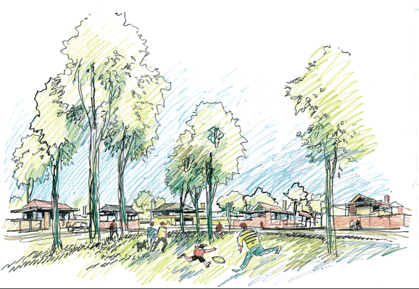

> [Picture on page 15: a picture, saved as a picture (images/vol-2-part-05-university-of-western-sydney-dcp-page-15-58.gif, 150 dpi).]

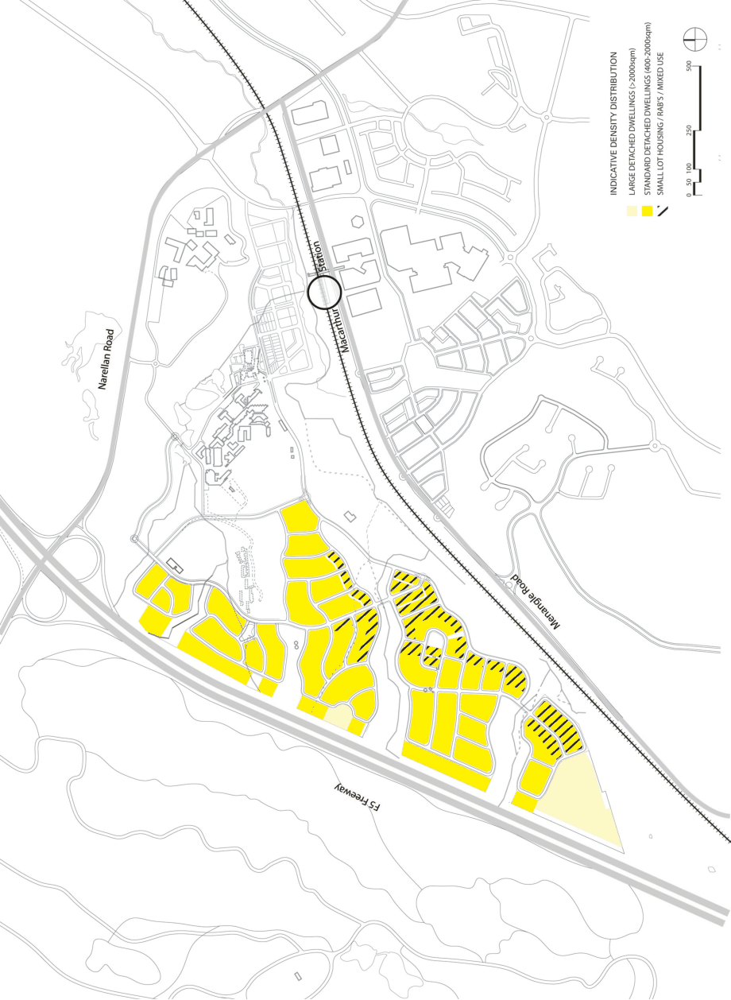

> [Picture on page 16: a picture, saved as a picture (images/vol-2-part-05-university-of-western-sydney-dcp-page-16-1.gif, 150 dpi).]

figure 3: indicative Density Distribution

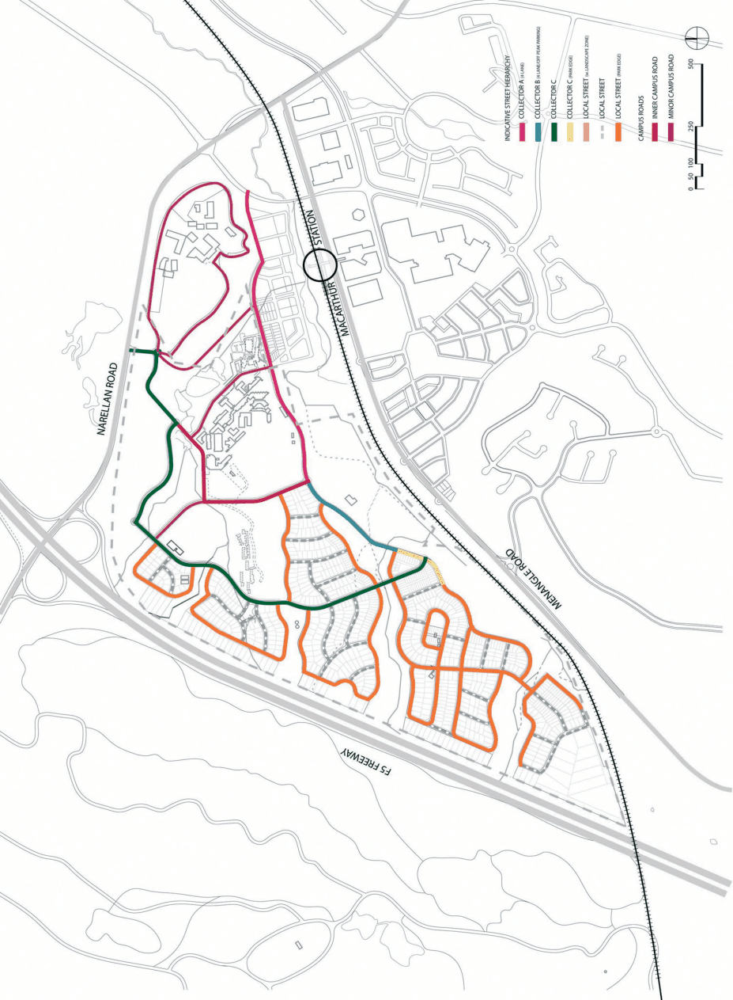

> [Picture on page 17: a picture, saved as a picture (images/vol-2-part-05-university-of-western-sydney-dcp-page-17-1.gif, 150 dpi).]

Figure 4: Indicative Street Hierarchy

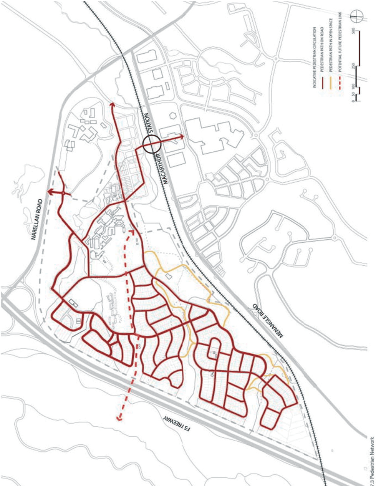

> [Picture on page 18: a picture, saved as a picture (images/vol-2-part-05-university-of-western-sydney-dcp-page-18-1.gif, 150 dpi).]

figure 5: indicative Pedestrian Circulation Plan

### 2.4 ACCeSS AnD CiRCUlATiOn

### 2.5 STReeTS

#### Objectives:

#### Objective:

• Ensure adequate access by a variety of modes to development on the site that does not negatively impact on the road network surrounding the site.

• Create a hierarchy of streets, each street type having its own character in terms of street setbacks, street trees, street quality and overall street character.

• Encourage use of public transport and cycling/ walking to reduce dependency on fossil fuels and private vehicle use.

• Provide for street trees to create a distinctive landscape, to reinforce themes, frame views and create attractive walking experiences.

• Use streets to define the edges between development and open spaces and to provide good levels of surveillance between the two.

• Maximise connections between the site and surrounding areas, particularly the existing connection to Macarthur station and the proposed bus interchange.

#### Design Requirements:

• Create a legible and functional road network that provides good connections with the surrounding areas and which clearly distinguishes between Campus and residential roads.

• Make adequate provision for bus services to service the site.

#### Design Requirements:

1\. The developer shall construct the proposed street network generally in accordance with the Indicative Street Hierarchy Plan at Figure 4.

2\. Individual road design, construction and landscaping shall be in accordance with the typical street types (refer Figures 8-16) and have regard to Council’s Engineering Design Guide for Developments and Specification for Construction of Subdivision Roads and Drainage Works.

3\. Kerbs shall generally be upright kerbing and not roll over.

4\. Street planting shall be coordinated with subdivision layout, traffic plan and services layouts to ensure appropriate configuration with vehicle crossovers, sight lines, lighting and other services and be generally in accordance with the species list (Appendix 2).

5\. A 500mm planting zone between public footpath and lot boundary shall be planted with non evasive low ground cover species.

6\. All street trees shall have root control barriers installed.

1\. Development shall be consistent with the Indicative Street Hierarchy, Pedestrian and Cycle Network Plans and Public Transport Network Plan at Figures 4, 5, 6 and 7.

2\. Pedestrian footpaths and cycleways shall be designed in accordance with Council’s Engineering Design Guide for Development.

3\. The developer shall provide street lighting to current Australian Standards and furniture including garbage bins, seating, bollards, signage etc, which relate to the street hierarchy and enhance the character of the development.

4\. Within the Academic lands all bus stops shall be off road, within dedicated bus bays. Bus shelters shall be provided in locations determined to have high demand.

5\. Within the Residential lands bus stops shall be on road utilising the parking lane provided for on collector roads. Bus shelters shall be provided in areas of high demand.

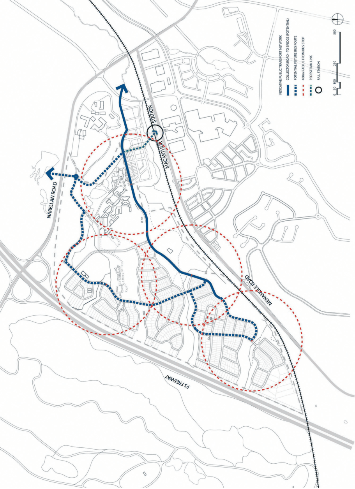

> [Picture on page 20: a picture, saved as a picture (images/vol-2-part-05-university-of-western-sydney-dcp-page-20-1.gif, 150 dpi).]

figure 7: indicative Public Transport network Plan

figure 8: Street Type – Collector Street A

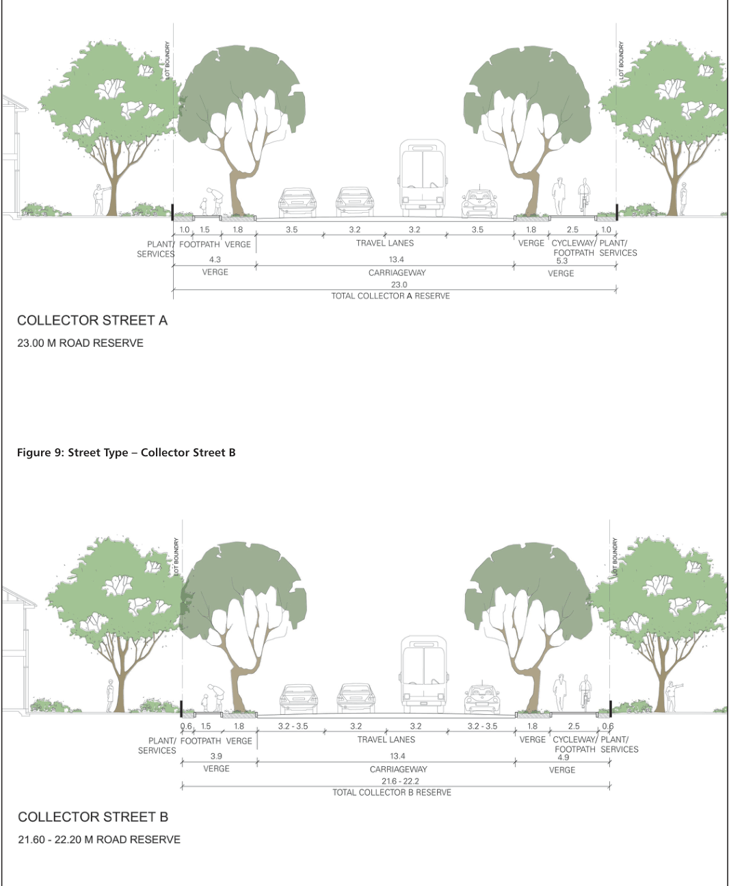

> [Picture on page 21: a picture, saved as a picture (images/vol-2-part-05-university-of-western-sydney-dcp-page-21-2.gif, 150 dpi).]

> Words printed on the picture (title and legend, copied from the PDF):
> figure 9: Street Type – Collector Street B

figure 10: Street Type – Collector Street C

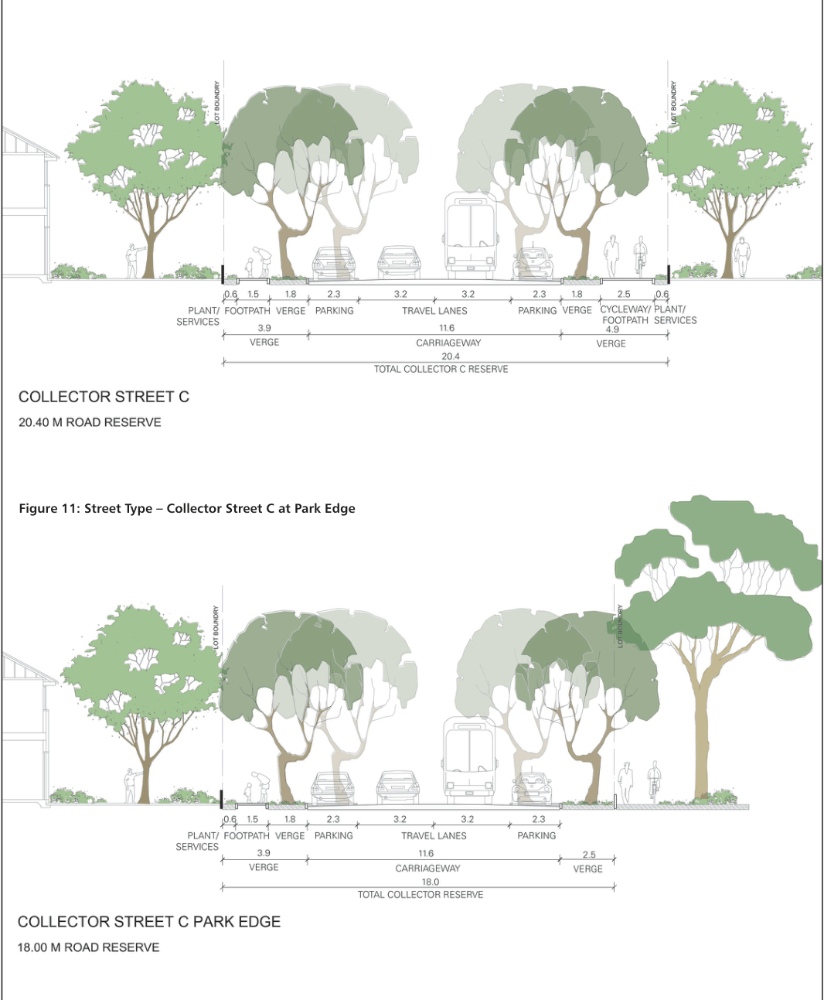

> [Picture on page 22: a picture, saved as a picture (images/vol-2-part-05-university-of-western-sydney-dcp-page-22-2.gif, 150 dpi).]

> Words printed on the picture (title and legend, copied from the PDF):
> figure 11: Street Type – Collector Street C at Park edge

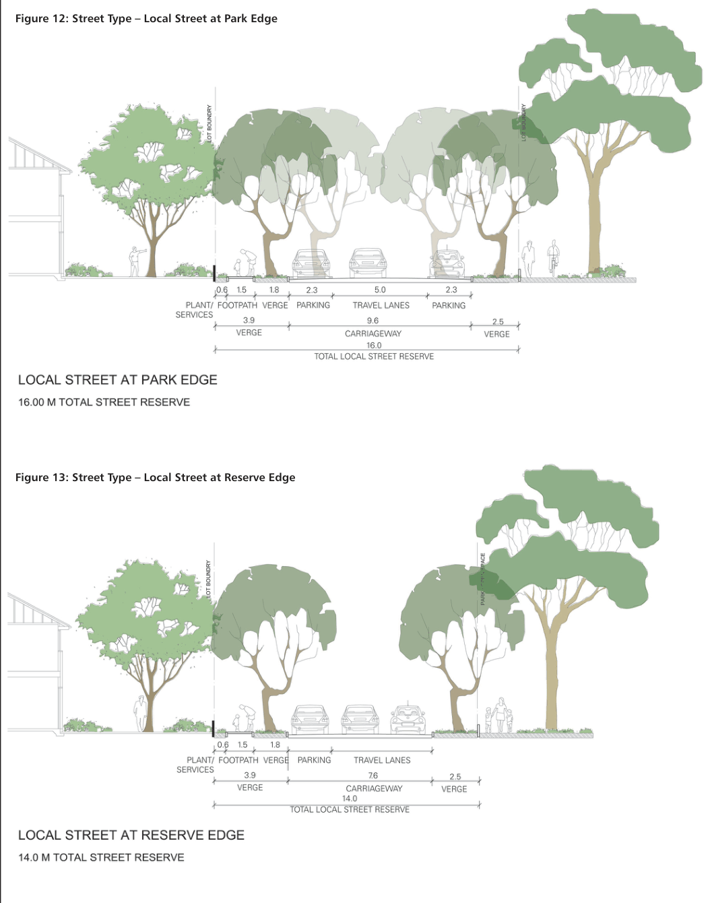

> [Picture on page 23: a picture, saved as a picture (images/vol-2-part-05-university-of-western-sydney-dcp-page-23-1.gif, 150 dpi).]
> Words printed on the picture (title and legend, copied from the PDF):
> figure 12: Street Type – local Street at Park edge
> figure 13: Street Type – local Street at Reserve edge

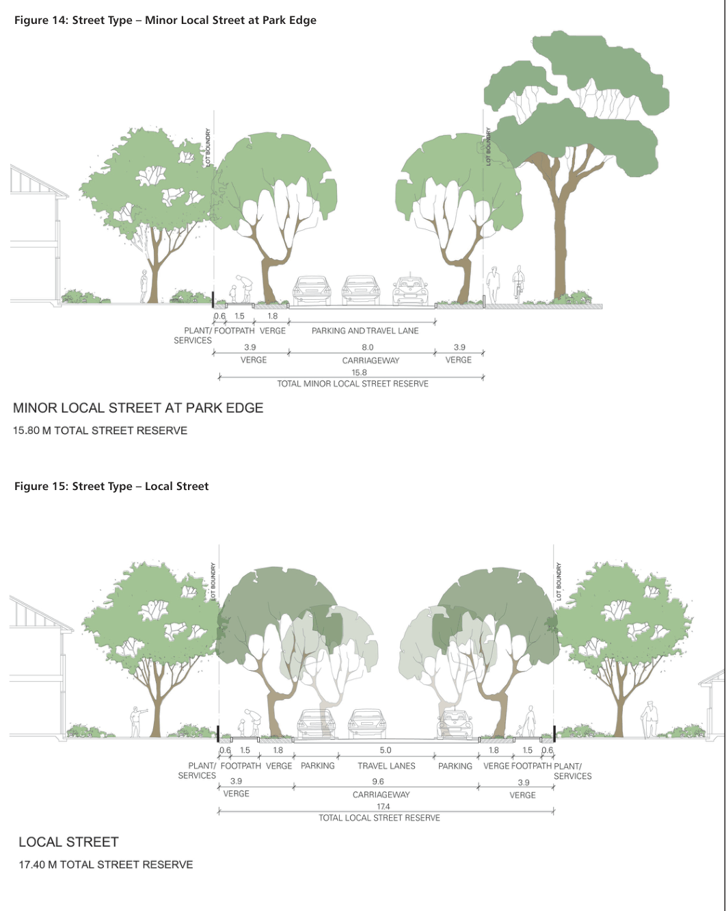

> [Picture on page 24: a picture, saved as a picture (images/vol-2-part-05-university-of-western-sydney-dcp-page-24-1.gif, 150 dpi).]
> Words printed on the picture (title and legend, copied from the PDF):
> figure 14: Street Type – minor local Street at Park edge

> Words printed on the picture (title and legend, copied from the PDF):
> figure 15: Street Type – local Street

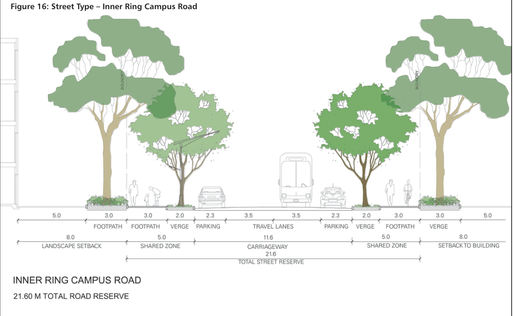

> [Picture on page 25: a picture, saved as a picture (images/vol-2-part-05-university-of-western-sydney-dcp-page-25-1.gif, 150 dpi).]
> Words printed on the picture (title and legend, copied from the PDF):
> figure 16: Street Type – inner Ring Campus Road

### 2.4 ACCeSS AnD CiRCUlATiOn

### 2.5 STReeTS

#### Objectives:

#### Objective:

• Ensure adequate access by a variety of modes to development on the site that does not negatively impact on the road network surrounding the site.

• Create a hierarchy of streets, each street type having its own character in terms of street setbacks, street trees, street quality and overall street character.

• Encourage use of public transport and cycling/ walking to reduce dependency on fossil fuels and private vehicle use.

• Provide for street trees to create a distinctive landscape, to reinforce themes, frame views and create attractive walking experiences.

• Use streets to define the edges between development and open spaces and to provide good levels of surveillance between the two.

• Maximise connections between the site and surrounding areas, particularly the existing connection to Macarthur station and the proposed bus interchange.

#### Design Requirements:

• Create a legible and functional road network that provides good connections with the surrounding areas and which clearly distinguishes between Campus and residential roads.

• Make adequate provision for bus services to service the site.

#### Design Requirements:

1\. The developer shall construct the proposed street network generally in accordance with the Indicative Street Hierarchy Plan at Figure 4.

2\. Individual road design, construction and landscaping shall be in accordance with the typical street types (refer Figures 8-16) and have regard to Council’s Engineering Design Guide for Developments and Specification for Construction of Subdivision Roads and Drainage Works.

3\. Kerbs shall generally be upright kerbing and not roll over.

4\. Street planting shall be coordinated with subdivision layout, traffic plan and services layouts to ensure appropriate configuration with vehicle crossovers, sight lines, lighting and other services and be generally in accordance with the species list (Appendix 2).

5\. A 500mm planting zone between public footpath and lot boundary shall be planted with non evasive low ground cover species.

6\. All street trees shall have root control barriers installed.

1\. Development shall be consistent with the Indicative Street Hierarchy, Pedestrian and Cycle Network Plans and Public Transport Network Plan at Figures 4, 5, 6 and 7.

2\. Pedestrian footpaths and cycleways shall be designed in accordance with Council’s Engineering Design Guide for Development.

3\. The developer shall provide street lighting to current Australian Standards and furniture including garbage bins, seating, bollards, signage etc, which relate to the street hierarchy and enhance the character of the development.

4\. Within the Academic lands all bus stops shall be off road, within dedicated bus bays. Bus shelters shall be provided in locations determined to have high demand.

5\. Within the Residential lands bus stops shall be on road utilising the parking lane provided for on collector roads. Bus shelters shall be provided in areas of high demand.

#### 2.6 lAnDSCAPe AnD OPen SPACe

#### Objectives:

• Build on the existing site character to create a distinctive and high quality campus and residential public domain.

• Create a network of open spaces, focal points and community facilities which provide for the active and passive needs of the community.

• Encourage planting and landscape treatments which build the environmental value of the site including biodiversity and which minimise water usage.

#### Design Requirements:

1\. Parks and open spaces shall generally be located as shown on the Illustrative Landscape Master Plan at Figure 17 and shall include facilities generally in accordance with the park type, character and proposed activities as detailed in Table 2.1 (see page 2-16).

2\. Landscape design shall enhance the visual character of the development and complement the design/use of spaces within and adjacent to the site.

3\. Street landscaping shall comply with Figures 8–16 and the streetscape character outlined in Table 2.2 (see page 2-17).

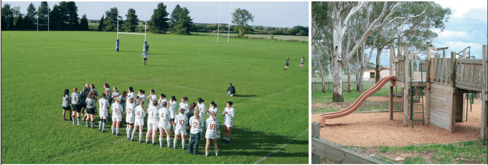

> [Picture on page 27: a picture, saved as a picture (images/vol-2-part-05-university-of-western-sydney-dcp-page-27-27.gif, 150 dpi).]

#### Table 2.1: Park Character and Activities

| PARK | ChARACTeR | ACTiViTieS | COnCePT |
|---|---|---|---|
| Major Ridge Park | Theme: Culture/Knowledge Linear park with informal ridge planting of native trees and trees with distinctive silhouettes to create site identity; extension of university campus landscape | Passive recreation; Picnics; children’s playground; education; outdoor exhibitions; Lookouts | Large scale passive open space, green backdrop Pedestrian and cycle ways with signature plantings; opportunity to integrate sculpture walk. |
| Riparian Park A | Theme: Lifestyle/Riparian corridor Link to lake; enhance existing vegetation; reinstate riparian woodland character; bridge crossing | Passive recreation; Wildlife watching/education; pedestrian pathway, | Informal parkland; natural character created by enhanced and restored creek line vegetation; create landscape links, provide seating area and pathway links to adjacent open spaces and streets. |
| Riparian Park B | Theme: Wildlife/Habitat corridor east-west orientation link to sports and recreation park; dense existing vegetation | Passive recreation; Wildlife watching/education; pedestrian and cycle way; Drainage function | enhanced and restored creek line vegetation; create landscape links, provide seating area and pathway links to adjacent open spaces and streets. |
| Riparian Park C | Theme: Green link/Sports park Link to adjacent sports field; green corridor links between campus zone and residential zone; | Passive recreation; sports; pedestrian pathway; Drainage function | Integrated informal indigenous vegetation with groups of formal planting to highlight adjacent green corridors in the campus area; create landscape links, provide pathway links to adjacent open spaces and streets. |
| Riparian Park D | Theme: Campus Entry/Water Feature Corridor Adjacent to campus entry road; landscape feature ponds | Passive recreation; outdoor exhibition; pedestrian art walk | A series of water features near campus entry road; varied open turfed areas defined by informal planting with public art display |
| Recreation Park | Theme: Sport and Ecology Passive recreation and active sports; existing vegetation retained and enhanced with copses of trees with lakeside activities, timber decks, waterside platforms playgrounds and bird watching | Passive and active recreation activities appealing to all age groups, Water bird watching; promenade; jogging; picnics, active ball games. Bicycle path. | Park landscape with lake, ecological wetlands setting. Variety of landscape spaces and lake edges; Upgraded sports fields and potential expansion of sports centre facilities; continuous pathway links to residential and academic precincts and lake edge; habitat protection; Drainage flood basin. |
| Knoll Park | Theme: Green park small local parks | Passive recreation, interpretation; small children’s playground | Informal local park accessible by immediate housing lots Pathway and seating area shaded by trees. |

#### Table 2.2: Streetscape Character

| STReeT TyPe | STReeTSCAPe ChARACTeR |
|---|---|
| Collector Streets On The Open Space | Generous informal character, overhanging shade, native tree species. |
| Local Streets Generally | Intimate character with regular street tree planting, mixture of native and deciduous species, concrete footpaths, minimize impact of driveways. |
| Local Streets Along Riparian Edges | open informal character, native canopy trees to blend in with character of riparian corridor. |
| Local Streets Along Ridges And Hillside Parks | strong local character, reinforce ridge tops and curvy street layouts with robust tree canopies, tall species with distinctive silhouettes. |
| Main Campus Streets | Pedestrian friendly streets, shaded tree canopies, mixture of deciduous and native trees. |
| Shared Zones | shaded overhanging canopies, trees planted in roadway to slow traffic, mixture of deciduous and native trees. |
| Entrance Drive | Maintain existing colourful deciduous character. enhance views to campus. |
| Ring Road | Distinctive campus-style avenue effect with large native trees and deciduous highlights (such as at thresholds gateways and entrances). |

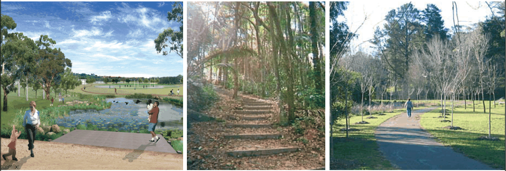

> [Picture on page 29: a picture, saved as a picture (images/vol-2-part-05-university-of-western-sydney-dcp-page-29-3.gif, 150 dpi).]

### 2.7 SAfeTy AnD SeCURiTy

#### Objectives:

• Ensure developments are safe and secure for occupants and visitors and contribute to the safety of the public domain.

• Ensure that development incorporates security features in accordance with the principles of Crime Prevention through Environmental Design (CPTED).

#### Design Requirements:

1\. Development should:

(i) maximise casual surveillance opportunities to the street and surrounding public places.

(ii) use streets fronting parks to provide opportunities for casual surveillance and improve safety of these areas.

(iii) ensure design does not give rise to dead ends and other possible entrapment areas.

(iv) clearly identify and illuminate access points.

(v) create a sense of ownership for the public domain through design to encourage community guardianship.

(vi) provide signage to make orientation and identification of public buildings and facilities clear.

(vii) ensure sight lines to all public areas shall be maximised. Concealed areas for possible hiding shall be avoided. Building designs shall minimise built elements which assist in providing illegitimate access. Service areas shall be secured or have surveillance.

(viii) ensure entrances shall be visible from the street.

(ix) ensure external lighting shall be designed to:

– encourage the use of safe areas,

– define safe corridors for movement of people,

– allow facial recognition of approaching pedestrians at 15m.

(x) minimise the use of external grilles, roller doors, downpipes and shelves which allow access to upper stories.

4\. Where existing significant trees are located within park areas consider detailed grading to provide for the retention of existing ground levels and trees.

5\. Lighting within open space and recreation areas shall conform to the current Australian Standards, including AS1158, AS1680 and AS2890 (as amended).

6\. Landscaping and structures shall not create obscured areas. Ensure tree species selected in public areas can be retained with a clear trunk to a minimum of 2m.

7\. Incorporate planting of indigenous species and vegetation communities to enhance native fauna habitats.

8\. Reduce water usage by using indigenous and low water tolerant species, as well as efficient irrigation systems.

9\. Native planting should be considered deep root planting to reduce salinity risk.

10\. Existing vegetation shall be retained where possible however all noxious weeds shall be removed. A report shall be provided with any Development Application detailing measures to be taken to ensure tree protection during construction prepared by a suitably qualified professional.

11\. Due to the topography immediately adjacent to many of the proposed ridgeline reserves and parks, the access from the adjacent public road system will be limited to those located where access can be safely and easily provided for people of all mobility levels. These access points shall be detailed upon the landscape plans for each proposed park or reserve.

12\. Provide seating areas, timber decks, directional signs and interpretive signage related to the detention ponds and wildlife.

13\. Provide shade trees and establish windbreaks where possible from southerly and westerly winter winds.

14\. Provide landscape screening to the railway line using indigenous trees and shrubs.

15\. Landscape plans to be prepared by a qualified landscape architect.

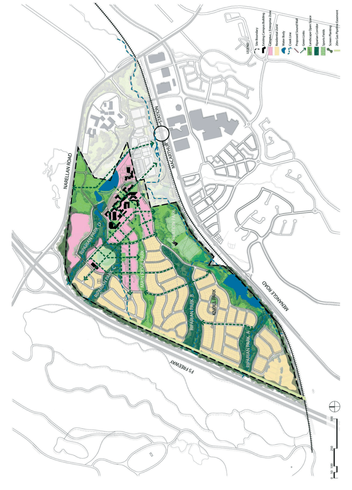

> [Picture on page 31: a picture, saved as a picture (images/vol-2-part-05-university-of-western-sydney-dcp-page-31-1.gif, 150 dpi).]

figure 17: illustrative landscape master Plan

### 2.8 VieWS AnD ViSTAS

#### Objectives:

• Ensure significant views and vistas from and to public places are protected.

#### Design Requirements:

Subsequent to the issue of Development Consent and prior to the issue of a Construction Certificate, a “dilapidation report” (prepared by a suitably qualified professional) shall be prepared upon all existing structures and utilities that lie within the zone of influence of an approved excavation or construction. A copy of the dilapidation report shall be provided to Council, the Principal Certifying Authority, and the owner(s) of each existing structure or utility.

1\. Development applications which relate to land within the University’s significant view catchment as identified in Figure 18 shall be accompanied by a landscape plan which addresses view corridors and screening to adjacent properties and the Freeway.

### 2.9 COnTROlS On eXCAVATiOn, flOOD liABle AnD/OR SlOPing lAnD

3\. Development incorporating fill shall comply with the following requirements:

(i) minimum site fall of 1% to any adjoining waterway or public road reserve, except where the Lot is serviced by an inter-allotment drainage easement.

(ii) fill batters to be no steeper than 3(H):1(V)

#### Objectives:

• Minimise the extent of earth works associated with development.

• Ensure that development appropriately responds to site conditions with proper consideration given to land capability and privacy/amenity of the proposed dwelling and adjoining properties.

• Ensure that excavation is minimised and properly retained.

• Ensure that adequate freeboard is provided to protect development from flooding and overland flows.

#### Design Requirements:

unless otherwise confirmed by a suitably qualified professional.

4\. Any proposed fill must be Virgin Excavated Natural Material (VENM) which has also validated by a suitably qualified professional as being “clean fill”.

5\. All fill deposited in the vicinity of existing endemic vegetation shall comprise local material, placed in layers, in order of their naturally occurring soil horizon.

6\. Land affected by the 100 year ARI storm event shall not be developed unless Council is satisfied that the development would be consistent with the NSW Government “Floodplain Development Manual – The Management of Flood Liable Land (April 2005) or its replacement.

7\. Any solid fence constructed across an overland flow path shall be a minimum 100mm above the predicted 1% AEP flow depth, as determined by a suitably qualified professional, of the overland flow path.

8\. Any allotments located on land that has been filled, shall be burdened by a 88B restriction regarding that fill and shall be noted on the respective Section 149 Certificate.

1\. A cut and fill management plan (CFMP) shall be submitted with the Development Application where a development incorporates cut and/or fill operations. The CFMP shall be in accordance with the requirements of the “Campbelltown (Sustainable City) Development Control Plan

– Appendix 6”.

2\. Any proposed excavation or structure within the zone of influence of any existing structure or utility, on or adjacent to the land, requires a ‘structural report’ (prepared by a suitably qualified professional) which demonstrates that adequate ameliorative measures can be implemented to protect the integrity of any existing structure or utility. This report shall be lodged with the CFMP as part of the Development Application.

figure 20: Significant panoramic view

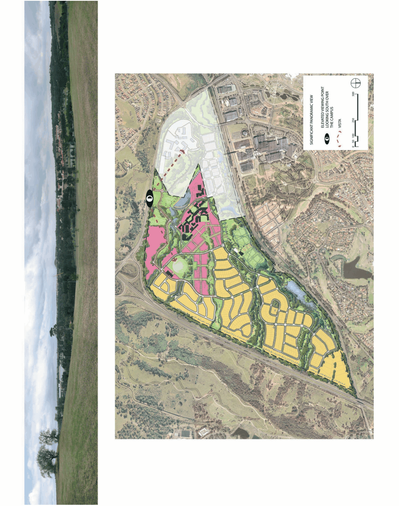

> [Picture on page 33: a picture, saved as a picture (images/vol-2-part-05-university-of-western-sydney-dcp-page-33-2.gif, 150 dpi).]

(v) Where site filling, at subdivision phase,

Requirements applying to

#### Civil and Subdivision Works:

requires a retaining wall element to be greater than 3m in height, the wall shall be terraced at a maximum grade of 3(V):1.5(H). All vertical face elements of the terrace shall be screened by vegetation planted upon the terrace immediately below the vertical face.

(vi) Rock cut face, having a maximum 1(V):0.25(H) for a maximum height of 3m which must be screened by vegetation.

(vii) Where site cutting, at the subdivision phase,

9\. The civil bulk earthworks undertaken during the subdivision phase will create the “engineered natural ground level”. All filling works shall have regard to Council’s Specification for Construction of Subdivision Roads and Drainage Works and AS 3798 Guidelines for Earthworks for Commercial and Residential Development.

10\. The interface between proposed public reserves and adjacent public roads shall be constructed as:

(i) Batters having a maximum 1(V):6(H) grade within “public reserves” where it is the intention of the proposed landscape plan for the batter to remain grassed.

(ii) Batters having a maximum 1(V):4(H) grade

requires a cut rock face element to be greater than 3m in height, the rock face shall be terraced at a maximum grade of 3(V):1.5(H). All vertical face elements of the terrace shall be screened by vegetation planted upon the terrace either immediately above or below the vertical element.

#### Requirements applying to Individual Lots:

within “public reserves” where it is the intention of the proposed landscape plan for the batter to be vegetated so as to require minimal maintenance.

(iii) Batters having a maximum 1(V):3(H) grade within “drainage reserves”. These batters are to be landscaped to reduce erosion, require minimal maintenance and provide a suitable transition from the riparian zones.

(iv) Retaining walls, having a maximum height of 3m, which must be screened by vegetation.

11\. For the purpose of creating a building platform, the sum of the maximum cut below the “engineered natural ground level” and the maximum depth of fill above the “engineered natural ground level” shall not exceed 1m, unless the interface between cut and fill is located more than 4m from any boundary in which case the sum shall not exceed 2.5m.

12\. All development shall satisfy the relevant floor level requirements as specified in Table 2.3, page 2-24.

13\. The proposed finished floor levels to non habitable rooms, including garages and outbuildings, must satisfy the relevant floor level requirement as specified in Table 2.3 for all sides except at their entrances where a 20mm to 30mm lip or ease may be provided below the freeboard.

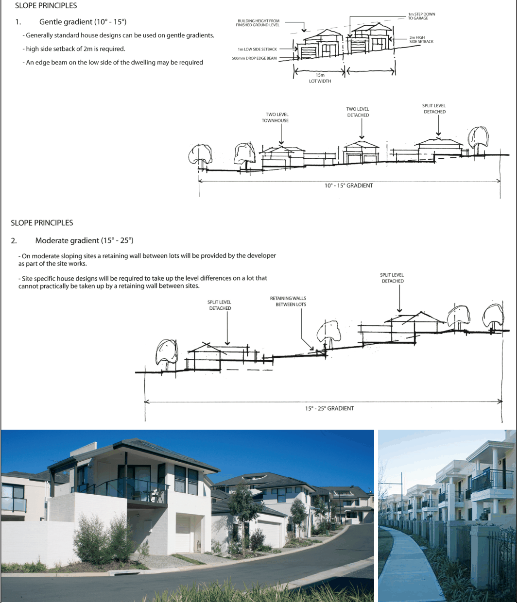

> [Picture on page 35: a picture, saved as a picture (images/vol-2-part-05-university-of-western-sydney-dcp-page-35-1.gif, 150 dpi).]

#### Table 2.3: floor level requirements for developments

| DeVelOPmenT | PReDiCTeD 1% AeP flOW DePTh OR WATeR leVel Of: An ADJACenT OfP; TRUnK DRAinAge ChAnnel OR BASin OR WATeR COURSe iS | flOOR leVel ShAll Be SeT AT The nOminATeD heighT ABOVe The 1% AeP flOOD leVel (fReeBOARD DePTh) |
|---|---|---|
| Non-habitable (including garages and outbuildings not adjacent to an OFP | 0mm | 100mm |
| Habitable rooms not adjacent to an OFP | 0mm | 150mm |
| Non habitable (including garages and outbuildings) affected by an adjacent OFP | ≤300mm | 100mm |
| Habitable rooms affected by an adjacent OFP | ≤300mm | 300mm |
| Non habitable (including garages and outbuildings) affected by an adjacent OFP | >300mm | 300mm |
| Habitable rooms affected by an adjacent OFP | >300mm | 500mm |
| All buildings (Habitable and Non Habitable) affected by an adjacent trunk drainage channel or basin or a | Any depth | 500mm |
| watercourse |  |  |

note: oFP – overland Flow Path

### 2.10 WATeR CyCle mAnAgemenT

### 2.11 RiSK mAnAgemenT

#### Objectives:

#### Objectives:

• Incorporate Water Sensitive Urban Design (WSUD) principles into development.

• Improve the quality and reduce the quantity of stormwater leaving the site, and reduce potable water usage.

• Ensure that hazards associated with development and the site are addressed so as to minimise the risk of:

– injury to persons/property

– damage to the environment and

– financial loss

#### Design Requirements:

#### Salinity

#### Design Requirements:

1\. Native vegetation and deep rooted trees shall be incorporated into gardens.

2\. Damp proof membranes shall be used in building construction for slabs on ground with a 50mm think layer of sand.

1\. Development shall not impact on adjoining sites by way of overland flow of stormwater. All overland flow shall be maintained in the pre-development form or be directed to designated overland flow paths such as roads.

2\. Development shall be consistent with Council’s Engineering Design Guide for Development.

3\. A suitable easement and drainage system shall be created over all downstream properties for development that cannot directly dispose of stormwater (under gravity) to the street or directly to Council’s trunk stormwater system.

4\. All rainwater tanks shall comply with AS3500 (as amended) – National Plumbing and Drainage Code Guidelines for Plumbing Associated with Rainwater Tanks in Urban Areas and Sydney Water’s Guideline for Rainwater Tanks on Residential Properties.

erosion and Sediment Control

#### Bushfire

#### Design Requirements:

#### Design Requirements:

1\. Development shall be located so as to minimise the risk of loss from bushfire.

2\. Development on bush fire prone land (as detailed on the Campbelltown Bush Fire Prone Lands Map) shall comply with the requirements of Planning for Bushfire Protection 2001 as amended from time to time.

3\. Asset protection zones are to be provided in accordance with the recommendations of the Bushfire Assessment prepared by Ecological Australia and dated January 2007.

4\. Adequate water reserves for fire fighting shall be available and accessible on site as specified in Planning for Bushfire Protection 2001.

#### 2.12 nOiSe

#### Objectives:

1\. An Erosion and Sediment Control Plan (ESCP) or Soil and Water Management Plan (SWMP) as applicable, shall be prepared and submitted with a development application proposing construction and/or activities involving the disturbance of the land surface.

2\. ESCPs or SWMPs to be prepared in accordance with Managing Urban Stormwater – Soils and Construction 2004”.

3\. Site activities shall be planned and managed to minimise soil disturbance.

4\. Catch drains or diversion banks shall be designed and constructed to divert water around any area of soil disturbance.

5\. All stockpiles shall be located within the sediment control zone and shall not be located within an overland flow path.

6\. A water pollution sign, supplied with the development consent, must be displayed on the most prominent point of the development site and be clearly visible to the street.

• Ensure all dwellings on site provide an appropriate level of amenity particularly in terms of noise for occupants.

#### Design Requirements:

1\. Development applications for land affected by noise from the F5 Freeway shall be accompanied by a noise management plan.

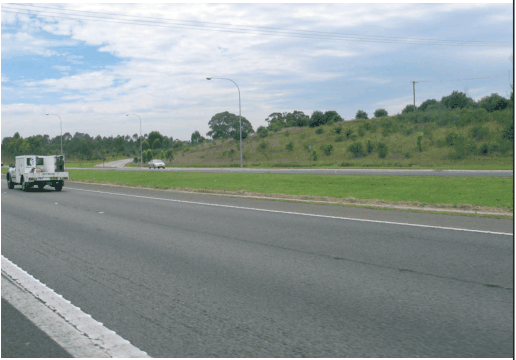

> [Picture on page 38: a picture, saved as a picture (images/vol-2-part-05-university-of-western-sydney-dcp-page-38-49.gif, 150 dpi).]

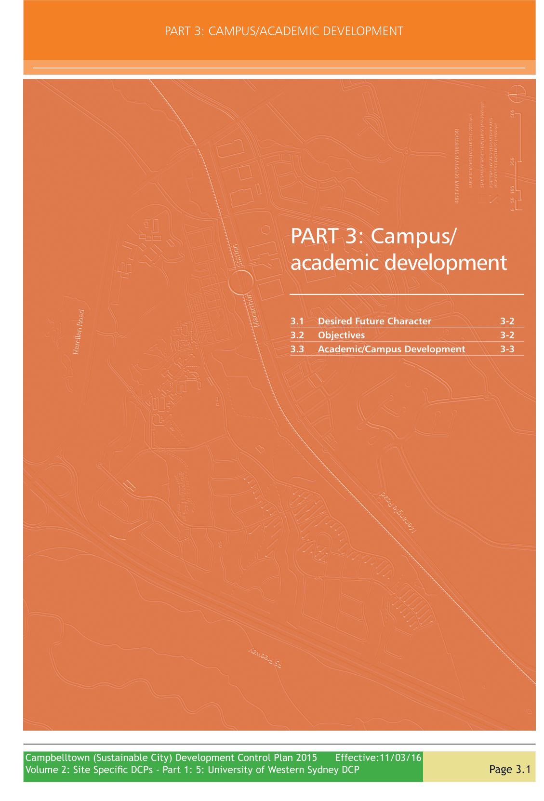

> [Picture on page 39: a picture, saved as a picture (images/vol-2-part-05-university-of-western-sydney-dcp-page-39-1.gif, 150 dpi).]
> Words printed on the picture (title and legend, copied from the PDF):
> 3-2
> 3-2

#### PARt 3: cAMPUs/AcADeMIc DeVeLoPMent

## PART 3: Campus/ academic development

### 3.1 Desired future Character

### 3.2 Objectives

### 3.3 Academic/Campus Development 3-3

> [Picture on page 40: a picture, saved as a picture (images/vol-2-part-05-university-of-western-sydney-dcp-page-40-1.gif, 150 dpi).]

### 3.1 DeSiReD fUTURe ChARACTeR

### 3.2 OBJeCTiVeS

The desired future character of this area is as follows: The objectives for future academic/campus development

are as follows:

• Accommodate university growth.

• Accommodate employment, research and development uses closely related to the University.

• Provide greater integration and connectivity within the campus and between the campus and surrounding areas.

• Strengthen the links between the campus and Macarthur Square and Station.

• Intensify and activate the campus core as a pedestrian place that is strongly connected to the community and public transport.

• Establish a vital and energetic campus that provides a diverse range of activities for students, workers and the surrounding community.

the existing UWs campbelltown campus is one of the most cohesive in sydney, designed in response to the very distinct landscape and topographical character of the site. the proposed campus extension will continue this approach with new areas of development defined by an expanded public domain of linked pedestrian walkways and open spaces. While it is expected that the density of the campus will increase over time, as it is envisaged that the campus will remain a ‘compact’ one, the open space and landscape character of

#### the campus will continue to be reinforced.

• Create a public domain that will be distinctive and memorable as it links existing places, including existing campus places as well as significant landscape features such as the ridge and lake areas.

All development is to be consistent with the above objectives.

the view of the central campus buildings seen from narellan Road will be protected. the proposed ring roads will maintain a defined edge between the campus and the

#### proposed new residential areas.

> [Picture on page 40: a picture, saved as a picture (images/vol-2-part-05-university-of-western-sydney-dcp-page-40-44.gif, 150 dpi).]

### 3.3 ACADemiC/CAmPUS DeVelOPmenT

#### Objectives:

• Allow development to accommodate the academic and administrative functions of the University as well as any ancillary functions.

• Allow development to accommodate business and other uses closely related to the University.

#### Design Requirements:

1\. Any new development within the academic campus area shall be consistent with the existing campus urban structure and reinforce the notion of a “walkable campus”.

2\. Proposed campus/academic type development shall be designed to encourage student activity, be welcoming and contribute to the character of the University as a distinctive place with its own “sense of place”.

3\. Development shall be designed to reinforce the existing network of ‘places’ within the campus and then link them with clear and direct pedestrian pathways. The paths should follow contours, recognising that this will be the most efficient route for students and staff to take.

4\. The proposed built form shall respond to both the topography and visual impact as well as the flexible needs of a growing campus.

> [Picture on page 41: a picture, saved as a picture (images/vol-2-part-05-university-of-western-sydney-dcp-page-41-27.gif, 150 dpi).]

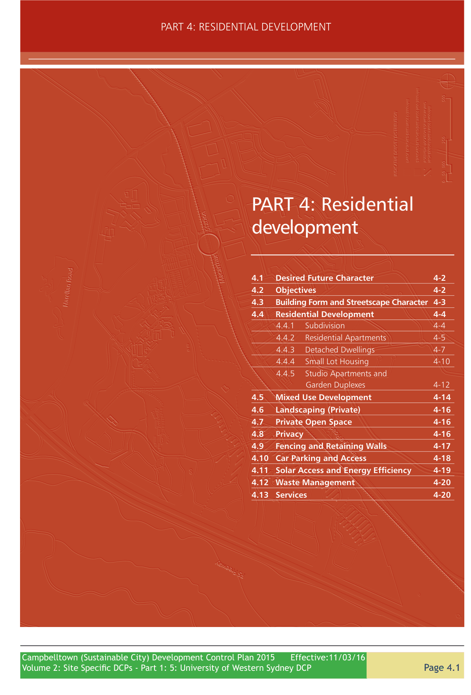

> [Picture on page 43: a picture, saved as a picture (images/vol-2-part-05-university-of-western-sydney-dcp-page-43-1.gif, 150 dpi).]

## PART 4: Residential development

| 4.1 | Desired future Character | 4-2 |
|---|---|---|
| 4.2 | Objectives | 4-2 |
| 4.3 | Building form and Streetscape Character | 4-3 |
| 4.4 | Residential Development 4.4.1 subdivision 4.4.2 Residential Apartments 4.4.3 Detached Dwellings 4.4.4 small Lot Housing 4.4.5 studio Apartments and Garden Duplexes | 4-4 4-4 4-5 4-7 4-10 4-12 |
| 4.5 | mixed Use Development | 4-14 |
| 4.6 | landscaping (Private) | 4-16 |
| 4.7 | Private Open Space | 4-16 |
| 4.8 | Privacy | 4-16 |
| 4.9 | fencing and Retaining Walls | 4-17 |
| 4.10 | Car Parking and Access | 4-18 |
| 4.11 | Solar Access and energy efficiency | 4-19 |
| 4.12 | Waste management | 4-20 |
| 4.13 | Services | 4-20 |

### 4.1 DeSiReD fUTURe ChARACTeR

### 4.2 OBJeCTiVeS

Residential and community development will generally occur within the area delineated as suitable for residential uses as shown on Figure 3.

• Promote well-designed buildings that make a positive contribution to the streetscape and amenity of the neighbourhood.

The desired future character of this area is as follows:

• Encourage a variety of forms of housing that are higher in density than traditional dwelling houses in locations which have a high level of amenity or are accessible to public transport and service facilities.

• Ensure development makes the best use of a site’s natural and other positive features, and considers amenity, streetscape and energy efficiency at the outset.

All development is to be consistent with the above objectives.

the residential area extends south and west of the existing academic campus. the area will be characterised by the distinctive undulating topography of the campbelltown hills and pronounced watercourses running through valleys between the hill sides. the residential development sits between the watercourses defined at their edges by a network of public streets. the streets will be generous and ‘leafy’ with street trees and footpaths on both sides of typical streets, creating walkable neighbourhoods.

House lots are generally sized in response to the character of the site with small lots near the southern open space on flatter land with larger single occupancy lots on

#### the steeper areas.

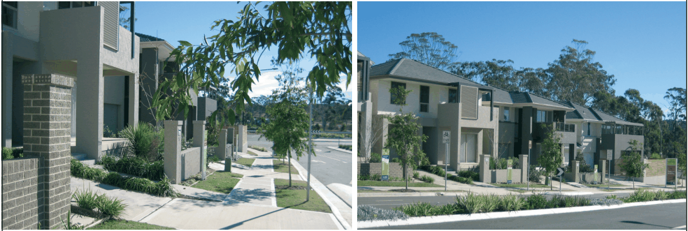

> [Picture on page 44: a picture, saved as a picture (images/vol-2-part-05-university-of-western-sydney-dcp-page-44-37.gif, 150 dpi).]

> [Picture on page 45: a picture, saved as a picture (images/vol-2-part-05-university-of-western-sydney-dcp-page-45-1.gif, 150 dpi).]

### 4.3 BUilDing fORm AnD STReeTSCAPe ChARACTeR

#### Objective:

• Encourage innovative and quality building designs which are distinctive and contemporary and fit harmoniously with their surroundings.

• Ensure that building design is responsive to the site’s topography.

• Establish quality streetscapes which respond to the site topography and which add to the visual and environmental amenity of the site.

#### Design Requirements:

5\. A site’s natural slope should be used to create visual interest and generate innovative housing forms while minimising cut and fill consistent with the requirements of Section 2.9.

6\. All dwellings, mixed use buildings and RABs shall be designed with a contemporary architectural character.

7\. Outbuildings and ancillary structures shall be located to the rear of the site.

8\. The maximum slope of a pitched roof shall be 36 degrees.

9\. Eaves are mandatory on pitched and sloping roofs and are to extend 450mm from the side of the dwelling except for zero lot line and parapet walls.

10\. Parapet, skillion and vaulted roof forms may be incorporated to create variety in architectural style.

11\. No blank walls shall be presented to any street frontage. Any continuous wall of more than one storey in height shall be no more than 10m in length on a street frontage and 14m on any other

side. Walls over the maximum length shall have a minimum offset of 500mm for the remainder of that wall. This does not apply to party walls between attached dwellings.

12\. The height of development shall not result in any significant loss of amenity (including loss of solar access and visual and acoustic privacy) to adjacent properties and public places.

1\. Building design (including façade treatment, massing, roof design and entrance features), setbacks and landscaping shall complement the scale of development, character and qualities of the adjoining streetscape.

2\. Articulate building frontages facing the street to add visual interest. Use of stepping, material combinations, verandahs, porches and balconies, canopies and blade walls is encouraged.

3\. Development on corner sites shall incorporate facade treatments that address both street frontages and achieve articulation in the building design.

4\. The built form shall relate to the natural landform and setting, particularly when viewed from a public place, building entrance ways and recognised vantage points outside the immediate locality.

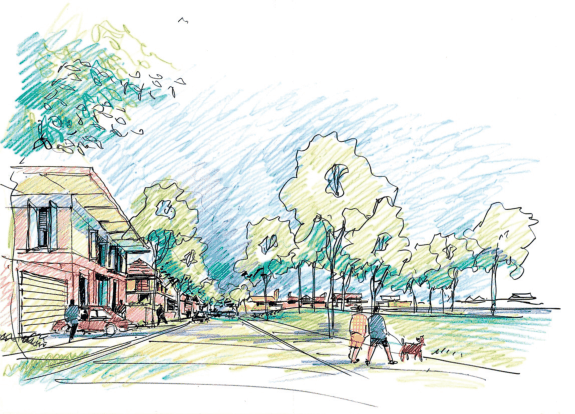

> [Picture on page 45: a picture, saved as a picture (images/vol-2-part-05-university-of-western-sydney-dcp-page-45-59.gif, 150 dpi).]

> [Picture on page 46: a picture, saved as a picture (images/vol-2-part-05-university-of-western-sydney-dcp-page-46-1.gif, 150 dpi).]

### 4.4 ReSiDenTiAl DeVelOPmenT

#### 4.4.1 Subdivision

#### Objectives

• Encourage a variety of lot sizes across the site to promote a variety of housing choice and achieve the desired urban form and density.

• Ensure that subdivision of residential land responds to the physical characteristics of the land.

13\. All dwellings shall have at least one habitable room with sufficient openings for public surveillance at ground level addressing the primary street frontage.

14\. When determining appropriate external building materials for residential development, the following guidelines shall be observed:

(i) External wall materials shall be predominantly masonry and finished in either face brickwork, coloured/painted render or coloured bagging;

(ii) Lightweight materials can be utilized to

• Ensure that subdivision of residential land provides safe connections with and extension of existing street patterns, as well as any pedestrian, cycleway and public open space networks.

provide variety in textures or profiles on dwelling facades (e.g. timber, feature fibre cement sheeting or pre-finished metal sheeting) or if required due to geotechnical constraints;

(iii) No galvanised iron or plain cement sheeting

#### Design Requirements:

shall be utilised on external walls;

(iv) Low profile concrete, terracotta or slate roof tiles or pre-finished and pre-coloured corrugated metal roofing shall be utilised.

15\. The colour palette to be used in all dwellings shall consist largely of neutral, natural tones. Feature colours may be utilised for selected elements to create interest and highlights.

16\. A detailed schedule of the proposed external finishes, materials and colours shall be submitted for Council’s approval as part of the development application.

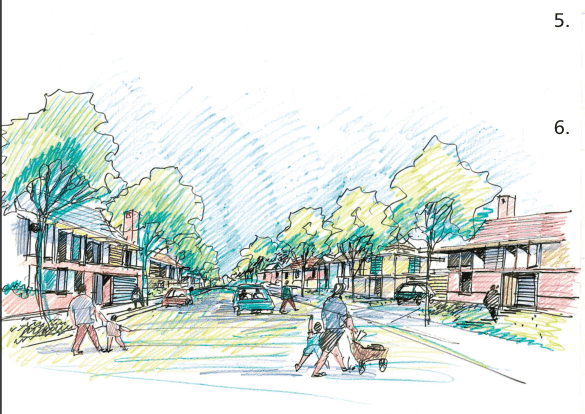

> [Picture on page 46: a picture, saved as a picture (images/vol-2-part-05-university-of-western-sydney-dcp-page-46-42.gif, 150 dpi).]

1\. The final design of residential allotments shall have regard for the impact of orientation, slope, and aspect to maximise solar access to future development.

2\. Subdivisions shall demonstrate compliance with the relevant design requirements contained in this Part.

3\. Subdivisions shall promote through street access and minimise the number of cul-de-sacs.

4\. Battle axe lots shall only be permitted where a street frontage can not otherwise be provided due to levels or safe street access requirements. Such lots shall have a minimum lot area of 500m2 excluding the access handle. Access handles shall be straight and have a minimum width of 3.5m or 6m for two adjacent handles with reciprocal rights of way.

5\. Car courts shall be accessed by a handle of no more than 40m in length and able to accommodate adequate turning and manoeuvrability in accordance with AS 2890. Through lanes are also permitted.

6\. Studio apartments may be strata subdivided subject to compliance with the criteria outlined in Section 4.4.5 below.

#### Design Requirements:

#### 4.4.2 Residential Apartment Buildings

#### Objectives:

• Encourage high quality residential apartments within areas of high amenity, in accessible locations and in close proximity to business centres.

• Ensure that the design of residential apartments responds to the site’s environmental characteristics and setting.

1\. All residential apartment buildings shall comply with the requirements set out in Table 4.1 below.

2\. All residential apartment buildings shall comply with State Environmental Planning Policy No. 65

– Design Quality of Residential Flat Development and the Residential Flat Design Code.

3\. Where possible vehicle entry points shall be located at the rear or off side streets.

• Achieve a high level of amenity for the occupants of residential apartment buildings, adjoining developments and public places.

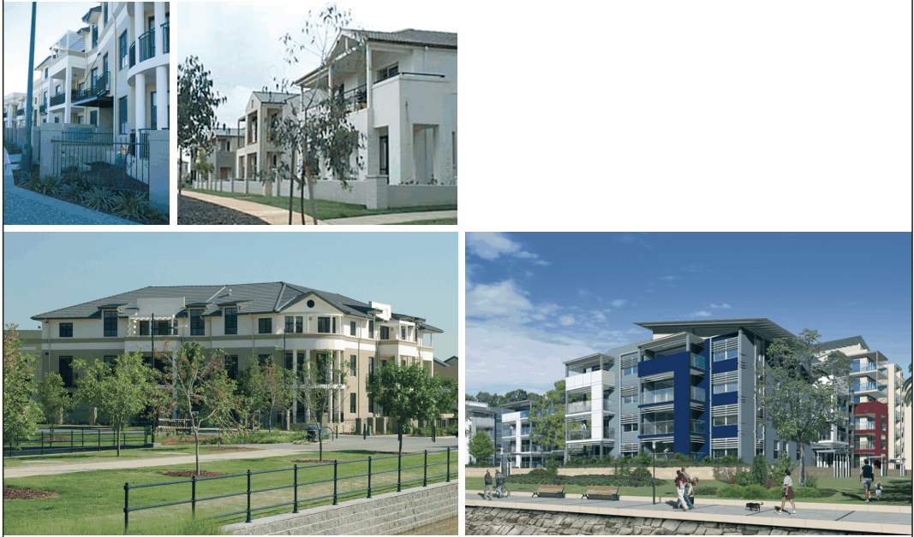

> [Picture on page 47: a picture, saved as a picture (images/vol-2-part-05-university-of-western-sydney-dcp-page-47-21.gif, 150 dpi).]

Table 4.1: Development Standards for Residential Apartment Buildings

| CRiTeRiA | COnTROlS |
|---|---|
| Minimum Allotment Size | 1000 m2 |
| Minimum frontage width | 20m (measured at front property boundary) |
| Landscape Area | Minimum 20% of site suitable for deep soil planting |
| Private Open Space (POS) either | Minimum 8m2 for each apartment – directly accessible from living areas |
| courtyard or balcony | Ground floor Pos shall be screened for privacy |
| Minimum clear balcony depth | 2m |
| Setbacks (Min/m) |  |
| Front | • 4m – Primary frontage • 4m – secondary frontage (note: setback may be reduced if appropriate in the streetscape) |
| side | • 5m (for buildings up to 4 storeys in height) unless attached to an adjoining building • 9m (for buildings greater than 4 storeys in height) |
| Rear | 9m |
| Height | Maximum 10 storeys |
| No. of dwellings accessible from common lobby or corridor in each level of building | Max 10 dwellings |
| Access | Minimum 1 lift required for access from basement to upper most floor (inclusive) in each RAB Max 30 dwellings accessed from a common lift shaft Access to lifts to be direct and well illuminated |
| Storage | each apartment to be provided with an internal storage area with minimum capacity: • studio Apartment – 6 m3 • 1 Bedroom Apartment – 8 m3 • 2 Bedroom Apartment – 10 m3 • 3 Bedroom Apartment – 12 m3 • 4 (or more) Bedroom Apartment – 15m3 |
| Car Parking Spaces | In accordance with As2890 Parts 1 and Minimum 1 space per dwelling plus: (i) an additional space for every 4 dwellings (or part thereof) (i) an additional visitor space for every 10 dwellings (or part thereof) Where development greater than 3 storeys all car parking is to be at basement level Parking at ground level shall be screened from view |
| Car Parking Space Dimension | Min 2.5m (2.7m where adjoins hard edge) X 5.5m |
| Driveway location | Min 6m from splay of any intersection |
| Bicycle Parking | All residential apartment buildings to provide bicycle storage at a rate of 1 space per 5 dwellings within common property. |
| Waste | In addition to requirements of 4.12 below all RABs shall provide bins at the following rates: (i) a 240 litre /2dwellings/week for household garbage; or (ii) 1000/1100 litre bulk bin; and (ii) A 240 litre/dwelling/fortnight for dry recyclables; (iii) Garden organic bins as required to be collected fortnightly. communal bin storage room in accordance with requirements of 4.3.10 of campbelltown (sustainable city) DcP |

#### Design Requirements:

#### 4.4.3 Detached Dwellings

#### Objectives:

• Encourage quality-designed dwelling houses that make a positive contribution to the streetscape and amenity of the neighbourhood.

1\. Detached dwellings shall generally take the form of either Standard Detached Dwellings (400–2000m2) or Large Detached Dwellings – over 2000m2 as provided for in Tables 4.2 and 4.3 on the following pages. Dwellings shall comply with the specific development controls for the relevant form of dwelling according to allotment size.

• Provide definition of the public domain by ensuring development addresses the streets and open spaces.

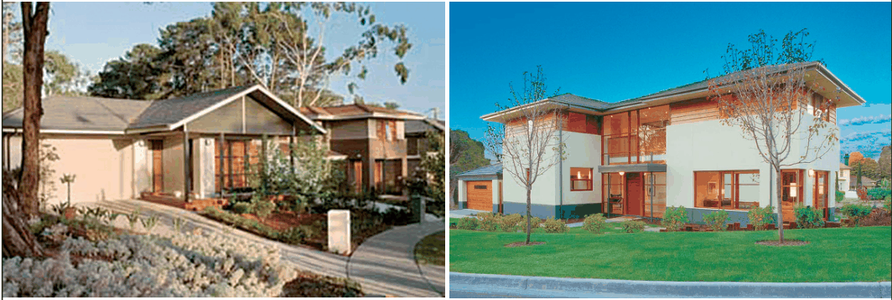

> [Picture on page 49: a picture, saved as a picture (images/vol-2-part-05-university-of-western-sydney-dcp-page-49-16.gif, 150 dpi).]

> [Picture on page 50: a picture, saved as a picture (images/vol-2-part-05-university-of-western-sydney-dcp-page-50-1.gif, 150 dpi).]

#### Table 4.2: Development Standards for Standard Detached Dwellings (400–2000m2)

| CRiTeRiA | COnTROlS |
|---|---|
| Minimum Allotment Size | 400m2 |
| Maximum Allotment Size | 2000m2 |
| Minimum average allotment width | 15m |
| Minimum Lot Depth | 20m |
| Private Open Space (POS) | 20% excluding driveways |
| Minimum width of POS | 2m – directly accessible from living areas |
| Minimum dimension of Principal POS | 4m X 5m |
| Maximum Building site coverage | 60% |
| Setbacks (Min/m) |  |
| Primary front | 4m |
| side | 1m 2m (on high side of lot where lot frontage slopes more than 10%) |
| Rear | • 4m • 8m – Upper Level |
| side and Rear (Garage) | Zero |
| corner Lots (secondary street Frontage) | 2m – up to 500m2 Greater than 500m2: • 2m – for a maximum length of 9m • 4m – along both street frontages for length of frontages beyond 9m • 3m – where frontage is to open space |
| Lightweight projections (balconies/verandahs/perches) | 2m |
| Maximum No. of Storeys | 2 |
| Maximum building length of any second storey wall component | 14m |
| Max Height of Dwelling | • 7.2m – to uppermost ceiling • 10m – to ridgeline |
| Car Parking Spaces | refer to table 4.7 |
| Garage Minimum Internal Dimension | refer to table 4.8 |
| Maximum Garage Door Width | not more than 50% of the dwelling width |

> [Picture on page 51: a picture, saved as a picture (images/vol-2-part-05-university-of-western-sydney-dcp-page-51-1.gif, 150 dpi).]

#### Table 4.3: Development Standards for large Detached Dwellings – Over 2000m2

| CRiTeRiA | COnTROlS |
|---|---|
| Minimum Allotment Size | 2000m2 |
| Minimum Lot Depth | 30m |
| Maximum Building site coverage | 35% |
| Setbacks (Min/m) |  |
| Primary Front (Building) | • 10m – Building Façade (may be reduced to 6m where opposite standard dwellings) • 2.0 – articulation zone (minor architectural features) |
| side | 3m |
| Rear | 5m 8m (upper level) |
| corner Lots (secondary street Frontage) | 4m |
| Maximum No. of Storeys | 2 |
| Max Height of Dwelling | • 7.2m – to uppermost ceiling • 10m – to ridgeline |
| Car Parking Spaces | Refer table 4.7 |
| Garage Minimum Internal Dimension | Refer table 4.8 |
| Max Garage Door Width | not more than 50% of the dwelling width |
| Domestic Outbuilding Max Height | 3.6m |
| Domestic Outbuilding Maximum Area | 100m2 |

> [Picture on page 52: a picture, saved as a picture (images/vol-2-part-05-university-of-western-sydney-dcp-page-52-1.gif, 150 dpi).]

#### Design Requirements:

#### 4.4.4 Small lot housing (less than 400m2)

#### Objectives:

• Encourage quality-designed dwelling houses that make a positive contribution to the streetscape and amenity of the neighbourhood.

1\. Small lot housing shall comply with the requirements set out in Table 4.4 below.

2\. Terrace housing is encouraged to have garages accessible from a car court, rear or secondary street frontage.

• Promote housing choice/variety/ affordability.

• Provide higher density dwellings on collector roads and bus routes, around parks and close to community facilities.

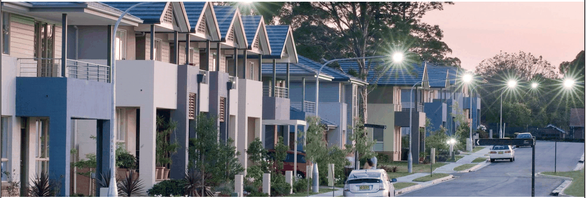

> [Picture on page 52: a picture, saved as a picture (images/vol-2-part-05-university-of-western-sydney-dcp-page-52-17.gif, 150 dpi).]

#### Table 4.4: Development Standards for Small lot housing (under 400m2)

| CRiTeRiA | COnTROlS |
|---|---|
| Minimum Allotment Size | 200m2 (terrace house) 250m2 (zero lot) 350m2 (small detached) |
| Minimum average allotment width | 6.5m (terrace house) |
| (measured at primary building line) | 10m (zero lot) 12.5m (small detached) |
| Maximum average allotment width – zero lots only (measured at primary building line) | 15m |
| Minimum Lot Depth | 20m |
| Private Open Space (POS) | 20% excluding driveways |
| Minimum width of POS | 2m – directly accessible from living areas |
| Minimum dimension of Principal POS | 4m X 4m |
| Maximum Building site coverage | 65% |
| Setbacks (Min/m) |  |
| Primary Front |  |
| • terrace houses | 3.5m |
| • Zero Lot | 4m |
| • small detached | 4m |
| side | 1m (except attached and zero lot) |
| Rear | • 4m • 8m – Upper Level |
| side and Rear (Garage) | Zero (this does not constitute a zero lot dwelling) |
| corner Lots (secondary street Frontage) | 2m |
| Lightweight projections (balconies/verandahs/perches) | 2m |
| Maximum No. of Storeys | 2 |
| Maximum building length of any second storey wall component | 14m |
| Max Height of Dwelling | • 7.2m – to uppermost ceiling • 10m – to ridgeline |
| Car Parking Spaces | refer to table 4.7 |
| Garage Minimum Internal Dimension | refer to table 4.8 |
| Maximum Garage Door Width | not more than 50% of the dwelling width |
| Easement for Zero Lots | 1m |

> [Picture on page 54: a picture, saved as a picture (images/vol-2-part-05-university-of-western-sydney-dcp-page-54-1.gif, 150 dpi).]

#### 4.4.5 Studio Apartments and garden Duplexes

3\. A separate off-street car parking space shall be provided for the occupants of the studio apartment in addition to the car parking requirements for the main dwelling.

4\. A separate area for clothes drying at ground level shall be provided out of view from the public domain for the studio apartment.

#### Design Requirements – Garden Duplexes

Studio apartments are “self-contained” and therefore include a combined living/bedroom area, a bathroom, maisonette kitchen and a separate on site car parking space. Studio apartments promote casual surveillance over car courts and secondary streets. Studio apartments can be strata titled and exclude garage lofts.

Garden duplex dwellings consist of a ground and an upper level single storey dwelling. Garden duplexes may form part of a group of houses or be detached. Garden duplexes can be strata titled.

#### Objectives:

5\. Garden duplexes shall comply with the requirements set out in Table 4.5 (see page 4-13).

6\. Each garden duplex shall be provided with a minimum of one off street parking space.

7\. A separate area for clothes drying at ground level shall be provided out of view from the public domain for each dwelling.

• Provide housing choice/diversity for families;

• Provide the opportunity for rental accommodation for single occupants; and

• Provide casual surveillance over rear access points.

#### Design Requirements – Studio Apartments

1\. Studio apartments shall comply with the requirements set out in Table 4.5 (see page 4-13).

2\. Studio apartments shall be located on top of detached double garages accessible from car courts or secondary street frontages only.

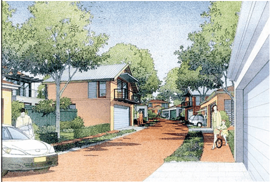

> [Picture on page 54: a picture, saved as a picture (images/vol-2-part-05-university-of-western-sydney-dcp-page-54-40.gif, 150 dpi).]

#### Table 4.5: Development Standards for studio apartments and garden duplexes

| CRiTeRiA | COnTROlS |
|---|---|
| Minimum Allotment Size | 300m2 for duplex dwellings |
| Minimum frontage width | 10m for duplex dwellings (12.5m for corner lot) 6.5m for attached dwellings (9m for corner lot) |
| Minimum average allotment width (measured at primary building line) | 5m |
| Minimum Lot Depth | 25m |
| Private Open Space (POS) | 10m2 (studio – minimum balcony width 2m) 16m2 (duplex) |
| Minimum width of POS | 2m for studios |
| Minimum dimension of Principal POS | 4m directly accessible from living areas (duplex only) |
| Maximum Building site coverage | 65% for duplex dwellings only |
| Setbacks (Min/m) |  |
| Primary Front (Building) | 3.5m – Building Façade (as part of terrace group) 4.0m – Building Façade (elsewhere) 2.0 – articulation zone (minor architectural features) |
| side | 1.0m (except for attached dwellings and zero lots) |
| Rear | 4.0m – Ground Level (duplex only – excluding rear garage) 8m – Upper Level (duplex only) |
| corner Lots (secondary street Frontage) | 2m |
| Easement for Zero Lot Line | 1m |
| Maximum No. of Storeys | 2 (excludes attic) |
| Maximum building length of any second storey wall component | 14m |
| Max Height of Dwelling | 7.2m – to uppermost ceiling 10m – to ridge line |
| Car Parking Spaces | refer table 4.7 |
| Garage Minimum Internal Dimension | refer table 4.8 |
| Max Carport and Garage Door Width | not more than 50% of the dwelling width |

#### 4.5 miXeD USe DeVelOPmenT

#### Objectives:

• Encourage high quality, high density mixed use development within close proximity to public transport and business centres, which is innovative and responsive to the site’s environmental characteristics and setting.

• Ensure a high level of amenity for the occupants of mixed use development, adjoining developments and public places.

#### Design Requirements:

1\. The residential component of any mixed use developments shall comply with State Environmental Planning Policy No. 65 – Design Quality of Residential Flat Development and the Residential Flat Design Code.

2\. Mixed use development shall comply with the requirements set out in Table 4.6 below.

3\. Mixed use development shall incorporate retail and/or commercial office uses at least at the ground floor level.

4\. Where possible vehicle entry points shall be located at the rear or off side streets.

> [Picture on page 57: a picture, saved as a picture (images/vol-2-part-05-university-of-western-sydney-dcp-page-57-1.gif, 150 dpi).]

#### Table 4.6: Development Standards for mixed Use Development

| CRiTeRiA | COnTROlS |
|---|---|
| Minimum Allotment Size | not applicable |
| Minimum frontage width | not applicable |
| Landscape Area | Minimum 20% of site suitable for deep soil planting |
| Private Open Space (POS) either courtyard or balcony | Minimum 8m2 for each apartment – directly accessible from living areas Ground floor Pos shall be screened for privacy |
| Minimum dimension of POS | 2m |
| Setbacks (Min/m) |  |
| Front | nil – Primary frontage nil – secondary frontage |
| side | 3m or as specified in the RFDc (whichever is the greater) – for ground and first floor 5.5m or as specified in the RFDc (whichever is the greater) – above first floor level |
| Rear | nil (for ground and first floor) 5.5m or as specified in the RFDc (whichever is the greater) – above first floor level |
| Height | Maximum 10 storeys |
| No. of dwellings accessible from common lobby or corridor in each level of building | Max 10 dwellings |
| Access | Minimum 1 lift required for access from basement to upper most floor (inclusive) in each RAB Max 30 dwellings accessed from a common lift shaft Access to lifts to be direct and well illuminated Pedestrian access to residential apartments on upper levels to be separated from commercial/retail uses at lower levels. |
| Storage | each apartment to be provided with an internal storage area with minimum capacity: studio Apartment – 6m3 1 Bedroom Apartment – 8m3 2 Bedroom Apartment – 10m3 3 Bedroom Apartment – 12m3 4 (or more) Bedroom Apartment – 15m3 |
| Car Parking Spaces | In accordance with As2890 Parts 1 and 2 Minimum 1 space per dwelling plus: (i) an additional space for every 4 dwellings (or part thereof) (iv) an additional visitor space for every 10 dwellings (or part thereof) Where development greater than 3 storeys all car parking is to be at basement level Parking at ground level shall be screened from view Plus 1 space per 25m2 of retail floor space and 1 space per 35m2 of commercial floor space |
| Car Parking Space Dimension | Min 2.5m (2.7m where adjoins hard edge) X 5.5m |
| Driveway location | Min 6m from splay of any intersection |
| Loading/Unloading | Development shall provide adequate space for on site parking, loading and unloading of all delivery/service vehicles |
| Waste | In addition to requirements of 4.12 below all RABs shall provide bins at the following rates: (iii) a 240 litre/2dwellings/week for household garbage; or (iv) 1000/1100 litre bulk bin; and (v) A 240 litre/dwelling/fortnight for dry recyclables; (vi) Garden organic bins as required to be collected fortnightly. communal bin storage room in accordance with requirements of 4.3.10 of campbelltown (sustainable city) DcP separate provisions to be made for commercial and residential waste |

#### 4.6 lAnDSCAPing (PRiVATe)

### 4.7 PRiVATe OPen SPACe

#### Objectives:

#### Objectives:

• Ensure appropriate landscaping of all residential developments.

• Ensure residents are provided with practical, useable and well located outdoor living environments.

#### Design Requirements:

• Enhance the sustainability of the development by minimising water usage, contributing to biodiversity and enhancing passive energy systems for development.

#### Design Requirements:

1\. Private open space must be:

(i) clearly defined for the private use of occupants.

(ii) a useable size and dimension,

(iii) a suitable slope.

(iv) directly accessible from a living area, and

(v) capable of receiving sufficient sunlight

2\. Private open space must be located beyond the street-front setback where orientation permits.

3\. On corner lots a minimum of 50 percent of the required private open space is to be located outside of the street-front setback where orientation permits.

4\. The location of private open space should not adversely affect the privacy of adjoining and nearby properties. (Refer to Section 4.8.

### 4.8 PRiVACy

#### Objectives:

• Provide adequate visual and acoustic privacy for residents.

#### Design Requirements:

1\. No window of an upper level habitable room or balcony shall directly face a window of another habitable room, balcony or private open space of another dwelling located within 6m of the proposed window or balcony. Notwithstanding, any window of a habitable room located on an upper level will be considered only where it:

(i) is offset to limit views between windows; or

(ii) has a sill height 1.5m above the floor level; or

(iii) is splayed to avoid direct views between

1\. A detailed Landscape Plan is required for all Development Applications for residential apartment buildings, mixed use development and small lot housing. This plan shall be prepared by a suitably qualified professional and show the extent and type of materials and finishes, garbage storage area and access, clothes drying area, water storage tank, built elements including fencing and retaining walls, existing trees to be retained or removed, noxious weeds removed, planting layout, species (botanical and common names), numbers, installation size.

2\. Landscaping shall incorporate the plant species identified in the Species List attached in Appendix 2.

3\. Existing vegetation shall be retained where possible however all noxious weeds shall be removed. A report shall be provided with the Development Application detailing tree protection during construction prepared by a suitably qualified professional.

4\. Screen planting shall be used to enhance privacy between dwellings and to assist in climate control.

5\. Landscape designs shall have regard for direct and easy access to, and appropriate screening of, bin storage areas, rainwater tanks, hot water units and air conditioning units associated with the dwelling.

6\. A variety of landscape treatments shall be incorporated in the front setbacks of dwellings such as lawns, paved areas, mass planting beds and shade trees.

windows; or

(iv) has fixed translucent glazing in any part of the window within 1.5m of the floor level.

2\. Screening of balconies and principal private open space areas of neighbouring properties will be required from upper level windows/balconies.

#### 4.9 fenCing AnD ReTAining WAllS

#### Objectives:

• Ensure that fencing/retaining walls are compatible with the character and scale of development within the streetscape and other public domain areas in the locality;

• Provide clear definition between the public and private domain while encouraging casual surveillance; and

• Create strong, visually integrating element along street frontages.

#### Design Requirements:

7\. On corner lots fencing to any secondary street frontage shall comply with the requirements listed above for front fencing. However, where such fencing encloses the rear private open space area, the maximum height of the fencing may be increased to 1.8m for no more than 50% of the length of the long frontage boundary.

8\. Fencing shall not obstruct power, water, sewer, gas or telephone services, drainage services (including overland flow paths) or any easements or rights of way.

9\. Small lot housing shall incorporate a private letter box to be incorporated within one of the masonry front fencing elements.

10\. All retaining walls proposed on site must be simultaneously approved as part of any dwelling development application.

11\. Any retaining wall that is proposed within a publicly visible location (e.g. Front and side forward of the building line building setback area) must be constructed of masonry materials (i.e. no timber products) that respond to the streetscape and/or materials to be utilised within the construction of the dwelling.

12\. Retaining walls shall be stepped/terraced at a maximum height of 900mm, with the exception of those retaining walls constructed during the subdivision phase, and incorporate a minimum horizontal step of 900mm face to face.

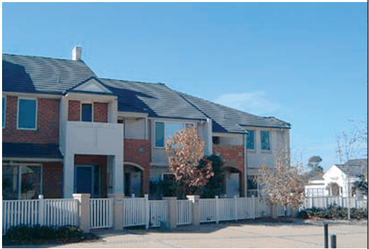

> [Picture on page 59: a picture, saved as a picture (images/vol-2-part-05-university-of-western-sydney-dcp-page-59-42.gif, 150 dpi).]

1\. All fencing and retaining wall details must be submitted to Council for approval as part of any new development application.

2\. All front fencing, secondary street fencing and fencing adjoining common boundaries with public open space areas must be constructed in accordance with the relevant Fencing Strategy for that development stage.

3\. Front fencing (i.e. located forward of the front building line including those on corner lots) shall be provided for small lot housing and residential flat buildings and be between 700mm and 1200mm in height and in accordance with the Fencing Strategy for that development stage.

4\. Side fences forward of the building line shall comply with the requirements for front fences in height and design.

5\. Fencing to all side and rear property boundaries (i.e. to those property boundaries that are not publicly visible) shall be provided. Such fencing shall have a maximum height of 1.8m and shall consist of lapped and capped hardwood timber. Metal sheeting, open mesh steel fencing and the like are not permitted.

6\. A separate fencing strategy may be adopted for allotments is excess of 2000m2 which may not comply with the requirements contained herein but rather may adopt a more rural fencing approach.

### 4.10 CAR PARKing AnD ACCeSS

#### Objectives:

• Minimise the visual impact of garages on the streetscape.

• Provide adequate on-site car parking for residents and visitors that is convenient, secure and safe.

• Provide safe convenient access for vehicles, pedestrians and cyclists whilst minimising conflict between them.

#### Design Requirements:

4\. All driveway crossings between the front property boundary and the road kerb shall be finished in uncoloured natural concrete to match the kerb. Dwellings shall utilise the driveway crossover provided.

5\. To reduce the visual impact of garages, built elements such as balconies projecting past the garage frontage shall be encouraged.

6\. The minimum dimensions of garages and parking areas shall be as shown in Table 4.8 below.

7\. Garages shall be setback a minimum 1.5m behind the building façade.

8\. Detached garages may have a zero setback from side or rear boundaries.

9\. Garages to rear loading accessways and car courts shall be setback a minimum 1m to accommodate adequate turning and manoeuvrability.

10\. Garage setbacks from secondary street frontages can be reduced to 2m and 1m in car courts.

11\. Where external space adjoins a building or fence an additional 0.5m width is required.

1\. Car parking spaces shall be provided in accordance with Table 4.7 below.

2\. All driveways shall be located a minimum distance of 6m from the tangent point of the kerb and gutter of an adjacent street corner (regardless of boundary splay).

3\. The geometric design of all driveways, including car courts, is to be in accordance with Councils Engineering Guide to Development and AS 2890 (as amended).

#### Table 4.7: Required car parking spaces

| DWelling Size | nUmBeR Of CAR PARKing SPACeS ReqUiReD |
|---|---|
| 2 bedroom dwelling or less | 1 covered space |
| 3 bedroom dwelling or more | 2 spaces with at least one covered |

#### Table 4.8: Car Parking Dimensions

| CRiTeRiA | COnTROlS |
|---|---|
| Minimum dimensions for enclosed single garage | 3.0 x 5.5m |
| Minimum dimensions for enclosed double garage | 5.5 x 5.5m |
| Minimum dimensions for hard stand car parking space | 2.75 x 5.5m |
| Minimum dimensions for uncovered space | 2.5 x 5.2m |

### 4.11 SOlAR ACCeSS AnD eneRgy effiCienCy

#### Objectives:

• Encourage building design and siting to take advantage of climatic factors and reduce household energy consumption.

• Encourage features to be incorporated into site and building design to optimize passive solar access to internal and external spaces.

#### Design Requirements:

1\. Living areas shall generally have a northern orientation and be directly accessible to private open space areas.

2\. For dwellings at least 50% of the private open space and all of the nominated outdoor clothing drying area shall receive three hours of direct solar access on 21 June, between 9.00am and 3.00pm, measured at ground level.

3\. Dwellings shall be designed to maximise solar access to all private open space areas. Suitable shadow diagrams shall be required.

4\. Development shall have appropriate regard to the impact on solar access to usable private open space, solar collectors and clothes drying areas of adjoining residential development.

5\. Dwellings shall be designed to reduce the need for artificial lighting during daylight hours.

6\. Windows shall be protected from direct summer sun with appropriate hoods, eaves or louvres or adjustable shading devices wherever possible.

7\. Materials selection and construction shall respond to orientation and potential for heat retention and protection including insulation.

8\. An outdoor clothes line with adequate solar access shall be provided for every dwelling.

9\. Windows and doors shall be arranged to encourage cross ventilation.

10\. Council may consider the use of deciduous trees at the north and west elevations to protect against hot summer temperature and to allow for solar penetration in winter, where it may otherwise be inappropriate to plant native trees.

11\. A BASIX certificate shall be submitted with the development application for all residential dwelling development. Further information is available at www.basix.nsw.gov.au

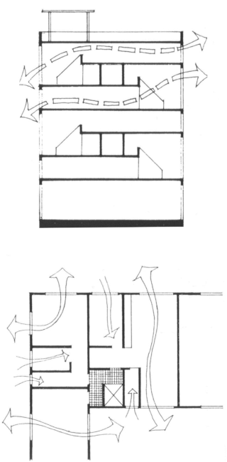

> [Picture on page 61: a picture, saved as a picture (images/vol-2-part-05-university-of-western-sydney-dcp-page-61-46.gif, 150 dpi).]

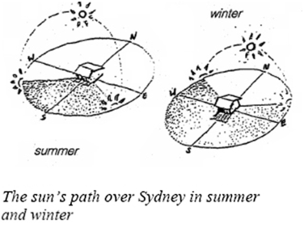

> [Picture on page 61: a picture, saved as a picture (images/vol-2-part-05-university-of-western-sydney-dcp-page-61-47.gif, 150 dpi).]

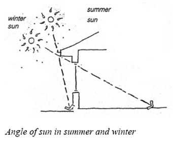

> [Picture on page 61: a picture, saved as a picture (images/vol-2-part-05-university-of-western-sydney-dcp-page-61-48.gif, 150 dpi).]

### 4.12 WASTe mAnAgemenT

### 4.13 SeRViCeS

#### Objectives:

#### Objectives:

• Minimise the visual and acoustic impact of on site services.

• Ensure waste systems are easy to use, are accessible by collection vehicles and minimise noise generation during collection.

#### Design Requirements:

• Ensure healthy and safe practices for the storage, handling and collection of waste and recycling materials.

• Prevent stormwater pollution that may occur as a result of poor waste storage and management arrangements.

#### Design Requirements:

1\. Provision shall be made for all waste and recycling storage containers to be located behind the primary and secondary building alignment and out of public view.

2\. Space shall be allocated to store the following bins:

(i) a 140 litre/dwelling/week for household garbage;

(ii) a 240 litre/dwelling/fortnight for dry recyclables; and

(iii) a 240 litre/dwelling/fortnight for

1\. All metre boxes and services plant shall be treated to reduce their visual prominence from the public domain by screening, recessing or colour treatments.

2\. TV aerials shall be located to the rear of the dwelling, whilst satellite dishes may only be erected if they are suitably screened from view of the public and neighbours. Only one aerial will be allowed per dwelling.

3\. Letter boxes shall be located visible from the street and accessible from the public footpath. If no footpath is present access shall be provided accessible from outside the front boundary of the property.

4\. Air-conditioning units shall be located a minimum of 4m from the site boundary or screened for visual and acoustic privacy. They shall not be located along the front site boundary.

garden organics.

3\. Any area for storing garbage and recycling shall be located in a position that is convenient for occupants and waste collection staff.

4\. The path for wheeling bins between waste storage area(s) and the collection vehicle shall be free of steps or kerbs and have a maximum gradient of 1:8.

5\. Collection vehicles must be able to service the development efficiently with minimal need to reverse, from a nominated collection point.

6\. Rear loaded, battle axe and car court dwellings shall make provision for bin collection on a public street accessible by collection vehicles.

7\. No waste incineration devices shall be permitted.

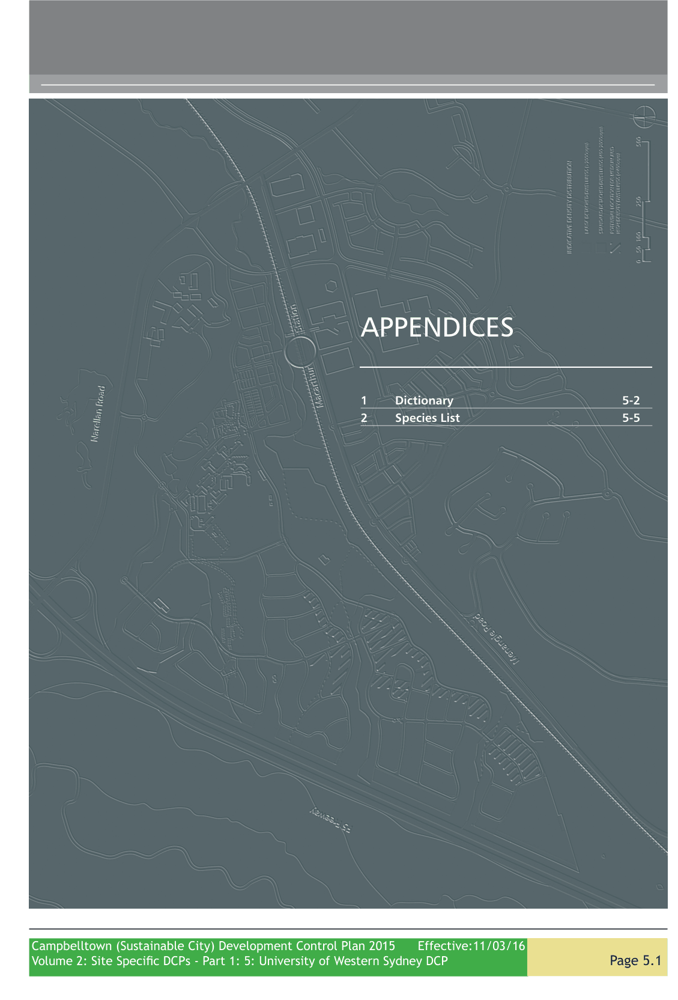

> [Picture on page 63: a picture, saved as a picture (images/vol-2-part-05-university-of-western-sydney-dcp-page-63-1.gif, 150 dpi).]
> Words printed on the picture (title and legend, copied from the PDF):
> 5-2
> 5-5

### APPENDICES

#### 1 Dictionary

#### 2 Species list

#### APPenDIX 1: DIctIonARy

“Detached Dwelling” means a dwelling house on a separate allotment of land that is not attached to another dwelling.

“1% AeP” (annual exceedance probability) means that there is a 1% chance in any year that this rain storm event could be exceeded. This does not preclude that two or more events could occur within hours of one another.

“Dwelling” means a room or suite of rooms occupied or used or so constructed, designed or adapted as to be capable of being occupied or used as a separate domicile.

“Amenity” means those qualities and characteristics of a site and its neighbouring area that contribute to the comfort and pleasantness of the local environment.

“Dwelling house” means a building containing one dwelling and may contain a subordinate structure such as a garage loft, studio apartment or outbuilding.

“Asset Protection zone” means a buffer between development and hazards. The size and location of an asset protection zone is determined by a number of factors detailed in Planning for Bushfire Protection, 2001.

#### “ecologically Sustainable Development” (eSD)

means a development that conserves and enhances the community’s resources so ecological processes are maintained and the total quality of life, now and in the future, can be increased.

“Average Recurrence interval” (ARI) means the average period between the recurrence of a storm event of a given rainfall intensity.

“engineered natural ground level” means the ground level at completion of the subdivision phase of the development.

“Battleaxe Allotment” means an allotment that does not have primary frontage to a public road and is accessed via a driveway (handle) located between two adjoining allotments.

“environmental Planning instrument” (ePi) means a State Environmental Planning Policy, Regional Environmental Planning Policy, Local Environmental Plan or Interim Development Order.

“Building Sustainability index” (BASiX) means a web-based planning tool designed to assess the potential performance of new development against a range of sustainability indices including landscape, stormwater, water, thermal comfort and energy.

“flowpath” means the overland route taken by any concentration of, or significant sheet flow of stormwater on its way to any creek, river, bay or a flood plain in a storm.

“Bushfire Prone land” means land, which has been identified as bush fire prone land on the Campbelltown Bush Fire Prone Lands Map as certified by the Commissioner of the NSW Rural Fire Service.

“freeboard” means a factor of safety used in relation to the setting of floor levels. It makes allowance for wave action, localised hydraulic behaviour and system blockages.

“Car Courts” means a vehicular accessway provided to the rear of a cluster of up to 4 lots. Car courts shall not be dedicated to Council and will be managed under strata or community title or a reciprocal right of way.

“garden Duplex” means a dwelling consisting of a ground and an upper level single storey dwelling. Garden duplexes may form part of a group of dwellings or be detached.

“Character” means the distinctive elements of an area or building.

“DA” means development application.

“garage loft” means habitable space over a garage which does not contain a kitchen or bathroom and does not comprise a studio apartment as separately defined.

“Open Space” means areas within a development designed exclusively for either private or communal use by the occupants of the development.

“gross floor Area” in relation to a building, means the sum of the areas of each level of the building, including:

(a) the thickness of all external walls, and

(b) the area of voids, staircases and lift shafts,

“Primary Street frontage” means the area between the building/structure and the road to which it is orientated.

counted at each level, and

(c) that part of the area of balconies and verandahs

“Primary Street Setback” means the setback between the building/ development and road upon which it faces and or the road from which the allotment is accessed.

which is in excess of 20m2 per dwelling in the case of a building used or intended for use for residential purposes, or in excess of 10% of the site area in the case of a building used or intended for use for non residential purposes, and

(d) any other areas of the building where the height

“Principal Private Open Space” means the area of private open space that is directly accessible from living areas of the dwelling, consisting of an appropriately dimensioned square.

of those areas exceeds 1.5m above ground level, and excluding:

(e) car parking to meet the requirements of the

“Private Open Space” means open space/landscaped area for the exclusive use of occupants of a dwelling with direct access to the living areas and of a minimum dimension in any direction of 2m.

Council and any access to the car park, and

(f) any area used or intended for use as a car parking station, and

(g) uncovered roof terraces, and

(h) any area used or intended for use as an arcade.

“Probable maximum flood” (Pmf) means the largest flood that could conceivably occur at a particular location.

“Public Domain” means an area that is adjacent to the development site, which is under the care, control and/or ownership of a public authority.

“habitable Room” means a room used for normal domestic activities and includes a bedroom, living room, lounge room, music room, television room, rumpus room, sewing room, study, play room, family room, sunroom and the like. It excludes a bathroom, laundry, water closet, pantry, walk in wardrobe, lobby, clothes drying room, and other spaces of a specialised nature that are not occupied frequently or for extended periods.

“Remnant Vegetation” means the natural vegetation that still exists or, if the natural vegetation has been altered, is still representative of the structure and florisitics of the natural vegetation.

“height” in relation to a building means the distance measured vertically from any point on the building to the engineered natural ground level immediately below that point.

“Residential Apartment Building” means a building that comprises:

(a) three (3) or more storeys (not including levels

“large lot housing” means a dwelling in a lot with an area of greater than 2000m2.

below ground level provided for car parking or storage, or both, that protrude less than 1.2m above ground level; and

(b) four (4) or more self contained dwellings.

“mixed-use Development” means a development that contains a mixture of retail and/or commercial and residential uses.

“RfDC” means the Residential Flat Design Code (NSW Government)

“Secondary Street frontage” means the area between the building/structure and any additional road to which it adjoins.

“noxious Weed” means a weed declared by an order under the Noxious Weeds Act 1993. Note: For the most up to date list refer to www.agric.nsw.gov.au/ reader/weeds or contact Council’s Planning and Environment Division on 02 4645 4601.

“Secondary Street Setback” means setback between the building/ development and the road upon which the building does not front.

“Tree” means a perennial plant with self supporting stem(s) which:

(a) is more than 3m in height; or

(b) has a spread of more than 3m; or

(c) a single trunk plant with a girth of more than

“Small lot housing” means a dwelling in a lot with an area of less than 400m2.

450mm or more, measured at a distance of 1m above the ground level; or

(d) a multi trunk plant with an individual trunk girth

“Standard lot housing” means a dwelling in a lot with an area of greater than 400m2 but less than 2000m2.

of 80mm or more, measured at ground level.

“Waste management Plan” (WmP) means a plan demonstrating the details of how waste will be managed during the demolition, construction and ongoing operations of a development.

“zero lot line” means the construction of a dwelling or garage wall on top of and/or along the side property boundary of an allotment.

“Storey” means any separate level within a building (not including levels below existing ground level provided for car parking or storage, or both, that protrude less than 1.2m above existing ground level, or an attic level), where the number of storeys that a building contains is the maximum number of storeys of a building which may be intersected by the same vertical line, not being a line which passes through any wall of the building.

“zone of influence” means the area likely to be influenced by building loads, and is a factor of the structure of the ground on which the building is to be located.

“Studio Apartment” means a self contained dwelling constructed above a double garage fronting a secondary street frontage or car court.

“Suitably qualified Professional” means a person who through suitable education and or experience, accreditation (trade or professional) and knowledge may be reasonably relied upon by Council to provide advice within an area of expertise related to the relevant task.

#### APPenDIX 2: sPecIes LIst

#### UWS CAmPBellTOWn TRee SPeCieS liST

#### Streetscape (local Residential Street)

#### BOTAniCAl nAme

#### COmmOn nAme

mh (m) CP

in

| Japanese Maple | 4 |  |
|---|---|---|
| Jacaranda | 8 |  |
| crepe Myrtle | 6 3 5 |  |
| crabapple | 5 |  |
| Flowering cherry | 5 |  |
| Manchurian Pear | 6 |  |
| Robinia | 5 |  |
| Lilly Pilli | 4 | • |

#### De

Acer palmatum

•

Jacaranda mimosifolia

•

Lagestroemia indica

•

Magnolia ‘Little Gem’

•

Magnolia soulangeana

•

Malus floribunda

•

Prunus serrulata

•

Pyrus calleryana ‘Chanticlaire’

•

Robinia ‘mop top’

•

Syzigium luehmanni

Legend: MH Mature Height CP cumberland Plain IN Indigenous DE Deciduous

> [Picture on page 68: a picture, saved as a picture (images/vol-2-part-05-university-of-western-sydney-dcp-page-68-1.gif, 150 dpi).]

#### Streetscape (main Collector)

#### BOTAniCAl nAme

#### COmmOn nAme

mh (m) CP

in

| Japanese Maple | 4 |  |  |
|---|---|---|---|
| Rough Barked Apple Gum | 20 |  | • |
| Broad-leaved Apple | 20 |  | • |
| Grey Myrtle | 6 |  | • |
| cape chestnut | 10 |  |  |
| spotted Gum | 20 | • | • |
| narrow Leafed Red Ironbark | 20 | • | • |
| Red Flowering Gum | 10 | • | • |
| Pink Flowering yellow Gum | 12 |  | • |
| Grey Box | 20 | • | • |
| coastal Blackbutt | 20 | • | • |
| swamp Mahogany | 15 |  | • |
| sydney Blue Gum | 30 | • | • |
| Ironbark | 20 | • | • |
| Forest Red Gum | 40 | • | • |
| Australian teak | 15 |  | • |
| Golden Ash | 16 |  |  |
| claret Ash | 16 |  |  |
| Jacaranda | 12 |  |  |
| crepe Myrtle | 6 |  |  |
| sweet Gum | 20 |  |  |
| Brush Box | 12 |  | • |
| Manchurian Pear | 10 |  |  |
| chinese tallow tree | 8 |  |  |
| chinese elm | 12 |  |  |
| Lilly Pilli | 8 |  | • |

#### De

Acer palmatum

•

Angophora floribunda Angophora subvelutina Backhousia myrtifolia Calodendrum capense Corymbia maculata Eucalyptus crebra Eucalyptus ficifolia Eucalyptus leucoxylon ‘Rosea’ Eucalyptus moluccana Eucalyptus Paniculata Eucalyptus robusta Eucalyptus saligna Eucalyptus sideroxylon Eucalyptus tereticornis Flindersia australis Fraxinus oxycarpa

•

Fraxinus oxycarpa ‘Raywood’

•

Jacaranda mimosifolia

•

Lagestroemia indica

•

Liquidambar styraciflua

•

Lophostemon confertus Pyrus calleryana ‘Chanticlaire’

•

Sapium sebiferum

•

Ulmus parvifolia

•

Waterhousia floribunda

Legend: MH Mature Height CP cumberland Plain IN Indigenous DE Deciduous

> [Picture on page 69: a picture, saved as a picture (images/vol-2-part-05-university-of-western-sydney-dcp-page-69-1.gif, 150 dpi).]

#### Park

#### BOTAniCAl nAme

#### COmmOn nAme

mh (m) CP

in

| Black Wattle | 15 |  | • |
|---|---|---|---|
| sydney Green Wattle | 10 |  | • |
| Japanese Maple | 4 |  |  |
| trident maple | 5 |  |  |
| narrow-leaved Apple | 20 |  | • |
| Hoop Pine | 25 |  | • |
| Grey Myrtle | 6 |  | • |
| coast Banksia | 15 |  | • |
| Aystralian Flame tree | 10 | • | • |
| cape chestnut | 10 |  |  |
| Lemon scented Bottlebrush | 3 |  | • |
| swamp oak | 20 |  | • |
| Blueberry Ash | 8 |  | • |
| cabbage Gum | 20 | • | • |
| camden White Gum | 30 |  | • |
| thin Leafed stringy Bark | 20 | • | • |
| Bloodwood | 20 |  | • |
| coral Gum | 10 |  | • |
| Port Jackson Fig | 12 |  |  |
| cheese tree | 4 |  |  |
| Kaffir Plum | 10 |  |  |
| native Frangipani | 7 |  | • |
| Jacaranda | 12 |  |  |
| crepe Myrtle | 6 |  |  |
| sweet Gum | 20 |  |  |
| southern Magnolia | 12 |  |  |
| Prickly-leaved Paperbark | 10 | • | • |
| Paperbark | 7 |  | • |
| Paperbark | 10 |  | • |
| chinese Pistacio | 12 |  |  |
| Manchurian Pear | 10 |  |  |
| chinese tallow tree | 8 |  |  |
| West African tulip tree | 10 |  |  |
| turpentine | 50 |  | • |
| Water Gum | 6 |  | • |
| small-leaved Linden | 15 |  |  |
| Lilly Pilli | 8 |  | • |

#### De

Acacia decurrens Acacia parramattensis Acer palmatum

•

Acer buergerianum

•

Angophora bakeri Araucaria cunninghamii Backhousia myrtifolia Banksia integrifolia Brachychiton acerifoliusa Calodendrum capense Callistemon citrinus Casuarina glauca Elaeocarpus reticulatus Eucalyptus amplifolia Eucalyptus benthamii Eucalyptus eugenioides Eucalyptus gummifera Eucalyptus torquata Ficus rubiginosa

•

Glochidion ferdinandi Harpephyllum caffrum

•

Hymenosporum flavum Jacaranda mimosifolia

•

Lagestroemia indica

•

Liquidambar styraciflua

•

Magnolia grandiflora Melaleuca stypheliodes Melaleuca decora Melaleuca linariifolia Pistacio chinensis

•

Pyrus calleryana ‘Chanticlaire’

•

Sapium sebiferum

•

Spathodia campanulata Syncarpia glomulifera Tristaniopsis laurina Tilia cordata ‘Green Spire’

•

Waterhousia floribunda

Legend: MH Mature Height CP cumberland Plain IN Indigenous DE Deciduous

Riparian Corridor – Trees

#### BOTAniCAl nAme

#### COmmOn nAme

mh (m) CP

in

| Grey Myrtle | 6 |  | • |
|---|---|---|---|
| swamp oak | 20 |  | • |
| Blueberry Ash | 8 | • | • |
| False sarsaparilla |  | • | • • |
| Dean’s Paperbark | 8 | • | • |
| White feather honeymyrtle | 8 | • | • |
| Prickly-leaved Paperbark | 10 | • | • |

#### De

Backhousia myrtifolia Casaurina glauca Elaeocarpus reticulatus Hardenbergia violacea Hibbertia scandens Melaleuca deanei Melaleuca decora Melaleuca stypheliodes

Riparian Corridor – Shrubs

| BOTAniCAl nAme | COmmOn nAme | DS (plants/m2) | CP |
|---|---|---|---|
| Carex appressa |  | 8 | • |
| Carex fascicularis |  | 8 | • |
| Carex gaudichadiana |  | 8 | • |
| Carex inversa |  | 8 | • |
| Dianella longifolia var. longifolia |  | 8 | • |
| Ficinia nodosa |  | 6 | • |
| Juncus procerus |  | 10 | • |
| Lepidosperma limicola |  | 10 | • |
| Lepidosperma laterale |  | 8 | • |
| Lepidosperma longitudinale |  | 8 | • |
| Lomandra filiformis |  | 8 | • |
| Lomandra longifolia var. longifolia |  | 6 | • |
| Patersonia sericea |  | 8 | • |
| Stypandra glauca |  | 6 | • |

Legend: MH Mature Height CP cumberland Plain IN Indigenous DE Deciduous DS Density

> [Picture on page 72, not reproduced as text; see the original PDF.]
> Words on this picture, read by OCR (may contain errors): campbelltown_nsw.gov.au Campbelltown City Council, PO Box 3/7, Campbelltown, NSW 2560
