## Part 2 Criteria for Development

### 2.1 Land use and development patterns

#### OBJECTIVES

a. To ensure that the area to which this Plan applies is planned in a comprehensive and

integrated manner.

b. To provide flexibility in planning to reflect the possible alternate scenarios of the New

South Wales Government commitment and timing regarding possible future public

transport corridor.

c. To provide details in regard to the urban form and design of the new residential area

in the form of a Masterplan map, including the location of public open space, roads,

lot configurations, pedestrian access connections, drainage systems, preservation of

significant vegetation and the provision of community facilities and services and

public utilities.

d. To provide safe, convenient and effective new neighbourhoods that meet the diverse

and changing needs of the community.

#### Performance Criteria

#### Development Standards

P1.1 Development must proceed in

accordance with the masterplan map

that shows the future public transport

corridor.

D1.1 The distribution of land uses

and development patterns must

conform to Maps 2 and 3.

Development should be staged in

accordance with Map 4. Approval

will not be granted for subsequent

stages until construction has

commenced on prior stages.

P1.2 While allowing for the creation of

its own identity, the new residential

area is to retain important linkages with

surrounding proposed release areas.

D 1.2 Development consent will

not be granted to the erection of a

building, subdivision, or the carrying

out of a work or the use of land

within the possible public transport

corridor or land adjacent to it unless

the Council is satisfied that the

proposed building, subdivision work

or use is designed with reference to

the level and alignment of the public

transport link to the satisfaction of

Rail Corporation NSW.

#### Performance Criteria

P1.3 Vehicle, cyclist and pedestrian

networks, land use mix and residential

density should minimise fossil fuel use

by reducing local vehicle trips, travel

distances and speeds, maximise public

transport effectiveness, and encourage

walking and cycling to daily activities.

P1.4 The site layout should retain

significant vegetation and habitat

areas, incorporate natural features,

minimise soil erosion and avoid

development on flood prone land.

#### Development Standards

D1.3 Council will refer

development applications to carry

out any development within the

possible public transport corridor or

within 100 metres from the centre

line of the defined public transport

corridor to the Director-General of

the Department of Planning and will

take into consideration any

comments received from the

Director-General in determining the

application.

D1.4     Council will refer

development applications to carry

out any development within the

possible public transport corridor or

within 100 metres from the centre

line of the defined public transport

corridor to the Chief Executive

Officer of RailCorp and will take into

consideration any comments

received from the Chief Executive in

determining the application.

D1.5 Development applications

shall address and be consistent with

the Rail Infrastructure Corporation's

Interim Guidelines – Consideration

of Rail Noise and Vibration in the

Planning Process or any other

relevant NSW Government rail

noise policy.

Page 12 - Vol 2 Edmondson Park Smart Growth DCP

#### Map 2 – Ingleburn Gardens Masterplan Concept

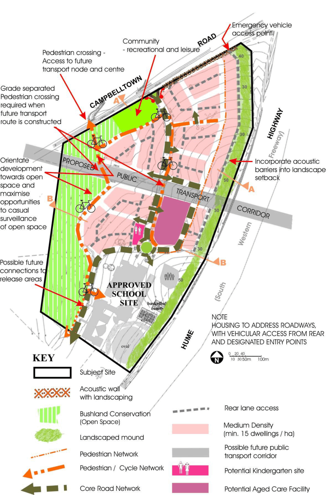

> [Picture on page 15: a picture, saved as a picture (images/vol-2-part-06-edmondson-park-smart-growth-dcp-page-15-2.gif, 150 dpi).]

#### Map 3

#### Ingleburn Gardens Masterplan Concept

#### - Indicative Sections

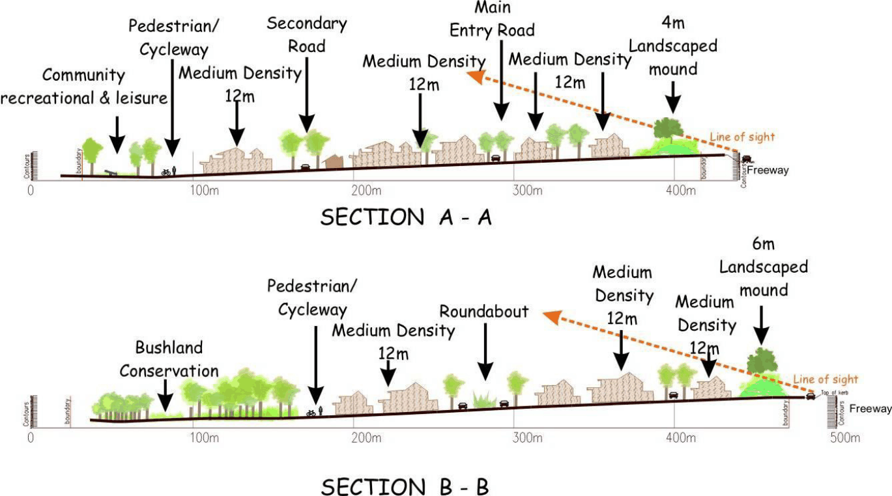

> [Picture on page 16: a picture, saved as a picture (images/vol-2-part-06-edmondson-park-smart-growth-dcp-page-16-4.gif, 150 dpi).]

#### DCP 123 - Ingleburn Gardens Masterplan

Date Sep

#### Map 4

#### Ingleburn Gardens Masterplan Staging Sequence

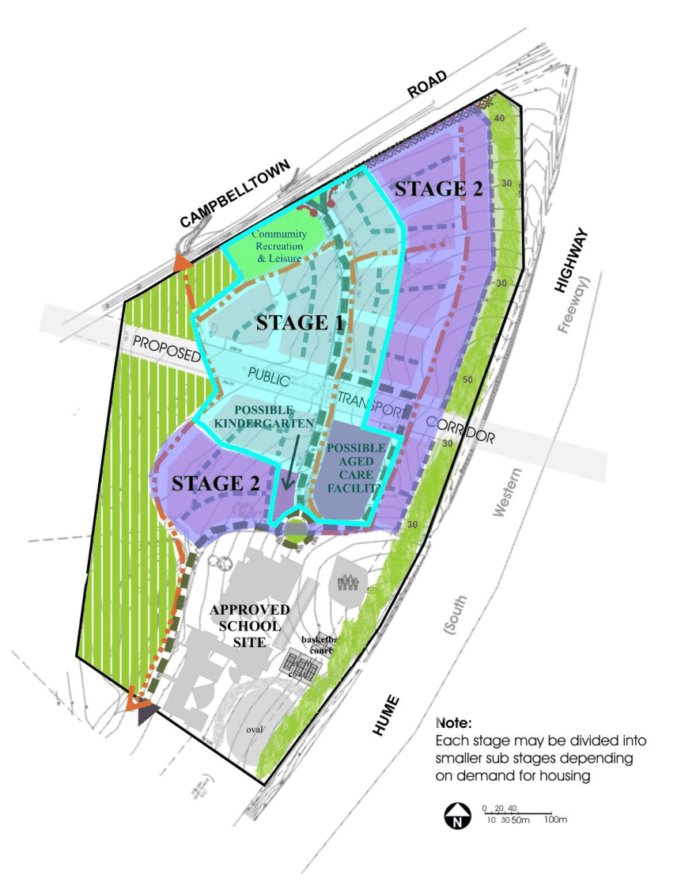

> [Picture on page 17: a picture, saved as a picture (images/vol-2-part-06-edmondson-park-smart-growth-dcp-page-17-4.gif, 150 dpi).]

D1. The development should be

consistent with the desired urban

character of the estate and the

Streetscape and Urban Form Plan.

### 2.2 Streetscape and urban character

#### OBJECTIVES

a. To ensure that all new development is compatible with the intended future

character of the locality.

b. To ensure that new development is sensitive to the landscape setting and

environmental conditions of the locality.

c. To ensure that the appearance of new development is of a high visual quality,

and will establish an exemplary model for the future Composite Edmondson

Park Urban Release Area Precinct.

#### Performance Criteria

#### Development Standards

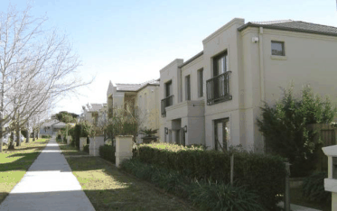

> [Picture on page 18: a picture, saved as a picture (images/vol-2-part-06-edmondson-park-smart-growth-dcp-page-18-16.gif, 150 dpi).]

#### Urban Character

P1. Development should be consistent

with the desired urban character of the

Ingleburn Gardens site. Elements which

describe the desired urban character are as

depicted by the Streetscape and Urban Form

Plan (Map 5 and 6) and described as follows: To create a high quality master planned

residential estate, to promote a coherent

sense of community. The creation of a legible, attractive and

inviting entry statement at the main

vehicular and pedestrian entries to the

estate.

#### Typical future urban character –

cluster housing development

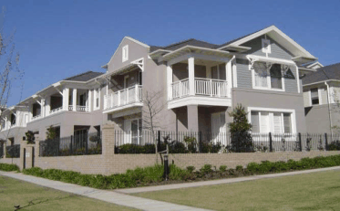

> [Picture on page 18: a picture, saved as a picture (images/vol-2-part-06-edmondson-park-smart-growth-dcp-page-18-33.gif, 150 dpi).]

To ensure that the most memorable

future impression is that of a landscape

dominated living area. To encourage functional building detail

elements to relieve building mass by

modulation of light and shadow (using

eaves, verandahs, sun control devices,

shutters, pergolas, balustrading and

dormers). To provide opportunities for a variety of

housing choice, inclusive of lower density

housing including detached dwellings,

terrace style/cluster housing and medium

density multi-unit dwellings.

Terrace Style - Articulated roof form

D1.1 Achievement of net

residential densities which assists

the viability of public transport

(exclusive of open space and

community facilities land, roads and

non-residential uses) of a minimum

of 15 dwellings per hectare:

#### Map 5 - Streetscape and Urban Form Plan

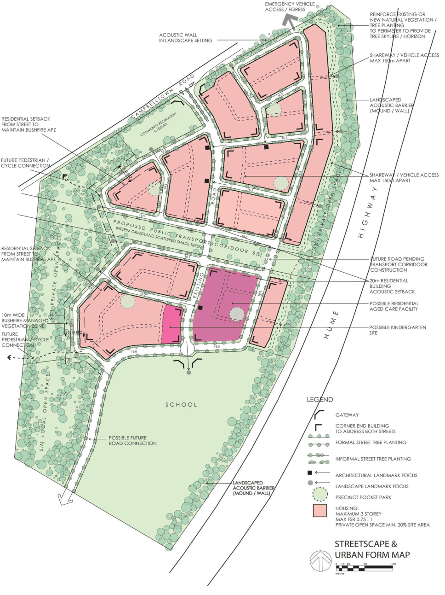

> [Picture on page 19: a picture, saved as a picture (images/vol-2-part-06-edmondson-park-smart-growth-dcp-page-19-2.gif, 150 dpi).]

#### Map 6

#### Typical Sections – Urban Form and Road Design

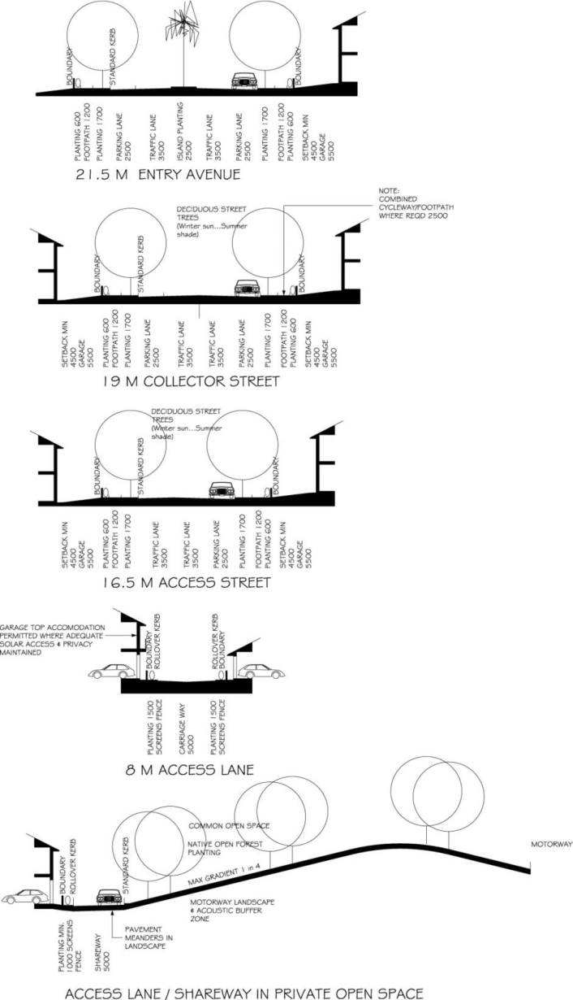

> [Picture on page 20: a picture, saved as a picture (images/vol-2-part-06-edmondson-park-smart-growth-dcp-page-20-3.gif, 150 dpi).]

Page 18 - Vol 2 Edmondson Park Smart Growth DCP

#### Performance Criteria

To provide maximum connectivity

through the estate for pedestrians, with a

defined pedestrian/ cycle network which

takes advantage of the attractiveness of

the proposed bushland open space

corridor, to encourage pedestrian/cycle

movements throughout the estate,

connecting to the possible future Bardia

transport node and Centre. The cycleway network shall be

constructed in a staged fashion

consistent with the approved staging

pattern of subdivision. The cycleway in

that particular stage shall be completed

prior to the release of the first occupation

certificate for a dwelling in that particular

stage.

Pedestrian footpaths shall be constructed

at the same time the adjacent road is

constructed.

All community facilities within the

Ingleburn Gardens site shall be

constructed by the developer at no cost

to Council.

To maximise the number of dwellings

with an outlook to the proposed open

space lands.

The provision of community facilities

within the estate which provides a focal

point for the incoming population, linked

by the pedestrian/cycle and open space

system.

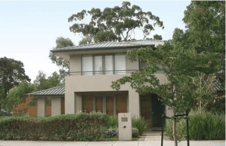

> [Picture on page 21: a picture, saved as a picture (images/vol-2-part-06-edmondson-park-smart-growth-dcp-page-21-34.gif, 150 dpi).]

#### Detached House

Parking from rear

#### Development Standards

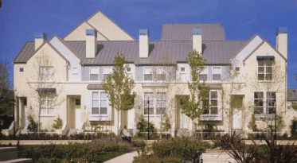

> [Picture on page 21: a picture, saved as a picture (images/vol-2-part-06-edmondson-park-smart-growth-dcp-page-21-38.gif, 150 dpi).]

#### Terrace Style

Articulated Roof – Height variation

Parking from rear

Individual dwellings expressed

Break in long lengths

Light wall colours contrast to

landscape

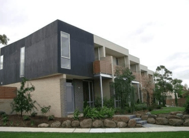

> [Picture on page 21: a picture, saved as a picture (images/vol-2-part-06-edmondson-park-smart-growth-dcp-page-21-46.gif, 150 dpi).]

#### Terraces/ Townhouses

Articulated façade

Parking from rear

Detail, texture & colours break down

scale

#### Performance Criteria

#### Development Standards

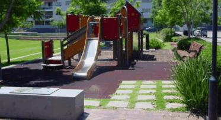

> [Picture on page 22: a picture, saved as a picture (images/vol-2-part-06-edmondson-park-smart-growth-dcp-page-22-3.gif, 150 dpi).]

Opportunity for larger landscaped area

Incorporate single storey element

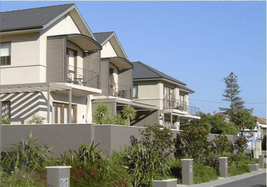

> [Picture on page 22: a picture, saved as a picture (images/vol-2-part-06-edmondson-park-smart-growth-dcp-page-22-6.gif, 150 dpi).]

#### Semi Detached Houses

Pair 1 or two storey houses

Breaks between buildings

Articulated roof in subdued colours

Elevated court assists privacy

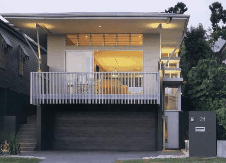

> [Picture on page 22: a picture, saved as a picture (images/vol-2-part-06-edmondson-park-smart-growth-dcp-page-22-12.gif, 150 dpi).]

#### Communal open space

Park with playground area

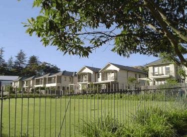

> [Picture on page 22: a picture, saved as a picture (images/vol-2-part-06-edmondson-park-smart-growth-dcp-page-22-15.gif, 150 dpi).]

#### Garage Top Accommodation

Option for self contained studio utilizing space

#### Communal Open Space

Local park within close proximity

from the houses provides amenity to

above the garage

Passive surveillance over the laneway

Designed to compliment the house

#### Streetscape

P2.1 Development should positively

contribute towards the creation and

enhancement of the landscape dominated

visual character of the street with particular

reference to architectural themes, landscape

themes and fencing styles.

local residents

D2.1 New buildings shall adhere

to a minimum front building line of

4.5 metres. However, projections

including, balconies, porches, bay

windows and sun control devices

are permitted to be setback a

minimum of 3.5 metres. A setback

of 5.5 metres applies to the face of

#### Performance Criteria

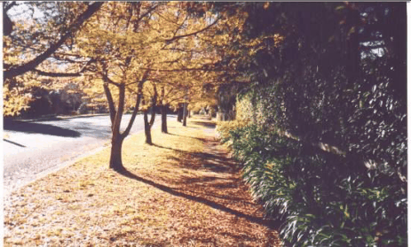

> [Picture on page 23: a picture, saved as a picture (images/vol-2-part-06-edmondson-park-smart-growth-dcp-page-23-2.gif, 150 dpi).]

#### Streetscape

Deciduous Trees provide solar access

#### Development Standards

garage doors or carports. Nil

setbacks to rear lanes are

acceptable subject to vehicles being

able to manoeuvre in the laneway.

Formal symmetrical planting to major streets

Landscape screening to fence

P2.2 Development on corner sites shall

incorporate façade treatments that address

both street frontages.

P2.3 Where a rear lane is provided to a

dwelling house, vehicular access to the front

of the dwelling house shall be denied.

#### Front Fences

P3. Front fences and walls shall maintain

the streetscape character and be consistent

with the established style and pattern of

fences in the locality.

D2.2 Subdivision proposals shall

provide for street tree planting

consistent with the Masterplan.

D2.3 Landscaping shall be

provided with all developments,

which is consistent with the

Masterplan and incorporate existing

trees where possible.

D2.4 Where a rear laneway is not

provided to a dwelling house,

garages facing a street shall not

occupy more than 45% of the total

width of the dwelling.

D3.1 Visually impenetrable solid

forms of front fences (such as

masonry or timber fences) shall not

exceed a height of 1.0 metre.

D3.2 Visually penetrable front

fences (such as pre-painted metal

grill or timber picket fences) shall

not exceed a height of 1.2 metres.

D3.3 Front fences of a height

exceeding 1.2 metres in height are

permitted only where required to

#### Performance Criteria

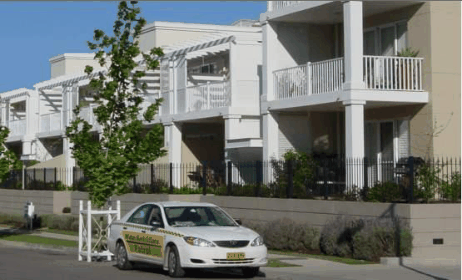

> [Picture on page 24: a picture, saved as a picture (images/vol-2-part-06-edmondson-park-smart-growth-dcp-page-24-2.gif, 150 dpi).]

#### Development Standards

#### Terrace Style

Varied architectural detail

Individual dwellings expressed

Slightly elevated court assists privacy

Provision for landscaping between fence and

path

satisfy acoustic abatement criteria

and shall be provided with a

landscaped area of not less than

600mm wide on the street side of

the fence and shall not exceed 10

metres in length without some

articulation or detailing to provide

visual interest.

D3.4 Any fence between a

building and its street frontage

(other than a rear lane) is to have a

minimum 600mm wide screen

landscape both sides.

D3.5  Retaining walls visible from

the public domain shall be a

maximum height of 1.0 metres and

be softened with landscaping at the

base and at the top of the wall. The

details of such walls shall be

provided at the development

application stage.

#### Landscape

P4. The urban form and landscape design

shall be integrated and of a combined high

standard.

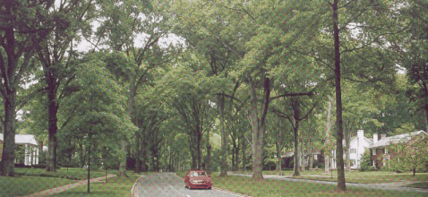

> [Picture on page 24: a picture, saved as a picture (images/vol-2-part-06-edmondson-park-smart-growth-dcp-page-24-35.gif, 150 dpi).]

D4.1 All development proposals shall

include landscape plans and

demonstrate that the landscape design

has been produced as an integral

component of the development design

and not subsequent to building siting

and design being completed.

#### Streetscape

A landscape dominated visual environment

#### Crossovers and Driveways

P5. Crossovers and driveways are to be

consistent with the landscape dominated

streetscape character, and are to maintain

the planned street tree planting.

D5.1 Crossover, driveway widths

on public or open access streets

shall not exceed the following:

Single dwellings: 3.0 metres

Multiple dwellings:6.0 metres

Rear lane access: 4.8 metres

D5.2 Crossover, driveway shall be

#### Performance Criteria

#### Development Standards

located to preserve existing or

planned street trees.

D5.3 Vehicle access shall be

solely from rear lanes where

available and secondary streets if

located on a corner site.

D5.4 Driveway crossovers shall be

provided to rear lanes only where

present. The crossover will be

constructed of concrete and

broomed.

#### Development Standards

### 2.3 Subdivision design

#### OBJECTIVES

a. To encourage a variety of lot sizes to promote housing choice.

b. To develop a subdivision and lot size pattern that will reinforce the desired

future character of the estate.

c. To encourage integrated housing and subdivision design.

d. The ensure the future allotments are of a size and configuration to

accommodate future intended housing, in recognition of any constraints that

may exist on the land.

e. To provide usable allotments which maximise energy efficiency and mitigate

environmental impacts.

f. To design roads which balance the functions of traffic movement and

pedestrian and residential amenity.

g. To ensure that the subdivision pattern accommodates the preferred alignment

for the possible public transport corridor.

h. To ensure that subdivision of land in close proximity to areas likely to be

affected by bushfire is carried out in accordance with the NSW Rural Fire

Services Planning for Bushfire Protection 2006

#### Performance Criteria

#### Performance Criteria

#### Minimum Allotment Sizes

P1. Lot size and dimensions should be

capable of accommodating a dwelling or a

multi-unit housing development where

consistent with the masterplan, in a manner

which complies with all other requirements

of this DCP, inclusive of the provision of

adequate landscaped area, private open

space and car accommodation.

#### Development Standards

D1.1 The minimum lot size for each

dwelling type shall be as follows:

| Housing Type | Minimum Lot Size | Site Width at the Building Line |
|---|---|---|
| Single Detached Dwelling | 430m2 | 12m |
| Zero lot line or semi-detached dwelling | 330m2 | 7.5m |
| Terraces | 230m2 | 7.5m |
| Multi-unit housing developments | 1500m2 | 25m |

D1.2 Lots to be created for single

detached dwellings shall be able to

accommodate a building footprint of

200m2 with a minimum dimension of

10 metres.

D1.3 Subdivision proposals for zero

lot line, semi-detached and attached

terrace housing shall also consist of

a development application for the

proposed housing, to be approved

by Council in conjunction with the

subdivision. Council shall not

release a subdivision certificate until

an occupation certificate for all

buildings on the land has been

issued.

#### Development Standards

#### Performance Criteria

#### Road & Pedestrian Planning

P2.      Road and pavement widths

should be adequate for the traffic

volumes generated and to provide for a

safe pedestrian environment.

D2.1 Road reservation widths and

construction standards shall be in

accordance with the Urban Form

and Streetscape Plan (Maps 5 and

6\) or otherwise as provided for in

Campbelltown (Sustainable City)

Development control Plan.

Road reservation and pedestrian

cycle path widths and construction

within the possible future public

transport corridor are to be designed

to the satisfaction of Rail

Corporation NSW and/or the

Transport Infrastructure

Development Corporation.

D2.2 Pedestrian and cycle paths

to be provided as shown on the

Urban Form and Streetscape Plan

(Maps 5 and 6) or otherwise as

provided for in Campbelltown

(Sustainable City) Development

control Plan

D2.3 Traffic control devices to be

provided to the requirements of

Council and are to be designed to

Austroad Guidelines and to the

satisfaction of Council.

#### Performance Criteria

#### Subdivision Pattern

P3.The subdivision pattern should

accommodate the preferred alignment

for the possible public transport

corridor.

#### Bushfire

P4.    The subdivision pattern should

comply with the requirements of the

NSW Rural Fire Services Planning for

Bushfire Protection 2006.

#### Development Standards

D3.1 Development consent will not

be granted to the subdivision of land

within the possible public transport

corridor unless the Council is

satisfied that the proposed

subdivision:

will not facilitate development for a

purpose or in a manner that is likely

to prejudice the ultimate

development of the corridor for

public transport purposes, or

does not otherwise prejudice the

ultimate development of the corridor

for public transport purposes, and

would not increase the likely cost to

a government agency of acquiring

the land within the corridor for public

transport purposes.

D4.1 A Bushfire Assessment

Report shall be submitted with

development applications for the

subdivision of bushfire prone lands

and the allotment layout shall

conform to the requirements of

Planning for Bushfire Protection

2006.

### 2.4 Building form

#### OBJECTIVES

a. To ensure that the bulk, scale and height of proposed development provides

reasonable neighbour amenity and maintains an appropriate residential

character.

b. To ensure that adequate sunlight access and ventilation for living areas and

private open spaces of new and neighbouring dwellings is provided for.

#### Performance Criteria

#### Building Size and Setbacks

P1. The form of proposed buildings,

which is controlled by setbacks, height,

the extent of cut and fill and achievable

floor space should be consistent with

the intended character of the

neighbourhood within which it is

located.

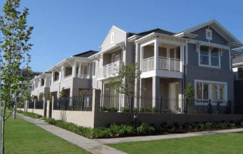

> [Picture on page 30: a picture, saved as a picture (images/vol-2-part-06-edmondson-park-smart-growth-dcp-page-30-17.gif, 150 dpi).]

#### Terrace Style

Varied architectural detail

Privacy shutters

Individual dwellings expressed

Dark spearpoint fence merges

with landscape

Alternative built form can provide

variety

#### Development Standards

D1.1 The maximum height of

buildings should not exceed 3

storeys or 12 metres in height. A

fourth storey, in the form of attic

rooms, may be provided for

architectural articulation of buildings

(eg. in a street corner situation).

#### D1.2 Floor Space Ratio

The floor space ratio (FSR) (ratio of

gross floor area to the site area) on

any allotment shall not exceed

0.75:1.

Gross floor area includes the sum of

all floor area and their enclosing

walls but excludes areas used

exclusively for garaging and

habitable spaces with a ceiling

height of less than 1.2m.

D1.3 Walls with windows or other

openings are to have a minimum

side and rear setback of 1 metre.

Page 28 - Vol 2 Edmondson Park Smart Growth DCP

#### Performance Criteria

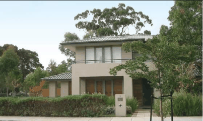

> [Picture on page 31: a picture, saved as a picture (images/vol-2-part-06-edmondson-park-smart-growth-dcp-page-31-2.gif, 150 dpi).]

#### Detached House

Two storey house with one storey

element visible from the street

Articulated façade

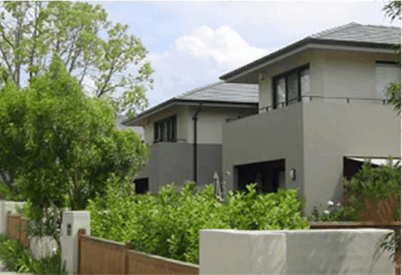

> [Picture on page 31: a picture, saved as a picture (images/vol-2-part-06-edmondson-park-smart-growth-dcp-page-31-7.gif, 150 dpi).]

#### Semi Detached Houses

Articulated façade  in subdued colours

Wall detail, texture & colours

break down scale

#### Building Design

P2. The building design, detailing and

finish should provide an appropriate

scale to the street, add visual interest

when viewed from public streets.

#### Development Standards

D1.4 Walls built to site boundaries

shall have a maximum wall height of

3.5 metres and a maximum wall

length of 40% of the abutting

property boundary. This does not

apply to integrated semi-detached,

terrace or villas style development

or garage top studio units.

D2.1 The frontage of buildings and

their entries shall address the street.

D2.2 A maximum unarticulated

length of a wall facing a public street

shall be 6.5 metres.

Note: Punctuation by bay windows,

verandahs, balconies or wall offsets

may be considered to be adequate

articulation.

#### Performance Criteria

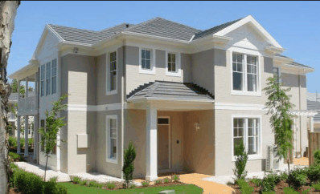

> [Picture on page 32: a picture, saved as a picture (images/vol-2-part-06-edmondson-park-smart-growth-dcp-page-32-2.gif, 150 dpi).]

#### Development Standards

#### Corner Sites

Façade treatment to address both

streets

Muted grey shade roofs are the least

obtrusive

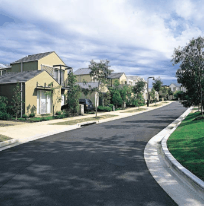

> [Picture on page 32: a picture, saved as a picture (images/vol-2-part-06-edmondson-park-smart-growth-dcp-page-32-9.gif, 150 dpi).]

#### Attached Dwellings

Variety in setback and height

Minimise crossover width to maximize

street planting opportunity

#### Performance Criteria

#### Roof Form and Materials

P3. Roof design is to:

minimise impact on tree-top skyline

viewed from beyond the site;

avoid glare, high colour contrast

and screen unsightly roof mounted

services; and

obscure roof mounted structures

when viewed from higher dwellings

and the public domain.

#### Car Parking Structures

P4.1 Large car parking structures,

podiums and the like are to be

unobtrusive and to be capable of being

landscape screened from the public

domain.

P4.2 Car parking is to be planned to

minimise on site hard stand and

maximise landscape opportunities.

#### Development Standards

D3.1 Pitched hip and gable roof

forms shall predominate.

D3.2 Roof materials shall to be low

reflectance muted grey tones.

D3.3 Strong colours and black shall

be avoided.

D3.4 Roof design shall fully

integrate and coordinate services.

Antennae, plant and solar panels

should not be viewed from public

aeras where practical.

D4.1 Resident car parking for multi

unit buildings shall be predominantly

below ground. Car parking floors of

buildings are to be located a

maximum of 1 metre above natural

ground level.

D4.2 External walls of car parking

structures shall be screened by

landscape planting and shall extend

no more than 2 metres above

finished ground level.

#### Performance Criteria

#### Development Standards

#### Garage Top Studio Units

P5.1 Passive surveillance shall be

provided to rear lanes.

P5.2 Shall be used primarily by family

members of the dwelling on the site

and will share the open space and

parking facilities available on the site.

P5.3 Shall be designed in such a

manner as to preserve visual privacy to

adjoining properties.

D5.1 Garage Top Studio

Apartments shall, as a minimum, be

located at the intersection of rear

lanes.

D5.2 The Garage Top Studio Units

shall not be strata titled.

D5.3 Side facing windows shall not

be provided. A balcony is to be

provided off the living area to

address the rear lane only.

D5.4  Garage Top Studio Units may

be located with a 0 metre side

boundary to one side only. A

minimum 900mm side boundary

shall be provided to at least one

side boundary.

D.5.5 Garage Top Studio

apartments shall be designed and

located so as to provide at least the

minimum solar access requirements

to thesite and adjoining properties.

### 2.5 Open space and landscaping

#### OBJECTIVES

To provide sufficient and accessible open space for the reasonable recreation needs of

a.

the likely residents of the proposed dwelling.

To provide private outdoor living areas that relate well to the living areas of dwellings.

b.

To enhance the appearance, amenity, energy and water efficiency of developments

c.

through integrated landscape design.

#### Performance Criteria

#### Private Outdoor Living Areas

P1. Each dwelling to have access to

some usable and private external area.

P2.1 Private outdoor living areas are

to be of sufficient area and dimensions

to meet the needs of expected

occupants and clearly defined and

screened for private use.

> [Picture on page 35: a picture, saved as a picture (images/vol-2-part-06-edmondson-park-smart-growth-dcp-page-35-20.gif, 150 dpi).]

#### Terrace Style

Fences to street merge with landscape

Variety in colour and texture

P2.2 Private outdoor living areas are

located to:

take advantage of available

Issue. 05

#### Development Standards

D1.1 All dwellings shall be provided

with some form of outdoor living area

such as either private open space,

balconies or roof terraces.

D2.1.1 Private outdoor living areas

located at ground level shall be:

bound by buildings, fencing or

dense landscaping which will

restrict views to a height of 1.8

metres

a minimum area of 20% of the site

area of each allotment with a

minimum dimension of 2.5 metres one area with a minimum dimension

of 4m x 4m

directly accessible from a living

area of the dwelling

a maximum gradient of 1 in 10

Private open space is to be located

behind the building except when lot

orientation is such that the minimum

solar access requirement cannot be

achieved on that lot only. In this

circumstance, private open space

may be located both in front of and

behind the building if:

o

Clotheslines are located at the

rear of the dwelling.

o

The front courtyard is

adequately screened by

vegetation or level change only.

Under no circumstances is

privacy to be achieved by

fencing.

D2.2. Private outdoor living areas

located above-ground level shall be:

Connected to the dwelling

#### Edmondson Park Smart Growth

#### Performance Criteria

#### Development Standards

outlooks or views and natural

features of the site

reduce adverse impacts of adjacent

buildings on privacy and

overshadowing

resolve surveillance, privacy and

security issues when private open

space abuts public space.

A minimum dimension of 2

metres

A minimum area of 8m2

D2.3 Private open space and

balconies shall take advantage of

mid and long distance views where

privacy impacts will not arise.

D2.4 Fencing of private open

space, where abutting public open

space, shall provide for casual

surveillance. This may be achieved

by an open palisade fence or being

partially visually penetrable above

1.5m.

P3. Orientation of the private outdoor

living areas should achieve comfortable

year round use.

D3.1 Solar access to private

outdoor living areas is to be

available for 3 hours to 50% of the

required minimum private open

space area at the winter solstice.

Development applications are to

include shadow diagrams. Where

the rear private open space is

located to the south of the dwelling

the front courtyard may be used for

the purposes of calculating solar

access to open space. The

development application must

demonstrate that adequate privacy

is afforded to the front courtyard and

that any privacy measures will not

detract from the streetscape.

#### Performance Criteria

#### Landscaping

P4.1 The landscape design specifies

landscape themes, vegetation (location

and species), paving and lighting that

provide a safe, attractive and functional

environment for residents, integrates

the development with the

neighbourhood and contributes to

energy efficiency and water

management.

P4.2 The design and management of

landscaping should reduce the

consumption of mains water that would

otherwise normally be required.

P5. Major existing trees are

retained in viable condition wherever

practicable through appropriate siting

of buildings, accessways and parking

areas and appropriate landscape

treatment.

P6. Lands adjoining the F5 Freeway

and zoned 6 (c) Private Open Space,

under the provisions of LEP 2002,

shall be retained and revegetated with

native vegetation incorporating any

acoustic barrier and

shareway/maintenance access.

#### Development Standards

D4.1 The submission of a detailed

landscape plan is required for all

applications for new buildings.

D4.2 A minimum of 20% of the

landscaped area in residential

zoned areas shall consist of deep

soil.

D4.3 The proposed landscaping

shall comply with the minimum

specification requirements outlined

under Schedule B.

D4.4 Landscape design should:

Choose species of plants which

are suited to the soil type and

aspect of the area, thereby

reducing the need for

supplementary watering;

Provide a minimum cover of

75mm to 100mm of mulch on

garden areas;

Minimise the area of lawn and

D5.1 No building structures or

disturbance to existing ground levels

shall to be within the drip line of

existing significant trees to be

retained.

substitute with ground cover or

native grasses.

D6.1 The Ingleburn Gardens site

includes a 50 metre buffer from the

M5 Freeway, is to be revegetated

with local native vegetation. The 50

metre wide private open space

buffer from the M5 Freeway is to be

revegetated with local native

vegetation. This buffer is also

required for acoustic purposes and

#### Performance Criteria

#### Development Standards

will be constructed at the cost of the

developer prior to the first

occupation certificate being issued.

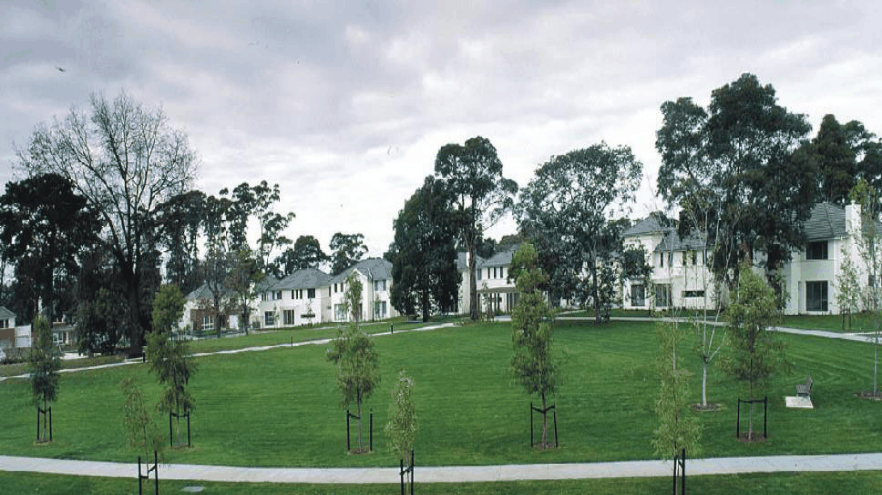

> [Picture on page 38: a picture, saved as a picture (images/vol-2-part-06-edmondson-park-smart-growth-dcp-page-38-6.gif, 150 dpi).]

Incorporating existing trees into parkland and

orientation of dwellings to address the open space enhances the appearance, safety

and useability of these spaces

### Ecologically sustainable development

### 2.6

#### OBJECTIVES

To reduce the demand for waste disposal by maximising the reuse and

a.

recycling of building/ construction materials.

To promote development which maximises the opportunities for energy efficient

b.

uses of resources, particularly in regard to solar power and water management.

To encourage the protection and conservation of native animals and plants,

c.

including threatened species, populations and ecological communities and their

habitat. To ensure that redevelopment of contaminated or potentially contaminated land

d.

does not pose a risk to public health or the environment, is suitably assessed to

determine the extent of contamination, and is remediated to render the site

suitable for the proposed use.

#### Performance Criteria

#### Waste Management

P1.1 Provide procedures to facilitate

waste minimisation and materials

recycling as part of the demolition and

construction process.

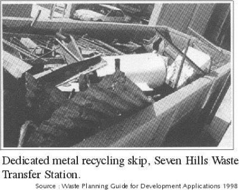

> [Picture on page 39: a picture, saved as a picture (images/vol-2-part-06-edmondson-park-smart-growth-dcp-page-39-25.gif, 150 dpi).]

#### Development Standards

D1.1 The applicant shall prepare a

waste management plan for all

development applications which

propose to construct a building,

which identifies and nominates

opportunities to reuse materials

from the demolition and excavation

phase for the proposed new use as

well as potential waste materials

(such as recyclable packaging, off

cuts and other excess materials as

part of the construction process.

D1.2 All dwellings shall be provided

with waste and recycling bins that re

conveniently located.

#### Performance Criteria

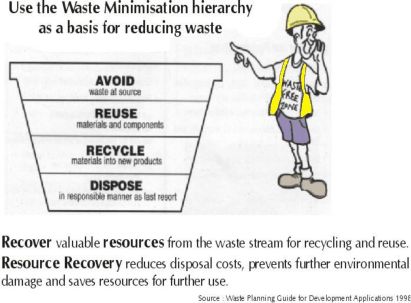

> [Picture on page 40: a picture, saved as a picture (images/vol-2-part-06-edmondson-park-smart-growth-dcp-page-40-2.gif, 150 dpi).]

#### Development Standards

D1.3 The development application

shall detail the following (as

applicable):

(i) the size and location of waste

and recycling storage areas;

(ii) routes for occupants to

access waste and recycling

areas;

(iii) Collection point and/or access

route for collection vehicles;

(iv) Ventilation of waste and

recycling storage areas;

(v) Bin and storage area washing

facilities; and

(vi) Occupant’s disposal points for

all waste streams.

D1.4  Space shall be allocated

behind the primary and secondary

building alignment for dwellings out

of public view to store the following

bins:

(vii) a 140 litre/dwelling/week for

household garbage;

(viii) a 240 litre/dwelling/fortnight

for dry recyclables; and

(ix) a 240 litre/dwelling/fortnight

for garden organics.

#### Energy Efficiency

P2. Design developments to current

best practice standards and so as to

facilitate the use of renewable energy

sources wherever possible.

D2.1 All development applications

are to include BASIX (Building

Sustainability Index) Certification as

required by the Environmental

Planning and Assessment

Regulation 2000.

Further information is available at

P3 Solar Access

Developments shall be designed to

ensure that the proposed building and

adjoining buildings are provided with

adequate solar access to allow

collection of solar energy

D2.2 The development application

shall demonstrate that new

development provides unimpeded

solar access to a minimum of 3m2 of

the north facing roof of adjoining

properties and shall not overshadow

an existing solar roof mounted solar

collectors between 9am and 3pm on

June 21.

#### Performance Criteria

P3.1 Residential buildings should be

designed to be energy efficient through

their design, construction and choice of

appliances and to maximise use of

renewable energy sources.

#### Flora and Fauna Conservation

P5.1 Development should not

significantly affect threatened species,

populations or ecological communities

and their habitats in any way, including:

their removal or destruction;

an alteration to drainage patterns,

water quality, solar access or

potential for weed invasion in a

manner which would critically affect

their long-term survival.

P5.2 Particular attention shall be

given to the preservation and long term

viability of the remnant Cumberland

Plain Woodland that exists on the site.

Note: Reference should be made to

the provisions of the Environmental

Planning & Assessment Act, 1979

and the NSW Threatened Species

Conservation Act, 1995 in regard to

the requirements for the protection of

rare, threatened or endangered

species.

#### Development Standards

D5.1 The proposed development

shall not significantly affect the

endangered ecological community

known as Cumberland Plain

Woodland, the area to be conserved

being delineated upon the DCP

Maps.

D5.2 A vegetation management

plan shall be submitted Council for

the Woodland area and riparian

corridors to be conserved prior to

development works proceeding.

D5.3 An active streetscape shall be

presented to the edge of the

Cumberland Plain Woodland so that

the remnant vegetation is seen as a

community asset. This will also

increase casual surveillance and

help with on-going management of

the area.

D5.4 Where there is potential for

scheduled species to be threatened

by a proposed development, an 7-

part test shall be undertaken to

confirm the existence or otherwise

of threatened species.

D5.5 Where confirmed by 7 part

test, or where the existence of

threatened species is known, a

Threatened Species Impact

Statement shall be provided with the

development application, and the

design of the development shall

take into consideration the findings

#### Performance Criteria

#### Development Standards

of that statement.

#### Water Conservation

P6. All practical means shall be

employed to maximise water reuse and

minimise water usage.

D6.1 Install rainwater tanks where

practicable and utilise water

collected for the watering of

landscaping on the site. If rainwater

tanks are not installed the design of

the development must incorporate

provision for the installation of

suitable tanks at a later date.

D6.2 The overflow from the

domestic rainwater tank is required

to be discharged to the site

stormwater disposal system.

D6.3 The rainwater tank shall

comply with the following Australian

Standards:

AS/NZ 2179-1994 “Specifications

for Rainwater Goods, Accessories

and Fasteners”.

AS 2180-1986 “Metal Rainwater

Goods – Selection and Installation”.

D6.4 Alternative rainwater

collection systems may be used if

practical, where the use of an

external tank would not be suitable

(ie. combined gutter/eave rain-water

collection system which feeds

directly to a water closet and

extension taps). The system may be

supplemented by the mains system

if required.

D6.5 Consideration should also be

given to the reuse of grey water in

the design of development to

supplement town water demand.

#### Performance Criteria

P7. New buildings should provide

for the use of water efficient fixtures to

reduce the demand for (mains) water

and wastewater discharge.

#### Development Standards

D7.1 Consideration shall also be

given to the reuse of grey water in

the design of development to

supplement town water supply

demand.

### 2.7 Water management

#### OBJECTIVES

To provide drainage systems which adequately protect people and the natural

a.

and built environments at an acceptable level of risk and in a cost effective

manner and which contribute positively to the environmental enhancement of

catchment areas

To ensure effective and adequate drainage is provided for new development

b.

sites.

To ensure development is designed in consideration of potential flood hazards.

c.

#### Performance Criteria

#### Floodplain Management

P1.1 The proposed development

should not result in any increased risk

to human life.

P1.2 Potential economic and social

costs which may arise from damage to

property from flooding should not be

greater than that which can reasonably

be managed by the property owner and

the general community.

#### Stormwater Drainage

P2. Stormwater runoff generated by

new development should be managed

to protect any potential damage to

persons or property.

D1.1 The development application

shall demonstrate compliance with

Council's Engineering Design Guide

for Development (as amended) and

The Government's "Floodplain

Development Manual, The

Management of Flood Liable Land,

2005).

#### Development Standards

D2.1 All properties shall be piped a

Council approved stormwater

system.

D2.2  Where properties fall away

from the street and/or are unable to

drain to a trunk drainage system, an

easement for draining stormwater

shall be created through

downstream properties.

D2.3  Development shall be

designed to incorporate the

principles detailed in the

Department of Environment and

Conservation's "Managing Urban

Stormwater: harvesting and reuse

2006".

Page 42 - Vol 2 Edmondson Park Smart Growth DCP

### 2.8 Transport

#### OBJECTIVES

a. To increase opportunities for choice in mode of transport and to assist in

facilitating cost effective and energy efficient public transport services that are

acceptable and convenient to the community.

b. To encourage walking and cycling by providing safe, convenient and legible movement

networks to points of attraction within and beyond the development and facilities for the

secure temporary storage of bicycles.

c. To provide convenient and safe access and parking to meet the needs of all

residents and visitors.

d. To provide access arrangements which do not impact upon the efficient or safe

operation of the surrounding road system.

d. To encourage the integrated design of access and parking facilities to minimise

visual and environmental impacts.

#### Performance Criteria

#### Development Standards

#### Public Transport

P1. Site layout and location should

maximise opportunities for use of

public transport.

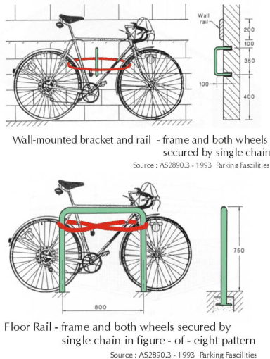

> [Picture on page 45: a picture, saved as a picture (images/vol-2-part-06-edmondson-park-smart-growth-dcp-page-45-21.gif, 150 dpi).]

D1.1 All dwellings shall be planned

to be within 400 metres walking

distance of a bus route.

D1.2 Where opportunities exist,

pedestrian and cycle links shall be

provided to, a bus route and the

future Bardia Centre and possible

future public transport node.

D1.3 Pedestrian and cycle links

shall be well lit and benefit from

casual surveillance from

surrounding development or

vehicular routes in regular use (eg.

bus routes).

#### Performance Criteria

#### Development Standards

D1.4 Bicycle racks in safe and

convenient locations shall be

provided in multi-dwelling housing

developments with a total gross

floor area exceeding 1,000m2, at the

rate of one rack per 5 dwellings.

#### Access and Circulation Design

P2. Vehicular movement to and from

the site and within the site, should be

designed to reduce potential conflict

with other vehicles and pedestrians.

D2.1 No direct vehicular access to

the South Western Freeway or

Campbelltown Road (other than

through the intersection shown on

the DCP maps is permitted and an

emergency vehicle only access to

Campbelltown Road).

D2.2 Accessways and driveways

for multi-unit dwelling developments

with common driveways shall:

Be designed to enable vehicles

to enter the parking space in a

single turning movement;

Leave the parking space in no

more than two turning

movements;

Permit entry and egress in a

forward direction;

Comply with AS 2890 – 1993

(Parts 1 to 5) Parking Facilities;

and

Comply with AS 1428.1 – 1993

Design for Access and Mobility

D2.3 All intersections shall be

designed in accordance with the

RTA and Austroads standards.

P3. Accessways, driveways and

open parking areas are suitably

landscaped to enhance amenity while

providing for security and accessibility

of all residents and visitors.

D3.1 Landscaping along driveways

and accessways shall be provided

as required to a minimum standard

which complies with the

specification provided within

Schedule B.

#### Vehicular Parking

P4. Parking facilities are designed and

located to:

D4.1 Designated car parking

spaces shall comply with the

#### Performance Criteria

conveniently and safely serve

users; provide designated car

parking spaces for people with

disabilities;

enable the efficient use of car

spaces and accessways;

use innovative solutions to car

parking (underground, semi-

basement or dual use) particularly

where site conditions permit; and

reduce the visual dominance of car

parking areas and accessways.

P5. The public transport corridor

shown on map 2 and map 5 indicates

the preferred alignment of the corridor.

requirements of parking for persons

with disabilities specified by

AS 2890.1 and AS 1428.2.

D4.2 Car parking spaces and areas

shall be designed to comply with

AS 2890 – 1993 (Parts 1 to 5)

Parking Facilities.

#### Development Standards

D6.1 Accommodation on-site for 2

cars shall be provided for single

detached dwelling-houses.

D6.2 Car parking shall be provided

for residential dwelling

developments at the following

minimum rates.

#### Performance Criteria

#### Development Standards

| Number of Bedrooms per Dwelling | Car Parking Spaces per dwelling |
|---|---|
| Bedsitter or 1 bedroom | 0.75 |
| 2 bedroom | 1 |
| 3 or more bedrooms | 1.5 |
| Visitor spaces | 0.2 |

P6. Car parking is provided with

regard to the:

likely parking demand generation of

the development;

availability of public transport

availability of on-street car parking

locations of schools and local

shops

possible demand for car parking

space from adjoining localities;

occasional need for overflow car

parking;

requirements of people with a limited

mobility, sensory impairment and at

different stages of the family life cycle.

Notes:

Visitor spaces are required for all multi-

unit dwelling developments in addition

to resident spaces. These may be

provided on-site, on-street, or a

combination of both. On street parking

shall be unallocated and available to the

public.

Car parking calculations are to be

rounded up.

D6.3 Stacked parking, for a

maximum of 2 car parking spaces,

may be provided only for use by the

same dwelling.

#### Performance Criteria

#### Design of Parking Spaces

P7 The size of parking spaces and

structures should reflect:

functional requirements;

the amount of space available (for

example, having regard to the

location of existing buildings or

trees); and

bulk/scale relationship with

adjacent development on-site.

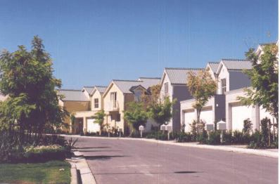

> [Picture on page 49: a picture, saved as a picture (images/vol-2-part-06-edmondson-park-smart-growth-dcp-page-49-12.gif, 150 dpi).]

#### Terrace Style

Rear Lane/shareway access

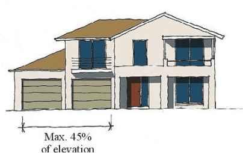

> [Picture on page 49: a picture, saved as a picture (images/vol-2-part-06-edmondson-park-smart-growth-dcp-page-49-15.gif, 150 dpi).]

D7.1 Car parking structures shall

be incorporated into the design of

residential buildings, so to not

dominate the appearance of the

building when viewed from public

streets or internal private roadways.

#### Development Standards

D7.2 Parking spaces and

manoeuvring areas shall conform to

the standards provided by AS2890.

D7.3 The openings of undercover

parking spaces shall not occupy

more than 45% of the total width of

the street elevation of the building.

This does not apply to rear lanes.

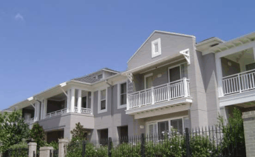

> [Picture on page 49: a picture, saved as a picture (images/vol-2-part-06-edmondson-park-smart-growth-dcp-page-49-31.gif, 150 dpi).]

#### Terrace Style

Parking from rear

Low fence & landscape to street

#### Performance Criteria

#### Development Standards

D7.4 The design of car parking

structures shall be integrated with

the design of the proposed

development, and be in sympathy

with the appearance of adjacent

development by:

the use of similar materials,

colours, height and roof pitch;

integrating the structure within

the development;

breaking up structures with

different surface and wall

treatments and landscaping;

locating car parking at the rear

of the site where rear access is

available; and

limit the number of adjoining

garages to single or double,

without some form of articulation

or break.

### Security, privacy and acoustic amenity

### 2.9

#### OBJECTIVES

To ensure the siting and design of buildings provide visual and acoustic privacy for

a.

residents and neighbours in their dwellings and private open spaces.

To provide personal and property security for residents and visitors and enhance

b.

perceptions of community safety.

To ensure that all future occupants are provided with appropriate acoustic amenity.

c.

#### Performance Criteria

#### Overlooking

P1. Private external living spaces and

internal living areas of adjacent

dwellings should be protected from

overlooking.

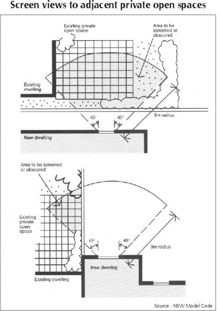

> [Picture on page 51: a picture, saved as a picture (images/vol-2-part-06-edmondson-park-smart-growth-dcp-page-51-18.gif, 150 dpi).]

#### Development Standards

D1.1 Site layout and building

design ensures that windows do not

provide direct and close views into

windows, or private external living

spaces of adjoining dwellings.

D1.2 Habitable room windows

(other than bedroom windows) of

adjacent dwellings within a distance

of 9 metres shall be:

Offset by a distance sufficient to

limit views between windows; or

Have sill heights of 1.7 metres

above floor level; or

Have fixed obscure glazing in

any part of the window within

1.7 metres of the floor level.

D1.3 Direct views onto adjoining

private external living spaces shall

be obscured by:

Screening that has a maximum

area of 25% openings, is

permanently fixed and made of

durable materials; or

Existing dense vegetation or

new planting.

#### Performance Criteria

#### Development Standards

#### Noise

P2.1 The transmission of noise

between adjoining residential

properties should be minimised.

D2.1 New dwellings shall be

protected from existing and likely

future noise sources emanating

from adjoining residential properties

and other high noise sources (such

as busy roads, railway lines and

industries) and minimise the

transmission of intrusive noise to

adjoining residential properties.

P2.2 Residential development should

be designed to be protected from the

transmission of noise from the possible

public transport corridor.

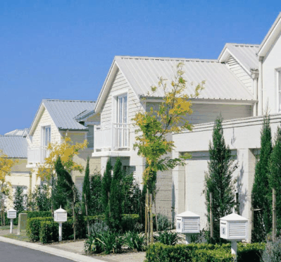

> [Picture on page 52: a picture, saved as a picture (images/vol-2-part-06-edmondson-park-smart-growth-dcp-page-52-20.gif, 150 dpi).]

D2.2 No occupation of residential

dwellings will be permitted until

noise abatement barriers

recommended by an acoustic

engineer for that dwelling are

constructed. The noise abatement

barriers and dwellings will need to

be designed to comply with the

following:

recommendations of the noise

planning report prepared by a

qualified Acoustic engineer and

submitted with the development

application for approval.

D2.3 Required acoustic barriers

shall be constructed at no cost to

Council.

#### Terrace Style

Garages to rear lane/shareway

Garage top accommodation provides

D2.4 The development application

shall demonstrate compliance with

the provisions of the Environmental

Noise Control Manual published by

the NSW Environment Protection

Authority.

#### D2.5

(1) This development standard

applies to a development application

made to the Council on or after the date

on which this development standard

takes effect being an application for

consent to the erection or alteration of a

dwelling on land within 100 metres of

the centre line of the public transport

corridor.

surveillance, variety and assists as a

(2) An application to which this

#### Performance Criteria

#### Development Standards

noise barrier

clause applies shall be prepared on the

assumption that noise emanating from

the possible public transport corridor, if

it is developed for public transport

purposes in the future, will, on the

worst-case scenario, be noise from

heavy rail.

(3) A development application to

which this clause applies shall be

accompanied by a report from a

suitably qualified acoustical consultant

demonstrating that the proposed

development will comply with the

requirements of paragraph 4.  The

acoustical consultant is required to

prepare the report in consultation with

the Department of Planning.

(4) The development standards in

relation to noise are as follows:

new dwellings or altered

dwellings do not require the

incorporation of acoustic treatment

into building design if they will be

constructed in a location where noise

levels in habitable rooms with external

windows and doors shut will not

exceed the acceptable noise levels for

habitable rooms set out in the

Environmental Noise Control Manual

published by the Department of

Environmental Conservation of NSW.

However, new dwellings that

will be constructed in a location where

noise levels in habitable rooms with

external windows and doors shut will

exceed the acceptable noise levels

set out in that Manual shall

incorporate acoustic treatment into

building design that complies with the

following criteria in habitable rooms

with external windows and doors shut:

| Internal Space | Time Period | Noise Level LAeq(1 hour) |
|---|---|---|
| Living Areas | Day or Night | ≤ 40 dBA |
| Sleeping Areas | Day (7am to 10pm) Night (10pm to 7am) | ≤ 40 dBA ≤ 35 dBA |

If noise levels from railway noise within

such buildings with windows or doors

open exceed these criteria by more

than 10dBA, the design of the

#### Performance Criteria

#### Security

P3. Site layout and design of the

dwellings, including height of front

fences and use of security lighting,

should minimise the potential for crime,

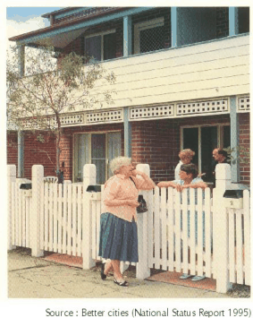

> [Picture on page 54: a picture, saved as a picture (images/vol-2-part-06-edmondson-park-smart-growth-dcp-page-54-7.gif, 150 dpi).]

vandalism and fear.

#### Development Standards

ventilation for habitable rooms shall be

such that windows and doors may be

left shut.

A development application to erect a

new dwelling or dwellings within 100

metres from the centre line of the

possible public transport corridor shall

be accompanied by a report from a

suitably qualified acoustical consultant

demonstrating that the new dwelling or

dwellings will comply with the

requirements of this development

standard.

D2.6 Residential buildings shall be

setback a minimum of 20 metres

from the proposed future public

transport corridor. Should the mode

of transport chosen for the corridor

be determined to be other than rail

at the time of determining a

development application, then

Council may consider a reduced

setback.

D3.1 Shared pedestrian entries to

multiple dwelling complexes shall be

lockable.

D3.2 Buildings adjacent to streets

or public spaces shall be designed

to allow casual surveillance and

shall have at least one habitable

room window facing that area.

Page 52 - Vol 2 Edmondson Park Smart Growth DCP

### 2.10 Ancillary site facilities

#### OBJECTIVES

To ensure that site facilities are effectively integrated into the development and are

(a)

unobtrusive. To ensure site facilities are adequate, accessible to all residents and easy to maintain.

(b) To ensure facilities are provided for efficient solid waste management.

(c)

#### Performance Criteria

#### Waste Disposal

P1.1 Provisions of waste and recycling

bin enclosures which are:

adequate in size

durable and waterproof

blend in with the development

avoid visual clutter

easy to maintain in a clean and

hygienic condition.

P1.2 Waste and recycling bin

enclosures are located for convenient

access by residents and collection

vehicles.

#### Clothes Drying Areas and Other Site

#### Facilities

P2. Adequate and accessible clothes

drying facilities are provided for all

residents.

#### Roof Mounted Structures

P3. Roof mounted structures such

as television antennae and satellite

dishes or solar panels shall be

unobtrusive.

#### Development Standards

D1.1 The development application

shall nominate a waste and recycling

bin storage area which is capable of

accommodating one 120-litre bin per

dwelling with easy access to the public

street frontage and which is located

within 60m walking distance from each

dwelling.

D1.2 If the area is to be a bin

storage area for more than one

dwelling it shall be adequately

screened.

D3.1 No roof mounted structures

such as television antennae and

satellite dishes shall be visible from

the public domain.

D2.1 Internal mechanical and/or

external passive clothes drying

facilities shall be provided, in a

manner conveniently accessible to

all residents.

D2.2 External clothes drying

facilities shall be adequately

screened from the public domain.

## PART 3 Schedules

environmental and economic

objectives can be achieved.

#### SCHEDULE A Dictionary

“AMCORD” means the national resource

document for residential development

published by the Commonwealth

Government and entitled “Australian

Model Code for Residential Development”

(1997 Edition). “amenity” means features, facilities or

services of a house, locality or district

which make for a pleasant and

comfortable life.

"height" means the vertical distance

between finished ground level and the

top most point of a structure, excluding

minor attachments and architectural

detailing such as television aerials and

fenestration.

“biodiversity” means variety of life

forms, plants, animals and micro

organisms. It is usually considered at

three levels:

(a) genetic diversity;

(b) species diversity; and

(c) ecosystem diversity.

"Public domain" is the shared urban

areas and spaces, the structures that

relate to those spaces and the

infrastructure that serves them, which

is accessible or available to the

general public, regardless of whether

they are in public ownership, or not.

(See also ecologically sustainable

development).

"Storeys, and the number of

storeys" are as defined by Clause 6

of State Environmental Planning Policy

No. 6 – Number of Storeys in the

Building (SEPP No. 6). Note: SEPP 6 generally defines the

number of storeys in a building as

follows:

“conservation” means all of the

processes of looking after a place so

as to retain its cultural significance. It

includes maintenance and may,

according to circumstance, include

preservation, restoration,

reconstruction and adaptation and will

be commonly a combination of more

than one of these. (Source: The Burra

Charter)

the maximum number of storeys,

floors or levels as the case may

be, of the building which may be

intersected by the same vertical

line, not being a line which passes

through any wall of the building;

but excluding the whole or any part of

a roof used as an uncovered

garden, terrace or deck. “Terrace” means a single dwelling

which shares at least one side

boundary line with adjoining

neighbours and is generally built from

side boundary to the other side

boundary. This building type is

repeated to form a row of attached

dwellings.

#### “ecologically sustainable

development (ESD)” means

development that uses, conserves and

enhances the community’s resources

so that ecological processes, on which

life depends, are maintained and the

total quality of life now and in the

future can be increased. (Source:

National Strategy for Ecologically

Sustainable Development, 1992) ESD

is essentially about creating a system

which is self sustaining in the long

term. It is more a process than a

product. It incorporates conservation

principles and practices into the

development process, so that a

sustainable balance between

“Zero lot line dwelling” means a

dwelling built to one side boundary

line. The planned configuration shall

form a courtyard space usually to the

rear of the allotment.

#### SCHEDULE B

#### Minimum Landscaping Specification

### 1.0 SITE MANAGEMENT CONDITION Site Condition

1.1 Areas to be landscaped should be left clean of building materials and rubbish.

#### Existing Plant Material

1.2 All existing trees, shrubs, ground covers, perennial plants and lawn areas

except those indicated to be removed shall be retained irrespective of size. Ensure

that trunks, branches and roots are protected against damage.

1.3 Special care is to be taken when cultivating around existing plant material.

#### Tree Protection

1.4 Protect all trees to be retained on site and their root systems from damage

caused by or arising from the course of the carrying out of works.

1.5 Before commencing any other work, surround each tree or group of trees on

site with a 2 metre high light gauge reinforcing mesh fence supported and tied to

50mm diameter galvanised steel posts firmly driven into the ground at not less than

1.5 metre spacings.

1.6 The fences shall be not less than 2 metres from any tree trunk and no

materials, equipment, machinery, rubbish and other items shall be stored within the

fence. Remove any materials, rubbish, etc. that may be within the fences at any time.

1.7 Should any minor trimming or removal of lower branches be necessary, this

shall comply with the requirements of the Council’s Tree Preservation.

#### Weed Eradication

1.8 Eradicate weeds by environmentally acceptable methods, using a non-

residual glyphosate herbicide in any of its registered formulas.

1.9 Regularly remove by hand rubbish and weed growth or regrowth that may

occur throughout the grassed, planted and mulched areas.

### 2.0 SITE PREPARATION

2.1 All garden areas shall have a minimum depth of 300mm of topsoil, being

either suitably improved and cultivated insitu soil or imported topsoil. Add organic

matter in the form of compost to a depth of 75mm over the entire areas previously

cultivated as specified. Organic matter shall be thoroughly mixed through the

prepared soil before planting out.

2.2 Insitu topsoil in garden areas shall be free from grass, weeds, stumps or

materials toxic to plant growth, and appropriately cultivated and fertilised.

2.3 Imported topsoil shall be of a horticulturally suitable quality sandy loam

comprising 85% coarse and fine sands and no more than 15% humus and fine

materials. It shall be in a friable state and free from any materials toxic to plant

growth, and free from stumps, roots, clay lumps or similar material. It shall be entirely

free from noxious weeds and free from grass. Topsoil shall only be worked whilst in a

moderately moist condition.

2.4 Level the site so that the contours are as shown on the plan. The surface

shall be left smooth and free of all foreign material. The contours shall be within plus

or minus 150mm of those shown on the plan.

### 3.0 FERTILISER

3.1 The areas to be turfed shall first be fertilised with a complete lawn fertiliser

with a N:P:K ratio of 10:9:8 such as “Shirley’s No. 17” applied evenly by a fertiliser

spreader at the rate of 4kg/100m2.

3.2 Plants are to be fertilised with a slow release fertiliser of 20g per hole.

### 4.0 TURFING

4.1 Provide 75mm depth of topsoil for lawn areas. Level, compact lightly and rake

to a smooth surface prior to turf laying. Ensure that turf finishes flush with kerbs and

pavements and no ponding occurs as a result of turf levels.

4.2 Turf shall be obtained from an approved commercial grower of cultivated turf.

It shall be free of lawn pests, diseases and reasonably weed free. Before cultivating,

turf shall be mown to a height of 12mm to give a close sward. Turf shall be machine

cut, of even thickness in either squares or rolls. After cutting, it shall not be stacked

or rolled for more than 48 hours.

4.3 Prior to final raking, apply fertiliser as specified elsewhere evenly over

levelled surfaces. Lay turf sods without excessive joints, thoroughly water without

delay and roll with light roller to bring into firm contact with soil.

4.4 Top-dress joints with sandy loam to give good cover whilst still revealing the

grass shoots.

4.5 Maintain lawn areas during construction with regular watering and mowing.

### 5.0 EDGINGS

5.1 Timber edgings shall consist of 300mm x 150mm hardwood edgings that

have been treated with one coat of creosote. Edgings to be fixed at 5 metre centres

using 50mm x 50mm hardwood pegs nailed to the edge board with a 40mm

galvanised clout. Edge boards are to be approximately 10mm below all grass areas.

5.2 Brick edgings shall consist of well baked selected common bricks placed on

edge 10mm below existing ground or grass level. A 10mm wide cement mortar joint

shall be applied between each brick.

### 6.0 PLANTING

6.1 Planting holes shall be at least 450mm square and dug to a depth of 75mm

more than the depth of the root ball.

6.2 All surplus material shall be removed and replaced with planting soil as

specified previously. The bottom of each hole shall be loosened to a further 150mm

to assist drainage.

6.3 A slow release fertiliser at the rate of 20g/hole shall be placed at the bottom of

each hole before planting. Stake and tie as specified elsewhere. If planted in lawn

areas, leave a neat 600mm square opening in turf after planting is completed. Form a

shallow saucer-like depression in soil around base of plant.

6.4 Planting shall not be carried out in dry soil or in extreme weather conditions.

6.5 Avoid hilling up of soil around young plant stem. Firm soil around the root ball

and thoroughly soak the areas after planting. On completion, cultivate, rake and

leave all gardens areas in a neat and tidy condition. Remove all containers from site.

### 7.0 PLANTING MATERIALS

7.1 Trees and shrubs shall be true to name and variety. Substitutes in size and

variety shall not be made without approval.

7.2 All plants shall be true to size, in well developed, healthy condition, free from

insects and diseases with well established root systems.

7.3 Advanced sizes shall be grown in a container of minimum 5 litre capacity.

Semi-mature sizes shall be grown in a container of minimum 3.5 litre capacity.

Ground cover plants shall be in 150mm pots.

### 8.0 STAKING

8.1 Provide stakes for all trees and shrubs.

8.2 All trees shall have one (1) 40mm x 40mm x 1.5m straight hardwood stake,

pointed at one end. Tall shrubs shall have one (1) 25mm x 25mm x 1.2m stake

pointed at one end.

8.3 Firmly install stakes to each tree/shrub taking care not to damage the root

system.

8.4 Ties shall be of plastic strips of webbing material or hessian tie.

8.5 Securely tie plant to the stake in a way to avoid damage to the stem whilst

allowing a small degree of movement.

8.6 Labels shall be entirely removed from the plants.

### 9.0 MULCH

9.1 Spread mulch to all areas indicated on plan. Mulch shall be of commercial

quality, free from foreign debris and without potential to initiate weed growth.

9.2 After planting the areas indicated, spread the material to an even depth of

75mm to 100mm on the surface of the topsoil so the refinished levels are flush with

surrounding kerbs, edges or paths.
