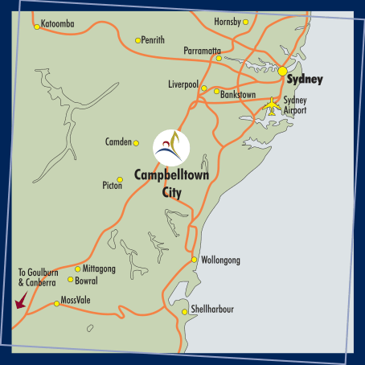

#### 11. PREFERRED PLANT SPECIES LIST

11.1 The following tables provide a list of preferred plant species. Alternate and

additional species may be proposed provided they are shown to be appropriate plant

material for the application context and suitable for the subject environment.

11.2 A consistent landscape theme must be adopted for public areas. A street tree

planting theme must be proposed for all new roads, utilising recommended tree

species below or alternate suitable species.

11.3 Species endemic to the locality should be used with the interface area

between urban development and remnant bushland.

| TREES |  |  |  |
|---|---|---|---|
| Botanical Name | Common Name | Mature Height | Description |
| Acacia decurrens | Green Wattle | 3-5m | native evergreen flowering |
| Acacia parramattensis | Sydney Green Wattle | 3-5m | native evergreen flowering |
| Backhousia myrtifolia* | Aniseed Tree | 10m | native evergreen flowering |
| Brachychiton acerifolius | Flame Tree | 25m | native deciduous |
| Casuarina glauca | Swamp Oak | 20m | flowering native evergreen |
| Eleocarpus reticulatus* | Blueberry Ash | 8m | native evergreen flowering |
| Eucalyptus amplifolia* | Cabbage Gum | 15m | native evergreen |
| Eucalytpus crebra | Narrow Leafed Ironbark | 20m | native evergreen |
| Eucalyptus moluccana* | Coastal Grey Box | 18m | native evergreen |
| Eucalyptus tereticornis | Forest Red gum | 20m | native evergreen |
| Ficus rubiginosa | Port Jackson Fig | 40m | native evergreen |
| Flindersia brayleyana | Flindersia | 20m | native semi evergreen flowering |
| Flindersia shottiana | Bumpy Ash | 20m | native semi evergreen flowering |
| Fraxinus excelsior ‘Aurea’* | Golden Ash | 10m | exotic deciduous |
| Fraxinus oxycarpa ‘Raywood’* | Claret Ash | 10m | exotic deciduous |
| Grevillea robusta | Silky Oak | 15-25m | native evergreen |
| Jacaranda mimosifolia* | Jacaranda | 10m | exotic deciduous flowering |
| Koelreuteria paniculata* | Golden Rain Tree | 9-15m | exotic deciduous flowering |
| Lagerstroemia indica | Crepe Myrtle | 5-7m | exotic deciduous flowering |
| Lophostemon confertus* | Brush Box | 15-30m | native evergreen |
| Magnolia grandiflora | Magnolia | 7-10m | exotic evergreen flowering |
| Malus floribunda | Crab Apple | 5-8m | exotic deciduous flowering |
| Melaleuca decora | Paperbark | 6-9m | native evergreen flowering |
| Melaleuca stypheloides | Prickly-leafed Paperbark | 8-12m | native evergreen flowering |
| Melia azederach var. australis | White Cedar | 7-10m | native deciduous flowering |
| Pinus canariensis | Canary Island Pine | 20m | exotic evergreen |
| Pistacia chinensis | Chinese Pistacia | 8m | exotic deciduous |
| Pittosporum thombifolium* | Diamond Laurel | 10m | native evergreen flowering |
| Pittosporum undulatum | Sweet Pittosporum | 8-12m | native evergreen flowering |
| Platanus orientalis ‘Digitata’ | Cut Leaf Plane | 30m | exotic deciduous |

| TREES |  |  |  |
|---|---|---|---|
| Botanical Name | Common Name | Mature Height | Description |
| Podocarpus elatus | Illawarra Pine | 20m | native evergreen |
| Populus nigra ‘Italica’ | Lombardy Poplar | 25m | exotic deciduous |
| Prunus spp. | Flowering Cherry/Plum | 6-8m | exotic deciduous flowering |
| Pyrus calleryana* | Carliery Pear | 15m | exotic deciduous flowering |
| Syzgium paniculatum syn australe | Brush Cherry | 10m | native evergreen |
| Tristaniopsis laurina | Water Gum | 6-10m | native evergreen flowering |
| Waterhousia floribunda | Weeping Lilly Pilly | 15m | native evergreen |

\* Preferred Street Tree Species

Species endemic to locality

| SHRUBS |  |  |  |
|---|---|---|---|
| Botanical Name | Common Name | Mature Height | Description |
| Baeckea densifolia | Baeckea | 1m | native evergreen flowering |
| Callistemon citrinus ‘Endeavor’ | Bottlebrush | 4m | native evergreen flowering |
| Callistemon viminalis ‘Little John’ | Bottlebrush | 1m | native evergreen flowering |
| Camellia sasanqua | Sasanqua | 3m | exotic evergreen flowering |
| Crinum pedunculatum | Swamp Lily | 600mm | native evergreen flowering |
| Gardenia augusta ‘Florida’ | Gardenia | 1-1.5m | exotic evergreen flowering |
| Kunzea ambigua | Tick Bush | 2-3m | native evergreen flowering |
| Leptospermum flavescens ‘Cardwell’ | Tantoon Tea Tree | 1.5m | native evergreen flowering |
| Lomandra longifolia var. longifolia | Spiny Headed Mat Bush | 0.4-0.8m | native evergreen flowering |
| Murraya paniculata | Orange Jessamine | 2-3m | exotic evergreen flowering |
| Phormium tenax/’Purpureum’/ ‘Rubrum’ | NZ Flax | 1.8-3m | exotic evergreen coloured foliage |
| Photinia ‘Red Robin’ | Red Robin Photinia | 2-4m | exotic evergreen coloured foliage |
| Plumbago auriculata ‘Royal Cape’ | Blue Plumbago | 2-3m | exotic evergreen flowering |

| GROUNDCOVERS AND CLIMBERS |  |  |  |
|---|---|---|---|
| Botanical Name | Common Name | Mature Height | Description |
| Acanthus mollis | Oyster Plant | 500mm-1m | exotic evergreen flowering |
| Agapanthus orientalis (Mauve and White) | Lily of the Nile | 500mm-1m | exotic evergreen flowering |
| Dianella revoluta | Spreading Lily | 500mm-1m | native evergreen flowering |
| Dianella caerulea var. producia |  | 500mm | native evergreen flowering |
| Dietes grandiflora | Wild Iris | 750mm | exotic evergreen flowering |
| Dietes iridioides | African Iris | 750mm | exotic evergreen flowering |

| GROUNDCOVERS AND CLIMBERS |  |  |  |
|---|---|---|---|
| Botanical Name | Common Name | Mature Height | Description |
| Dicondra repens | Kidney Weed | 200-600mm | native evergreen flowering |
| Erigeron karvinskianus | Fleabane | 200mm | exotic evergreen flowering |
| Gardenia augusta ‘Radicans’ | Prostrate Gardenia | prostrate | exotic evergreen flowering |
| Hardenbergia violacea | Purple Coral Pea | prostrate/climber 3m | native evergreen flowering |
| Hemerocallis spp | Day Lily | 500mm | exotic evergreen flowering |
| Liriope spicata | Turf Lily | 300mm | exotic evergreen flowering |
| Lomandra longifolia | Mat Rush | 700mm | native evergreen |
| Myoporum parvifolium | Myoporum | prostrate | native evergreen flowering |
| Ophiopogon japonicus | Mondo Grass | 200mm | exotic evergreen |
| Themeda australia | Kangaroo Grass | 1.2m | native evergreen |
| Viola hederacea | Native Violet | prostrate | native evergreen flowering |

> [Picture on page 66: a picture, saved as a picture (images/vol-2-part-06-edmondson-park-smart-growth-dcp-page-66-1.gif, 150 dpi).]

campbelltown.nsw.gov.au

Campbelltown City Council, PO Box 57, Campbelltown, NSW 2560
