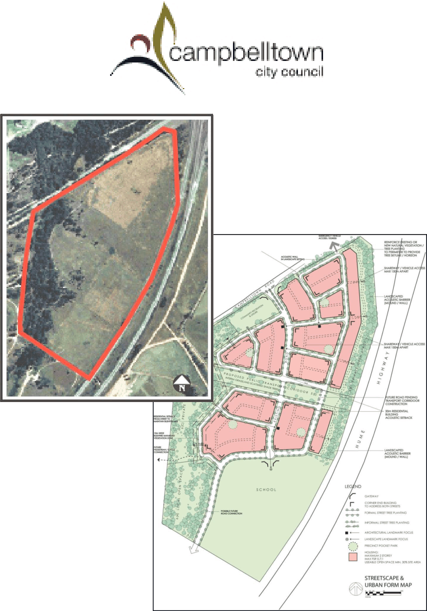
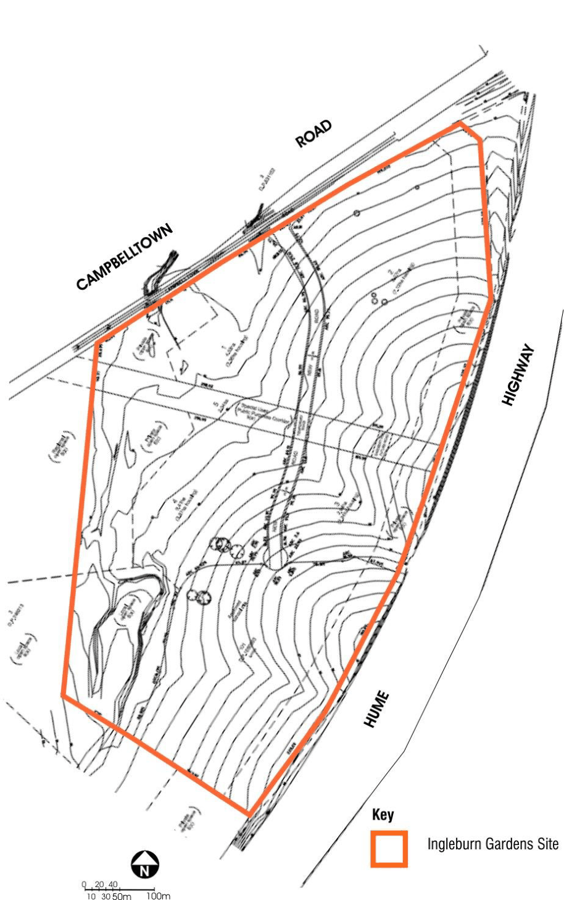

# Campbelltown Sustainable City Development Control Plan 2015 - Part 6 Edmondson Park Smart Growth DCP

> This chapter is split into 3 section file(s), one per numbered heading, in the order they appear in the PDF.

Source PDF: [volume-2-part-6-edmondson-park-smart-growth-dcp-with-cover.pdf](volume-2-part-6-edmondson-park-smart-growth-dcp-with-cover.pdf)

### Campbelltown (Sustainable City) Development Control Plan 2015

> [Picture on page 1: a picture, saved as a picture (images/vol-2-part-06-edmondson-park-smart-growth-dcp-page-1-5.gif, 150 dpi).]

### VOLUME 2

### Site Specific DCPs

## Part 6:  Edmondson Park Smart Growth  DCP

### Creating Campbelltown's Future 2025

#### Note:

The Edmondson Park Smart Growth DCP was adopted by Council on 1 May 2007  and has been incorporated as Part 6, Volume 2 of Campbelltown (Sustainable City) DCP .

> [Picture on page 3: a picture, saved as a picture (images/vol-2-part-06-edmondson-park-smart-growth-dcp-page-3-1.gif, 150 dpi).]

### Edmondson Park Smart Growth

### Development Control Plan

### Locality CB

### masterplan

Prepared by Don Fox Planning on behalf of Campbelltown City Council In association with

Giles Tribe Architects, and

Mepsteads & Associates Don Fox Planning Pty Limited ACN 002 263 99   ABN 24 551 441 566

PO Box 230 Pennant Hills  NSW  1715

Email: donfoxpl@donfoxplanning.com.au

Web Site: www.donfoxplanning.com.au

Telephone: 02 9980 6933   Fax: 02 9980 6217

Project No: P5285

File Ref: 5285 Masterplan

Date:  April 2007

### Edmondson Park Smart Growth DCP

### Locality CB

### masterplan

### TABLE OF CONTENTS

## PART 1 GENERAL INFORMATION

1.1 What is this Plan called? .................................................. 4

1.2 How is this Plan made? .................................................... 4

1.3 Why is the Plan required? ................................................ 4

1.4 Where does the Plan apply? ............................................. 4

1.5 What applications does the Plan apply to? ....................... 4

1.6 Who is the Consent Authority? ......................................... 4

1.7 What do the terms used in this Plan mean? ...................... 4

1.8 How does this Plan relate to other Plans and Legislation? ...................................................................... 6

1.9 What are the objectives of the Plan? ................................ 6

1.10 How is the Plan to be applied to achieve its objectives? .... 6

1.11 What is a site analysis? .................................................... 7

1.12 What is required to lodge a development application? ...... 8

## PART 2 CRITERIA FOR DEVELOPMENT

2.1 Land use and development patterns ............................... 11

2.2 Streetscape and urban character .................................... 16

2.3 Subdivision design ......................................................... 24

2.4 Building form .................................................................. 28

2.5 Open space and landscaping ......................................... 33

2.6 Ecologically sustainable development ............................ 37

2.7 Water management ........................................................ 42

2.8 Transport ....................................................................... 43

2.9 Security, privacy and acoustic amenity ........................... 49

2.10 Ancillary site facilities ..................................................... 53

## PART 3 SCHEDULES

A. Dictionary

B. Minimum Landscape Requirements

### General Information

### 1.1 What is this Plan

### called?

### 1.4 Where does the

### Plan apply?

This Plan shall be known as the

“Edmondson Park Smart Growth

Development Control Plan Locality

CB, Masterplan”

### 1.2 How is this Plan

### made?

#### 1.2.1 This Plan is adopted by Council

in accordance with Section 72 of the

Environmental Planning & Assessment

Act 1979 and Campbelltown (Urban

Area) Local Environmental Plan 2002.

This Plan applies to that land within

the Campbelltown Local Government

Area (LGA) generally bound by

Campbelltown Road, the South

Western Freeway (Hume Highway)

and the Ingleburn Army Camp, as

identified on Map 1.

### 1.5 What applications

### does the Plan apply

### to?

Council adopted the Plan on 1 May

2007 and the Plan became effective

on 15 May 2007.

#### 1.2.2 Notes are provided in italic text

within boxes throughout the Plan to

provide supplementary information

and explanation. These notes do not

form part of the Plan adopted by

Council.

### 1.3 Why is the Plan

### required?

This Plan provides a masterplan and

associated criteria for the assessment

of all applications lodged for the

purposes of obtaining development

consent. The types of development for

which approval may be sought will

primarily relate to subdivision, single

dwelling houses, medium density

housing residential aged care facilities,

educational establishments and

ancillary development.

### 1.6 Who is the Consent

### Authority?

Campbelltown City Council is the

consent authority for local

development.

#### 1.3.1 This Plan is required to provide

a planning framework and detailed

controls to supplement the provisions

of Campbelltown (Urban Area) Local

Environmental Plan 2002.

### 1.7 What do the terms

### used in this Plan

### mean?

1.3.2 This Plan supersedes an

earlier masterplan approved for the

land by Council, with a Plan which

reflects current planning

considerations inclusive of a public

transport corridor and the proposals

for the Composite Edmondson Park

Release Area as identified within the

North Campbelltown Structure Plan.

For the purposes of this Plan, the

definitions outlined within the

Dictionary appended to the Plan as

Schedule A have been adopted.

Issue.05

Issue 03

#### Map 1 – Areas Where the Policy Applies

> [Picture on page 7: a picture, saved as a picture (images/vol-2-part-06-edmondson-park-smart-growth-dcp-page-7-2.gif, 150 dpi).]
> Words printed on the picture (title and legend, copied from the PDF):
> Possible future
> Transport Corridor
> Part 1 - General Information  Page 5
> Date March

#### Edmondson Park Smart Growth

#### Development Control Plan

c) To specify criteria to ensure that

development is consistent with the

planned urban character of the

area.

d) To identify key principles

### 1.8 How does this Plan

### relate to other

Plans and

### Legislation?

associated with the development

of the area, inclusive of land

required for open space/drainage

management purposes, protection

of watercourses, riparian corridors,

bushland conservation and salinity

management.

e) To identify land required for a

1.8.1 This Plan should be read in

conjunction with Campbelltown LEP

(Urban Area) 2002 the Environmental

Planning and Assessment Act, 1979

and associated Regulations and

applicable Regional Environmental

Plans and State Environmental

Planning Policies.

public transport corridor and

protect the availability of land so

identified for that purpose.

f) Identifies appropriate locations for

1.8.2 Reference should also be

made to other development control

plans (DCPs) adopted by Council. This

Plan prevails to the extent of any

inconsistency between this Plan and

any other DCP.

uses such as a residential aged

care facility, school, kindergarten

and community facilities.

### 1.9 What are the

objectives of the

### Plan?

### 1.10 How is the Plan to

be applied to

### achieve its

### objectives?

#### 1.10.1 The design elements within

Part B of this Plan have three

components: A set of objectives;

The aim of this Plan is to provide a

masterplan for a new residential estate

together with detailed planning

guidelines and standards to ensure the

orderly, efficient and environmentally

sustainable development of a new

urban area in a manner which

achieves the following objectives:

Performance criteria; and

a) To ensure that the land is

Development standards. The "objectives" specified for each

design element represent the

outcomes that Council wishes to

achieve.

developed in a manner which is

consistent with the North

Campbelltown Structure Plan and

the broader objectives of the

Edmondson Park Urban Release

Area Precinct.

b) To comprehensively outline all

The "performance criteria" represent

a means of assessing whether the

desired outcomes will be achieved.

Council will consider how each of

these criteria (where relevant) has

been addressed by the applicant or

designer when determining an

application under this Plan. The "development standards" are

ways of achieving the outcomes. While

these solutions may satisfy the

criteria which will be relevant to the

assessment of development

proposals, including urban

character, subdivision design,

building form, open space and

landscaping, transport, traffic and

access, car parking, ecologically

sustainable development, noise,

soil, water management and

pollution control.

Issue 03

performance criteria, other solutions

could also be considered.

#### 1.10.2 It is essential that all

development satisfies the performance

criteria to meet the objectives of that

criteria, and in some cases compliance

with the development standard may

not be sufficient. The aim is to suit the

approach to the site while satisfying

market requirements and enable

proponents to develop a variety of

design responses.

#### 1.10.3 Council may consider

variations to the requirements of the

Plan in certain circumstances.

Requests for variations are required to

be in writing and shall clearly

demonstrate the reason(s) why the

variation sought would not adversely

impact on the environment or local

amenity, would not erode the relevant

standard and requirement; and that

compliance with the objectives and

requirements of the Plan are

unreasonable or unnecessary in the

circumstances of the case. Council

gives no assurance that it will permit

any variations(s) to the requirements

of the Plan. Variations will only be

considered in exceptional

circumstances.

Compliance with any numerical

provisions of the Plan does not

guarantee the granting of development

consent. Each application will be

considered on its merits, having regard

to the matters for consideration under

Section 79C of the Act. Consistent application of the

provisions of the Plan will be given

high priority by Council.

### 1.11 What is a site

### analysis?

A site analysis is the process of examining

and recording the opportunities and

constraints to the potential development of

the site, including consideration of how

such development may best achieve

Issue 03

compatibility with the existing and likely

future urban character of the locality. A site analysis should form the basis for

the design of any development proposal,

to ensure that the best possible design for

a site is achieved.

The amount of information required for

a site analysis will vary depending on

location, scale and complexity of the

proposal.

A site analysis shall be lodged with the

development application for all

development involving the construction

of a building.

Each application is required to

demonstrate that a site analysis has

been undertaken. The preferred

means to demonstrate that a site

analysis has been undertaken is to

provide an annotated diagram and, if

appropriate, commentary within an

accompanying statement of

environmental effects.

An investigation of the site should

identify:

Site dimensions:

Topography: spot levels and/or

contours; north point; natural

drainage; and any contaminated

soils or filled areas.

Services:  easements/connections

for drainage and utility services. Existing vegetation: location;

height; spread of established trees;

and species.

Micro climates: orientation; and

prevailing winds.

Location of buildings and other

structures; fences; property

boundaries; and pedestrian and

vehicle access.

Views to and from the site. Overshadowing by neighbouring

structures.

The location of the possible public

transport corridor.

Features of the surrounding locality

that should be considered within a site

analysis include: Neighbouring buildings:  location;

height; and use.

### 1.12 What is required to

lodge a

### development

### application?

Privacy:  adjoining private open

spaces; living room windows

overlooking site (particularly those

within 9 metres of the site); and

location of any facing doors and/or

windows. Walls built to the site’s boundary:

location; height; and materials.

Applicants are encouraged to use the

services of architects, town planners,

engineers, landscape architects,

professional designers and other

specialists as required to undertake

the site analysis, design of

development and to prepare the

supporting documentation.

Consultation with Council officers

before completing the proposal is

highly recommended.

Difference in levels between the

site and adjacent properties at its

boundaries. Views and solar access enjoyed by

neighbouring properties.

The amount of information required for

a development application will vary

depending on location, scale and

complexity of the proposal.

Major trees on adjacent properties,

particularly those within 9 metres

of the subject site.

The following information must be

submitted as part of an application:

Street-frontage features:  poles;

trees; kerb crossovers; bus stops;

and other services.

a completed application form,

signed by the owner of the land or

accompanied by the written

authority of the owner to lodge the

application (including where

appropriate the company seal or

seal of the owner’s corporation).

The built form and character of

adjacent development including:

architectural character; front

fencing; and garden styles.

application fees as advised by

Council.

Direction and distance to existing

and planned local facilities: shops;

schools; public transport; and

recreation and community facilities.

a survey and site plan at a scale

of 1:200 showing:

- site dimensions;

Existing and planned open space,

location; and use.

- changes of levels on the site;

Adjoining bushland or

environmentally sensitive land.

- existing vegetation, showing

canopy spread of trees and

ground levels at the base of the

trunk;

Sources of nuisance:  noisy roads

or significant noise sources; and

polluting operations.

- spot levels of street frontage

including road gutter; and

- easements for drainage and

services affecting or benefiting

the subject property. a site analysis as outlined in

Section 1.11 for development

applications proposing to construct

Issue 03

a building, including a statement of

how the proposed development

has addressed the site

opportunities and constraints

identified.

architectural plans (8 copies) at a

minimum scale of 1:200 showing:

- dimensions and reduced levels

of all floors and ridge-lines;

- detailed floor plans; and

- all elevations and relevant

sections.

notification plans  (10 copies) (A4

size) showing the location, height

and external configuration of the

proposed development. a statement of environmental

effects (for all development

applications) which:

- explains how the proposal has

addressed the relevant

considerations contained in

Section 79C of the

Environmental Planning and

Assessment Act 1979, and in

particular this Plan;

- explains how the project design

has responded to the

information contained in the

site analysis; and

- demonstrates that the intent of

the criteria has been satisfied. A statement of compliance with

this DCP, demonstrating how the

subject application is consistent

with the Plan and policies

contained in this document. This

should be incorporated into the

statement of environmental

effects.

a landscape plan showing:

- proposed site contours and

reduced levels at embankments,

retaining walls, adjacent floor

levels and other critical locations

- existing vegetation and the

proposed

Issue 03

planting and landscaping

(including proposed species)

- details of planting procedure

and maintenance

- general arrangement of hard

landscaping elements on and

adjoining the site

- possible location of composting

areas

- barriers between landscaped

and trafficable areas

- proposed lighting arrangements

- proposed maintenance and

irrigation systems.

A stormwater management plan

specifying the proposed method of

draining the site and provision of

on-site stormwater detention.

Location, diameter, invert levels

and specification of all proposed

piping with supporting calculations

are to be included.

Other information may also be

required, including:

shadow diagrams showing the

effect of 9am, 12 noon and 3pm

shadows during mid-winter. In

some circumstances it may be

necessary to provide shadow

diagrams at 10.30pm and 1.30pm

to demonstrate compliance a species impact statement

where a threatened species,

population or community is

identified in accordance with the

NSW Threatened Species

Conservation Act, 1995. soil and water management on

and sediment control plan, for all

subdivisions requiring site works

and residential development sites. A salinity assessment that details

the levels of salt present in the soil

which may affect the building

materials used in the development. An acoustic report demonstrating

compliance with the acoustic

standards established in the Rail

Infrastructure Corporation/State

Rail Authority document Interim

Guidelines for Applicants -

consideration of rail noise and

vibration in the planning process,

when the proposed development is

within 100 metres of the centreline

of the future public transport

corridor. For further information, refer to

Council’s application form or enquire

with Council’s Planning and

Environment Division.

Issue 03

<!-- sections -->
## Sections

1. [2 Criteria for Development](01-2-criteria-for-development.md)
2. [10 MAINTENANCE](02-10-maintenance.md)
3. [11 PREFERRED PLANT SPECIES LIST](03-11-preferred-plant-species-list.md)
