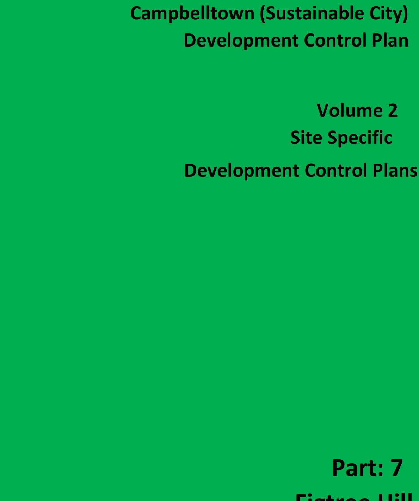

## Part 7 Figtree Hill

List of Amendments to the Plan:

| Amendment No | Date of Adoption by Council | Effective Date |
|---|---|---|
| Amendment No 8 | 14 April 2020 | 4 May 2020 |
| Amendment No 17 | 12 April 2022 | 26 April 2022 |

> [Picture on page 3: a picture, saved as a picture (images/vol-2-part-07-mount-gilead-dcp-page-3-1.gif, 150 dpi).]

### Campbelltown (Sustainable City)

### Development Control Plan

### Volume 2

### Site Specific

### Development Control Plans

### Part: 7

### Figtree Hill

### Table of Contents

1\. INTRODUCTION .................................................................................................................. 2 1.1. Land to which this Development Control Plan Applies ............................................. 2 1.2. Campbelltown LEP Compliance Table .................................................................... 4

2\. VISION AND DEVELOPMENT OBJECTIVES ..................................................................... 7 2.1. Vision for Mt Gilead.................................................................................................. 7 2.2. Key Development Objectives ......................................................................................... 7

3\. DEVELOPMENT PRINCIPLES AND CONTROLS ............................................................... 9 3.1. Heritage and Views ........................................................................................................... 9 3.2. Street Network and Public Transport ............................................................................... 11 3.3. Public Open Space and Landscaping ............................................................................. 22 3.4. Residential Subdivision ................................................................................................... 24 3.5. Residential Development ................................................................................................. 25 3.5.1. Front Setbacks ....................................................................................................... 25 3.5.2. Side and rear setbacks .......................................................................................... 25 3.5.3. Corner lots ............................................................................................................. 28 3.5.4. Building design and materials ................................................................................ 30 3.5.5. Garages, driveways and parking ........................................................................... 31 3.5.6. Private Open Space ............................................................................................... 31 3.5.7. Landscaping .......................................................................................................... 32 3.5.8. Retaining walls ....................................................................................................... 33 3.5.9. Fencing .................................................................................................................. 34 3.5.9. Land Adjacent to Appin Road ................................................................................ 37 3.5.10. Additional controls for double frontage lots .......................................................... 37 3.5.11. Additional controls for dual occupancies, semi-detached dwellings and attached dwellings ...................................................................................................................... 38

APPENDIX 1 INDICATIVE STREET TREE HIERARCHY ..................................................... 40
