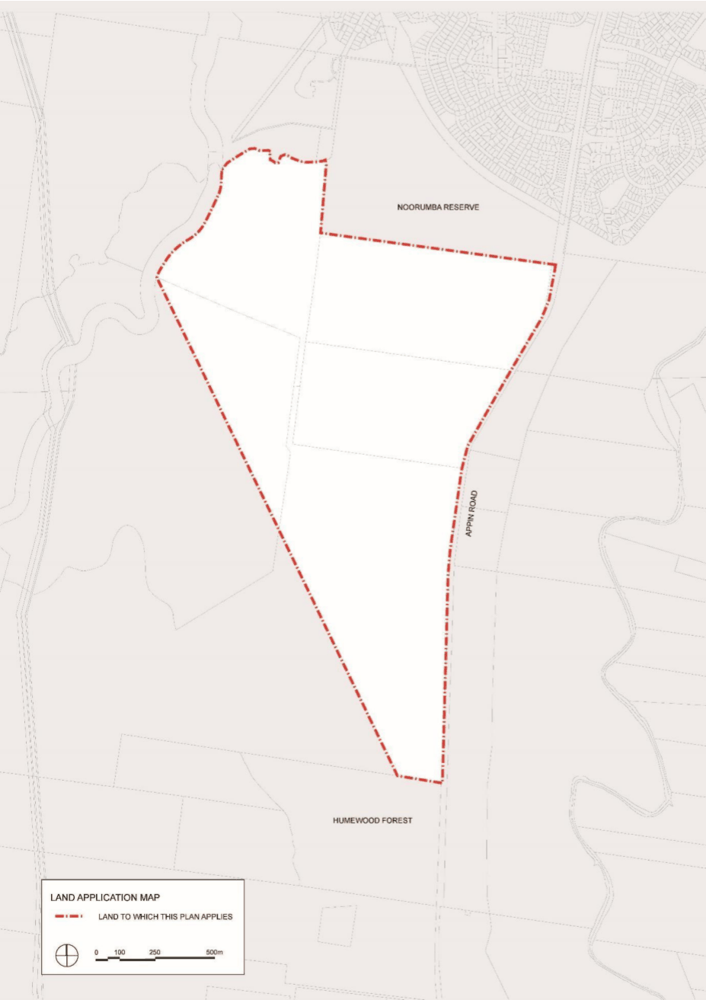

#### 1. INTRODUCTION

### 1.1. Land to which this Development Control Plan Applies

This Part applies to the land identified in Figure 1. This Part establishes additional provisions for Figtree Hill. When a development control is not specified in this Part, development should be consistent with all other relevant controls of Volume 1 Campbelltown (Sustainable City) DCP. Where there is an inconsistency between Part 7 and any other Part of this Development Control Plan, Part 7 applies to the extent of the inconsistency. The arrangement of controls in this section does not represent any particular order of priority or importance. Maps and diagrams in this Part are indicative only. Campbelltown City Council Engineering Design Guide for Development applies to development specified in this Part.

#### Figure 1: Land to which this DCP applies

> [Picture on page 6: a picture, saved as a picture (images/vol-2-part-07-mount-gilead-dcp-page-6-2.gif, 150 dpi).]
