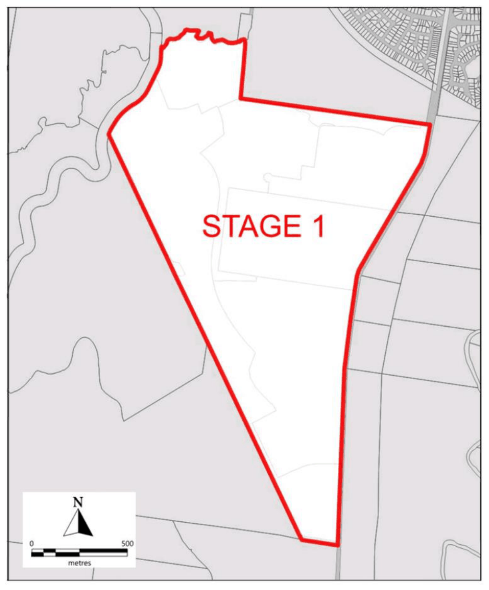

### 1.2. Campbelltown LEP Compliance Table

This DCP is intended to satisfy Clause 6.3 of Campbelltown Local Environmental Plan 2015, as it applies to the subject land.

#### Table 1: Consistency with Clause 6.3

| CLEP 2015 Clause 6.3 Requirement | Relevant Provision / Control |
|---|---|
| (a) A staging plan for the timely and efficient release of urban land, making provision for necessary infrastructure and sequencing. | Development may be undertaken in a single stage (as shown in Figure 1A, staging plan) or in any number of substages provided that development reflects the progressive delivery or road, utility and local infrastructure over the land. Development may be undertaken pursuant to several development applications with an explanation of how this is compatible with the delivery of infrastructure. |
| (b) An overall transport movement hierarchy showing the major circulation routes and connections to achieve a simple and safe movement system for private vehicles, public transport, pedestrians and cyclist. | This infrastructure shall be provided in accordance with Section 3.2 (including, without limitation, consistency with the details in Figures 4, 5 and 6). |
| (c) An overall landscaping strategy for the protection and enhancement of riparian areas and remnant vegetation, including visually prominent locations, and detailed landscaping requirements for both the public and private domain. | All development shall be undertaken in accordance with Section 3.3 (including, without limitation, consistency with the details in Figure 7). |
| (d) A network of passive and active recreational areas. | All development shall be undertaken in accordance with Section 3.3 (including, without limitation, consistency with the details in Figure 7). |
| (e) Stormwater and water quality management controls. | All development shall be undertaken in accordance with the Campbelltown City Council Engineering Design Guide for Development. Section 2.18 of Volume 1 of CSCDCP |
| (f) Amelioration of natural and environmental hazards, including bushfire, flooding and site contamination and in relation to natural hazards, the safe occupation of and evacuation | Bushfire All future development is to comply with the NSW Rural Fire Service’s Planning for Bushfire Protection. This includes the provision of suitable asset protection zones and appropriate maintenance of vegetated open space areas. |

| from, any land so affected. | Flooding All future development is to comply with Council’s Engineering Design Guides for development. Contamination All future development is to comply with State Environmental Planning Policy No. 55 – Remediation of Land. Mine Subsidence All future development is to comply with the requirements of NSW Subsidence Advisory. |
|---|---|
| (g) Detailed urban design controls for significant development sites. | All development must address the matters under Section 3.1 including consideration of the principles provided in Figure 3, Section 3.4, Section 3.5 and be consistent with low density residential development control in Volume 1, Part 3. Where there is an inconsistency, Sections 3.4 and 3.5 of this part of the DCP prevail. Development in the vicinity of the “One Tree Hill” site shall be undertaken in accordance with Section 3.3 (including, without limitation, consistency with the details in Figure 7) and the objectives of the RU2 Rural Landscape Zone in which it is located. All development shall be undertaken in accordance with Section 3.1 (including, without limitation, consideration of the principles provided in Figure 3). |
| (h) Measures to encourage higher density living around transport, open space and service nodes. | Any development must locate smaller high density residential types of development around transport, open space and service nodes in accordance with Section 3.4. |
| (i) Measures to accommodate and control appropriate neighbourhood commercial and retail uses. | Commercial and retail development shall be concentrated in the B1 Neighbourhood Centre Zone within the precinct and must be undertaken in accordance with the objectives of B1 Neighbourhood Centre Zone and Volume 1, Section 6 of the Campbelltown (Sustainable City) Development Control Plan 2015. |
| (j) Suitably located public facilities and services, including provision for appropriate traffic management facilities and parking. | Public facilities and services are to be provided in the B1 Neighbourhood Centre Zone and shall be provided in accordance with Council’s Engineering Design Guide for Development. |

Note: Unless otherwise specified, a reference to a section or figure is a reference to the corresponding section or figure in this Volume 2, Part 7 of Campbelltown (Sustainable City) Development Control Plan.

#### Figure 1A: Figtree Hill Staging

> [Picture on page 9: a picture, saved as a picture (images/vol-2-part-07-mount-gilead-dcp-page-9-4.gif, 150 dpi).]

#### Note: Multiple Sub-stages may occur under the initial stage.
