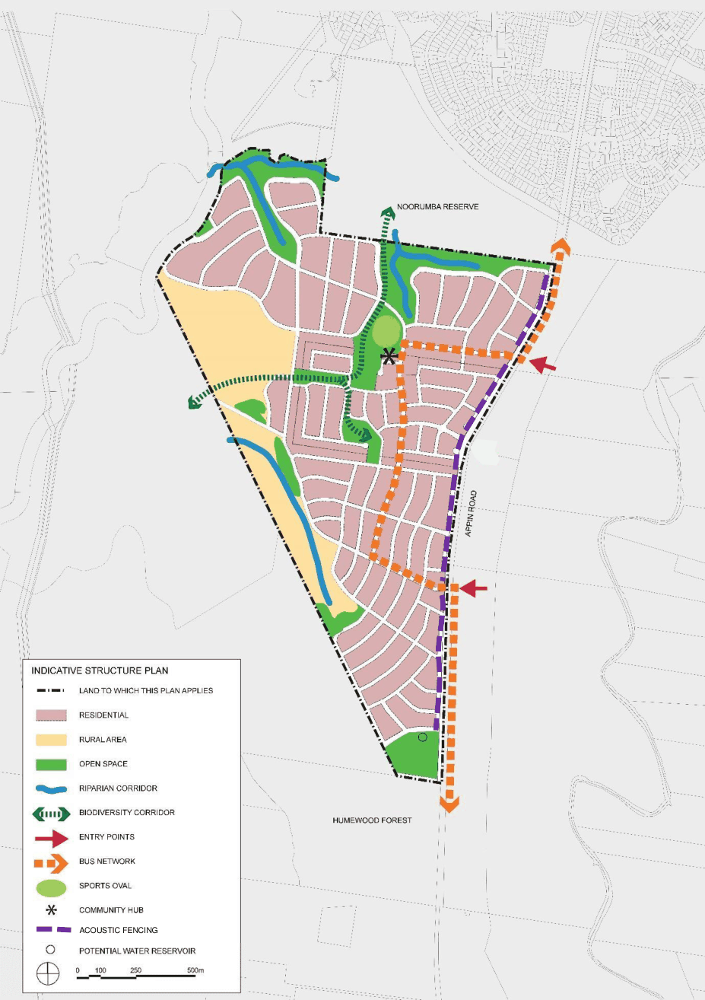

### 2.2. Key Development Objectives

Key Development Objectives for Mt Gilead are to:

Create an environmentally and socially sustainable residential estate at Mt Gilead that provides housing diversity and choice within the Campbelltown local government area. Provide a broad variety of lot sizes. Ensure all development achieves a high standard of urban and architectural design. Promote walking and cycling, and provide good access to public transport. Maximise opportunities for future residents to access and enjoy the outdoors. Protect riparian corridors and significant vegetation. Provide for the establishment of a biodiversity corridor to allow for the movement of fauna from Noorumba Reserve through the subject site to connect with the Nepean River corridor and the Beulah biobanking site. Respect the heritage significance of the Mount Gilead homestead site including the outbuildings, mill and dam and their setting.

#### Controls

1\. Development of Mt Gilead is to be generally consistent with the Indicative Structure Plan shown in Figure 2.

#### Figure 2: Figtree Hill Indicative Structure Plan

> [Picture on page 11: a picture, saved as a picture (images/vol-2-part-07-mount-gilead-dcp-page-11-2.gif, 150 dpi).]
> Words printed on the picture (title and legend, copied from the PDF):
> ACOUSTIC FENCING
