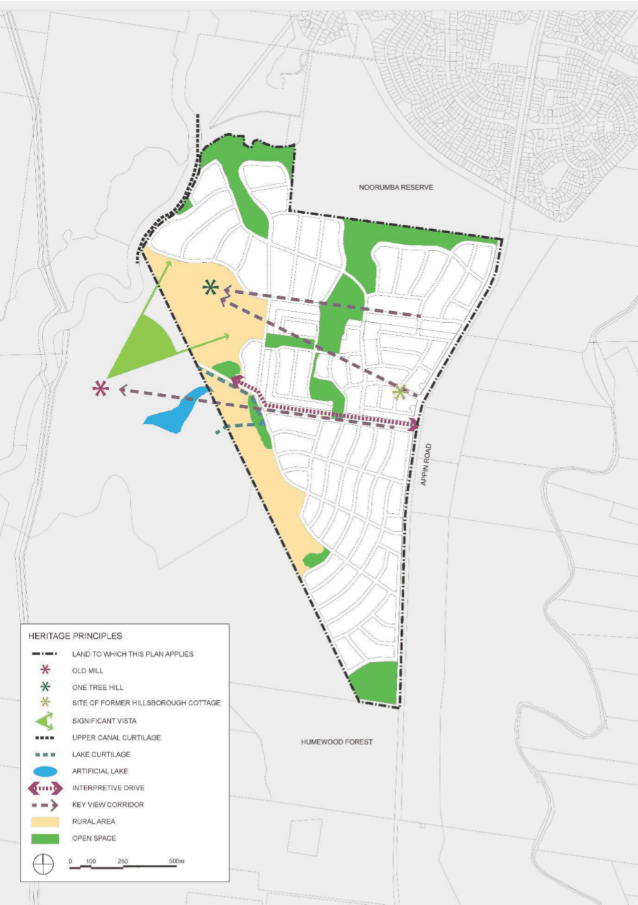

#### 3. DEVELOPMENT PRINCIPLES AND CONTROLS

### 3.1. Heritage and Views

#### Objectives

Interpret the rural landscape values of the site and surrounding locality. Where possible, retain and enhance European heritage through its integration into the development of Figtree Hill. Retain the regional views to hills to the west from within the subdivision to retain the visual context of the landscape’s prior land uses and heritage values. Retain the 'bald' character of One Tree Hill above the background skyline when viewed from The Old Mill, with a single landmark tree. Recognise the State Heritage Listing of the Upper Canal

#### Controls

1\. Development of Mt Gilead is to be consistent with the heritage principles identified in Figure 3 Heritage Principles Plan. The following specific measures are to be incorporated into the subdivision design:

i. An interpretation of the historic carriageway alignment from Appin Road to the Mt Gilead homestead at the existing entrance to the Mt Gilead Property as shown in Figure 3 Heritage Principles Plan. This should include land mark specimen tree planting.

ii. Retention of One Tree Hill as a grassed knoll with a single tree.

iii. Interpretation of the former Hillsborough Cottage is to be provided in the general vicinity as identified in Figure 3 Heritage Principles Plan. This may include landscaping, signage, walling or/and the erection of a commemorative plaque.

iv. Be consistent the with the Upper Canal State Heritage curtilage.

2\. Landscape screening is to be provided in the locations identified in Figure 7 Indicative Landscape Strategy to:

i. Ensure that housing at Mt Gilead is not visible when viewed from the Old Mill.

ii. Interpret the original landscape setting around the lake when viewed from the Old Mill.

3\. Where possible, the key view corridors identified from the indicative locations in Figure 3 Heritage Principles Plan to the Old Mill and One Tree Hill are to be retained and interpreted.

4\. When the subdivision street pattern and open space locations are finalised, a site review will be required to confirm that important views to the west are retained and interpreted within the public domain (streets and parks). These locations will be identified on the plans submitted with development applications for subdivision. Note: Methods to retain and interpret views include: Using trees species that will not block views when mature. Placement of seating and/or interpretive signage at the viewpoints that explains the view and its significance in the context of the locality’s cultural and natural heritage.

Development to be consistent with Section 2.18 of

#### Figure 3: Heritage Principles Plan

> [Picture on page 13: a picture, saved as a picture (images/vol-2-part-07-mount-gilead-dcp-page-13-2.gif, 150 dpi).]
