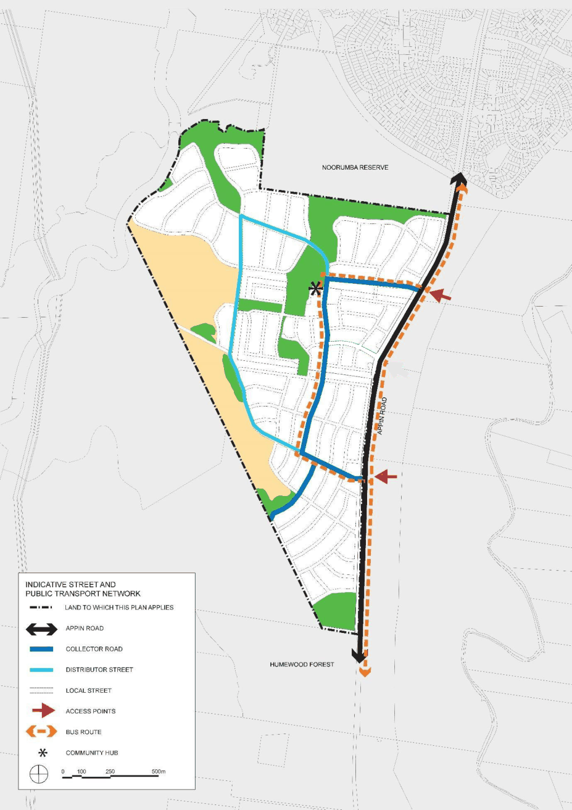
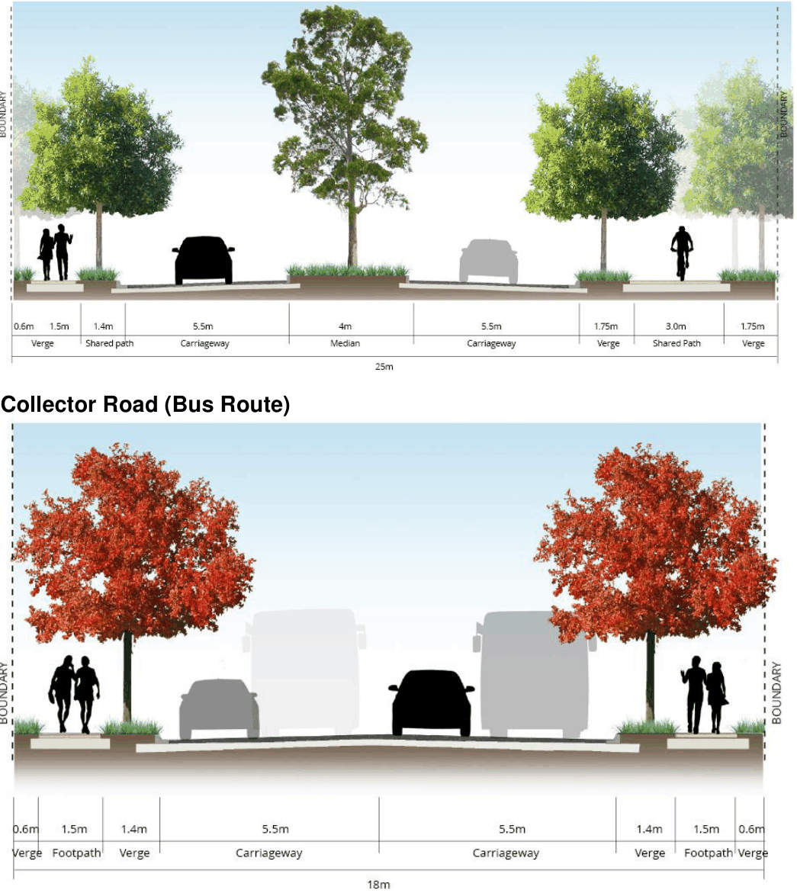
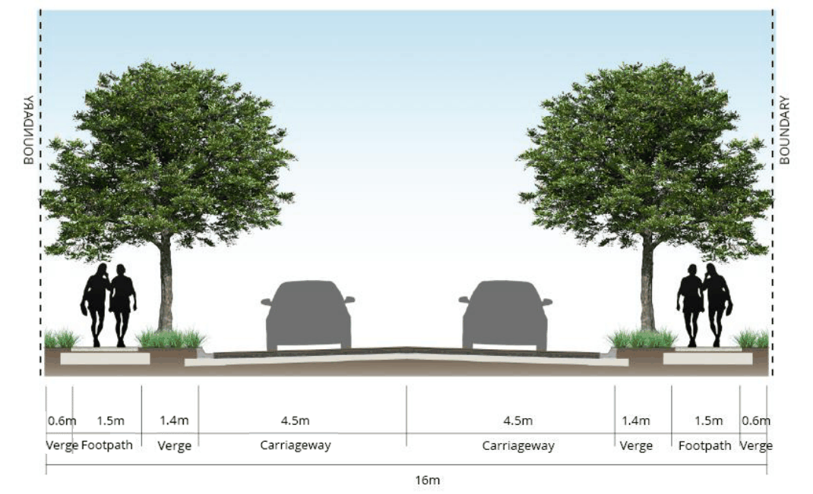
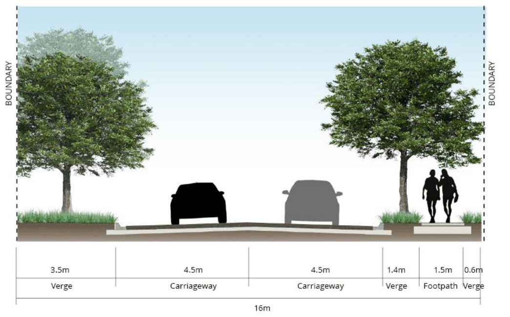
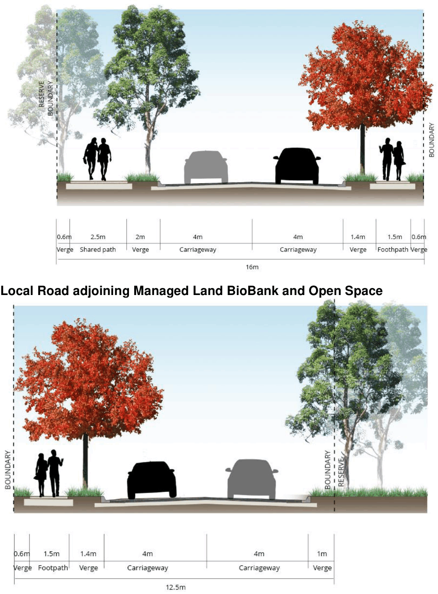
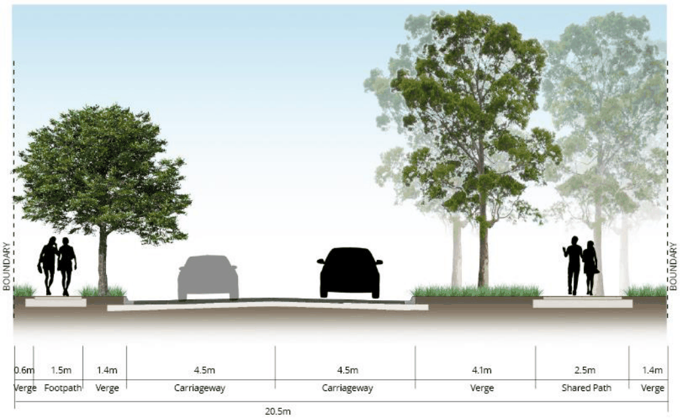
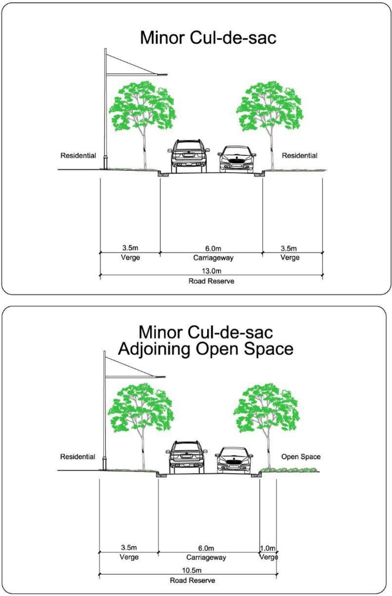
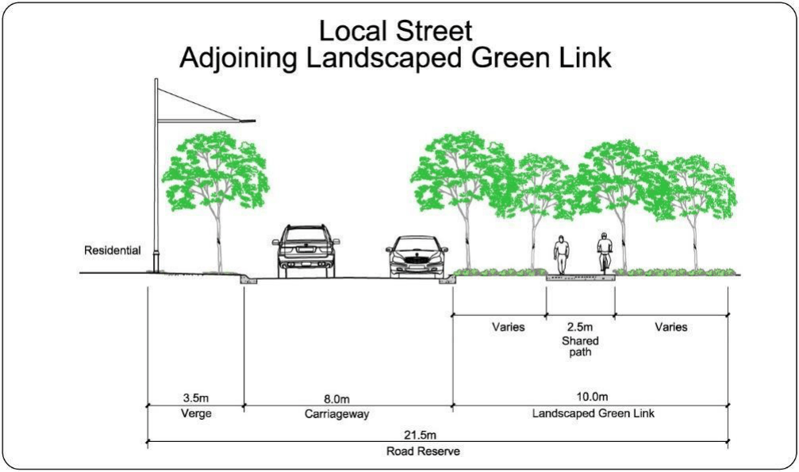
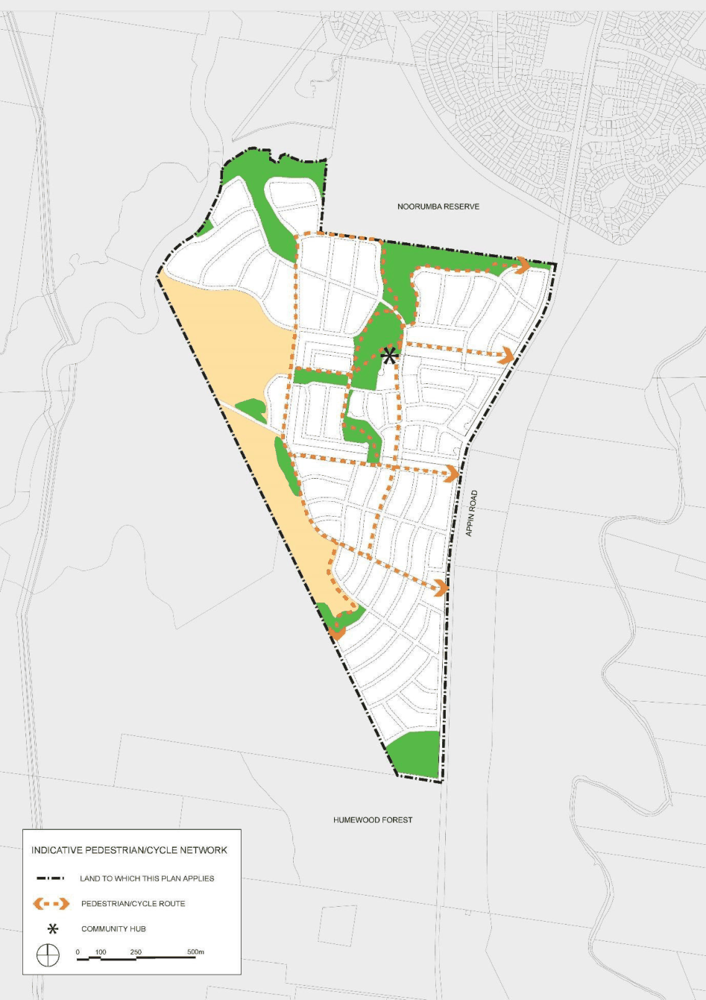

### 3.2. Street Network and Public Transport

#### Objectives

Provide a clear hierarchy of interconnected streets that enables safe, convenient and legible access. Provide easily accessible connections to Appin Road. Ensure carriageways and verges match the function of the road. Provide adequate land within verges for infrastructure, landscaping and pathways. Facilitate use of public transport with suitable seating and adequate road widths. Provide a clear pedestrian and cycle network that provides links between bus stops, the community hub and open space areas. Provide a connected, convenient, efficient and safe network of pedestrian and cycle shareways. Promote the efficient use of land by allowing pedestrian and cycle shareways located within open spaces wherever practical.

#### Controls

1\. The design of the local street network is to:

i. facilitate walking and cycling and enable direct local vehicle trips;

ii. create a safe environment for walking and cycling with safe crossing points;

iii. encourage a low-speed traffic environment;

iv. optimise solar access opportunities for dwellings;

v. take into account the site's topography and view lines;

vi. provide frontage to and maximise surveillance of open space;

vii. facilitate wayfinding and place making opportunities by taking into account streetscape features; and

viii. retain existing trees, where appropriate, within the road reserve.

2\. Two entrances are to be provided off Appin Road generally in accordance with the locations identified in Figure 2 Mt Gilead Indicative Structure Plan and Figure 4 Indicative Street Network and Public Transport.

3\. The public street network is to be provided generally in accordance with Figure 4 Indicative Street Network and Public Transport.

4\. Street design is to comply with the minimum standards in the cross-sections detailed in Figure 5 Indicative Street Cross Sections.

5\. Where bus bays are required on the Collector Road, the carriageway must be widened to accommodate a 2.5m wide bus parking bay.

6\. Alternative street designs may be permitted on a case-by-case basis if the functional objectives and requirements of the street design are maintained and the outcome is in accordance with the Campbelltown City Council Engineering Design Guide for Development.

7\. All kerbs are to be barrier kerbs.

8\. Pedestrian paths and cycle ways within Open space should be well connected to the local road network.

9\. Cul-de-sac streets will only be permitted where there are physical constraints such as sloping land, riparian corridors and bushland. Verges abutting open space and riparian areas may be reduced to 1m in width providing no servicing infrastructure is installed on the non-residential side of the road.

10\. Appropriate seating or shelters shall be provided at bus stops.

11\. Footpaths must be provided on at least one side of every street, except on the collector road where a footpath must be provided on both sides, unless it can be located within adjacent open space.

12\. Pedestrian and cycle network is to be provided in accordance with Figure 6 Indicative Pedestrian/Cycle Network, and is to:

i. provide safe and convenient linkages between residences and open space systems, neighbourhood shops, the community facility and the bus route;

ii. respond to the topography and achieve appropriate grades for safe and comfortable use where possible; and

iii. comply with the requirements of Campbelltown City Council Engineering Design Guide for Development.

13\. Street trees are to be provided in a manner consistent with the Indicative Street Tree Hierarchy at Appendix 1.

14\. A 10m wide Landscape Green Link is to be provided in the verge of the local street in the location shown in Figure 7 Indicative Landscape Strategy. The Landscape Green Link is to be planted with endemic native plant species and designed in a manner consistent with Figure 5 Indicative Street Cross Sections.

15\. Water Sensitive Urban Design green infrastructure such as raingardens, swales, tree pits, grasscrete within road carriageways and parking areas where it contributes to, and meets the objectives and principles of the Figtree Hill Stormwater Management Strategy and Council’s engineering specifications.

16\. With the agreement of Council’s Urban Release Area team, alternative road pavement finishes, to reduce solar absorption, may be trialled within Figtree Hill.

#### Figure 4: Indicative Street Network and Public Transport

> [Picture on page 16: a picture, saved as a picture (images/vol-2-part-07-mount-gilead-dcp-page-16-2.gif, 150 dpi).]

#### Figure 5: Indicative Street Cross Sections

> [Picture on page 17: a picture, saved as a picture (images/vol-2-part-07-mount-gilead-dcp-page-17-2.gif, 150 dpi).]

#### Collector Road (Bus Route)

Note:  Carriageway to be locally widened at bus stops to 12.0m to allow for 2.5m bus bay Where adjoining Managed Land BioBank reserve to widen by 1m to provide 2.5m sharepath on BioBank side.

#### Distributor Street

> [Picture on page 18: a picture, saved as a picture (images/vol-2-part-07-mount-gilead-dcp-page-18-2.gif, 150 dpi).]

#### Local Road

> [Picture on page 19: a picture, saved as a picture (images/vol-2-part-07-mount-gilead-dcp-page-19-2.gif, 150 dpi).]

#### Local Road adjoining Figtree Hill Noorumba BioBank

> [Picture on page 20: a picture, saved as a picture (images/vol-2-part-07-mount-gilead-dcp-page-20-2.gif, 150 dpi).]

#### Local Road adjoining Managed Land BioBank and Open Space

#### Homestead Interpretive Drive

> [Picture on page 21: a picture, saved as a picture (images/vol-2-part-07-mount-gilead-dcp-page-21-2.gif, 150 dpi).]

> [Picture on page 22: a picture, saved as a picture (images/vol-2-part-07-mount-gilead-dcp-page-22-1.gif, 150 dpi).]

> [Picture on page 23: a picture, saved as a picture (images/vol-2-part-07-mount-gilead-dcp-page-23-1.gif, 150 dpi).]

#### Figure 6: Indicative Pedestrian/Cycle Network

> [Picture on page 24: a picture, saved as a picture (images/vol-2-part-07-mount-gilead-dcp-page-24-2.gif, 150 dpi).]
