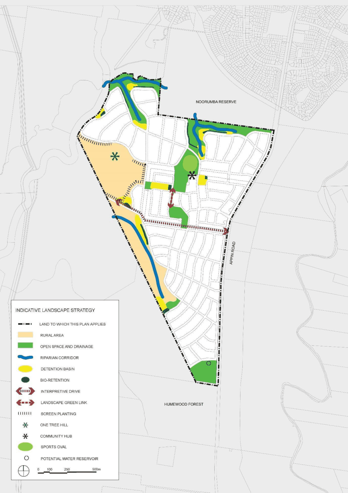

### 3.3. Public Open Space and Landscaping

#### Objectives

Provide safe and accessible open space areas for the enjoyment of the local population and promote local character. Provide open space which can be used by a range of users, linked with other activities and services. Conserve trees and other vegetation of ecological, aesthetic and cultural significance. Provide, enhance and protect existing watercourses and riparian corridors and improve habitat features. Promote riparian areas for the conservation and enhancement of riparian habitat and connectivity values, and for passive open space uses and activities where such uses will not degrade the riparian corridors. Restore and conserve remnant bushland.

#### Controls

1\. Landscaping and public open spaces are to be generally provided in accordance with Figure 7 Indicative Landscape Strategy.

2\. Public Open Space is to be linked using streets, pedestrian paths and cycle ways.

3\. Development is to front public open spaces to allow for casual surveillance and enhance safety.

4\. Riparian areas are to be protected and enhanced.

5\. Bushland to be conserved is to be identified in each development application for subdivision, and the application is to provide details of proposed regeneration and restoration.

6\. Significant trees are to be retained where possible. Trees proposed for removal are to be identified in each development application and the impact of their removal is to be assessed appropriately.

7\. Screen planting on the slopes of One Tree Hill as shown on Figure 7 Indicative Landscape Strategy should not be planted above the background skyline.

#### Figure 7: Indicative Landscape Strategy

> [Picture on page 26: a picture, saved as a picture (images/vol-2-part-07-mount-gilead-dcp-page-26-2.gif, 150 dpi).]
