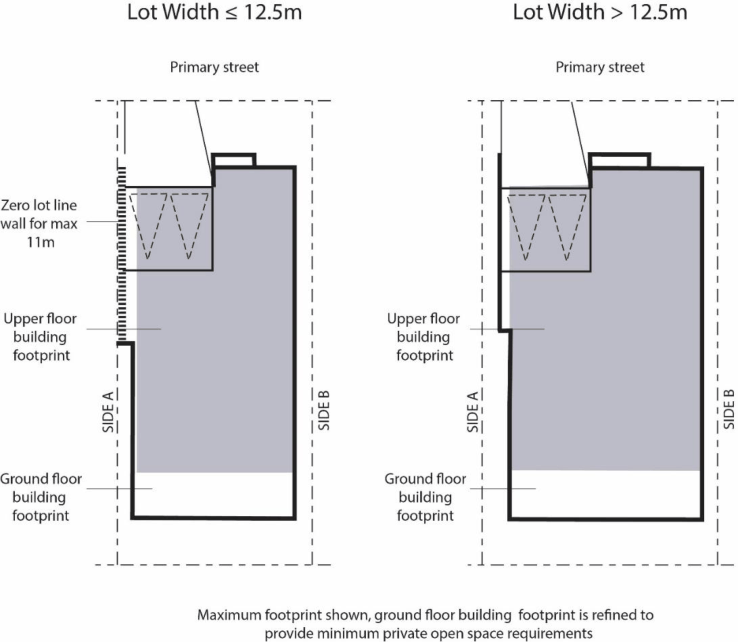
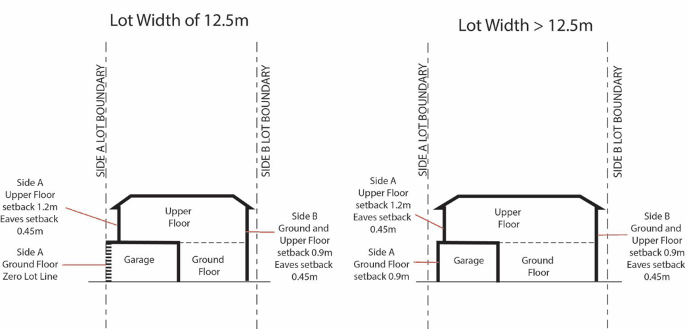

#### 3.5.2. Side and rear setbacks

#### Objectives

Protect the amenity of adjacent properties particularly in terms of privacy and overshadowing. Use land efficiently.

#### Controls

1\. Minimum side and rear setbacks are to be consistent with Table 3 and Figure 8.

2\. Upper storey setbacks are to ensure that neighbouring dwellings receive the minimum required solar access to private open space.

3\. Walls constructed to the lot boundary are only permitted on lots with a width of 12.5m or less and where an easement for maintenance has been provided on the adjoining lot.

#### Table 3: Minimum side and rear setbacks

| Lot Size | Lot width of 12.5m | Lot width > 12.5m |
|---|---|---|
| Side setback – ground floor | Side A – 0m Side B – 0.9m | 0.9m |
| Side setback – upper floor | Side A – 1.2m Side B – 0.9m |  |
| Side setback - garage | Side A - 0m Side B - 0.9m | 0.9m |
| Rear setback – ground level | 4m |  |
| Rear setback – upper level | 6m |  |
| Zero Lot line Max Length | 11m |  |

> [Picture on page 29: a picture, saved as a picture (images/vol-2-part-07-mount-gilead-dcp-page-29-10.gif, 150 dpi).]

Figure 8: Side and rear setbacks and building footprint

> [Picture on page 30: a picture, saved as a picture (images/vol-2-part-07-mount-gilead-dcp-page-30-1.gif, 150 dpi).]

Figure 9: Elevation of side setback requirements
