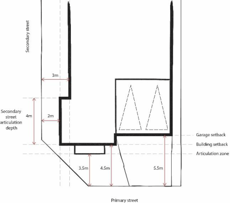
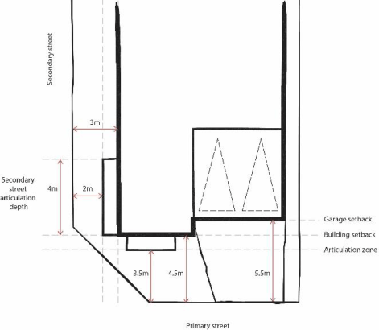
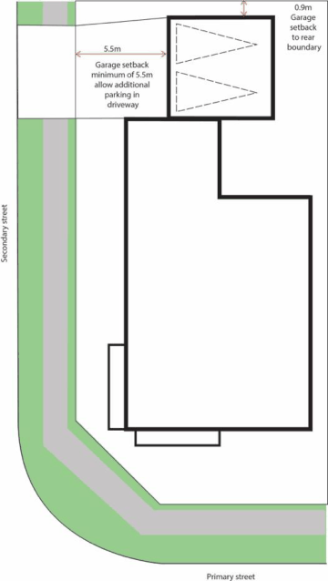
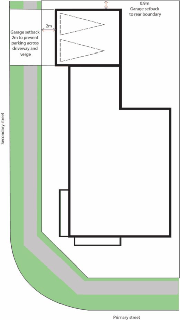

#### 3.5.3. Corner lots

#### Objective

Ensure that land is efficiently used at block ends. Provide a strong visual identification of the street block by articulating both frontages. Locate garages on secondary street frontages.

#### Controls

1\. The minimum lot size on a corner lot is 450m2.

2\. To provide an attractive streetscape, dwellings on corner lots are to provide appropriate articulation to the facade on both street frontages. Minimum secondary setbacks are to be consistent with Table 4 and Figures 10 and 11.

3\. Where feasible, garages should be located on the secondary street frontage of corner lots.

4\. To prevent carparking over the public road verge, garages located on secondary street frontages are to be setback either 2m or a minimum of 5.5m and integrated into the dwelling design consistent with Table 4 and Figure 12 and 13. Garages setback from secondary street frontage that are greater than 2m but less than 5.5m will not be accepted.

5\. Dwellings and landscaping shall be designed to minimize the amount of privacy/security fencing that faces roads.

6\. Garages located on secondary street frontages are to be setback a minimum of 0.9m from the rear boundary of the lot.

#### Table 4: Minimum secondary street setbacks

| Requirement | Setback |
|---|---|
| Where façade elements provide articulation |  |
| Secondary setback to building line | 3m |
| Secondary setback to articulation | 2m |
| Minimum length of articulation from front building line | 4m |
| Where built corner provides articulation |  |
| Secondary setback to building line for first 4m from front building line | 2m |
| Secondary setback to building line for remainder of facade | 3m |
| Garages |  |
| Secondary setback to garages | At 2m, or minimum of 5.5m |

> [Picture on page 32: a picture, saved as a picture (images/vol-2-part-07-mount-gilead-dcp-page-32-1.gif, 150 dpi).]

Figure 11: Articulation to secondary setback with built corner

> [Picture on page 32: a picture, saved as a picture (images/vol-2-part-07-mount-gilead-dcp-page-32-4.gif, 150 dpi).]

> [Picture on page 32: a picture, saved as a picture (images/vol-2-part-07-mount-gilead-dcp-page-32-5.gif, 150 dpi).]

Figure 10: Articulation to secondary setback with façade elements

> [Picture on page 32: a picture, saved as a picture (images/vol-2-part-07-mount-gilead-dcp-page-32-9.gif, 150 dpi).]

Figure 12: 2m setback to garage on secondary street frontage

Figure 13: Minimum 5.5m setback to garage on secondary street frontage
