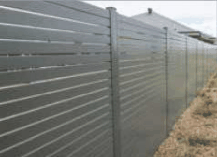
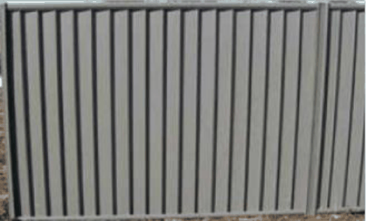
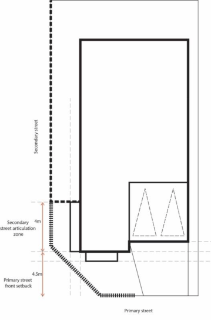
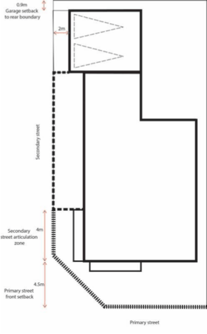
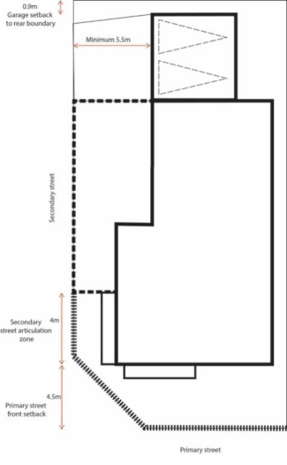
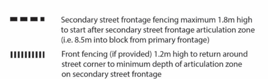

#### 3.5.9. Fencing

#### Objective

Ensure boundary fencing is of a high quality and does not detract from the streetscape.

Ensure boundary koala proof fencing is provided in accordance with the commitments in the Biodiversity Certification Agreement that applies to the land.

#### Controls

1\. All fencing is to be constructed flush to finished ground level to prevent koala access to private lots.

2\. All boundary fencing is to be of Lysaght ‘Smartascreen’ or similar in Colorbond ‘Woodland Grey’ colour or similar to meet the requirements of the Biodiversity Certification Agreement to prevent koala from entering private lots. Refer to Figure 14.

3\. Boundary fencing not visible from the street is required to be a maximum of 1.8m high and must finish 6.5m from the front boundary and return to the side wall of the home.

4\. Any fence forward of the building line to the primary street frontage or side boundaries is to be a maximum of 1.2m high and with a predominantly open character. The design of the fence is also to integrate a letterbox.

5\. On corner lots, fencing to the secondary street frontage is to be a maximum of 1.8m in height, inclusive of retaining walls and consistent with Figure 15. Square hollow steel section posts are to be of 100mm x 100mm with 20mm to 30mm horizontal slats with spacing of between 5mm to 10mm. All posts and rails are to be installed internally to face the lot not the street. Fencing slats are to be of durable material and to be finished in Colorbond ‘Woodland Grey’ or similar.

6\. Corner lot fencing 1.8m in height must not be located closer than 8.5m from the Primary Street boundary consistent with Figures 16, 17 and 18.

7\. On corner lots, where a the front fence is proposed it is to continue around the corner to the secondary street for a minimum depth of 8.5m from the primary street boundary consistent with Figures 16, 17 and 18.

8\. A 1.8m side fence on a secondary street is to be:

i. include a gradual transition to the front fence that has continued along the

> [Picture on page 38: a picture, saved as a picture (images/vol-2-part-07-mount-gilead-dcp-page-38-24.gif, 150 dpi).]

secondary frontage; and

ii. of a similar look and character as the front fence.

iii. Plantings

Note: The provision of a front fence is not mandatory.

> [Picture on page 38: a picture, saved as a picture (images/vol-2-part-07-mount-gilead-dcp-page-38-29.gif, 150 dpi).]

Figure 15: Example secondary street frontage

Figure 14: Example side and rear boundary fencing

> [Picture on page 39: a picture, saved as a picture (images/vol-2-part-07-mount-gilead-dcp-page-39-1.gif, 150 dpi).]

Figure 16: Secondary street fencing with garage access from Primary Street

> [Picture on page 39: a picture, saved as a picture (images/vol-2-part-07-mount-gilead-dcp-page-39-5.gif, 150 dpi).]

> [Picture on page 39: a picture, saved as a picture (images/vol-2-part-07-mount-gilead-dcp-page-39-6.gif, 150 dpi).]

Figure 17: Secondary street fencing with garage access from secondary street frontage (2m setback)

> [Picture on page 39: a picture, saved as a picture (images/vol-2-part-07-mount-gilead-dcp-page-39-11.gif, 150 dpi).]

Figure 18: Secondary street fencing with garage access from secondary street frontage (5.5m setback)
