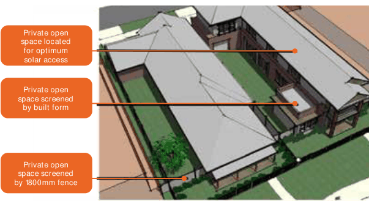

#### 3.5.10. Additional controls for double frontage lots

#### Objective

To ensure nominated double fronted lots are of high quality design and positively address both frontages.

To provide well designed homes that contribute to an attractive and complementary streetscape.

To preserve the function, use and aesthetic of the estate’s main entry roads.

#### Controls

1\. The primary and secondary frontages are to be nominated on Building Envelope Plans to ensure a coordinated streetscape outcome is achieved.

2\. Garages are to be located on the primary frontage and setback a minimum of 5.5m from the street.

3\. The secondary frontage is to be detailed with the same architectural features as the primary elevation.

4\. A minimum setback of 3m is to be provided to the secondary frontage, including articulation.

5\. Articulation to the secondary frontage to a public road and must not exceed 60% of the lot frontage.

6\. The secondary frontage must include an alternate dwelling entry.

7\. Private Open Space is to be located to the side of the dwelling to ensure privacy from the secondary frontage consistent with Figure 19.

8\. Vehicular access to the northern and southern entry collector roads is prohibited.

> [Picture on page 41: a picture, saved as a picture (images/vol-2-part-07-mount-gilead-dcp-page-41-9.gif, 150 dpi).]
> Words printed on the picture (title and legend, copied from the PDF):
> Private open
> space located
> for optimum
> solar access
> Private open
> space screened
> by built form
> Private open
> space screened
> by 1800mm fence

### al Private Open Space

vate Open Space is to be located to the side e with fencing to ensure privacy from the treet frontage. s and private open space provision controls hieved. uctures such as clothes lines rainwater airconditioning units are to be located in the n space and screened from view.

Figure 19: Private Open Space location on double frontage lots

### ape Elements

elements such as fences, walls, plants and ould match or complement the design, scale, d details of the dw elling.
