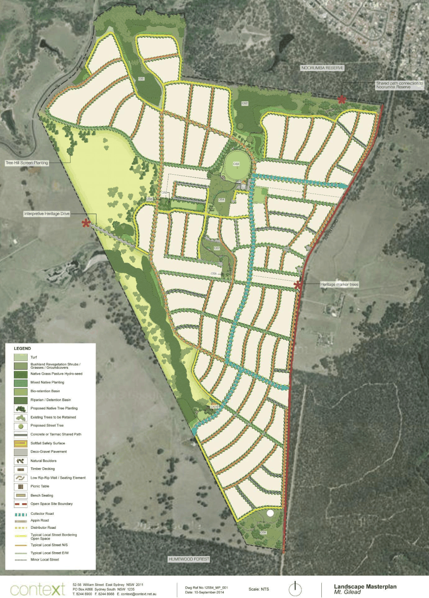
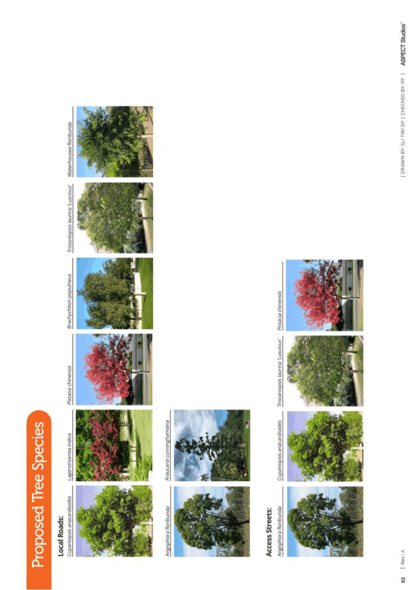

#### 3.5.11. Additional controls for dual occupancies, semi-detached

#### dwellings and attached dwellings

ould achieve privacy or permeability and to and from the dwelling.

Services to be screened behind 1800mm

Objective return fence

Screen planting in front of all 1800mm fencing

To ensure other dwelling types are of high quality design and positively address street frontages.

#### Controls

Note: These controls are in addition to the provisions in section 3.6.3, 3.6.4 and 3.6.5 of the DCP. Where there is an inconsistency, the controls in this section prevail.

Unless otherwise specified, these forms of development are to be consistent with the controls for dwelling houses in Section 3.5 of this part of the DCP.

1\. The setbacks outlined in Tables 2, 3 and 4 apply to dual occupancy semi-detached dwellings and attached dwelling forms of development. The side setbacks do not apply to attached dwellings delivered between two other attached dwellings.

1800mm fence permitt ed 1m behind adjac ent

m high fence will be constructed by the long the secondary frontage and will include fencing will consist of a masonry pier at the point of each front boundary, with  stained s between and a metal palisade inf ll and hedge planting. This fencing must not be altered.

dwelling w all

t fencing be installed, this fencing typ emust econdary frontage fence.

2\. Private Open Space is to be provided at the rates specified for lots less than 500m2 as specified in control 3.5.6(1)(i) and 3.5.6(2)(i) and 3.5.6(4).

Transparent front fence to be provided by developer

ary fencing between each lot  is to be as per Hill Home Design Guidelines. de return fencing is required 1m behind t dwelling wall. This must be of the same required for corner lot fencing as described ee Hill Home Design Guidelines. Planting is screen the 1.8m high fencing.

3\. Each dwelling is to provide a minimum of one tree in the front garden and one tree in the rear of each dwelling. Tree species are to be a minimum height of 1m when planted and capable of growing between 4m to 6m in height at maturity.

4\. These controls override the need to consider the Low Rise Medium Density Design Guide for development applications for side by side dual occupancies.

#### APPENDIX 1 INDICATIVE STREET TREE HIERARCHY

> [Picture on page 43: a picture, saved as a picture (images/vol-2-part-07-mount-gilead-dcp-page-43-2.gif, 150 dpi).]

> [Picture on page 44: a picture, saved as a picture (images/vol-2-part-07-mount-gilead-dcp-page-44-1.gif, 150 dpi).]
