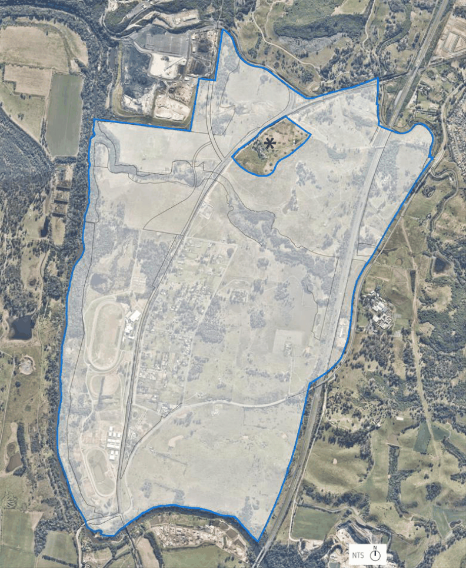

## 1. Application

### 1.1. Name and Application of this Plan

This Development Control Plan (DCP) is the Menangle Park Development Control Plan (DCP) 2023. It has been prepared pursuant to the provisions of Section 3.43 of the Environment Planning and Assessment Act 1979.

The DCP applies to land in the Menangle Park Precinct shown on the Land Application Map in Figure 1.1.

> [Picture on page 5: a picture, saved as a picture (images/vol-2-part-08a-menangle-park-page-5-6.gif, 150 dpi).]

Figure 1.1 Land Application Map (Satellite) - * Glenlee Precinct is currently not included in this Part 8A Menangle Park DCP and is the subject of an independent Precinct DCP.
