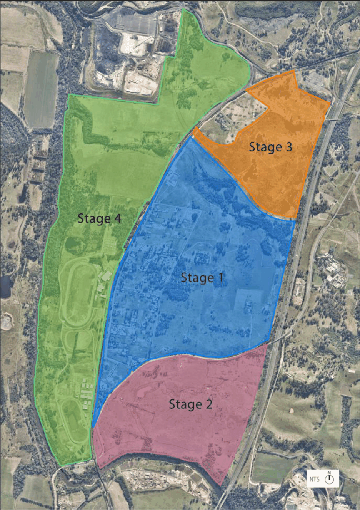

### 1.4. Staging

Objective

a. Ensure the orderly development of the land and assist in the coordinated programming and provision of necessary infrastructure and sequencing.

b. Ensure staging of works protects the amenity of future residents from the effects of mining, industrial and waste disposal activities.

c. Ensure services and works are carried out in logical and related stages.

d. Ensure the overall order of residential subdivision includes provision of community infrastructure to deal with stormwater drainage in an ecologically sensitive manner.

Controls

1\. The overall stages proposed are as follows and are illustrated in the Staging Plan at Figure 1.2: Stage 1 – Menangle Park Central and Village

Stage 2 – Menangle Park South

Stage 3 – Menangle Park North

Stage 4 – Paceway, Employment and Environmental

2\. Development is to be generally undertaken in accordance with the Staging Plan. Where alternative staging is proposed, the Applicant is to demonstrate that sufficient utilities services and community infrastructure is, or is capable of being made, available to service the development.

3\. Sub-stages can be undertaken concurrently within the Menangle Park Precinct.

> [Picture on page 9: a picture, saved as a picture (images/vol-2-part-08a-menangle-park-page-9-1.gif, 150 dpi).]

Figure 1.2 Staging Plan
