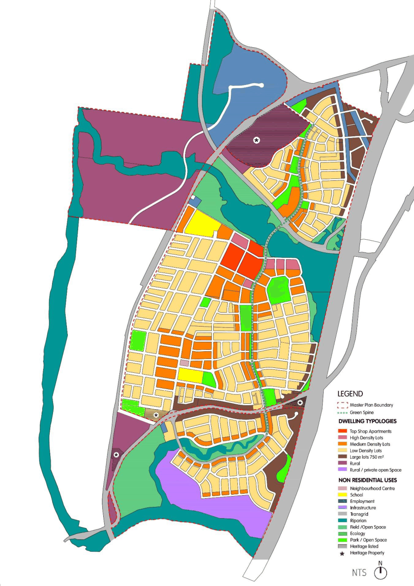

### 2.2. The Indicative Layout Plan

An ILP is contained in Figure 2.1 below. The ILP forms the basis for urban development in the Precinct by setting out:

► Road Networks; ► Public transport routes; ► Open space and drainage networks; ► Locations of land uses including residential development, schools, community facilities, utilities, centres and employment lands; ► Areas requiring protection because of environmental or heritage values; and ► Density and types of housing that are preferred in various parts of the Precinct.

Objectives

a. To ensure development in the precinct occurs in a coordinated manner consistent with the Menangle Park ILP.

Controls

1\. All DAs are to be generally prepared in accordance with the ILP.

2\. When assessing DAs, Council will consider the extent to which the proposed development is consistent with the ILP.

3\. Any proposed variations to the general arrangement of the ILP must be demonstrated by the Applicant, to Council’s satisfaction, to be consistent with the Vision, Desired Future Character Statement and Principles in Section 2.1 of this DCP.

> [Picture on page 16: a picture, saved as a picture (images/vol-2-part-08a-menangle-park-page-16-1.gif, 150 dpi).]

Figure 2.1 Indicative Layout Plan (ILP)
