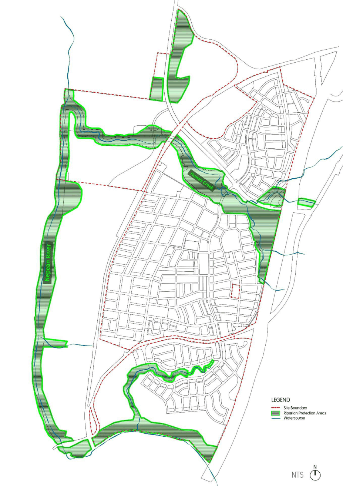

## 3. Environmental Management

### 3.1. Riparian Corridors

Objectives

a. Protect, restore and enhance the environmental qualities of water courses, in particular the Nepean River and Howes Creek.

b. Allow the use of riparian corridor buffers for low impact recreational activities such as walking and cycling.

c. Manage riparian corridors, wherever possible, in single ownership and as a continuous corridor.

d. To ensure that land development does not result in the degradation or loss of groundwater dependent ecosystems.

e. To site accessways to and within a riparian buffer so as not to compromise the ecological integrity of any existing riparian vegetation, stream bed or bank stability,

f. Road crossings, active transport paths and access points to riparian corridors are to have a minimum impact by implementing ecologically informed design principles.

g.

Controls

1\. The impact of salinity on the landscape and watercourses shall be managed in accordance with the Local Government Salinity Initiative series of booklets provided by the NSW Office of Environment and Heritage.

2\. All core riparian zones are to be rehabilitated and revegetated with appropriate native vegetation having regard to their drainage function and vegetation management for bushfire protection.

3\. A works plan is to be submitted to Council for development applications on land containing a riparian corridor or for subdivision of land adjacent to a riparian corridor. The works plan is to:

a. Identify existing trees to be retained and existing trees to be removed;

b. be consistent with NSW Department of Primary Industries Office of Water guidelines; and

c. indicate the location, type and size of all new plant species.

4\. Where wetlands are proposed, a vegetation management plan outlining ownership, ongoing management, annual maintenance costs and initial development costs shall be submitted with any development application.

> [Picture on page 19: a picture, saved as a picture (images/vol-2-part-08a-menangle-park-page-19-1.gif, 150 dpi).]

Figure 3.1 Riparian Protection Areas
