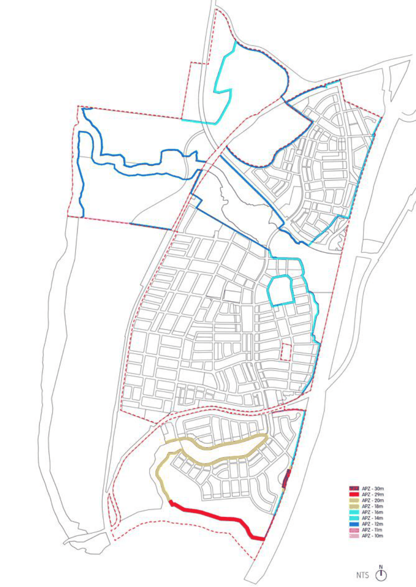

### 3.3. Bushfire Hazard Management

Objectives

a. To prevent loss of life and property due to bushfires by providing for development compatible with bushfire hazard, and

b. To encourage appropriate management of bushfire-prone areas.

Controls

1\. Bushfire prone areas in the Menangle Park Precinct are shown in Figure 3.2. For developments in these areas, reference is to be made to Planning for Bushfire Protection 2019 in subdivision planning and design. All development in bushfire prone lands is to be consistent with Planning for Bushfire Protection 2019.

2\. Subject to detailed design at DA stage, the indicative location and widths of Asset Protection Zones (APZs) are to be provided generally in accordance with the Bushfire risk and APZ Requirements under Planning for Bushfire Protection 2019. APZs and construction standards are to be accurately mapped and detailed for each affected lot on plans submitted with the development application.

3\. The Bushfire Attack Level (BAL) shall be determined by a person recognised by the NSW RFS as a suitably qualified consultant in bushfire risk assessment and meet:

a. A maximum of BAL - 12.5 for Special Fire Protection Purposes (SFPP)

b. A maximum BAL – 29 for all other development

4\. APZs:

► may incorporate roads, verge areas and flood prone land, ► are to be maintained in accordance with the guidelines in Planning for Bushfire Protection 2019, ► may incorporate private residential land, but only within the building setback (no dwellings are to be located within the APZ), ► are not to burden public land, and

► are to be generally bounded by a public road or perimeter fire trail that is linked to the public road system at regular intervals in accordance with Planning for Bushfire Protection 2019. Are to be maintained in accordance with the Planning for Bushfire Protection 2019.

5\. Where an allotment fronts and partially incorporates an APZ it shall have an appropriate depth to accommodate a dwelling with private open space and the minimum required APZ. The APZ will be identified through a Section 88B instrument.

6\. Temporary APZs, identified through a Section 88B instrument, will be required where development is proposed on allotments adjoining undeveloped land that is mapped as bushfire prone. Once the adjacent stage of development is undertaken, the temporary APZ will no longer be required and shall cease.

7\. Buildings adjacent to APZs are to be constructed in accordance with the requirements of Appendix 3 of Planning for Bushfire Protection 2019 and Australian Standard 3959-1999-Construction of Building in Bushfire Prone Areas.

8\. An emergency bushfire evacuation and management plan should be prepared as part of each Development Stage and indicate the proposed emergency management arrangements for such developments.

> [Picture on page 23: a picture, saved as a picture (images/vol-2-part-08a-menangle-park-page-23-1.gif, 150 dpi).]

Figure 3.2 Bushfire Prone Lane Map Menangle Park
