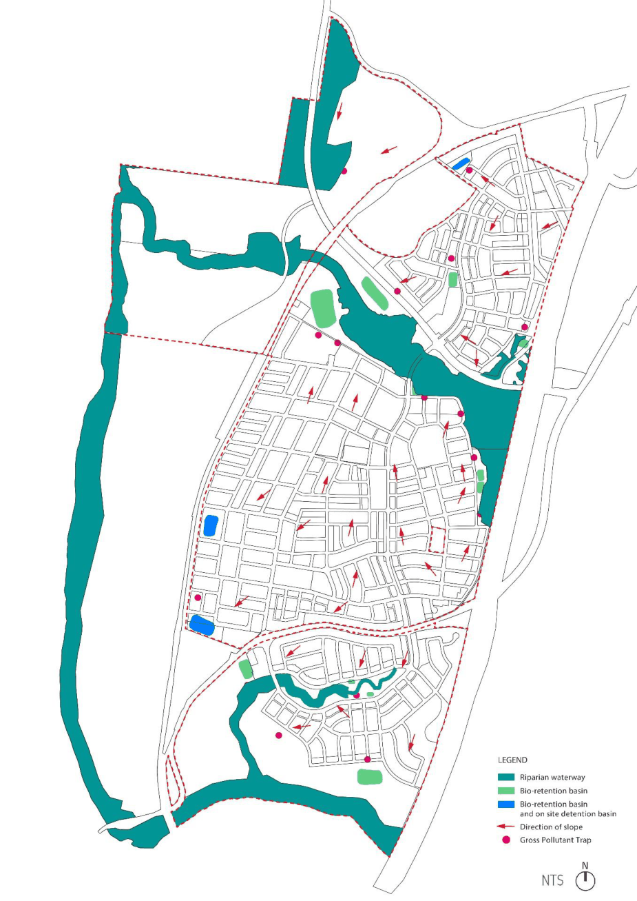

### 3.5. Stormwater, Water Cycle Management and Flooding

Objectives

a. To manage the flow of stormwater and integrate Water Sensitive Urban Design in the urban parts of the Menangle Park Precinct.

b. To minimise the potential of flooding impacts on development.

c. To incorporate best practice stormwater management principles and strategies in development proposals.

d. To avoid adverse impacts from stormwater runoff on other properties as a result of development in the catchment for all storm events up to and including a 1% Annual Exceedance Probability (AEP) flood event.

e. To minimise potable water consumption and maximise re-use of stormwater within urban areas, and

f. To maintain and enhance the quality of runoff to natural water bodies and the Nepean River.

Controls All future developments must comply with the Council’s Engineering Design for Development (as amended), Volume 1, Part 2, 2.10 of the Campbelltown (Sustainable City) DCP, the Western Sydney Engineering Design Guidelines and the Menangle Park Water Cycle Management Report prepared by SMEC, dated 14 November 2018

1\. The pattern of subdivision is to ensure that no new dwellings are located within the post development 1% AEP Flood extent.

2\. All buildings are to be located above the Flood Planning Level (FPL). The FPL is a level 300mm-500mm depending on flow depth above the 1% AEP flood level.

3\. The 1% AEP flood extent relating to creek flows (not the Nepean River) may be varied based on more detailed flood studies that are prepared to the satisfaction of the Council.

4\. Pedestrian and cycle pathways and open space may extend within the 1% AEP flood level, provided the safe access criteria contained in the NSW Floodplain Development Manual are met. Reference should also be made to Appendix B (Riparian Protection Area controls).

5\. Where development is proposed within or adjacent to land that is identified as being affected by the 1% AEP level, a detailed flood study is to be undertaken to confirm the extent of the flood affectation on the subject land.

6\. Filling of land within the floodway is not permitted due to its function as the main flow path for flood waters and the possibility of a significant threat to life and property in a major flood. Filling of flood storage areas may only be considered where offset storage is provided and modelling provided that demonstrates no adverse impacts.

7\. Stormwater within new subdivisions is to be managed through a gravity network of pipes and overland flows generally following streets where flow volumes exceed the capacity of pipes.

8\. Flows in roads must not exceed safety criteria as set out in Section 4.13.4 of Campbelltown City Council’s Engineering Design for Development (as amended)

9\. The acquisition or dedication of drainage easements over downstream properties will be required where direct access to a drainage system or discharge of stormwater to a creek via the street network is not possible (i.e., street kerb and gutter, piped system or open channels and watercourses). However, the design of subdivisions is to generally comply with Control No. 1 above and management of stormwater through easements will only be permitted by Council in exceptional circumstances where no other practical solution is available.

10\. All outlet structures discharging to a creek system shall provide scour protection and energy dissipaters to minimise erosion of creek banks and beds. The number of outlet connections is to be minimised.

11\. Some development areas within certain areas may not drain to the trunk stormwater system. In these locations, stormwater detention is managed by offsetting flows from these areas in detention basins located on other catchments. Water quality treatment is still required for these areas and is to be managed within the street network.

12\. The trunk stormwater system is to be constructed in accordance with the Council’s Engineering Design for Development.

13\. All water quality devices are to achieve Gross Pollutants >95% Total Suspended Solids 85%, Total Nitrogen 55%, Total Phosphorus 70%, Stream Erosion Targets (SEI) 1-2 And sized to cater for stormwater flows up to 3 months ARI (4 EY) storm events.

14\. Where flood detention basins occur, water quality treatment areas can be co-located within the detention basin to reduce WSUD infrastructure area requirements.

Note: for development on ‘affected land’ under s 2.163 of State Environmental Planning Policy (Transport and Infrastructure) 2021 (T&I SEPP), development is to be consistent with the Water NSW Guideline.

> [Picture on page 26: a picture, saved as a picture (images/vol-2-part-08a-menangle-park-page-26-1.gif, 150 dpi).]

Figure 3.3 Drainage sub-catchments and WSUD elements for managing stormwater quality
