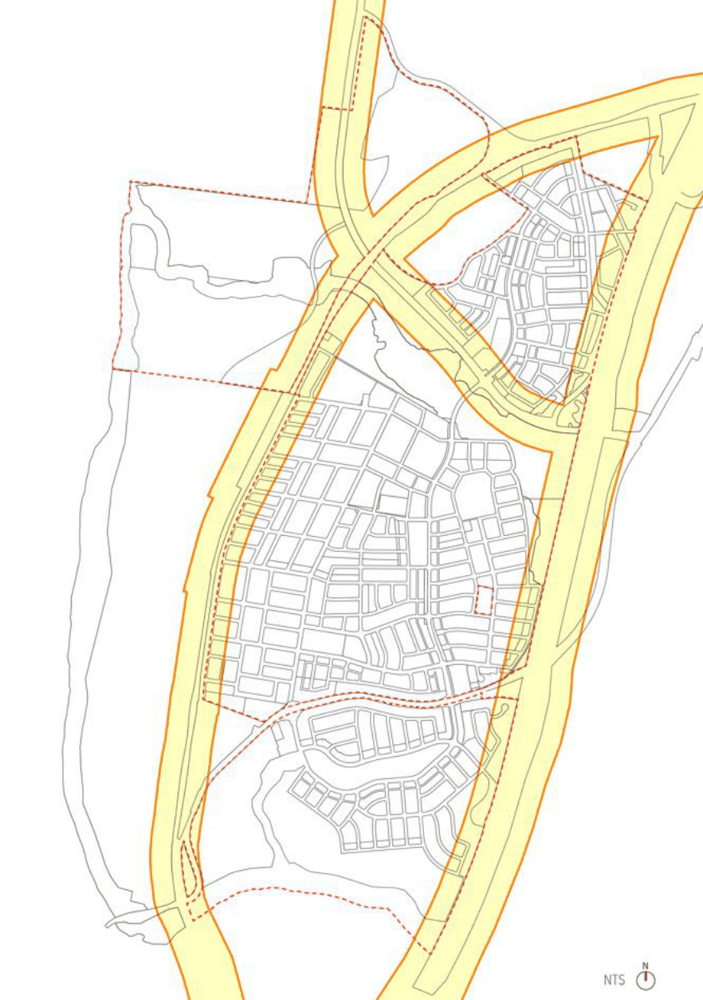

### 3.6. Noise Management

Objectives

a. Limit environmental noise levels due to road traffic and railway noise.

b. To minimise the impacts of noise from major transport infrastructure and employment areas on residential amenity.

c. To achieve an acceptable residential noise environment whilst maintaining well designed and attractive residential streetscapes.

Controls The following controls apply where residential and other noise sensitive development is proposed within areas affected by road and rail noise as shown in Figure 3.4.

1\. A noise assessment report which includes acoustic treatment requirements for dwellings and immediate external environments is to be prepared by a suitably qualified professional for all subdivision and development proposals within the area of the site affected by road and/or rail noise as shown in Figure 3.4.

2\. Compliance with the State Environmental Planning Policy (Transport and Infrastructure) 2021 (or equivalent) is required in regard to Division 15 Railways and Division 17 Roads and traffic.

See Table 3.1 for examples of possible acoustic treatment options:

Table 3.1 Acoustic Treatment Options

Orientation of residences

Residences may be situated within lots along the site boundary so that they provide acoustic shielding for residences at greater distance from the highway, reducing the number of residences requiring noise treatment.

Orientation of rooms and windows

Less noise sensitive rooms such as garages, bathrooms and laundries can be oriented towards the noise source, shielding more noise sensitive areas of the dwelling. Similarly, buildings can be constructed to minimise the number of doors and windows exposed to the noise source.

External walls

Masonry (particularly double brick) or concrete facades provide greater transmission losses than weatherboard or other lightweight structures.

Doors

External doors which open into habitable rooms should be heavy solid-core doors with effective acoustic seals.

Acoustic insulation

Acoustic insulation such as polyester or rockwool/glass wool batts placed between the wall studs of brick veneer and timber framed buildings will reduce the noise entering the building by an additional 5dB(A).

Architectural treatment

Such as double-glazing or provision of enclosed balconies.

Landscape Shielding Hard and soft landscaping to assist with external alfresco amenity outcomes.

> [Picture on page 29: a picture, saved as a picture (images/vol-2-part-08a-menangle-park-page-29-1.gif, 150 dpi).]

Figure 3.4 Areas impacted by Road and Rail Noise
