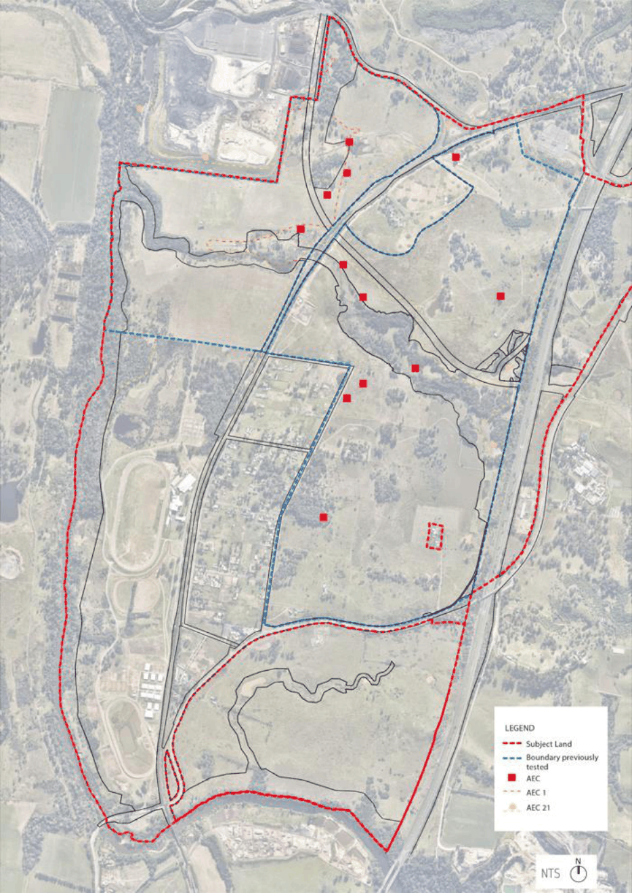

### 3.9. Site Contamination

Objectives

a. To minimise the risks to human health and the environment from the development of potentially contaminated land, and

b. To ensure that potential site contamination issues are adequately addressed at the subdivision stages.

Controls The following controls apply to development proposals within affected areas of potential environmental concern shown in Figure 3.5.

1\. All subdivision development applications (or  applications proposing a change of use to a more sensitive land use (e.g. residential, education, public recreation facility, etc.), shall be accompanied by a Stage 1 Preliminary Site Investigation prepared in accordance with the NSW EPA Contaminated Sites Guidelines, State Environmental Planning Policy (Resilience and Hazards) 2021 and the Contaminated Land Management Act 1995 and relevant Council Policies.

2\. Where the Stage 1 Investigation identifies potential or actual site contamination, a Stage 2 Detailed Site Investigation must be prepared in accordance with the NSW EPA Contaminated Sites Guidelines, State Environmental Planning Policy (Resilience and Hazards) 2021 and the Contaminated Land Management Act, 1995 and relevant Council Policies. A Remediation Action Plan (RAP) will be required for areas identified as contaminated land in the Stage 2 Site Investigation.

3\. Any remediated areas that are to come into Council ownership shall be remediated to standards appropriate for the end land use.

> [Picture on page 32: a picture, saved as a picture (images/vol-2-part-08a-menangle-park-page-32-1.gif, 150 dpi).]

Figure 3.5 Areas of potential environmental concern
