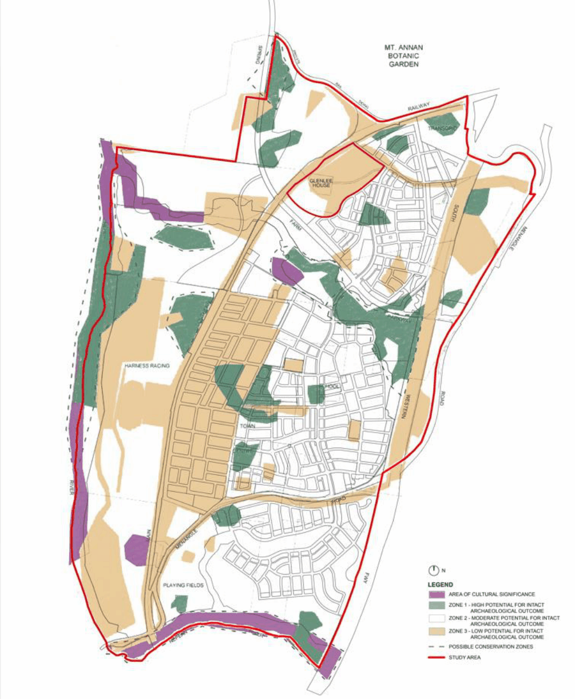

### 3.11. Aboriginal Heritage

Objectives

a. Ensure that a representative sample of intact Aboriginal landscapes and a range of human responses (represented by the archaeology) are protected.

b. Ensure that areas of Aboriginal heritage significance are managed into the future on the basis of their Aboriginal (and scientific) heritage and environmental values.

c. Ensure that sites and/or landscapes with high archaeological potential or Aboriginal significance are retained and protected.

Controls

1\. Development shall be guided by an overreaching Connecting with Country Framework approach.

2\. Development within areas identified as Zone 1, Zone 2, Zone 3 and Culturally Significant Areas shown in Figure 3.6 are subject to the controls for indigenous heritage in Clause 2.11.1 of Volume 1 of this DCP.

> [Picture on page 34: a picture, saved as a picture (images/vol-2-part-08a-menangle-park-page-34-1.gif, 150 dpi).]

Figure 3.6 Areas of Aboriginal Heritage sensitivity
