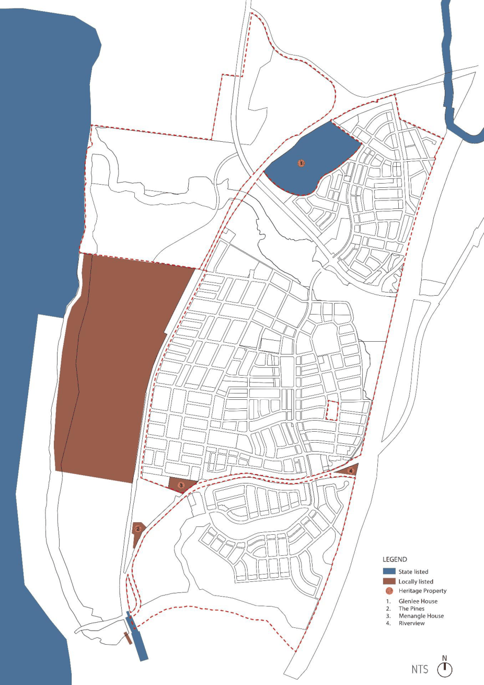

### 3.12. Non-Indigenous Heritage

Objectives

a. Ensure that new development is undertaken in a manner that is sympathetic to, and does not detract from, the heritage significance of heritage items and their settings.

b. Promote the protection or conservation of those resources where possible.

c. Ensure the impacts of development on significant views to and from Glenlee House are minimised as far as possible.

d. Ensure that the Glenlee House interface is sensitively addressed.

Controls

1\. The controls for non-indigenous heritage in clause 2.11.2 of Volume 1 of this DCP apply to Menangle Park.

2\. An archaeological assessment must accompany any application for development of land (including subdivision involving the creation of allotments for further (future) development) containing a known or potential archaeological site. Known and potential archaeological sites at Menangle Park (excluding Glenlee House) are shown in Table 3.2. The archaeological assessment should be undertaken in accordance with Assessing Significant Historical Archaeological Sites and ‘Relics’ (Heritage Branch, NSW Department of Planning, 2009).

3\. In recognition of the heritage significance of Glenlee House and its curtilage it will be necessary to delineate its boundary. Thus, any development applications for the subdivision of land adjoining Glenlee House will only be considered where a road is provided on the eastern and northern boundaries of this property, which is listed under the NSW Heritage Act 1977.

4\. Screen vegetation should be provided along the route of the proposed Spring Farm Parkway to ameliorate the impact on views and vistas to and from Glenlee House.

5\. Development applications for subdivision in the vicinity of the WaterNSW Upper Canal are to consider the potential impacts (including any stormwater runoff) on the Canal and ensure that any impacts are appropriately mitigated. Refer to clause 2.18 Work on Land Adjacent to the Upper Canal Corridor Volume 1 of this DCP.

Note: for development on ‘affected land’ under s2.163 of State Environmental Planning Policy (Transport and Infrastructure) 2021 (T&I SEPP), development is to be consistent with the WaterNSW Guideline.

Table 3.2 List of known and potential archaeological sites

| Site No Name Property Description Significance |  |  |  |
|---|---|---|---|
| S1 S3 S4 S5 S6 S7 S8 S9 US10 S11 S12 US13 US14 US15 US16 US17 | Brien’s farm and house site Thomas Vardy’s estate, including house and stable Grazier’s Inn Mt Pleasant Noone’s farm House and shed of Chinese market gardener Railway Hotel (Edrop estate) North Menangle railway station site Thomas Taber’s original homestead site Madden’s Hill house site Ward’s house site Railway sites, stone quarry, tramway, site of workers tent town Original Erdrop homestead, dairy and worker’s cottages Archaeological sites, Menangle Park Paceway Doyle’s property Tyson’s estate | Lot D DP 19853 Lot 1 DP 249393 Portion 29 Parish Menangle (in road reserve Menangle Road) Lot 2 DP 598067 Lot 32 DP 1101983 Lot D DP19853 Lot 1 DP 877582 Lot 1 DP 877582 Lot 10 122204 (previously Portion 16 Parish Menangle) Lot 3003 DP 802845 Lot 4 DP 249530 Lot 1 DP 249393 Lot 3 DP 236059 Lot 3 DP 236059 Lot 10 DP 1022204 Lot 7 DP 787284 Lot 2 DP 790254 (previously Portion 27 Parish Narellan) | Local Local Local Local Local Local Local Further assessment required Local Local Local Local Local Further assessment required Further assessment required Further assessment required |

NB: The location of some of these sites is unknown and can only be more closely identified through further research and survey work.

(Source: Non-Indigenous Heritage Study Menangle Park NSW, Casey and Lowe Pty Ltd, March 2010)

> [Picture on page 37: a picture, saved as a picture (images/vol-2-part-08a-menangle-park-page-37-1.gif, 150 dpi).]

Figure 3.7 Areas of European Heritage sensitivity
