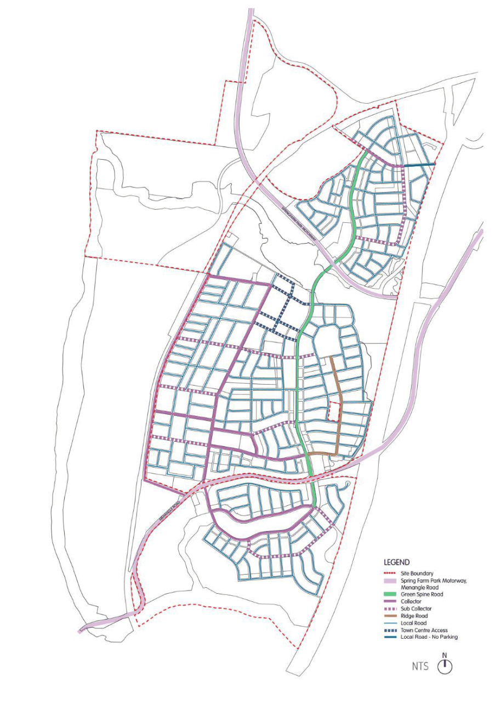
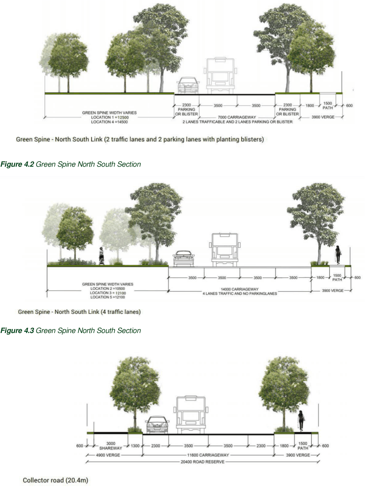
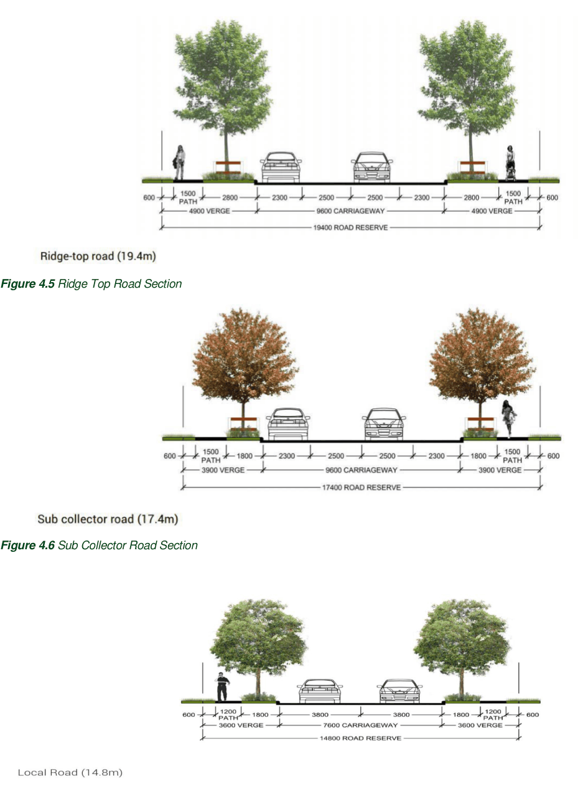

### 4.2. Movement Network

#### 4.2.1. Street layout and design

Objectives

a. To provide for the safe and efficient circulation of pedestrians, bicycles and motor traffic and on street parking requirements.

b. To provide an attractive and safe urban streetscape environment.

c. To provide a hierarchy of streets with good connectivity that utilises features and landmarks to enhance wayfinding for pedestrians, buses, private vehicles.

d. To design the street network to consider streets as linear parks and/ or recreation opportunities with a significant tree canopy.

e. To encourage less motor vehicle use by enhancing pedestrian and cycle connections to the Town Centre, schools and parks.

Controls

1\. The design and construction of streets in Menangle Park is to be generally consistent with the relevant typical designs in Figure 4.2-4.7 and Council’s Engineering Design Guide. Where any variation to the street network is proposed, the alternative street network is to be designed to achieve the objectives of this section.

Note: Applicants are to consult with WaterNSW during the design development stage regarding affects to WaterNSW access road immediately west of the Hume Highway.

2\. Street design is to be in accordance with the indicative street cross sections at Figures 4.2-4.7. Alternative street designs may be permitted on a case by case basis if they preserve the functional objectives and requirements of the design standards.

3\. Where streets are proposed as part of an application for subdivision that are located adjacent to public recreation land, drainage land, community facilities or schools, the applicant will be responsible for construction of the full width of the street, unless Council specifies otherwise.

4\. Except where otherwise provided for in this DCP, all streets and roundabouts are to be designed and constructed in accordance with the minimum requirements set out in Council’s Engineering Design Guide for Development. Where a corner lot fronts a roundabout, the driveway shall be set back 10m from the splay.

5\. Street trees are required for all streets. Street planting is to:

► Be coordinated with subdivision layout, traffic plan and services, ► Use the preferred species listed in Appendix C. ► Be consistently used to distinguish between public and private spaces and between different classes of street within the street hierarchy, ► Minimise risk to drainage swales, utilities and services, ► Be durable and suited to the street environment and, wherever appropriate, include endemic species,

► Maintain adequate lines of sight for vehicles and pedestrians, especially around driveways and street corners, ► Be planted in kerb extensions to assist with traffic calming, ► Be located to minimise conflicts between trees and driveways, ► Provide appropriate shade in summer and solar access in winter, ► Provide an attractive and interesting landscape character and clearly define public and private areas, without limiting passive surveillance of the street, ► Include a root guard to minimise damage to road pavements and foot paths, ► Not interfere with refuse collection and buried utilities, and ► Consider items of environmental heritage, heritage conservation areas, historic road alignments and significant view lines.

6\. Signage, street furniture and lighting are to be:

► Designed to reinforce the distinct identity of the development; ► Provided at all bus stops, ► Coordinated in design and style; ► Located so as to minimise visual clutter and obstruction of the public domain; and ► Consistent with any landscaping and public domain guidelines or policies specified by council.

7\. Water Sensitive Urban Design (WSUD) green infrastructure such as raingardens, swales, tree pits and parking areas where it contributes and meets the objectives and principles of the Menangle Park Stormwater Strategy and Councils Specifications are to be considered.

8\. The construction of the proposed realignment of Glenlee Road and its intersection with Menangle Road must be completed before the release of any new residential lots within the northern precinct of Menangle Park Urban Release Area.

9\. Any application that impacts the intersection of Glenlee Road and the WaterNSW owned service road (immediately west of the Hume Motorway / Mark Evans Bridge) must demonstrate consultation with WaterNSW in order to ensure that access to the service road is maintained for construction and maintenance vehicles.

> [Picture on page 42: a picture, saved as a picture (images/vol-2-part-08a-menangle-park-page-42-1.gif, 150 dpi).]

Figure 4.1 Menangle Park Road Hierarchy

> [Picture on page 43: a picture, saved as a picture (images/vol-2-part-08a-menangle-park-page-43-1.gif, 150 dpi).]

Figure 4.2 Green Spine North South Section

Figure 4.3 Green Spine North South Section

Figure 4.4 Collector Road Section

> [Picture on page 44: a picture, saved as a picture (images/vol-2-part-08a-menangle-park-page-44-1.gif, 150 dpi).]

Figure 4.5 Ridge Top Road Section

Figure 4.6 Sub Collector Road Section

Figure 4.7 Local Road Section
