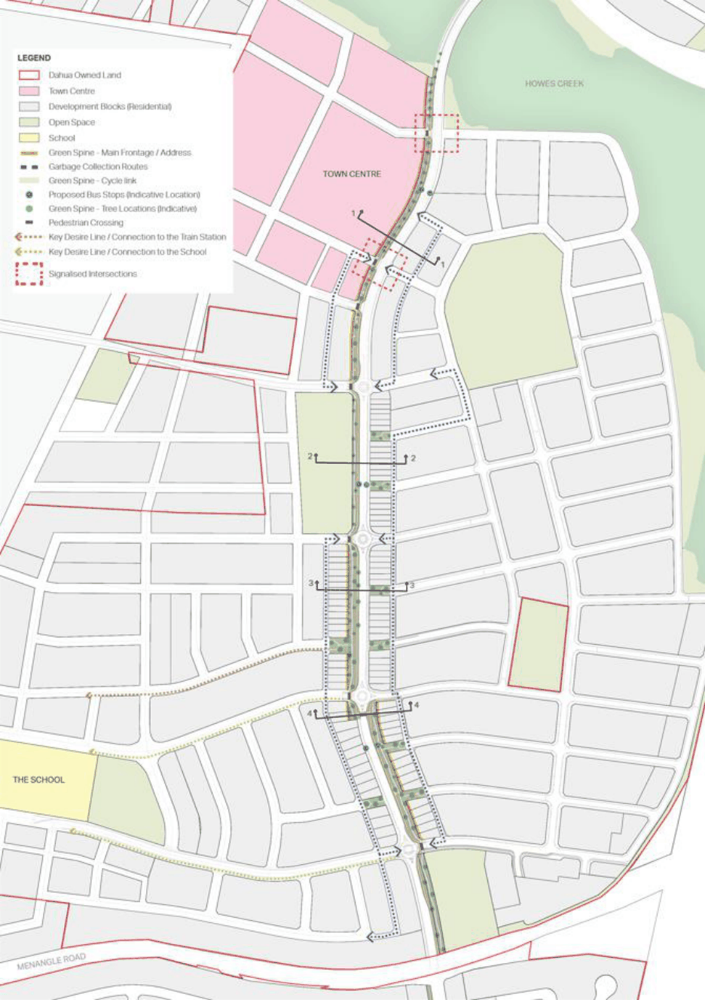
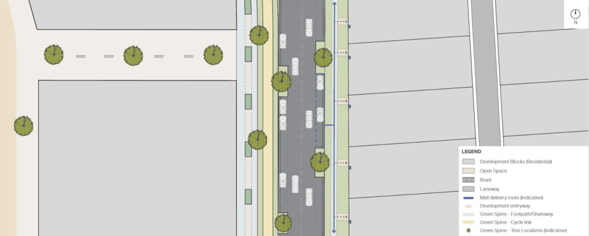
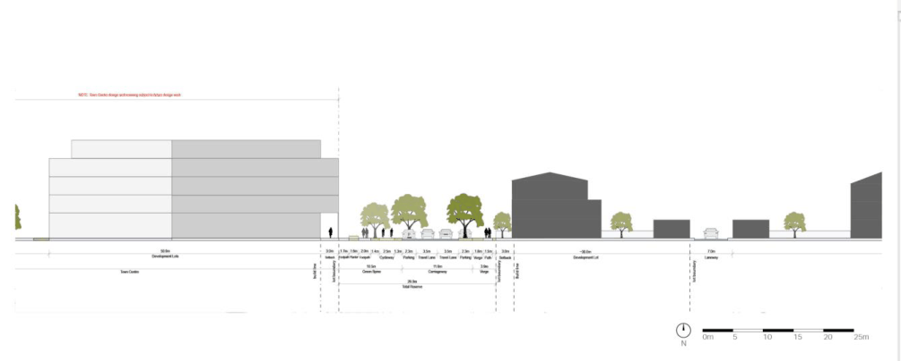
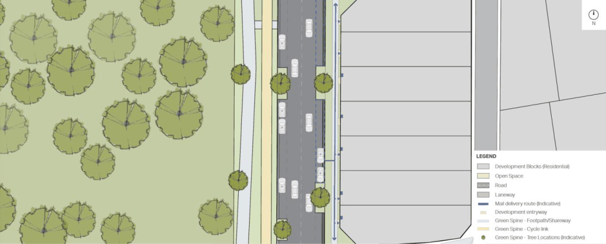
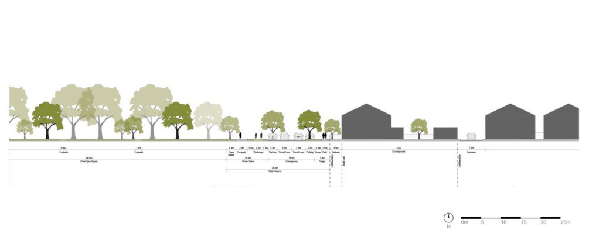
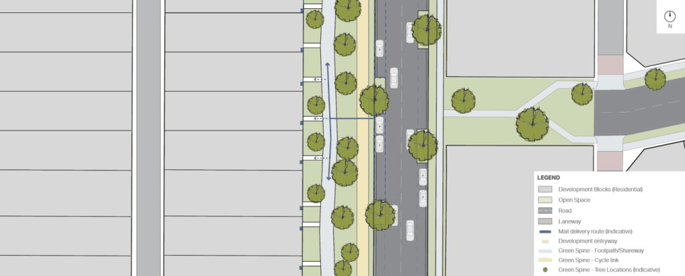
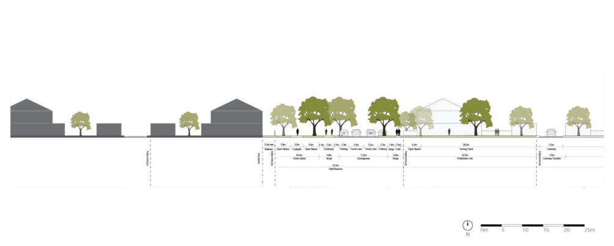
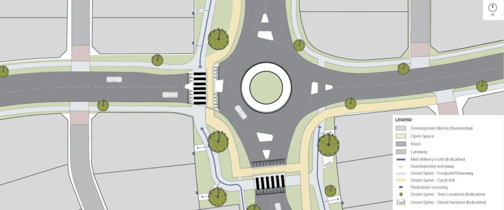
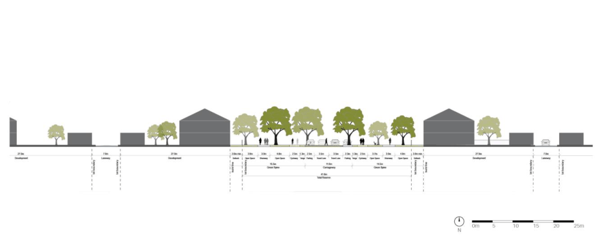

#### 4.2.2. Green Spine

The Green Spine is a key structural component of Menangle Park and will provide for an exemplary north-south active travel corridor that prioritises recreational open space and permeable mobility. The Green Spine will connect pedestrians and cyclists with approximately 80% of the entire open space network within Menangle Park and will provide opportunities for recreation, social interaction, urban cooling and opportunities for water sensitive urban design.

Objectives

a. To provide a north-south collector allowing for safe vehicle, cyclist and pedestrian movements.

b. To unlock mobility options that promote active transport and healthy outcomes.

c. To provide for recreation opportunities and promote social interactions.

d. To provide tree planting that enhances urban canopy cover and mitigates urban heat island effects.

e. To minimise dead-ends and promote street permeability that prioritise pedestrian movement.

Controls

1\. The design and construction of the Green Spine is to be delivered generally in accordance with Figure 4.8.

2\. Dwellings fronting the Green Spine should have front doors and letterboxes oriented to the public domain to increase street activation and encourage passive surveillance.

3\. Pedestrian crossings are to be provided in the form of signalised pedestrian crossings, raised thresholds intersections and wombat crossings.

4\. Through-site links which connect parallel residential streets to the Green Spine are to be provided in accordance with Figure 4.8 to promote street permeability.

5\. The design of the Green Spine is to maximise opportunities for street furniture, passive and active recreation and social interaction.

> [Picture on page 46: a picture, saved as a picture (images/vol-2-part-08a-menangle-park-page-46-1.gif, 150 dpi).]

Figure 4.8 Green Spine Concept Plan

> [Picture on page 47: a picture, saved as a picture (images/vol-2-part-08a-menangle-park-page-47-1.gif, 150 dpi).]

Figure 4.9.1 Green Spine Plan 1

> [Picture on page 47: a picture, saved as a picture (images/vol-2-part-08a-menangle-park-page-47-3.gif, 150 dpi).]

Figure 4.10.2 Green Spine Section 1

> [Picture on page 48: a picture, saved as a picture (images/vol-2-part-08a-menangle-park-page-48-1.gif, 150 dpi).]

Figure 4.11.3 Green Spine Plan 2

> [Picture on page 48: a picture, saved as a picture (images/vol-2-part-08a-menangle-park-page-48-3.gif, 150 dpi).]

Figure 4.12.4 Green Spine Section 2

> [Picture on page 49: a picture, saved as a picture (images/vol-2-part-08a-menangle-park-page-49-1.gif, 150 dpi).]

Figure 4.13.5 Green Spine Plan 3

> [Picture on page 49: a picture, saved as a picture (images/vol-2-part-08a-menangle-park-page-49-3.gif, 150 dpi).]

Figure 4.14.6 Green Spine Section 3

> [Picture on page 50: a picture, saved as a picture (images/vol-2-part-08a-menangle-park-page-50-1.gif, 150 dpi).]

Figure 4.15.7 Green Spine Plan 4

> [Picture on page 50: a picture, saved as a picture (images/vol-2-part-08a-menangle-park-page-50-3.gif, 150 dpi).]

Figure 4.16.8 Green Spine Section 4
