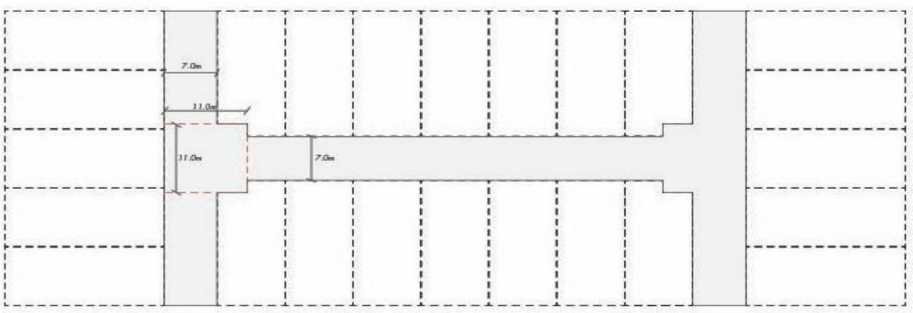
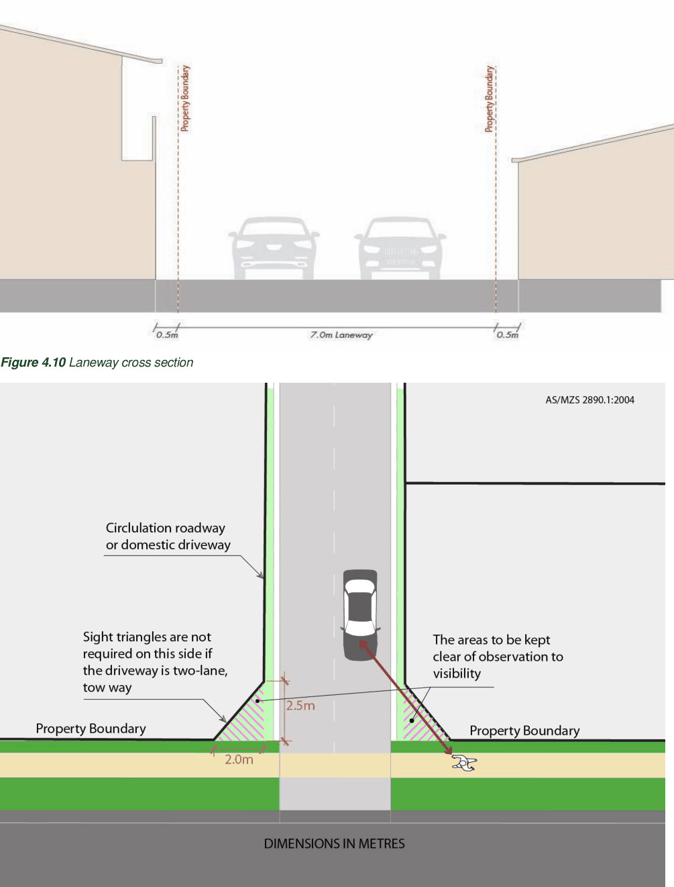

#### 4.2.3. Laneways

Laneways are public roads that provide rear vehicular access to compact or restricted access lots. The primary purpose of rear laneways is to create attractive front residential streets by removing garages and driveway cuts from the street frontages, improving the presentation of houses and maximising on street parking spaces and street trees.

Objectives

a. To provide vehicular access to the rear or side of lots where front access is restricted or not possible, particularly narrow lots where front garaging is not permitted.

b. To reduce garage dominance in residential streets.

c. To maximise on-street parking spaces and landscaping in residential streets.

d. To ensure lane ways have sufficient widths to enable garbage collection.

e. To facilitate the use of attached and narrow lot housing to achieve overall higher neighbourhood densities.

f. To create a slow speed shared zone requiring co-operative driving practices for the very low volume and frequency of vehicle movements that is distinctly different in character and materials to residential streets.

Controls

1\. The design and construction of laneways is to be consistent with Figure 4.9 and 4.10.

2\. The design and construction of street splays shall be in accordance with Council's Engineering Design for Development and the relevant part of the SCDCP.

3\. The design of circulation roadways shall be in accordance with AS 2890.

4\. The splays between two local streets are to have dimensions of 4m by 4m to maintain the residential character.

> [Picture on page 51: a picture, saved as a picture (images/vol-2-part-08a-menangle-park-page-51-15.gif, 150 dpi).]

Figure 4.9 Laneway Principles Plan

> [Picture on page 52: a picture, saved as a picture (images/vol-2-part-08a-menangle-park-page-52-1.gif, 150 dpi).]

Figure 4.10 Laneway cross section

Figure 4.11 Minimum sight lines for pedestrian safety
