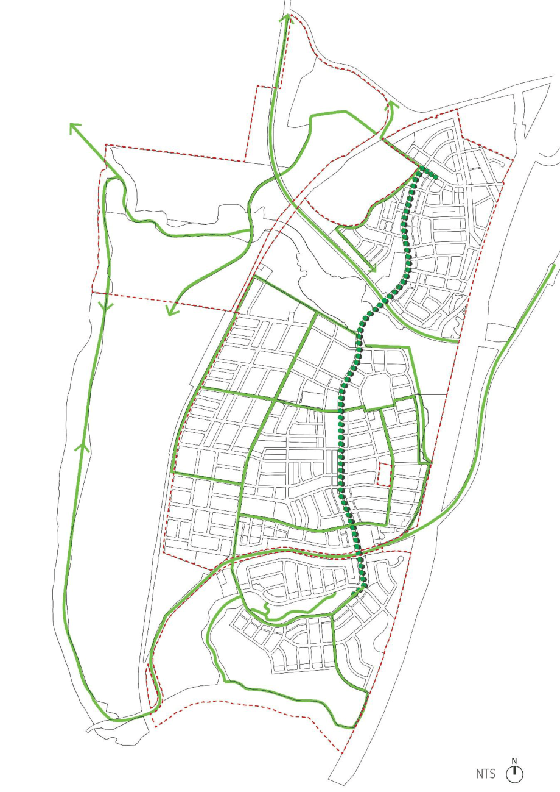

#### 4.2.4. Pedestrian and Cycle Network

Objectives

a. To provide a convenient, efficient and safe network of pedestrian and cycle paths within and beyond the site that provides links between all key activities, community facilities, open space areas and the Town Centre.

b. To create an interconnected pedestrian and cycle network comprising streets and paths that are safe, legible, and comfortable.

c. To ensure a high level of pedestrian and cycle accessibility and priority to and within the Town Centre.

d. To encourage cycling and pedestrian manoeuvrability and usage.

Controls

1\. Pedestrian and cycle routes should generally be provided in accordance with Figure 4.12. Alternate configurations can be provided subject to consistency with the objectives.

2\. Ensure pedestrian and cycle facilities in public spaces are safe, well lit, clearly defined, functional and accessible to all users.

3\. Minimum pedestrian footpath width is to be 1.2m.

4\. The minimum width of shared cycle / pedestrian paths is to be 2.5m.

5\. Pedestrian and cycle paths are to be provided as part of the open space and recreation areas.

6\. Where an open space related path exists generally in parallel, and proximate, to a road reserve; the footpath associated with the thoroughfare cross section is no longer required.

7\. Design pedestrian and cycle ways and pedestrian refuge islands so that they are fully accessible by all users in terms of access points and gradients, in accordance with AS 1428 (Part 1 to 4 Design for access and mobility).

8\. Footpaths take visual priority over laneway and driveway crossovers.

9\. Paving units or colour are encouraged to enhance the contrast between carriageway and crossing.

10\. Place bicycle racks in clusters clear of pedestrian travel paths and locate share bike parking adjacent to traditional bicycle racks with rack space left free for regular bicycles that need to be locked to a fixed point.

> [Picture on page 54: a picture, saved as a picture (images/vol-2-part-08a-menangle-park-page-54-1.gif, 150 dpi).]

Figure 4.12 Menangle Park Pedestrian and Cycle Network Plan
