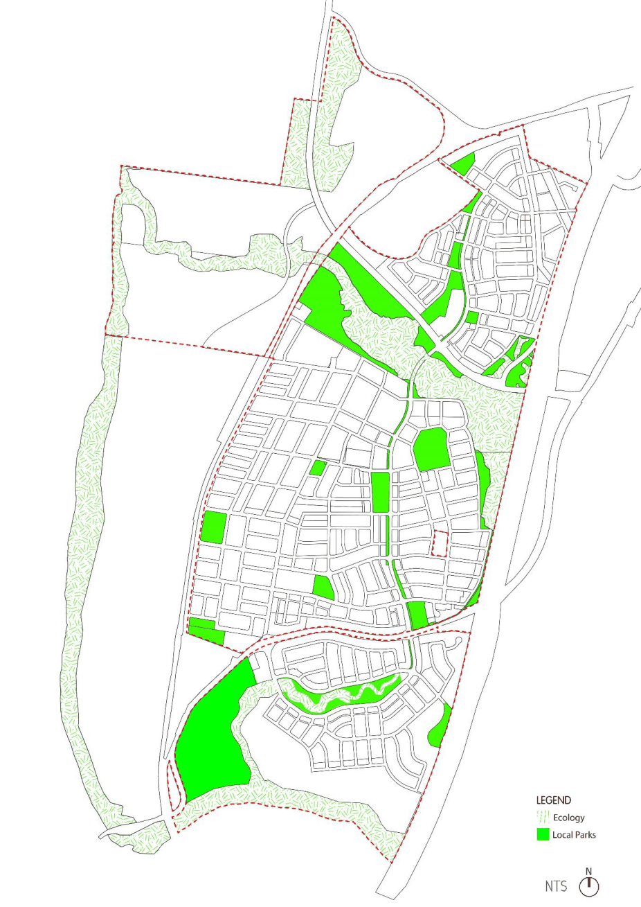
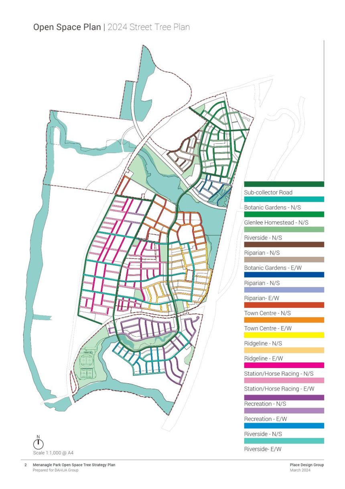
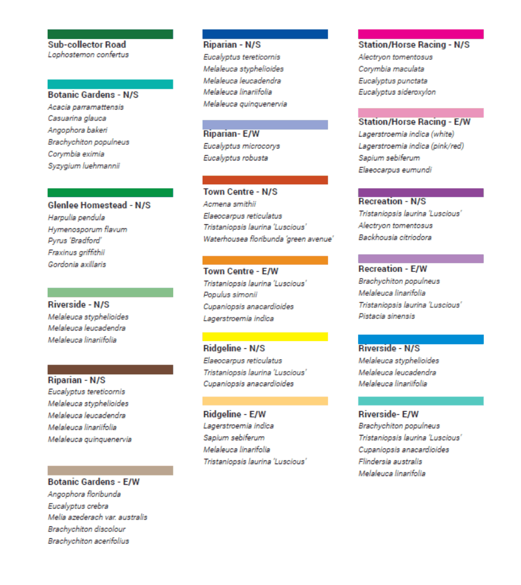

### 4.3. Public Domain, Parks and Community Infrastructure

Objectives

a. Create a network of open spaces, focal points and recreation and community facilities which meet the needs of the future residents and workers of Menangle Park.

b. To provide places and spaces that are accessible to all which accommodate a range of activities for residents and visitors.

c. To establish open spaces that promote local character, place making and identify as an interconnected network of open space including parks, squares and streets.

d. To incorporate environmentally sensitive areas such as riparian land, bushland and archaeologically sensitive sites into the open space network and provides appropriate protection and management mechanisms.

e. To ensure that public domain elements such as street trees, paving, street furniture, lighting and signage contribute to a consistent street character.

f. Create a living and working environment that promotes health, well-being, active living and sociability;

g. Optimise access and connectivity to all public open spaces, with a focus on walkability and cycle network

h. Increase urban tree canopy through the provision of connected high quality landscaped active and passive open space, riparian corridor and tree lined streets.

i. Incorporate water sensitive urban design and other sustainable development practices in the creation of the public domain.

Controls

1\. The open space network for Menangle Park is to be provided in accordance with Figure 4.13.

2\. The open space network shall be connected via a network of pedestrian and cycle links focused along the riparian corridors as per Figure 4.12.

3\. Street trees throughout Menangle Park are to be delivered in accordance with the Menangle Park Street Tree Plan at Figure 4.14.

4\. A development application for subdivision incorporating open space is to be accompanied by a landscape plan where the park is to be constructed as ‘works in kind’.

5\. Perimeter streets are generally to be provided on 2-3 sides of an open space unless:

a. A street frontage is not provided the development must front the park to provide surveillance.

6\. Incorporate public art in open space areas. Where appropriate, artwork should serve a dual role (e.g. as play equipment for children, informal seating, or a marker for a meeting place).

7\. Riparian corridors and conservation areas are to provide opportunities for pedestrian and cycle ways, fitness trails and additional open space in a manner that maintains the environmental significance of these areas.

A range of themed elements such as boardwalks, eco-pathways, and educational tracks should be utilised in appropriate locations (i.e. within the riparian corridor buffer).

8\. Where parks are to incorporate Aboriginal or European cultural heritage items, a public art strategy is to be submitted to ensure they are sensitively designed in accordance with the following provisions:

► For Aboriginal Heritage, areas identified in Figure 3.6 of this DCP. ► For European Cultural Heritage, the Conservation Management Plan, Interpretation Plan and Vegetation Management Plan as described in Section 3.12 of this DCP. ► All new plantings shall be in accordance with Council’s Prescribed Trees and Preferred Species list contained in Appendix C of this DCP.

► Landscape materials and design should respond to an identified planting palette. ► Street furniture, lighting, paving etc. should be contemporary and reflect the local environmental character of the Precinct as well as interpretation initiatives (where appropriate). ► The ‘Silos’ of Menangle Park are to be interpreted into the Public Domain with consideration for adaptive conceptual reuse.

9\. A street tree planting plan is required to be submitted with development applications for subdivisions.

10\. Street trees will be required to be planted at the time of subdivision construction unless bonded to ensure dwelling construction does not impact street trees.

11\. Street tree planting is to be provided to all streets with a spacing of between 7 and 10 metres, with a minimum of one tree per lot frontage. Corner lots will have a minimum of two street trees and normally three trees. The location of street trees must complement proposed driveway locations.

12\. A report prepared by a suitably qualified Arborist with an AQF 5 level accreditation shall be provided with any development application detailing measures to be taken to ensure tree protection during construction.

13\. Demonstrate the potential to double the existing (incl. proposed) canopy coverage over public landscaped areas (including street trees) from planting within 15 years from the completion of development.

14\. A wayfinding signage strategy is to be provided to guide the provisions of wayfinding signage for relevant development within Menangle Park. This strategy will relate to DAs for open spaces, green links, community hubs and the like, and  is to consider:

a. Identification of locations within a building or external space,

b. Key places along a journey, including green links, arrival points, and destinations,

c. Passive and public transportation,

d. Opportunities to embed and enrich journeys and destinations with cultural meanings (i.e. Aboriginal languages, places of significance and stories).

15\. The following principles are to be taken into consideration in the location of public parks:

a. Parks are to be located as focal points within the residential neighbourhoods. All dwellings are to be located within 400m from a public park.

b. Parks should be located within close proximity to community and education facilities and be highly accessible and linked by pedestrian and cycling networks.

c. Parks should be located and designed to accommodate remnant vegetation and where appropriate, should be linked to and integrated with riparian corridors, and

d. Should be bordered generally, by streets on all sides with houses orientated towards them for surveillance.

16\. The detailed design of public parks is to consider:

a. The need for a range of play spaces and opportunities and cater for a range of ages.

b. The provisions of adequate parking, lighting and waste management facilities,

c. The inclusion of interpretive signage detailing local history, Aboriginal cultural values, environmental education themes and the like,

d. The provision of amenities such as seating and shade structures, drinking fountains, street lighting, street and information signs, planter boxes, feature fencing and the like.

e. CPTED Strategy which includes – security cameras at key locations with parks to ensure coverage of primary movement and play zones.

f. Technology and tools to construct and operate new innovative infrastructure more efficiently and sustainably. Including the supply and installation of the Smart Lighting Network to Council’s specifications.

> [Picture on page 58: a picture, saved as a picture (images/vol-2-part-08a-menangle-park-page-58-1.gif, 150 dpi).]

Figure 4.13 Menangle Park Open Space Network

> [Picture on page 59: a picture, saved as a picture (images/vol-2-part-08a-menangle-park-page-59-1.gif, 150 dpi).]

> [Picture on page 60: a picture, saved as a picture (images/vol-2-part-08a-menangle-park-page-60-1.gif, 150 dpi).]

Figure 4.14 Menangle Park Street Tree Plan
