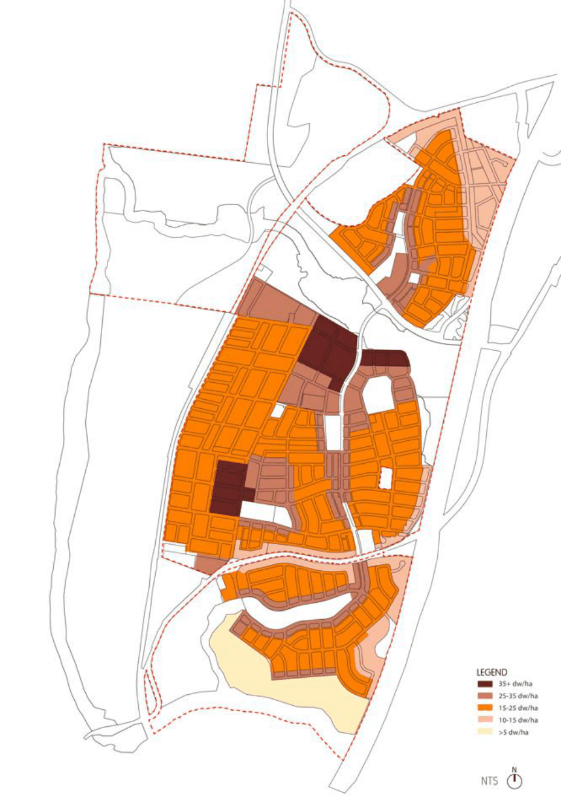
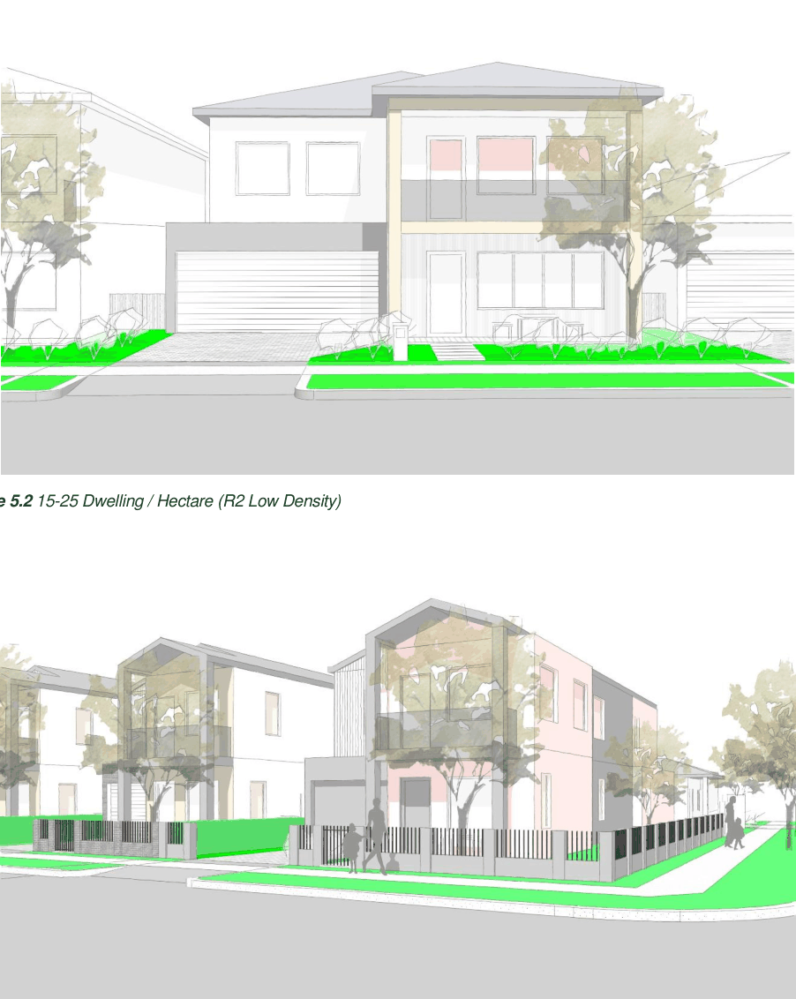
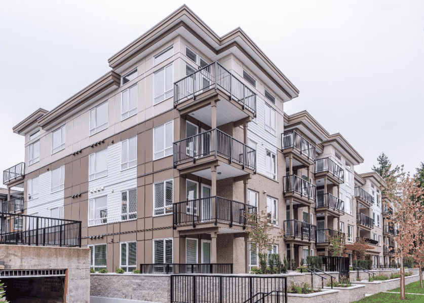

## 5. Residential Development and Subdivision

### 5.1. Residential Density

Objectives

a. To provide guidance to Applicants on the appropriate mix of housing types and appropriate locations for certain housing types.

b. To establish the desired character of the residential areas.

c. To promote housing diversity and affordability.

Controls

1\. Developments are to demonstrate consistency with the yields specified in the Residential Density Map in Figure 5.1.

2\. All applications for residential subdivision and the construction of residential buildings are to demonstrate densities compliant with the relevant Density Band / Housing Area in Table 5.1 and Section 5.1

3\. Residential development is to be consistent the ‘typical characteristics’ of the corresponding Density Band / Housing Area in Table 5.1 below.

Table 5.1 Housing Character / Density

| Net Residential Housing Area (Zone) Typical Characteristics per Housing Area Density dw/Ha |  |  |
|---|---|---|
| >5 dw/ HA 10-15 dw/ Ha | RU2 Rural Landscape C4 Environmental Living R5 Large Lot Residential | ► Located on the edges of the precinct. ► Detached dwellings. ► Predominantly single storey in height with detached garages and outbuildings. ► Dwellings designed to respond to key environmental opportunities and constraints of lots. ► Development to retain protected biodiversity values and significant trees in lots. ► Development to be designed to respect and preserve rural scenic qualities of the landscape. ► Generally located at the outer fringes of the low density residential areas. ► Predominantly detached dwelling houses on larger lots with some semi-detached dwellings and secondary dwellings. ► Single and double storey dwellings. ► Mainly garden suburban and suburban streetscapes. |

| Net Residential Housing Area (Zone) Typical Characteristics per Housing Area Density dw/Ha |  |  |
|---|---|---|
| 15-25 dw/ Ha 25-35 dw/ Ha 35+ dw/ Ha | R2 Low Density Residential R3 Medium Density Residential R4 High Density Residential E1 Local Centre | ► Predominantly a mix of detached dwelling houses, semi- detached dwellings and dual occupancies with some secondary dwellings. ► Focused areas of smaller lot dwelling houses (between 375-420sqm) in high amenity locations. ► Single and double storey dwellings. ► Diverse suburban streetscape. ► Generally located within the walking catchment of centres, corridors and public transport. ► Consists of predominantly dwelling houses on small lots, attached and multi-dwelling housing developments located close to neighbourhood centres, open space and public transport. ► Typically rear-loaded double storey dwellings with some single and three-storey dwellings. ► Incorporates laneways and shared driveways. ► Designed to provide activation of the public domain, including streets and public open space through the orientation and design of buildings and communal spaces. ► Mainly urban streetscape typology. typology. ► Generally located immediately adjacent centres and / or public transport nodes. ► Consists of predominantly residential flat buildings and shop top housing. ► Manor homes attached and multi-dwelling housing. ► Generally double and multi-storey buildings ► Predominantly urban streetscapes with minimal front setback; incorporates laneways and shared driveways. |

> [Picture on page 65: a picture, saved as a picture (images/vol-2-part-08a-menangle-park-page-65-1.gif, 150 dpi).]

Figure 5.1 Residential Density Map

> [Picture on page 66: a picture, saved as a picture (images/vol-2-part-08a-menangle-park-page-66-1.gif, 150 dpi).]

Figure 5.2 15-25 Dwelling / Hectare (R2 Low Density)

Figure 5.3 25-35 Dwelling / Hectare (R3 Medium Density)

> [Picture on page 67: a picture, saved as a picture (images/vol-2-part-08a-menangle-park-page-67-1.gif, 150 dpi).]

Figure 5.4 35 Dwellings / Hectare (R4 High Density) (illustrative purposes only – not to be taken as a control)
