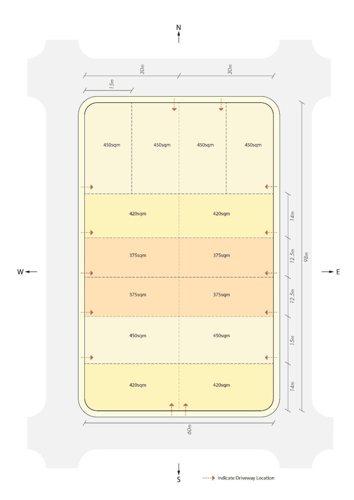
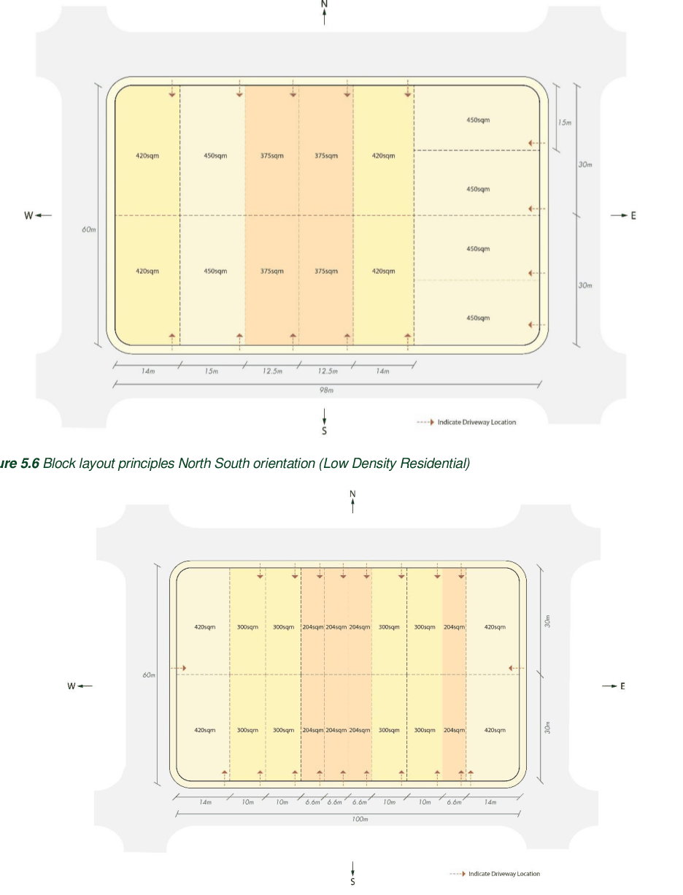

#### 5.2.1. Block Layout

1\. All block and lot layouts are to be generally consistent with the ILP.

2\. Subdivision design and lot configuration for lots fronting streets is to demonstrate:

► Suitable orientation to provide street address, activation and surveillance; ► Appropriate interface (front to front and rear to rear housing) ► Suitable access arrangements; ► Adequate setback arrangements; and ► Appropriate acoustic amenity

3\. Street block lengths should be a maximum of 250m and broken up using the above thoroughfare types to ensure permeability.

4\. Street block and subdivision design is to optimise solar orientation, taking into account other factors such as open space location, views and topography. Optimise the number of east-west orientated lots in medium density areas.

5\. Utilise laneways to provide rear-loaded access in medium density housing areas. Laneways are to be designed as share ways to promote pedestrian and cycle safety.

6\. Optimise secondary streets for garage access to corner lots.

7\. Locate garages on the lower southern side wherever possible.

> [Picture on page 69: a picture, saved as a picture (images/vol-2-part-08a-menangle-park-page-69-1.gif, 150 dpi).]

Figure 5.5 Block layout principles East-West orientation (Low Density Residential)

> [Picture on page 70: a picture, saved as a picture (images/vol-2-part-08a-menangle-park-page-70-1.gif, 150 dpi).]

Figure 5.6 Block layout principles North South orientation (Low Density Residential)

Figure 5.7 Block layout principles orientation (Medium Density Residential)
