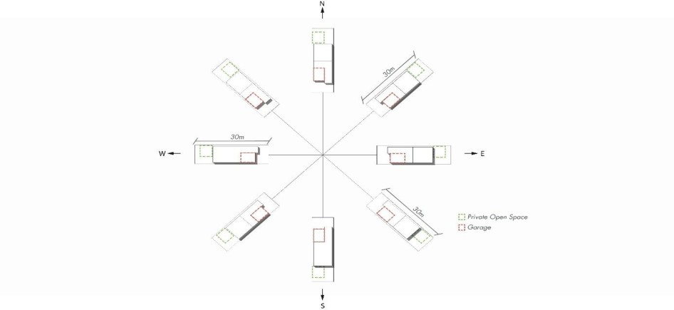

#### 5.2.2. Lot Layout

1\. A range of residential lot types (area, frontage, depth, zero lot and access) must be provided to ensure a mix of housing types and dwelling sizes across both the R2 and R3 zones.

2\. Lots should be rectangular and/ or demonstrate a viable rectangular building siting footprint exists within the irregular shaped lot. Where lots are an irregular shape, they are to be large enough and oriented to enable dwellings to meet the controls in this DCP.

3\. Preferred block orientation is established by the road layout on the ILP. Optimal lot orientation is east-west, or north-south where the road pattern requires. Exceptions to the preferred lot orientation may be considered where factors such as the layout of existing roads and cadastral boundaries, or topography and drainage lines, prevent achievement of the preferred orientation.

4\. Lot depths in the low density areas are to be generally between 25m-35m depending on orientation and garage location.

5\. Lot depths in the medium density housing areas is typically 20-30m.

6\. Minimum Lot widths are to comply with Table 5.2:

Table 5.2 Minimum Lot Frontages

| Zone Minimum Lot Width |  |
|---|---|
| R2 R3 (Rear Loaded Lots) R3 (Front Loaded Lots) R5 RU2 and C4 | 11.5m 6.5m 8.0m 15m 15m |

7\. No more than 6 x 200sqm contiguous lots (accommodating Attached Dwellings) are permitted in the R3

zone. Contiguous  lots are to be broken up by a minimum of three larger lots of 375sqm or greater.

8\. Continuous long runs of front loaded narrow lots (i.e. less than 8m) are to be avoided in all Housing Areas.

> [Picture on page 72: a picture, saved as a picture (images/vol-2-part-08a-menangle-park-page-72-1.gif, 150 dpi).]

Figure 5.8 Lot Layout Principles
